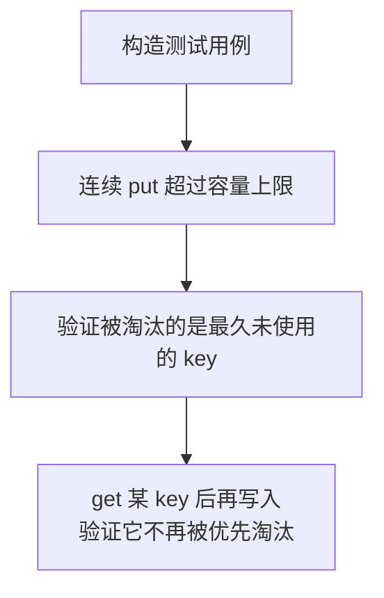

# LRU 缓存实现：测试与验证

前面几节我们把 LruCache 的骨架写完了：双向链表加 HashMap，put、get、断开链接、链入头节点一个个方法补全。这篇收个尾，把代码跑起来，用真实的输出验证淘汰逻辑和访问顺序是否正确。

## 先给结论

测试要验证三件事：

- put 超过容量上限时，最久未使用的元素被淘汰，而不是报错或无限增长。
- get 命中之后，被访问的节点被提升到链表头部，成为「最近使用」。
- 淘汰跟的是访问顺序，不是插入顺序：get 过的元素可以逃过一次淘汰。

构造之初还有一个坑要先补上：初始化时忘了把头尾两个哨兵节点相连，不补这一刀，后面的遍历和淘汰全都建立在错误的地基上。



## 是什么：测试代码与调试输出

测试代码本身很直白：建一个容量为 5 的缓存，依次 put 五个元素，再 put 第六个触发淘汰，get 一次看节点是否提头，最后再 put 一次看淘汰的是谁。每次操作完都把整个缓存打印出来，观察链表形态的变化。

```java
public static void main(String[] args) {
    LruCache cache = new LruCache(limit: 5);
    System.out.println(cache);
    cache.put("1", 1);
    System.out.println(cache);
    cache.put("2", 1);
    System.out.println(cache);
    cache.put("3", 1);
    System.out.println(cache);
    cache.put("4", 1);
    System.out.println(cache);
    cache.put("5", 1);
    System.out.println(cache);
    cache.get("2");
    System.out.println(cache);
    cache.put("7", 1);
    System.out.println(cache);
}
```

肉眼验证链表指针连得是否正确，靠的是两个改写过的 toString。

Node 的 toString 把节点本身用圆括号括起来和其他节点区分，除了打印自己的 key，还把上一个节点和下一个节点的 key 一并打出来，前后关系一眼可见：

```java
public String toString() {
    StringBuilder sb = new StringBuilder(capacity: 128);
    sb.append("(");
    sb.append(this.prev == null ? null : this.prev.key);
    sb.append("<-");
    sb.append(this.key);
    sb.append("->");
    sb.append(this.next == null ? null : this.next.key);
    sb.append(")");
    return sb.toString();
}
```

缓存自身的 toString 先拼上头节点，然后从 head.next 开始遍历链表，每次取下一个节点，不为空就继续拼接，把所有节点走完，拼成一个完整字符串输出：

```java
@Override
public String toString() {
    StringBuilder sb = new StringBuilder();
    sb.append(this.head);
    Node node = this.head.next;
    while (node != null) {
        sb.append(node);
        node = node.next;
    }
    return sb.toString();
}
```

说明一句：上面两段按课程原稿逐字收录，`limit: 5` 和 `capacity: 128` 是原稿中夹带的编辑器参数名提示，并非合法的 Java 语法，阅读时知道指的是字面量 5 和 128 即可。

## 为什么：哨兵节点要先相连

双向链表两头各挂一个哨兵节点，head 在前、tail 在后，作用是统一边界处理，让中间节点的增删不用反复判空。但哨兵生效有个前提：构造时就得把两者连起来，head.next 指向 tail，tail.prev 指回头。反过来，头节点的 prev 和尾节点的 next 都是 null，因为头的上面、尾的下面都没有内容了。

这一处是测试前专门回头纠正的：最初初始化时漏了头尾相连，遍历会提前中断，淘汰时找尾节点也会找错位置。补上之后，初始状态就是 head 连尾、尾连头的空链表，后面每插入一个节点都是往中间挤，逻辑才立得住。

可视化输出则是为了调试。LRU 的全部正确性都压在四根指针上，prev、next 指错一根，现象可能要到很后面的操作才暴露。把每个节点的前后邻居都打出来，哪根指针断了，看输出就知道。

## 深入细节：从头走到尾

先看构造，容量给了一个下限保护，`Math.max(limit, 2)` 保证至少能存两个元素，随后完成头尾相连和 map 的初始化：

```java
public LruCache(int limit) {
    this.limit = Math.max(limit, 2);
    this.head = new Node("Head", null);
    this.tail = new Node("Tail", null);
    head.next = tail;
    tail.prev = head;
    this.map = new HashMap<>();
}
```

四个核心方法按此前几篇的实现逐字收录。

断开节点链接，两根指针改线，把节点从链表中摘出来：

```java
public void unlink(Node node) {
    node.prev.next = node.next;
    node.next.prev = node.prev;
}
```

链入头节点，四根指针依次改线，把节点插到 head 之后：

```java
public void toHead(Node node) {
    node.prev = this.head;
    node.next = this.head.next;
    this.head.next.prev = node;
    this.head.next = node;
}
```

get 命中之后把节点提到头部，这是 LRU 与普通 Map 的分水岭：

```java
public Object get(String key) {
    Node node = this.map.get(key);
    if (node == null) {
        return null;
    }
    // 1. 将节点移到头部
    toHead(node);
    // 2. 返回值
    return node.value;
}
```

put 先摘旧节点再插新节点，超容量时淘汰尾部：

```java
public void put(String key, Object value) {
    // 1. 从 map 中获取旧值并移除节点
    Node old = this.map.remove(key);
    // 2. 如果旧节点存在，将其从链表中移除
    if (old != null) {
        unlink(old);
    }
    // 3. 创建新节点并添加到头部
    Node newNode = new Node(key, value);
    toHead(newNode);
    // 4. 如果超过容量，移除尾部节点
    if (this.map.size() > this.limit) {
        Node tailNode = this.map.remove(tail.prev.key);
        unlink(tailNode);
    }
    // 5. 将新节点放入 map
    this.map.put(key, newNode);
}
```

Node 的构造只存键值，指针留给链表操作时维护：

```java
public Node(String key, Object value) {
    this.key = key;
    this.value = value;
}
```

代码就位，跟着 main 一步步看输出。

初始状态只有头尾两个哨兵，头连尾、尾连头。

依次 put 1 到 5，链表从 head-1-tail 长成 5-4-3-2-1，每 put 一次新节点都挤到头部，尾部的 1 成为最久未使用的元素。

第六次 put 触发淘汰：6 加入头部，最尾部的 1 被淘汰，尾部节点变成 2，链表是 6-5-4-3-2。

接着 `get("2")`，2 从尾部一路提到头部，链表变成 2-6-5-4-3。注意此时 2 已经「被使用过」，不再是最久未使用的那个。

最后 put 7：7 进头部，容量再次超出，这一回淘汰的是尾部的 3，而不是之前侥幸逃过一劫的 2，链表变成 7-2-6-5-4。

三次操作正好演示了 LRU 的全部要义：淘汰看访问顺序，get 一次就能延寿，插入永远在头部。头尾哨兵的指针在每步输出里都保持正确，说明这套实现是通的。

有一点值得对照着看：put 里淘汰判断写在新节点入 map 之前，严格按这个顺序，第六次 put 时 map 里还是 5 个条目，不满足大于 5，淘汰会晚一步触发；而演示输出里第六次 put 就淘汰了 1，说明判断实际发生在入 map 之后。自己写生产代码时，把「入 map」放在「判大小」之前，才能保证容量不超标。

## 面试怎么答

面试官让你手写 LRU，可以按这个路径答。

数据结构选 HashMap 加双向链表。HashMap 负责 O(1) 按 key 找节点，双向链表按使用顺序串起所有节点，头部是最近使用、尾部是最久未使用。两者配合，查找、移动、删除都是 O(1)。

为什么必须是双向链表？因为淘汰和移动都要摘除任意节点，摘节点要改前驱的 next，单链表找不到前驱，只能从头遍历，退化到 O(n)。有 prev 指针，unlink 就是两根指针改线。

为什么加头尾哨兵？让每个中间节点都有非空的前后邻居，插入删除不用对边界判空，代码统一。

get 为什么要 toHead？get 本身就是一次使用，用了就要更新使用顺序，否则退化成的就是 FIFO，先插队的先淘汰，与 LRU 的定义相悖。

put 一个已存在的 key 怎么办？先从 map 取出旧节点、从链表摘除，再把新节点插到头部，相当于一次「更新并刷新顺序」。不摘旧节点，链表里会出现两个同 key 的节点，map 指向新的，旧节点成为内存泄漏。

淘汰策略？容量超出上限时移除尾部节点，即最久未使用的那个，同时从 map 中删除对应条目，保持两边一致。

最后可以补一句：JDK 的 LinkedHashMap 就是这套结构的官方实现，把 accessOrder 设为 true 就是 LRU，setUp 时重写 removeEldestEntry 即可控制淘汰。

## 常见误区

**误区一：构造时漏掉头尾相连。** 这是初版代码里一个典型的疏漏。head.next 不指向 tail，遍历走不出哨兵；tail.prev 不指回头，淘汰时找不到真正的尾节点。哨兵节点的意义全部建立在「构造时相连」之上。

**误区二：get 命中后忘记 toHead。** 只返回值不挪位置，使用顺序永远停留在插入顺序，LRU 直接退化成 FIFO。这是手写 LRU 最高频的失分点。

**误区三：put 已存在的 key 不摘旧节点。** 旧节点还挂在链表上，map 却指向新节点，旧节点再也无法被访问也无法被淘汰，形成泄漏。正确做法是先 unlink 旧节点，再 toHead 新节点。

**误区四：淘汰判断与新节点入 map 的顺序颠倒。** 判断写在入 map 之前，第 limit+1 次 put 时 map 里仍是 limit 个条目，淘汰晚一步触发，缓存会超容量一个。先入 map 再判大小，或者判断后立即补淘汰，才能守住上限。

**误区五：toString 与遍历不判空。** Node 的 toString 里 prev、next 可能是 null，头哨兵的 prev、尾哨兵的 next 就是 null，不判空会直接空指针。缓存遍历同理，走到尾节点要能停住。
