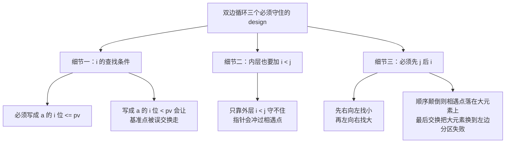

# 快速排序：双边循环的三个细节

上一篇实现双边循环时，代码里留了两个待补的问题：内层循环要加 i < j 条件，还有一处要用小于等于。这节课把遗留问题一次讲清，并且额外回答一个更容易踩坑的疑问：两个指针的查找顺序为什么不能颠倒。

## 先给结论

双边循环有三个必须守住的设计，每一个都有反例支撑：

- i 的查找条件必须用小于等于（`a[i] <= pv`），不能用小于，否则基准点会被误交换走。
- 两个内层循环都必须加 i < j，只靠外层的 i < j 守不住，指针会冲过相遇点。
- 必须先 j 后 i，即先从右向左找小、再从左向右找大。顺序颠倒，相遇点会落在大元素上，最后一次交换把大元素换到基准点左边，分区失败。

这三条合起来才是完整的双边循环分区。



## 是什么：三个待解的问题

问题一，i 查找的条件为什么是小于等于。写代码时如果凭直觉写成小于，会发生什么。

问题二，外层循环已经有 i < j，为什么每个内层循环还要各加一个 i < j，是不是重复。

问题三，两个指针的查找顺序有没有讲究，先 i 后 j 行不行。

三个问题都不大，但每一个都直接决定分区正确性，逐个用反例验证。

## 为什么：三个反例

问题一用反正法。假设把 i 的条件改成小于。看这样一个场景：先运行 j 的查找，j 从右向左找到一个比基准点小的值 4（4 小于 5），退出内层循环停下来。接着运行 i 的查找，注意此刻 i 指向的是基准点元素，值是 5，而基准点 pv 也是 5。自己能小于自己吗？不能，条件不成立，i++ 不会执行，内层循环直接结束，i 仍指向基准点。接下来执行交换，就会把基准点 5 跟后面的 4 交换，相当于把基准点交换走了。基准点一旦离开最左位置，后面「基准点与相遇点交换」的逻辑全部错乱，后续完全不正确。

加上小于等于之后，5 小于等于 5 条件成立，i 继续加加，把基准点元素跳过去，去后面找真正大的元素。基准点不会被误交换，i 停下的位置一定是非基准点的大元素。

问题二看一个具体场景。假设 j 已经找到一个比基准点小的元素 3（3 小于 5），轮到 i 查找大的。如果不加内层 i < j：当前是基准点元素，小于等于基准点，i 加加；下一个是 1，仍小于 5，继续；再下一个是 2，仍小于 5，继续；下一个是 3，仍小于 5。可此时 i 已经走到 j 所在的位置，本该停，但没有 i < j 守不住，循环停不下来，i 继续加加，找到了 6。接下来交换，就会把 6 错误地与 j 指向的 3 交换，大的被换到了左边。所以内层条件不能少，j 的循环和 i 的循环都必须加 i < j，让指针在相遇处强制停住。

问题三把顺序颠倒来试。把底层代码改成先 i 后 j：先从左向右找大的，3 比基准点小不算，7 比基准点大，i 停下；j 从右向左找小的，第一个 4 比 5 小，j 停下；二者交换。前两轮看起来都对，继续运行才暴露问题：i 继续找到 9，j 继续找小的，交换；再继续，i 找到大的，j 找不到小的但与 i 重合，这一轮不用交换，退出外层循环。但这时 i 和 j 指向的都是比基准点大的元素。如果执行外层 swap，就会把大元素交换到基准点左边，整个逻辑不正确。

根子在于：先 j 后 i，相遇点停在小元素一侧（或基准点自身），最后一次交换把小的换到最左、基准点换到中间，成立；先 i 后 j，相遇点可能停在大元素上，最后一次交换反而把大的放到基准点左边，分区失败。前几轮看似正确，只是因为还没走到相遇那一刻，这种错误最危险。

## 深入细节：补全后的代码

把三个修正合进去，内层循环带上 i < j，i 的条件用小于等于：

```java
while (i < j && a[j] > pv) {
    j--;
}
while (i < j && a[i] <= pv) {
    i++;
}
swap(a, i, j);
```

课程幻灯片对两个方案的代码记录如下，形态相同，实际单边循环只有一个 j 指针负责找小、i 只维护边界（见前文实现），与这里的双指针结构并不是一回事，以双边循环这份为准：

```java
while (i < j && a[j] > pv) {
    j--;
}
while (i < j && a[i] <= pv) {
    i++;
}
swap(a, i, j);
```

拿数组 `[5, 3, 7, 2, 9, 8, 1, 4]` 验证补全后的版本。pv 为 5，i = 0，j = 7。

第一轮，j 先动：a[7] 是 4，4 大于 5 不成立，j 停在 7，找到小的。i 后动：a[0] 是 5，5 小于等于 5 成立，i 加加；a[1] 是 3，小于等于 5 成立，i 加加；a[2] 是 7，不大于 5，i 停在 2，找到大的。交换 a[2] 与 a[7]，数组变成 `[4, 3, 1, 2, 9, 8, 7, 5]`。注意 i 起点处小于等于保证了基准点被跳过，i 没有停在 0。

第二轮，j 继续向左：a[5] 是 8 大于 5，j 减减；a[4] 是 9 大于 5，j 减减；a[3] 是 2 不大于 5，j 停在 4。i 继续向右：a[2] 是 1 小于等于 5，i 加加；a[3] 是 2 小于等于 5，i 加加；a[4] 是 9 不大于 5，i 停在 4。i 与 j 在 4 相遇，内层条件 i < j 守住了边界，交换 a[4] 与 a[4] 无变化，外层循环退出。

最后 swap(a, l, j)，基准点 5 与索引 4 的 9 交换，数组变成 `[2, 3, 1, 4, 5, 8, 7, 9]`，返回分区位置 4。三个条件各司其职，分区正确。

## 面试怎么答

面试问双边循环的细节，把三个要点连起来答，每个点附带一句原因。

第一，基准点选最左，因此必须先 j 后 i：先从右向左找小，再从左向右找大。反序会让相遇点落在大元素上，最后交换把大元素放到基准点左边，分区失败。

第二，i 的查找条件是 a[i] <= pv 而不是 a[i] < pv。i 起点就在基准点上，小于条件对基准点自身不成立，i 无法移动，第一次交换就会把基准点换走。小于等于让 i 先跳过基准点。

第三，两个内层循环都要加 i < j。外层的 i < j 管的是外层循环，内层循环里指针移动时同样可能越过相遇点，没有内层保护，i 会一路冲过 j 找到错误的大元素，j 也会冲过 i，交换随之错乱。

如果还能补充一句设计思想：先 j 后 i 保证相遇点停在小元素一侧，最后基准点与相遇点交换才成立。三个条件不是凑数的，是在为「最后一次交换」服务的。

## 常见误区

**误区一：i 的条件写成小于。** 基准点自身卡在起点，i 动弹不得，第一次交换就把基准点换走，分区从第一步就错。必须小于等于，让 i 跳过基准点。

**误区二：内层循环不加 i < j。** 外层的相遇判断守不住内层的指针移动，i 或 j 会冲过相遇点，把错误一侧的元素换过来。两个内层循环都要加，一个都不能少。

**误区三：颠倒查找顺序。** 先 i 后 j 在前几轮交换看起来正常，容易漏过去，直到相遇点落在大元素上才崩，最后 swap 把大元素放到基准点左边。顺序必须从右往左先找。

**误区四：以为这三个条件是可有可无的补丁。** 小于等于、内层 i < j、先 j 后 i，每一个都对应一个具体的错误场景。漏任何一个，代码在某些数据上可能碰巧跑对，换组数据就出错，属于典型的假性正确。
