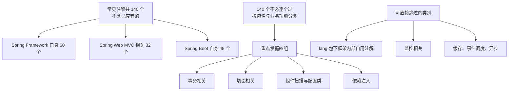

# Spring 注解体系总览

有一道经典面试题：「Spring Boot 中有哪些常见的注解」。网上的回答大多千奇百怪，一个通病是把 Spring 和 Spring MVC（Spring 的 Web 框架，负责处理 HTTP 请求）的注解也归类到 Spring Boot 里，分类并不准确。这一篇换一种答法：先把 Spring 全家桶的注解按框架拆开数一遍，再挑重点讲原理，最后给出这类题的标准答法。

## 先给结论

直接翻 Spring 与 Spring Boot 的源码逐个数，常见注解一共 140 个（不含已被官方标注废弃的），划分如下：

- Spring Framework 自身 60 个。
- Spring Web MVC 相关 32 个，数量较多，单独归一类。
- Spring Boot 自身 48 个，注意只是 Spring Boot 自己，不含 Boot 派生出的其他框架。

140 个不可能逐个过，按包名和业务功能分类，重点掌握四组：事务、切面、组件扫描与配置类、依赖注入。

## 是什么：注解版图的划分

先说几个直接跳过的类别。lang 包下有一些注解，但基本没人见过，它们是 Spring 框架内部自己用的，业务开发不直接接触。监控相关的注解日常也用不到。缓存、事件调度、异步这些类别要么用得少，要么在以往课程里单独讲过，本篇不展开。

重点看四组。

事务组两个，都重要。@Transactional 加在 public 方法上，表示这个方法受事务控制；加在类上，表示这个类的所有公共方法都受事务控制。@EnableTransactionManagement 用来启用声明式事务，几乎是必用注解。

切面组需要掌握的是 @EnableAspectJAutoProxy，它启用 AOP 自动代理。同组的 @EnableLoadTimeWeaving、@Configurable 不常用，且不是基于代理模式实现切面，本篇略过。

组件扫描与配置类是数量最多也最熟悉的一组：@Component、@Controller、@Service、@Repository 四人组，配合 @ComponentScan 使用；@Conditional 做条件装配；@Configuration 标注配置类，@Bean 标注配置类里哪些方法要作为 bean 定义，@Import 导入其他配置类或 ImportSelector；@Lazy 延迟加载；@PropertySource 读取外部配置文件。

依赖注入组最熟悉的是 @Autowired，配合 @Qualifier 按名字消歧，@Value 做字面值注入。

## 为什么：分类乱的根源与 Enable 的原理

分类之所以容易乱，是因为有些注解名字上像是 Spring 的，实际属于第三方。典型的如 @Aspect、@Before、@After、@Around 这些切面通知注解，它们属于 AspectJ 第三方库，Spring 只是借用，并不是 Spring 自己的注解，数 Spring 的注解时不该把它们算进来。面试答这类题，先声明按框架分层，混乱就少了一半。

再说 @EnableTransactionManagement 的「启用」到底是什么意思。这是很多同学说不清的地方。遇到 @Enable 开头的注解，看它上面有没有标注 @Import：真正干活的是 @Import 导入的东西，它会把一批新的 bean 加进 Spring 容器，正是这些新 bean 完成了声明式事务管理。

具体到事务，TransactionManagementConfigurationSelector 实现了 ImportSelector 接口，它的 selectImports 方法返回一个字符串数组，数组里是要加入容器的类名，Spring 根据这个返回结果把对应的 bean 注册进容器。它分两种情况：基于代理的 AOP 增强和基于 AspectJ 的 AOP 增强，默认走第一种，于是注册一个 AutoProxyRegistrar，再注册一个配置类，由它把声明式事务相关的 bean 一批加进来。加进来的共有三个关键 bean：

第一个是 BeanFactoryTransactionAttributeSourceAdvisor，从名字就能看出 advisor，它是事务切面类。第二个是 TransactionAttributeSource，作用名看不出，它的职责是解析类和方法上有没有标注 @Transactional，并读取注解上的事务属性，简单说就是 @Transactional 的解析器。第三个是 TransactionInterceptor，事务拦截器，相当于通知。一个切面由切点和通知组成：切点就是被 @Transactional 标注的方法，它们都会被拦截、被增强；通知由 TransactionInterceptor 承担。切面、通知、解析切点的类三者齐备，声明式事务管理才真正具备。

@EnableAspectJAutoProxy 是同一套机制。看它的 @Import，AspectJAutoProxyRegistrar 负责注册 bean，核心动作是注册 AnnotationAwareAspectJAutoProxyCreator。这是一个 bean 的后处理器，在 bean 初始化的后处理阶段检查：如果某个 bean 与切点表达式匹配，就为它生成代理对象，把代理对象放进单例池，代替目标对象对外提供服务。代理的生成时机，绝大多数情况是在初始化之后；如果遇到循环依赖又需要代理的情况，代理的生成会提前到依赖注入之前。

## 深入细节：四组重点注解

事务组。@Transactional 加 public 方法表示方法级事务，加类表示类下所有 public 方法都纳入事务。@EnableTransactionManagement 启用声明式事务，底层靠 @Import 注册事务切面、事务属性解析器和事务拦截器三件套，缺一不可。

切面组。@EnableAspectJAutoProxy 启用 AOP 自动代理，注册的 AnnotationAwareAspectJAutoProxyCreator 是核心，它作为 bean 后处理器判断哪些 bean 需要被代理，生成代理并放入单例池。注意 @Aspect、@Before、@Around 等通知注解来自 AspectJ，不属于 Spring 注解体系。

组件扫描与配置类组。@Component、@Controller、@Service、@Repository 是标注组件的四个人选，被组件扫描到就会被纳入 Spring 容器管理。@ComponentScan 指定起始包名，从该包开始扫描它和所有子孙包，扫到的组件全部纳入容器。@Conditional 做条件装配：条件成立才加入容器，条件不成立即使扫描到也不加入。它有两个使用场景，一是配合组件扫描时判断，二是在配置类里解析 @Bean 时同步判断，很多文章把它归成 Spring Boot 注解，其实 Spring 自身就有这个能力。@Configuration 标注配置类；@Bean 标注配置类中哪些方法要作为 bean 定义；@Import 导入其他配置类或 ImportSelector，按返回的 bean 名加入当前容器，自动装配部分还会细讲。@Lazy 有两个用途：加在类上，表示这个类延迟实例化和依赖注入，第一次用到才创建；加在方法参数或成员变量上，用于解决循环依赖，注入时先给一个代理对象，等循环依赖过程走完、真正使用时才创建真正的 bean。@PropertySource 读取外部 properties 文件，把配置信息加入 Environment，Environment 里装着应用运行期需要的全部配置信息。

依赖注入组。@Autowired 完成依赖注入，可以加在构造方法、方法参数、成员变量上。同一类型有多个 bean 时，用 @Qualifier 按名字进一步区分。@Value 做字面值注入，配合 ${} 读取配置项，配合 #{} 可做嵌套值注入。

## 面试怎么答

这道题的正确姿势是先分层，再挑重点，最后点原理。

分层：Spring Framework 有 60 个左右注解，Spring MVC 有 30 个左右，Spring Boot 自身有 40 多个，网上的混乱回答多半是把三层的注解混成一锅。声明按框架分，格局先立住。

挑重点：事务组的 @Transactional 与 @EnableTransactionManagement，切面组的 @EnableAspectJAutoProxy，组件扫描与配置类的 @Component、@Controller、@Service、@Repository、@ComponentScan、@Conditional、@Configuration、@Bean、@Import、@Lazy、@PropertySource，依赖注入的 @Autowired、@Qualifier、@Value。这些是出现频率最高的。

点原理：@Enable 开头的注解靠 @Import 注册 bean 干活，声明式事务靠事务切面、事务属性解析器、事务拦截器三件套，AOP 自动代理靠 AnnotationAwareAspectJAutoProxyCreator 这个 bean 后处理器。能讲到这一层，回答就从「背列表」上升到「懂机制」。

## 常见误区

**误区一：把 MVC 注解甚至 AspectJ 注解算进 Spring Boot。** @RequestMapping、@RestController 属于 Spring MVC，@Aspect、@Before、@Around 属于 AspectJ 第三方库。答题时按框架分层，别混为一谈。

**误区二：分不清 @Transactional 加类与加方法的区别。** 加类只对 public 方法生效，且是整类统一纳入；加方法只作用于单个方法。说成「加类所有方法都走事务」时，别忘了 public 这个限定。

**误区三：以为 @Enable 注解有魔法。** 它本身只是标记，真正干活的是其 @Import 注册的 bean。答「加了注解就有了事务」却说不出背后注册了什么，等于没答到点子上。

**误区四：以为 @Conditional 是 Spring Boot 专属。** Spring Framework 自身就支持条件装配，组件扫描和配置类解析 @Bean 两个场景都会判断条件是否成立。

**误区五：以为 @Lazy 只有延迟加载一个用途。** 加在类上是延迟实例化；加在方法参数或成员变量上是注入代理解决循环依赖，后者在实际排障中更常见。

## 课件注解速查表（完整清单）

> 以下清单整理自课件 day04 的 `面试题-spring-注解.xmind`，与上文本「140 个按框架分层」的口径一一对应，可作为速查表对照阅读。

  - web
    - mapping
      - @Mapping
      - @RequestMapping
      - @GetMapping
      - @PostMapping
      - @PutMapping
      - @DeleteMapping
      - @PatchMapping
    - rest
      - @RequestBody
      - @ResponseBody
      - @ResponseStatus
      - @RestController
    - 统一处理
      - @ControllerAdvice
      - @ExceptionHandler
      - @RestControllerAdvice
    - 参数
      - @RequestHeader
      - @CookieValue
      - @PathVariable
      - @RequestParam
      - @MatrixVariable
      - @RequestPart
    - 转换与格式化
      - @DateTimeFormat
      - @NumberFormat
      - @InitBinder
    - validation
      - @Validated
    - scope
      - @ApplicationScope
      - @RequestScope
      - @SessionScope
      - @ModelAttribute
      - @RequestAttribute
      - @SessionAttribute
      - @SessionAttributes
    - ajax
      - @CrossOrigin
  - boot
    - auto
      - @AutoConfigurationPackage
      - @AutoConfigureAfter
      - @AutoConfigureBefore
      - @AutoConfigureOrder
      - @ImportAutoConfiguration
      - @SpringBootApplication
      - @EnableAutoConfiguration
      - @SpringBootConfiguration
    - condition
      - @ConditionalOnBean
      - @ConditionalOnClass
      - @ConditionalOnCloudPlatform
      - @ConditionalOnExpression
      - @ConditionalOnJava
      - @ConditionalOnJndi
      - @ConditionalOnMissingBean
      - @ConditionalOnMissingClass
      - @ConditionalOnNotWebApplication
      - @ConditionalOnProperty
      - @ConditionalOnResource
      - @ConditionalOnRepositoryType
      - @ConditionalOnSingleCandidate
      - @ConditionalOnWarDeployment
      - @ConditionalOnWebApplication
    - properties
      - @EnableConfigurationProperties
      - @ConfigurationProperties
      - @ConfigurationPropertiesBinding
      - @ConfigurationPropertiesScan
      - @ConstructorBinding
      - @DeprecatedConfigurationProperty
      - @NestedConfigurationProperty
      - @DefaultValue
      - @Name
    - convert
      - @DataSizeUnit
      - @Delimiter
      - @DurationFormat
      - @DurationUnit
      - @PeriodFormat
      - @PeriodUnit
    - 其它
      - @DependsOnDatabaseInitialization
      - @EntityScan
      - @BatchDataSource
      - @FlywayDataSource
      - @LiquibaseDataSource
      - @QuartzDataSource
      - @QuartzTransactionManager
      - @JsonComponent
      - @LocalRSocketServerPort
      - @LocalServerPort
      - @ServletComponentScan
  - 依赖注入
    - @Autowired
    - @Qualifier
    - @Value
    - @Lookup
  - 缓存
    - @EnableCaching
    - @CacheConfig
    - @CacheEvict
    - @CachePut
    - @Cacheable
    - @Caching
  - 组件扫描与配置类
    - @Component
    - @Controller
    - @Service
    - @Repository
    - @Indexed
    - @ComponentScan
      - @Filter
    - @ComponentScans
    - @Conditional
    - @DependsOn
    - @Description
    - @Configuration
    - @Bean
    - @Import
    - @ImportResource
    - @Lazy
    - @Primary
    - @Profile
    - @PropertySource
    - @PropertySources
    - @Role
    - @Scope
  - 切面
    - @EnableAspectJAutoProxy
    - @EnableLoadTimeWeaving
    - @Configurable
  - 事件、调度、异步
    - @EventListener
    - @TransactionalEventListener
    - @EnableAsync
    - @Async
    - @EnableScheduling
    - @Scheduled
    - @Schedules
  - 核心
    - @AliasFor
    - @Order
  - 监控
    - @EnableMBeanExport
    - @ManagedAttribute
    - @ManagedMetric
    - @ManagedNotification
    - @ManagedNotifications
    - @ManagedOperation
    - @ManagedOperationParameter
    - @ManagedOperationParameters
    - @ManagedResource
  - 事务
    - @EnableTransactionManagement
    - @Transactional
  - lang
    - @NonNull
    - @NonNullApi
    - @NonNullFields
    - @Nullable
    - @UsesSunMisc
