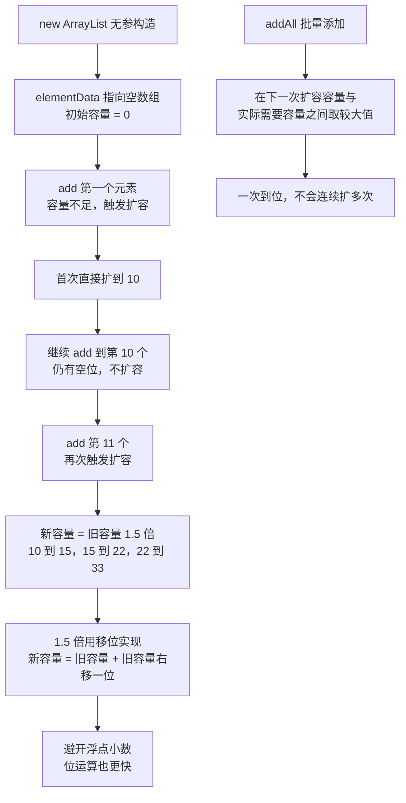

# ArrayList 扩容规则

集合相关的面试题里，ArrayList 是第一个重点，最常考的是它的扩容机制。这一篇把初始容量、add 的扩容规则、addAll 的扩容规则一次讲透，最后给出常见考法的推演。

## 先给结论

三句话记住核心规则：

- 无参构造的初始容量是 0，不是 10。带整数参数的构造用指定容量，带集合参数的构造用集合大小。
- add 单个元素：首次扩容扩到 10，之后每次扩容为上一次容量的 1.5 倍。
- addAll 批量添加：扩容时在「下一次扩容的容量」与「实际需要的容量」之间取较大值，一次到位，不会连续扩多次。



## 是什么：初始容量与 add 扩容

先纠正一个流传很广的错误认知：new 一个无参 ArrayList，底层数组的初始容量不是 10，而是 0。看源码，无参构造给 elementData 这个成员变量赋的是一个空数组，里面没有任何元素，所以初始容量是 0。

有参构造分两种。传整数容量，就按这个整数创建数组；传集合，就按集合的大小创建数组。日常讨论扩容时一般假定是无参构造，即初始容量 0。

add 的扩容规则这样走。往空 list 里加第一个元素，容量 0 存不下，触发第一次扩容，直接扩到 10。继续加元素，长度为 10 的数组还有 9 个空位，不扩容；一直加到 10 个元素存满了，再加第 11 个才触发第二次扩容，扩到 15，即上一次容量的 1.5 倍。此后每次扩容都是上一次容量的 1.5 倍：15 之后是 22，再之后是 33。

这里有个实现细节：底层说的 1.5 倍并不是浮点乘法，而是用移位运算实现的。先算旧容量的一半，正数右移一位相当于除以二，15 右移一位得 7；这个一半再加上原始容量，就是新容量，15 加 7 得 22。用移位而不是乘法，一是位运算快，二是天然避开小数问题，15 乘 1.5 这种会得到 22.5 的尴尬。

扩容的动作本身：创建新数组，把旧数组元素拷贝过去，再把新元素追加到新数组尾部，最后用新数组替换旧数组。旧数组失去引用，成为垃圾被回收。

把前二十次扩容的容量打印出来，规律一目了然：0、10、15、22、33，之后照此推导。考试如果问「往 list 里添加 100 个元素，最终容量是多大」，顺着序列推即可：73 存不下 100 个，下一次是 109，所以最终容量是 109。

## 为什么：addAll 为什么要取较大值

addAll 一次添加的是一个集合，里面可能有多个元素，同样可能触发扩容，但它的规则与 add 不同。核心原则是：在「下一次扩容的容量」与「实际元素个数」之间取较大值，作为真正的扩容目标。

为什么要这样设计？因为一次扩容到位的效率最高。如果按 add 的节奏先扩到 10，发现 11 个元素还存不下，再扩到 15，一次 addAll 触发两次扩容，拷贝两次数据，明显浪费。取较大值，能一次解决就不扩两次。

分四种情况验证这个规则。

情况一，list 本身为空（容量 0），addAll 添加 3 个元素。按 add 规则，首次扩容目标是 10；实际元素个数是 3；两者取较大值得 10。反射打印底层容量，确实是 10。

情况二，list 为空（容量 0），addAll 添加 11 个元素。首次扩容目标 10，实际元素个数 11，取较大值得 11。注意不是先扩到 10 再扩到 15，最终就是 11，一次到位。

情况三，list 已有 10 个元素（容量 10 已满），addAll 添加 3 个元素。此时不是首次扩容，下一次扩容目标是原容量的 1.5 倍即 15；实际元素总数是 10 加 3 等于 13；两者取较大值得 15。

情况四，容量 10 已满，addAll 之后元素总数达到 16。下一次扩容目标 15，实际元素个数 16，取较大值得 16。这一回扩容结果比 1.5 倍还多一个，因为实际需要更大。

想亲眼验证容量变化，可以用反射把底层数组的长度读出来：

```java
import java.lang.reflect.Field;
import java.util.ArrayList;
import java.util.List;

// 运行时需加 JVM 参数：--add-opens java.base/java.util=ALL-UNNAMED
public class TestArrayList {
    public static void main(String[] args) {
        System.out.println(arrayListGrowRule(30));
    }

    // 依次 add n 个元素，返回每次 add 之后底层数组的容量
    private static List<Integer> arrayListGrowRule(int n) {
        List<Integer> list = new ArrayList<>();
        int init = 0;                    // 无参构造的初始容量是 0
        list.add(init);
        if (n >= 1) {
            init = 10;                   // 第一次扩容直接到 10
            list.add(init);
        }
        for (int i = 1; i < n; i++) {
            init += (init) >> 1;        // 之后每次扩容为上一次的 1.5 倍
            list.add(init);
        }
        return list;
    }
}
```

## 深入细节：规则汇总与推演

把规则按场景汇总。

初始容量：无参构造为 0；整数参数构造用指定容量；集合参数构造用集合大小。

add 单个元素：若初始为 0，首次扩容到 10，之后每次为上一次的 1.5 倍；若初始容量非 0，首次扩容即为上一次容量的 1.5 倍。1.5 倍的算法是旧容量加旧容量右移一位。

addAll 批量添加：list 为空时，在 10 与实际元素个数之间取较大值；list 非空时，在原容量的 1.5 倍与实际元素总数之间取较大值。一次扩容到位，不连续扩多次。

推演练习：一个无参构造的 ArrayList，连续 add 100 个元素。容量序列为 10、15、22、33、49、73、109。73 装不下 100，所以最终容量 109。如果改用 addAll 一次性添加 100 个元素呢？list 为空，在 10 与 100 之间取较大值，直接扩到 100。同一个结果不同的路径，addAll 确实更省。

## 面试怎么答

面试问 ArrayList 扩容机制，分四层答。

初始容量：无参构造初始容量是 0（底层是空数组，不是长度 10 的数组）；传整数用指定容量；传集合用集合大小。

add 规则：首次扩容扩到 10，之后每次扩到上一次的 1.5 倍。1.5 倍不是乘法，是旧容量加旧容量右移一位，即 old + (old >> 1)，所以 15 的下一次是 22 而不是 22.5。

addAll 规则：与实际需要的容量取较大值，一次扩容到位。空 list addAll 三个元素扩到 10，addAll 十一个元素扩到 11；已有 10 个元素再 addAll 3 个扩到 15，addAll 后总数 16 则扩到 16。

推演：add 一百个元素，容量序列 10、15、22、33、49、73、109，最终 109。

能主动说出「初始容量是 0 而不是 10」和「1.5 倍用移位实现」，基本就与背八股文的回答拉开差距了。

## 常见误区

**误区一：以为无参构造初始容量是 10。** 是 0。10 是第一次 add 时扩容出来的，不是构造时给的。这个细节几乎每次面试都会被追问。

**误区二：以为 1.5 倍是浮点乘法。** 底层是 old + (old >> 1)，右移一位得一半，再加原容量。15 的下一次是 22，不是 22.5，也不是 23。

**误区三：以为 addAll 会连续扩容多次。** addAll 取较大值一次到位，不会先扩到 10 再扩到 15。答成多次扩容，等于没理解它的效率考量。

**误区四：以为扩容只是把数组换掉。** 扩容要创建新数组、拷贝全部旧元素、追加新元素，最后旧数组才成为垃圾。频繁扩容的代价主要在拷贝，这也是预估容量、用 addAll 批量添加的意义。
