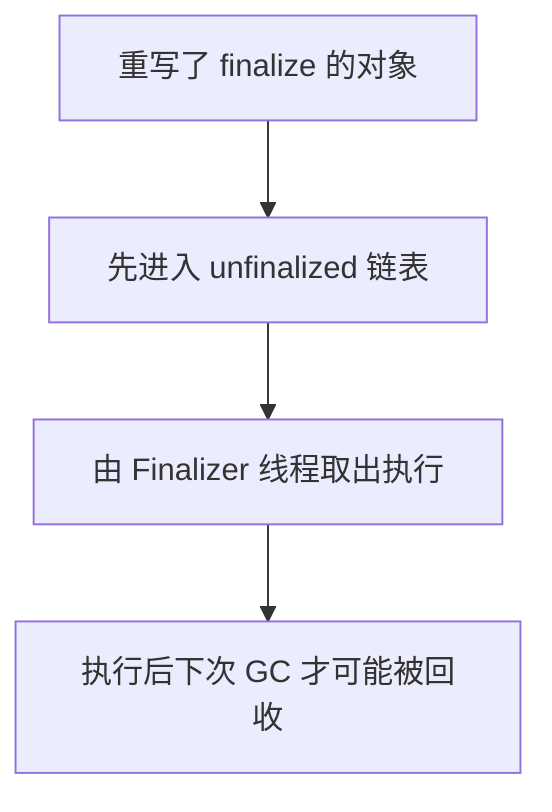

# finalize 原理：unfinalized 链表

上一篇留下一个疑问：垃圾回收的时候，就会立刻调用 finalize 吗？要回答它，得先看 JVM 在幕后做了多少准备工作。跟着 Debug 跟一遍对象的构造过程，答案会自己浮出来。

## 先给结论

重写了 finalize 方法的对象，命运从构造那一刻就被改变了：

- JVM 会偷偷修改该类的构造方法，构造被调用时，先把对象包装成一个 Finalizer 对象。
- 这个 Finalizer 对象会被加入 Finalizer 类的静态成员 unfinalized 指向的双向链表，链表记录所有「有待执行 finalize」的对象。
- Finalizer 与虚引用、弱引用是类似的东西，它关联一个 ReferenceQueue，对象一旦被垃圾回收，Finalizer 就会进入队列，从而被后续的 Finalizer 线程取走并执行 finalize。

一句话：finalize 不是 GC 顺手调用的，对象早在构造时就被登记在册，GC 之后再由专门的线程按队列执行。



## 是什么：跟着 Debug 走一遍

把断点加在 Dog 的构造方法调用处，用 Debug 运行，Force Step Into 跟进去。

此刻正准备执行狗的构造，狗对象其实已经创建，只是还没执行构造体、还没给成员变量赋值。按 Java 的规则，构造执行前要先执行父类构造，父类是 Object。继续跟进，果然跳到了 Object 的构造。

Object 构造执行完，按理应该回到狗的构造继续赋值。但没有，调用栈跳到了一个新类型 Finalizer 里，正在执行它的 register 方法。鼠标放上传入的参数，赫然就是正在构造过程中的这只狗，只不过构造还没走完，成员变量尚未赋值。

register 干了什么？它把传过来的狗对象包装成了一个 Finalizer 对象。这个 Finalizer 对象与前面讲过的虚引用、弱引用是类似的东西，配合一个引用队列，就能跟踪狗对象的垃圾回收过程。

再看 Finalizer 的构造。父类构造与其他引用类型一样，先调引用的父类构造；接着加了一把锁；然后检查 unfinalized 是否为空。一开始它是空的，条件不成立，于是直接把当前这个 Finalizer 对象赋值给 unfinalized。

## 为什么：要记下所有待收尾的对象

unfinalized 是 Finalizer 类的一个静态成员，形态是一个双向链表，链表中链入各个 Finalizer 对象，每个 Finalizer 对象又真正引用着对应的业务对象。它的职责一句话：记录所有实现了 finalize 方法的对象，一个都漏不掉。

为什么需要它？因为 finalize 的执行是异步的、滞后的。GC 只负责回收对象，回收之后谁去调 finalize、什么时候调，需要有一个「待办清单」。unfinalized 链表就是这份清单：对象构造时登记，GC 后凭引用队列确认死亡，再交给 Finalizer 线程逐项办理。没有这份清单，JVM 就不知道该给哪些对象调 finalize。

这也解释了上一篇的第二个现象：日志里执行 finalize 的线程名是 Finalizer。它不是在 GC 线程里跑的，而是有一个专门的 Finalizer 线程，从 ReferenceQueue 里取被回收对象关联的 Finalizer，再执行清理。

## 深入细节：链表长什么样

创建第一个狗对象。构造过程中 register 被调用，unfinalized 原本为空，现在头节点挂上一个 Finalizer 对象，它引用着这只狗。register 返回，狗的构造剩余代码执行完，第一只狗创建完成。

创建第二只狗。又走到 register，unfinalized 链表再链入一个元素。此时头节点是新创建的 Finalizer 对象，引用最新创建的狗；它的下一个节点是之前那个 Finalizer 对象，引用最早创建的大傻。新节点挂在头部，先创建的对象排在后面。

三只狗都创建完毕后，链表形态完整呈现：unfinalized 的头节点引用一个 Finalizer 对象，该 Finalizer 引用三笨；沿 next 到下一个 Finalizer 对象，引用二哈；再沿 next，是引用大傻的 Finalizer 对象。所有重写了 finalize 方法的对象，都通过这条链表被 JVM 统一管理。

配合 ReferenceQueue，这套结构的闭环就清楚了：构造时，对象被包装成 Finalizer 挂进 unfinalized 链表；GC 回收到狗对象时，关联的 Finalizer 被放入 ReferenceQueue；Finalizer 线程从队列中取出它们，执行对应的 finalize。从登记到执行，中间隔着 GC 和队列两道异步环节，这正是「GC 完成」与「finalize 执行」不同步的原因，也是它执行时机不可控的根源。

至于 Finalizer 线程如何被创建、如何轮询队列、finalize 调用前后链表如何变化，下一篇结合源码继续。

## 面试怎么答

面试问 finalize 的执行原理，按四步答。

第一步，注册时机在构造时：只要类重写了 finalize，JVM 就会修改其构造方法，对象创建时先把对象包装成 java.lang.ref.Finalizer 实例。

第二步，登记：Finalizer 实例被加入静态成员 unfinalized 指向的双向链表，链表管理所有有待执行 finalize 的对象。

第三步，检测：Finalizer 本质是引用类型，关联 ReferenceQueue。对象被 GC 回收后，对应的 Finalizer 进入队列。

第四步，执行：专门的 Finalizer 线程从队列取出 Finalizer，调用其引用对象的 finalize 方法。该线程是守护线程，主线程结束它可能来不及执行。

四步讲完，再点一句结论：finalize 的执行时机由 GC 和守护线程共同决定，不可控、不保证，所以 Java 9 起已废弃，资源管理应使用 try-with-resources。

## 常见误区

**误区一：以为 finalize 由 GC 线程直接调用。** GC 只负责把对象回收、把 Finalizer 放进队列，真正调用 finalize 的是独立的 Finalizer 守护线程。两者异步，这也是调用时机不可控的根源。

**误区二：以为包装发生在 GC 时。** 发生在构造时。对象一创建就被包装成 Finalizer 挂进 unfinalized 链表，GC 时只是「确认死亡并入队」，登记早在构造阶段就完成了。

**误区三：以为所有对象都会走这套流程。** 只有重写了 finalize 方法的类才会被 JVM 特殊处理。没重写的对象构造时不会注册，回收时也没有后续动作。

**误区四：以为进链表就等于安全。** unfinalized 链表只是待办清单，清单上的项能不能被执行，还要看 ReferenceQueue 有没有收到、Finalizer 线程有没有来得及跑。清单不等于执行。

## 课件源码参考

> 以下示例出自课件 day03 的 `TestFinalize.java`，与上文讲解一一对应，可直接对照阅读。

```java
package day03.reference;

import day02.LoggerUtils;

import java.io.IOException;

public class TestFinalize {
    static class Dog {
        private String name;

        public Dog(String name) {
            this.name = name;
        }

        @Override
        protected void finalize() throws Throwable {
            LoggerUtils.get().debug("{}被干掉了?", this.name);
            int i = 1 / 0;
        }
    }

    public static void main(String[] args) throws IOException {
        new Dog("大傻");
        new Dog("二哈");
        new Dog("三笨");
        System.gc();
        System.in.read();
    }
    /*
    第一，从表面上我们能看出来 finalize 方法的调用次序并不能保证
    第二，日志中的 Finalizer 表示输出日志的线程名称，从这我们看出是这个叫做 Finalizer 的线程调用的 finalize 方法
    第三，你不能注释掉 `System.in.read()`，否则会发现（绝大概率）并不会有任何输出结果了，从这我们看出 finalize 中的代码并不能保证被执行
    第四，如果将 finalize 中的代码出现异常，会发现根本没有异常输出
    第五，还有个疑问，垃圾回收时就会立刻调用  finalize 方法吗？
     */
}
```
