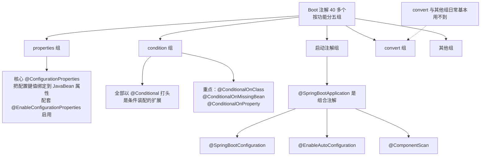

# Spring Boot 注解梳理

Spring 注解三篇之三。Spring Boot 自身的注解有四十多个，看起来吓人，真正用过、见过的并不多。挑重点分组过一遍，最后落在每个 Spring Boot 程序都躲不掉的那个启动注解上。

## 先给结论

Boot 注解按功能分五组，重点在三组：

- properties 组核心是 @ConfigurationProperties，负责把配置文件中的键值绑定到 JavaBean 属性，配套 @EnableConfigurationProperties 启用该功能。
- condition 组全部以 @Conditional 打头，是 Spring 条件装配的扩展，重点掌握 @ConditionalOnClass、@ConditionalOnMissingBean、@ConditionalOnProperty 三个。
- 启动注解 @SpringBootApplication 是组合注解，由 @SpringBootConfiguration、@EnableAutoConfiguration、@ComponentScan 三部分组成，三个都要记住。

convert 组和「其他」组日常基本用不到，略过。

## 是什么：三组重点注解

properties 组的核心是 @ConfigurationProperties，作用是把 properties 文件中的键值信息与 JavaBean 的属性进行绑定：键的名称与属性名称相同的，就把对应的值赋给这个属性。效果是简化 bean 的初始化。同样的值注入用 @Value 也能做，但每个字段都要写一遍占位符，属性一多就很繁琐。@ConfigurationProperties 按名字自动绑定，相当于在一定程度上简化 @Value 的赋值操作。

与它配套的 @EnableConfigurationProperties 用来启用这项功能。所谓启用并不神秘，和前几篇见过的 @Enable 系一样，无非是在 bean 工厂里加一些后处理器，这些后处理器能够识别 @ConfigurationProperties 注解，一旦识别到，就执行绑定操作。两个注解搭配出现，知道彼此的分工即可。

condition 组数量很多，共同特点是都以 @Conditional 打头。Spring 自带 @Conditional，需要自己写条件判断逻辑；Boot 里的这些 Conditional 系列是对 @Conditional 的扩展：把已经实现好的条件判断直接加在 @Conditional 上，不用自己实现，拿来就用。

启动组只有一个，但分量最重，下面单独展开。

## 为什么：预置条件与组合注解

条件注解的价值在「省掉重复造轮子」。自己写 @Conditional，每加一种判断都要实现一个 Condition 接口；Boot 把高频判断预制好，标注即用。三个最常用的预制条件：

@ConditionalOnClass，当类路径下包含某个类时条件才成立。典型场景是配置数据源：希望类路径下存在具体的数据源实现类，比如 Druid 的 DataSource，条件才成立，后续的数据源装配才会执行；类路径下没有这个类，条件不成立，装配整体跳过。它检查的是 classpath 下某个类是否存在。

@ConditionalOnMissingBean，当容器中缺失某个 bean 时条件才成立。它经常承担兜底角色：用户没有提供某个 bean，框架就提供一个默认的。判断依据主要是 bean 的名字：容器中没有这个名字的 bean，条件成立；这个名字的 bean 已经存在，条件不成立。

@ConditionalOnProperty，根据 properties 配置信息判断：看有没有做某些配置，配置了且取值与条件中指定的值一致，条件才成立；没有相应配置，条件不成立。

组合注解的价值在「固化常用搭配」。一个 Spring Boot 启动类身上要同时背配置类、自动配置、组件扫描三件事，每次手写三行不如打包成一个注解，这是与 @RestController、@RestControllerAdvice 一脉相承的设计思路。

## 深入细节：拆解 SpringBootApplication

每个 Spring Boot 程序都要标注 @SpringBootApplication，但它是组合注解，由三个重要注解组合而成。

第一个是 @SpringBootConfiguration。它表示「这是一个配置类」，只不过是针对 Spring Boot 的配置类，本身并没有什么特殊之处，上面仅仅是加了一个 @Configuration，与原生的配置类功能几乎等价。

第二个是 @EnableAutoConfiguration，这个非常重要，单独一篇来讲。它的主要作用是找到那些自动配置类，把自动配置类里关联的 bean 全部注册到容器中。

第三个是 @ComponentScan，执行组件扫描。从标注了 @SpringBootApplication 的类作为起点，扫描它的当前包以及子孙后代包。扫描时会做排除工作，配有两个 exclude filter，也就是排除过滤器：被排除过滤器排除掉的 bean，不会加入 Spring Boot 的容器。条件装配是「符合条件的才加入容器」，exclude filter 则是另一种手段，直接判断某个 bean 是否应该被纳入容器管理。

三个注解各管一段：一个定性（这是配置类），一个找自动配置，一个扫组件。三者合起来，才让一个 main 方法具备了启动整个应用的能力。

## 面试怎么答

面试问 Spring Boot 注解，建议按三组加一个启动注解答。

properties 组：@ConfigurationProperties 把配置文件键值绑定到 JavaBean 属性，简化 @Value 的逐个注入；配套的 @EnableConfigurationProperties 负责启用这项功能，底层是在 bean 工厂里注册能识别绑定注解的后处理器。

condition 组：重点三个。@ConditionalOnClass 看类路径下有没有某个类，有才装配；@ConditionalOnMissingBean 看容器里缺不缺某个 bean（按名字判断），缺才装配，常用于兜底默认实现；@ConditionalOnProperty 看配置文件里有没有指定配置且值匹配。三个都是 @Conditional 的预制扩展。

启动注解：@SpringBootApplication 是组合注解，由 @SpringBootConfiguration、@EnableAutoConfiguration、@ComponentScan 组成。前者等价于 @Configuration；中间负责加载自动配置类，把关联 bean 注册进容器；后者从启动类所在包开始扫描子孙包，并支持 exclude filter 排除。自动配置的细节由 @EnableAutoConfiguration 展开，这是下一篇的主题。

## 常见误区

**误区一：以为 @SpringBootApplication 是一个功能注解。** 它是三合一的组合注解，拆开后各管各的。答组成时漏掉 @ComponentScan 或 @SpringBootConfiguration，都属于没拆开看过。

**误区二：分不清 @ConfigurationProperties 与 @Value。** @Value 逐字段注入，灵活但繁琐；@ConfigurationProperties 按名前缀批量绑定，适合把一组相关配置收进一个 JavaBean。复杂类型（列表、嵌套对象）绑定是前者的主场。

**误区三：以为 @ConditionalOnMissingBean 按类型判断。** 它主要按 bean 名字匹配，容器里没有这个名字才成立。答成按类型，会在「同类型多个 bean」的追问下露怯。

**误区四：以为组件扫描是照单全收。** 扫描支持 exclude filter 排除，被排除的 bean 不进容器。它与 @Conditional 是两种不同的准入控制手段，一个做排除，一个做条件准入。

**误区五：把 Boot 的条件注解与 @Conditional 对立。** Boot 的 ConditionalOn 系列是 @Conditional 的扩展与预制，不是另一套机制。说清这层关系，才显得成体系。
