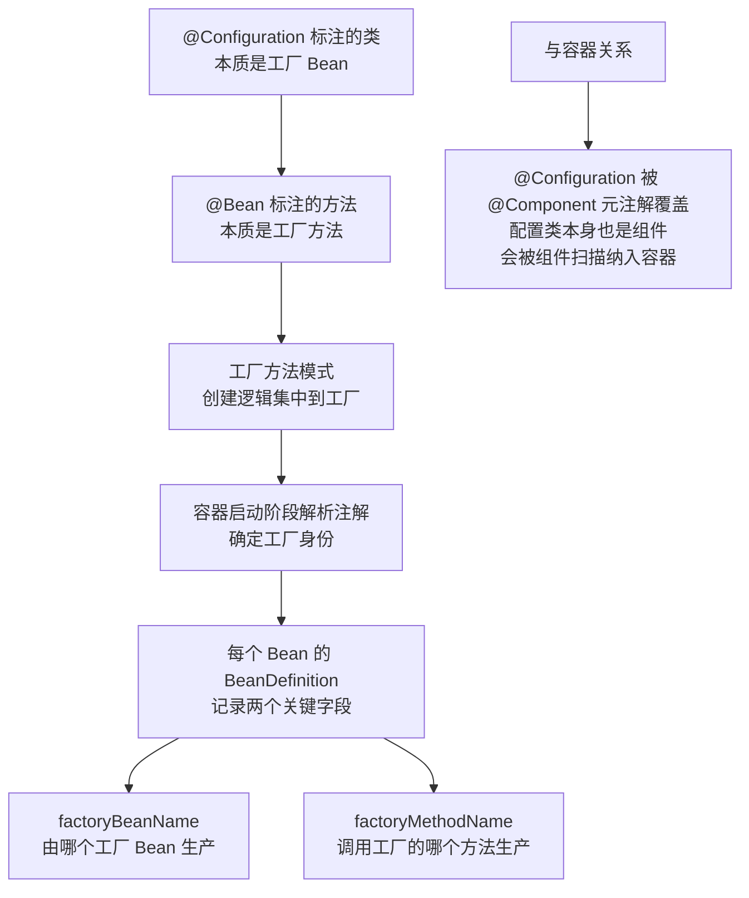

# @Configuration：配置类即为工厂

`@Configuration` 是 Spring 里使用频率最高的注解之一，但不少同学对它的工作原理说得含糊：知道它用来声明 Bean，却说不出容器内部到底把它当成什么。这一系列内容围绕 `@Configuration` 归纳了四个要点，本篇只讲第一点，也是理解其余三点的地基：**配置类本质上是一个工厂，标注 `@Bean` 的方法本质上是一个工厂方法**。这个结论不是类比，而是可以在调试器里逐字段验证的事实。

## 先给结论

被 `@Configuration` 标注的类，在 Spring 容器中扮演的角色是**工厂 Bean**；类中每一个被 `@Bean` 标注的方法，就是这个工厂的**工厂方法**。容器最终创建的每一个 Bean，其 BeanDefinition（Spring 内部描述「一个 Bean 如何创建」的元数据对象）中都记录了两个关键字段：`factoryBeanName` 记录由哪个工厂 Bean 来生产，`factoryMethodName` 记录调用工厂里的哪个方法来生产。只要在调试器里看到这两个字段被正确填充，配置类即工厂这件事就被证明了。



## 是什么

工厂方法模式是创建型设计模式的经典一员：创建对象的逻辑不散落在使用方，而是集中到专门的工厂中，使用方向工厂要对象即可。Spring 把这一思想推到了框架级别。配置类承担工厂的职责，负责「怎么造」；`@Bean` 方法是工厂里的具体产线，负责「造什么、怎么造」。

这里有一个容易忽略的层次差异：Spring 的配置类并不要求实现任何接口、继承任何父类。它与传统工厂的区别在于，工厂身份不是靠代码写出来的，而是靠注解声明、由容器在启动阶段解析出来的。`@Configuration` 自身的定义就说明了它的定位，它是标注在类上的元注解载体，并且被 `@Component` 元注解覆盖，意味着配置类本身也是一个组件，会被组件扫描纳入容器：

```java
@Target(ElementType.TYPE)
@Retention(RetentionPolicy.RUNTIME)
@Documented
@Component
public @interface Configuration {
}
```

一个最小配置类长这样：

```java
@Configuration
public class AppConfig {
    @Bean
    public MyBean myBean() {
        // instantiate, configure and return bean ...
    }
}
```

`myBean()` 方法没有任何入参，返回值是一个全新对象。这段代码放在普通 Java 程序里只是普通方法，但在 Spring 上下文里，它就是工厂方法：容器会调用它来获得 `myBean` 这个 Bean 的实例。

## 为什么

为什么 Spring 要把配置类设计成工厂，而不是让用户自己 new？因为工厂化之后，创建对象的时机、依赖的注入、生命周期的管理才全部收归容器统一调度。配置类只负责描述创建过程，容器负责在合适的时机执行这个过程。

这件事同样可以实证。准备一个包含两个 `@Bean` 方法的配置类，再用一个最精简的容器把它注册进去：

```java
public static void main(String[] args) {
    GenericApplicationContext context = new GenericApplicationContext();
    AnnotationConfigUtils.registerAnnotationConfigProcessors(context.getDefaultListableBeanFactory());
    context.registerBean("myConfig", MyConfig.class);
    context.refresh();
    System.out.println();
}
```

被注册的配置类如下：

```java
@Configuration
static class MyConfig {
    @Bean
    public Bean1 bean1() {
        System.out.println("bean1()");
        return new Bean1();
    }

    @Bean
    public Bean2 bean2() {
        System.out.println("bean2()");
        return new Bean2();
    }
}
```

在 `refresh()` 执行完毕的位置打下断点，展开 `context` 的成员变量 `beanFactory`，找到其中的 `beanDefinitionMap`。这个 map 存放的是所有 Bean 的定义信息，key 是 Bean 名称，value 是描述这个 Bean 将来如何被生成的 BeanDefinition，注意此时存放的是定义，不是最终实例。

第一次运行时会发现，`beanDefinitionMap` 里只有 `myConfig` 一个定义，`bean1` 和 `bean2` 都不存在。原因是缺少一个 Bean 工厂后处理器。解析 `@Configuration` 与 `@Bean` 的工作由 `ConfigurationClassPostProcessor` 完成，它是一个 `BeanFactoryPostProcessor`，没有它，配置类里的工厂方法根本不会被解析成 BeanDefinition。解决办法是调用工具类 `AnnotationConfigUtils.registerAnnotationConfigProcessors`，它会把 Spring 日常所需的常见 Bean 工厂后处理器与 Bean 后处理器一并注册到工厂中。

补齐这一步再运行，`beanDefinitionMap` 的 size 变成了 8：其中 `myConfig` 仍在，新增的 `bean1`、`bean2` 以及若干后处理器定义都在其中。名字较长的那些定义都是后处理器，正是它们把配置类中的两个工厂方法解析成了独立的 BeanDefinition。

## 深入细节

证明的核心在 BeanDefinition 的字段上。展开 `bean1` 对应的 BeanDefinition，忽略表示名称的 key，直接看 value 中的两个字段：

- `factoryBeanName` 的值是 `"myConfig"`，含义是：要生成 `bean1`，需要先找到名为 `myConfig` 的工厂 Bean；
- `factoryMethodName` 的值是 `"bean1"`，含义是：找到工厂之后，调用其中名为 `bean1` 的方法来生产。

`bean2` 的 BeanDefinition 同理：`factoryBeanName` 为 `"myConfig"`，`factoryMethodName` 为 `"bean2"`。这两个字段合起来，把「工厂类即配置类、工厂方法即 @Bean 方法」落实成了容器可执行的指令：将来要拿 `bean1` 实例，先取得 `myConfig` 这个 Bean，再反射调用它的 `bean1()` 方法，返回值即为 `bean1` 实例。

工厂方法分两类。一类是上面这种没有 `static` 修饰的，叫**实例工厂方法**，调用前必须先有工厂实例，因此容器要先把 `myConfig` 这个 Bean 创建出来，才能调用它的 `bean1()`。另一类是用 `static` 修饰的方法，叫**静态工厂方法**，它不需要工厂实例，容器拿到工厂类的 Class 对象即可直接调用静态方法。区分这两类的意义在于：静态工厂方法不依赖配置类实例的存在，在某些启动顺序场景下行为更可控。

关于 `@Configuration` 还有两个要点，分别是「@Bean 不支持重载」与「@Configuration 默认为配置类生成代理以保证 @Bean 方法互调时的单例性」，属于本系列后续篇目的主题，本篇不展开。

## 面试怎么答

被问到 `@Configuration` 是什么，可以这样答：`@Configuration` 标注的类是 Spring 的配置类，它的本质是一个工厂，类中被 `@Bean` 标注的方法是工厂方法，负责返回 Bean 实例。这一点可以从 BeanDefinition 的结构得到验证：每个由 @Bean 方法产生的 Bean，其定义里都带有 factoryBeanName 与 factoryMethodName，分别指明工厂 Bean 的名称和工厂方法的名称，容器据此先获取工厂实例再调用工厂方法完成 Bean 创建。工厂方法分为实例工厂方法与静态工厂方法，前者需要先创建工厂实例，后者通过类对象直接调用。此外，解析 @Configuration 与 @Bean 依赖 ConfigurationClassPostProcessor 这个 Bean 工厂后处理器，若手工创建容器而未注册该后处理器，配置类中的 Bean 定义不会被解析出来。

## 常见误区

误区一：以为 `@Configuration` 只是一个参与组件扫描的普通组件。它当然会被扫描，但它的核心职能是工厂：其中的 `@Bean` 方法产出 Bean，与组件扫描产出实例化对象的路径完全不同。

误区二：以为只要把配置类注册进容器，`@Bean` 方法就一定会生效。若容器是手工创建的，没有注册 Bean 工厂后处理器，`@Configuration` 与 `@Bean` 不会被解析，`beanDefinitionMap` 中只会剩下配置类自身的定义，两个工厂方法形同虚设。

误区三：分不清实例工厂方法与静态工厂方法。看到 `@Bean` 方法上有 `static` 就应当反应过来，这个 Bean 的生产不依赖配置类实例，容器不需要先实例化配置类即可完成调用。
