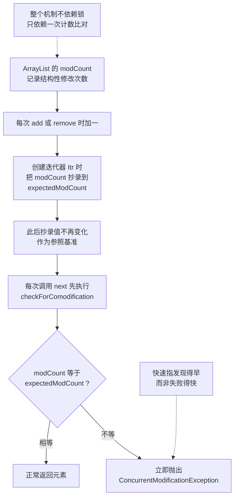

# Iterator 快速失败机制的源码实现

上一篇用演示说明了快速失败的现象：遍历 `ArrayList` 的过程中修改集合，下一轮循环抛出 `ConcurrentModificationException`。本篇从源码角度解释这个现象是怎么实现的。结论先行：`ArrayList` 用一个修改计数器 `modCount` 记录集合被结构性修改的次数，迭代器创建时把这个数值抄录到自己的 `expectedModCount` 字段，之后每次 `next()` 都比对两个数值，一旦不等就立刻抛异常。整个机制不依赖锁，也不依赖线程判断，只依赖一次计数比对。

## 先给结论

快速失败的实现只需要三样东西：集合侧的 `modCount`、迭代器侧的 `expectedModCount`、以及每次 `next()` 时调用的 `checkForComodification()` 比对。三者关系是：`modCount` 每经历一次结构性修改就加一；`expectedModCount` 在迭代器诞生时从 `modCount` 抄录，此后不再变化；`next()` 先比对再取元素，比对失败立即抛 `ConcurrentModificationException`。所谓「快速」，指的不是失败得快，而是发现得早，一旦检测到遍历期间集合被改，马上报错，不让错误潜伏到后续操作。



## 是什么

`modCount` 是 `ArrayList` 的成员变量，含义是集合被结构性修改的次数。所谓结构性修改，指会引起元素个数或内部结构变化的操作，典型的是 `add` 与 `remove`；单纯修改某个元素的字段不算。初始值为 0，每 `add` 一次加一，所以连续 add 四个元素之后它的值是 4。

`expectedModCount` 是 `ArrayList.Itr` 迭代器的成员变量，含义是「我开始迭代时，这个集合被修改了多少次」。它在迭代器初始化时从外层集合的 `modCount` 抄录，此后与集合侧的计数器脱钩，只作为参照基准存在。

`checkForComodification()` 是迭代器内部的方法，每次 `next()` 之前执行，职责就是比对两个计数器的值。

## 为什么

为什么用一个计数器就能发现问题？因为在单次遍历的语义里，集合的修改次数应当是恒定的：遍历开始之后，如果没有任何人动集合，`modCount` 一路保持原值，迭代器的抄录值与之相等，相安无事；一旦有人在遍历过程中调了 `add`，集合侧计数器加一，两侧数值立刻出现差异。这个差异与「是谁改的」无关，只回答「有没有被改过」，而快速失败机制关心的恰恰是后者。它并不试图阻止并发修改，也无力在修改发生的瞬间拦截，它选择在下一轮访问元素时核对账本，发现账实不符就抛异常，把问题暴露在最早的时刻。

## 深入细节

演示用的遍历写法是增强 for 循环，它的底层仍然走迭代器。首次循环时，编译器生成的代码会调用集合的 `iterator()` 方法创建迭代器对象，之后每轮循环分别调用 `hasNext()` 判断是否还有元素、调用 `next()` 移动到下一个元素。原始写法如下：

```java
private static void failFast() {
    ArrayList<Student> list = new ArrayList<>();
    list.add(new Student("A"));
    list.add(new Student("B"));
    list.add(new Student("C"));
    list.add(new Student("D"));
    for (Student student : list) {
        System.out.println(student);
    }
    System.out.println(list);
}
```

对照用的安全失败写法通常换用 `CopyOnWriteArrayList` 这类线程安全集合，本篇只聚焦前者：

```java
private static void failSafe() {
    // 通常会使用 CopyOnWriteArrayList 等线程安全的集合
}
```

核心机制全部落在迭代器内部类中：

```java
private class Itr implements Iterator<E> {
    int cursor;       // index of next element to return
    int lastRet = -1; // index of last element returned; -1 if no such
    int expectedModCount = modCount; // 预期的修改次数

    public boolean hasNext() {
        return cursor != size;
    }

    public E next() {
        checkForComodification();
        int i = cursor;
        if (i >= size)
            throw new NoSuchElementException();
        Object[] elementData = ArrayList.this.elementData;
        cursor = i + 1;
        return (E) elementData[i];
    }

    final void checkForComodification() {
        if (modCount != expectedModCount)
            throw new ConcurrentModificationException();
    }
}
```

按课程原稿逐字收录，`expectedModCount` 一行的注释「预期的修改次数」是稿件原有内容。

逐行看这段代码。`cursor` 记录下一个待返回元素的下标，`lastRet` 记录上一个已返回元素的下标，`remove()` 会用到它。`expectedModCount = modCount` 这行在迭代器构造时执行，是整套机制的锚点：迭代器诞生的那一刻，集合被修改了多少次，就被定格在这里。上面的例子里，循环前 add 了 A、B、C、D 四个元素，`modCount` 已经是 4，因此迭代器的 `expectedModCount` 也是 4。

`hasNext()` 只比较 `cursor` 与 `size`，与计数器无关，它回答的是「还有没有元素」而不是「集合有没有被改」。

`next()` 第一行就是 `checkForComodification()`，然后才取元素、推进 `cursor`。顺序很关键：先验账，后动手。如果跳过校验直接取元素，异常就会延后到真正访问到非法位置时才暴露，快速失败的意义也随之减弱。

`checkForComodification()` 只有两行：`modCount` 与 `expectedModCount` 不相等就抛 `ConcurrentModificationException`。相等时什么都不做，直接返回，遍历正常继续。

把上一轮的演示代入数值走一遍。循环前 add 四次，`modCount` 为 4，迭代器创建时 `expectedModCount` 抄录 4。第一轮打印 A，第二轮打印 B，两侧数值始终相等。第三轮循环体内执行 `list.add(new Student("E"))`，集合侧 `modCount` 变为 5。在调试器里选中 list 右键 view as object，可以绕过 IDEA 对集合的优化显示，看到原始成员变量 `modCount` 已经变成 5。下一轮循环进入 `next()`，`checkForComodification()` 比对发现 5 不等于 4，条件成立，进入 if 分支抛出 `ConcurrentModificationException`。异常堆栈的顶端正是 `ArrayList$Itr.checkForComodification()`，与源码逐行对应。

还有一处细节：`modCount` 没有加 `volatile`。这意味着这个机制并不能可靠捕获多线程并发修改，一个线程的修改未必能被另一个线程及时看到。快速失败的本意是「尽力而为」地检测遍历期间的意外修改，帮助开发者尽早暴露单线程场景下的误用，把它当成并发安全的保证是对机制的误读。

## 面试怎么答

被问到快速失败的原理，可以这样答：`ArrayList` 用成员变量 `modCount` 记录集合被结构性修改的次数，每次 add、remove 都会让它加一。迭代器创建时，把这个值抄录到自己的 `expectedModCount` 字段。遍历过程中每次调用 `next()`，都会先执行 `checkForComodification()`，比对集合当前的 `modCount` 与迭代器的 `expectedModCount`，一旦不相等就抛出 `ConcurrentModificationException`。它记录的是循环开始时的修改次数，循环中若有人改了集合，两侧数值出现差异，就会被立刻发现，因此叫快速失败。这个机制不依赖锁，`modCount` 也没加 volatile，所以它是尽力而为的检测，不是并发安全的保证。

## 常见误区

误区一：以为快速失败是并发安全的机制。它既不阻止并发修改，也不保证能检测到并发修改，只是单线程误用场景下的尽早报错手段。真正要安全遍历，应换用 `CopyOnWriteArrayList` 或加锁遍历。

误区二：以为抛异常的是循环语句本身。异常实际由迭代器的 `checkForComodification()` 抛出，增强 for 循环只是它的调用方，异常堆栈可以印证这一点。

误区三：以为只要不调用 `add`、`remove` 就不会触发。修改元素字段不影响计数器，但任何改变元素个数的操作，包括通过集合自身之外渠道造成的结构性变化，都会打破两侧数值的平衡。
