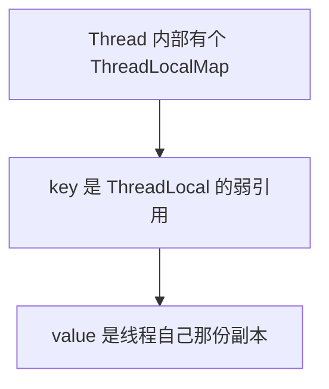

# ThreadLocal 的实现原理

前面用代码演示了 ThreadLocal 的效果：一个 `static final` 的 ThreadLocal 对象，配合数据库连接管理，让每个线程用到的是各自独立的 Connection。这里藏着一个反直觉的问题：ThreadLocal 对象明明只有一个，凭什么能隔离出多个资源？本篇把这件事拆开讲清楚。结论是：真正干活的是每个线程内部的那个 ThreadLocalMap，ThreadLocal 自己只充当关联资源的钥匙。

## 先给结论

ThreadLocal 本身不存储资源，它只负责以自己为 Key，把资源关联到「当前线程」内部的一张 Map 上。这张 Map 是线程的成员变量，每个线程各有一份、互不可见。资源隔离由线程内的 Map 实现，ThreadLocal 实现的只是「用哪个 Key 去存取」。set 时把 ThreadLocal 对象自己作为 Key、资源作为 Value 存入当前线程的 Map；get 时以同样方式从当前线程的 Map 中把资源取回；remove 时以同样方式移除关联。



## 是什么

先回顾演示代码。连接管理工具类把 ThreadLocal 声明为静态常量，整个进程中只有一个对象：

```java
static class Utils {
    private static final ThreadLocal<Connection> tl = new ThreadLocal<>();
    public static Connection getConnection() {
        Connection conn = tl.get();
        if (conn == null) {
            conn = innerGetConnection();
            tl.set(conn); // 特别强调：将连接存入当前线程的 ThreadLocal 中
        }
        return conn;
    }
    private static Connection innerGetConnection() {
        try {
            return DriverManager.getConnection("jdbc:mysql://localhost:3306/test?useSSL=false", "root", "root");
        } catch (SQLException e) {
            throw new RuntimeException(e);
        }
    }
}
```

按课程原稿逐字收录，`tl.set(conn)` 一行的中文注释是稿件原有内容。

线程一调用 `getConnection()`，`tl.get()` 取不到值，于是新建连接并 `tl.set(conn)`；线程二走同样的代码路径，但因为 set 操作落在自己线程内的 Map 上，拿到的是另一个连接。同一个 ThreadLocal 对象，在不同线程中关联到了不同资源，隔离就此形成。Java 文档对 ThreadLocal 的定位描述也印证了这一点：每个通过 get 或 set 访问它的线程，拥有的是一份独立初始化的副本。

```java
public class ThreadLocal<T> extends Object
This class provides thread-local variables. These variables differ from their normal counterparts in that each thread that accesses one (via its get or set method) has its own, independently initialized copy of the variable.
```

## 为什么

隔离的关键不在 ThreadLocal，而在线程自身。每个线程对象内部都有一个成员变量，类型是 ThreadLocalMap，它是这个线程私有的存储区。Map 的 Key 是 ThreadLocal 对象，Value 是资源。每个线程各有一张 Map，各存各的资源，彼此不可见，这就是隔离的物理基础。

ThreadLocal 承担的角色是「关联」：set 方法把自己作为 Key、把参数作为 Value，写入当前线程的 Map；get 方法以自己为 Key，到当前线程的 Map 里把值读出来；remove 方法以自己为 Key，从当前线程的 Map 里删掉这条关联。三个方法操作的都是「当前线程」，currentThread 在哪个线程执行，存取就落在哪个线程的 Map 上，这正是同一份静态代码产生隔离效果的原因。

这张 Map 是懒创建的。线程内的 ThreadLocalMap 一开始并不存在，第一次对该线程执行 set 时才创建，没用到的线程不会付出任何存储开销。

## 深入细节

ThreadLocalMap 不是普通的 HashMap，它有四个值得单独讲的点。

第一，索引的计算。每个新的 ThreadLocal 对象诞生时都会被分配一个哈希值，且这个值有规律：第一个 ThreadLocal 的哈希值是 0，之后每新建一个就在前一个基础上累加一个固定的大整数 1640531527，再以数组长度取余得到存放位置。所以第一个 ThreadLocal 落在索引 0，第二个算出来是 7，第三个算出来是 14，以此类推。哈希值累加过程中变成负数也没有关系，只要最终算出的同下标为正即可。

第二，初始容量与扩容。ThreadLocalMap 的初始容量是 16，扩容阈值是数组长度的三分之二，也就是 16 乘以 2 除以 3 约等于 10.67，实际表现是元素个数达到 10 时触发扩容。前九个元素放入都不扩容，放入第十个时触发，扩容方式与普通哈希表一致：容量翻倍，所有 Key 重新计算索引。重新计算后位置有变化，但索引为 0 的那个 Key 不受影响，因为 0 无论对哪个容量取余都是 0，它始终停在原点。

第三，冲突的解决方式。HashMap、ConcurrentHashMap、Hashtable 都用拉链法，把冲突的元素串成链表挂在同个桶上；ThreadLocalMap 用的是开放寻址法：目标索引被占用时，从该索引向后寻找下一个空闲位置放入。比如某个 Key 算出的索引是 0，而 0 已被占用，就往后找到 1 放入；下一个同样算到 0 的 Key，则继续往后找空闲位置。

第四，它服务于隔离而非高并发。ThreadLocalMap 是线程私有的，不存在多线程同时读写同一张表的情况，这也是它敢用开放寻址法、敢把容量做得小的前提。

把面试要点收拢成四条：ThreadLocalMap 的核心作用是实现资源的线程隔离；初始容量 16，扩容阈值为长度的三分之二，即元素达到 10 触发扩容；索引针对每个 ThreadLocal 对象从 0 开始累加固定整数计算；冲突用开放寻址法解决，而非拉链法。

## 面试怎么答

被问到 ThreadLocal 的原理，可以这样答：ThreadLocal 对象本身只有一个，它并不存储资源，真正实现隔离的是每个线程内部的 ThreadLocalMap。ThreadLocal 在 set 时把自己作为 Key、资源作为 Value 存入当前线程的 Map，get 时以自己为 Key 从当前线程的 Map 取回资源，因此同一个 ThreadLocal 在不同线程中关联到的是不同资源。ThreadLocalMap 是线程的成员变量，懒创建，线程之间互不可见。它的初始容量是 16，元素个数达到三分之二即 10 时触发扩容，扩容是容量翻倍并重新计算索引。索引方面，每个 ThreadLocal 对象从 0 开始累加固定值 1640531527 作为哈希值。冲突解决采用开放寻址法而非拉链法。

## 常见误区

误区一：以为资源存在 ThreadLocal 对象里。ThreadLocal 里没有任何资源副本，它只是钥匙；隔离由线程私有的 ThreadLocalMap 完成。这也是为什么 ThreadLocal 通常声明为 static，一个实例即可服务所有线程。

误区二：以为 ThreadLocalMap 和 HashMap 一样用拉链法。它用开放寻址法线性探测下一个空闲位置，两者在冲突处理与并发假设上完全不同。

误区三：以为 Map 在类加载或线程创建时就建好。ThreadLocalMap 是懒创建的，第一次 set 时才在当前线程内创建，没有使用过的线程不承担这份开销。
