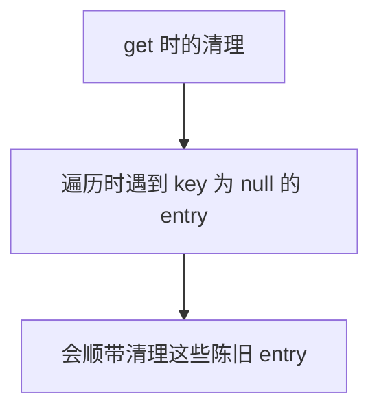

# value 的内存释放时机：get 时

上一篇讲清了 key 的内存释放：ThreadLocalMap 的 key 是弱引用，GC 时只要外部没有强引用指向 ThreadLocal，key 就能被回收，key 变为 null。但 value 是强引用，GC 动不了它，key 被回收后 Entry 依然存在，资源对象仍占着内存。value 的释放只能另找时机，一共分三种情况，本篇讲第一种：**get 时发现 key 已为 null，顺手把 value 也清理掉**。

## 先给结论

GC 之后，ThreadLocalMap 中那些 key 已被回收的条目会呈现「key 为 null、value 仍在」的中间状态。此时对该 map 执行 get 操作，如果访问到的索引位置上 key 已经是 null，就会把这个条目的 value 一并置为 null，释放资源。也就是说，get 操作承担了一部分清理职责：取值的路上遇到过期条目，顺手回收。

## 是什么

先还原 GC 之后的现场。假设 ThreadLocalMap 中有两组键值，key 分别记为 K1、K2。由于内存不足触发垃圾回收，且这两个 ThreadLocal 在外部已无强引用，GC 会把两个 key 回收掉。在模拟图上，被回收的 key 显示为灰色，表示取值已经变成 null。但请注意，value 仍然存在，资源对象占多少内存还占多少，整个 Entry 也没有被清除。这就是 value 泄漏风险的来源：key 没了，value 还挂着。

## 为什么

为什么 value 不能像 key 一样靠 GC 释放？因为 key 是弱引用，value 是强引用，引用强度的差异决定 GC 对它们的态度完全不同。弱引用对象在 GC 时只要无人强引用即可回收；强引用对象只要还被引用就绝不被回收。map 中的 value 被 Entry 强引用握着，GC 无权过问。要释放 value，只能由代码主动出手，把引用断开。

get 就是主动出手的第一个时机。当对 map 执行 get 操作时，会先按索引定位到目标位置，如果发现这个位置的 key 已经是 null，说明该条目已过期，value 没人再会用到，于是顺手把 value 也置为 null。资源引用断开，value 占用的内存就交给了 GC 处置。

## 深入细节

ThreadLocalMap 与普通 Map 有一个显著差异：get 一个 key 时，如果该 key 原本不存在，普通 Map 什么都不做直接返回 null，而 ThreadLocalMap 会放入一个 key 为 null 的 Entry。模拟实验可以验证：对 ThreadLocalMap get 一个不存在的 key D，map 中会新增一个 key 为 D 但 value 为 null 的条目。这个特性是 ThreadLocalMap 独有的，理解它才能看懂 get 的清理逻辑为什么以「key 是否为 null」为判据。

把两个例子走一遍。第一个例子：get key C，C 的索引固定为 1，于是到索引 1 处执行 get。发现该位置的 key 已是 null，顺手把该条目的 value 清理为 null。清理后可以看到，value 变成灰色表示已释放，但 key 的位置仍然存在，这正是 ThreadLocalMap 与普通 Map 行为差异的体现，它不会删除条目，只是断开 value 的引用。第二个例子：get key E，E 的索引是 10，到索引 10 处执行 get，同样发现 key 已为 null，同样把 value 清理掉。

这两种情况合起来就是 value 释放的第一种时机：get 时命中过期条目，顺手清理 value。

value 的释放时机一共三种，get 只是其一，另外两种分别是 set 时与 remove 时，由后续篇目展开。先说清楚一个结论：这三种时机都是「被动发现」，即 key 已经被 GC 回收之后，代码在正常的读写路径上撞见过期条目才清理。如果程序既不再 get 也不再 set，过期的 value 就会一直占着内存，这就是为什么官方强烈建议使用完 ThreadLocal 后主动调用 remove，而不是把希望寄托在这些被动清理上。

## 面试怎么答

被问到 value 的内存释放，可以这样答：ThreadLocalMap 中 key 是弱引用、value 是强引用。GC 只能回收 key，key 变 null 后 value 仍被强引用握着，Entry 呈现 key 为 null、value 存在的中间状态。value 的释放分三种时机：get 时如果按索引定位发现 key 已是 null，会顺手把 value 置 null；set 时会用启发式扫描清理临近的 null key；remove 时直接删除条目。三种都是被动触发，所以规范做法是使用完 ThreadLocal 后主动 remove，防止内存泄漏。另外 ThreadLocalMap 有个特性，get 一个不存在的 key 会放入一个 key 为 null 的 Entry，这与普通 Map 不同。

## 常见误区

误区一：以为 key 被回收后 value 会跟着自动释放。value 是强引用，GC 不会动它，必须靠代码在 get、set、remove 时主动清理。

误区二：以为被动清理足以兜底。三种清理时机都要求代码继续访问 map，若一个线程长期不再使用某个 ThreadLocal，过期的 value 会一直占内存，主动 remove 才是正解。

误区三：忽略 ThreadLocalMap 的特殊语义。get 不存在的 key 会放入 key 为 null 的 Entry，这与普通 Map 不同，理解它是看懂清理逻辑的前提。
