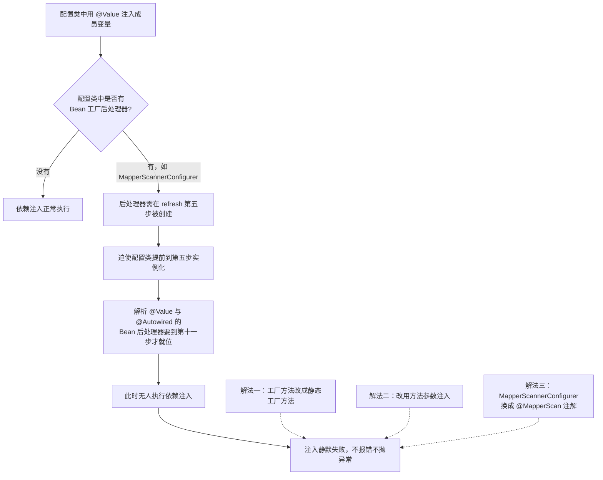

# 配置类依赖注入失效问题

@Configuration 四个要点的最后一点，讲一个非常隐蔽的坑：配置类中用 @Value 注入成员变量，平时工作正常，一旦引入 Bean 工厂后处理器就静默失效。这个问题不报错、不抛异常，只是注入值凭空消失，排查成本极高。理解它需要回到 refresh 流程的时序。

## 先给结论

配置类里用 @Value 或 @Autowired 注入成员变量，在没有 Bean 工厂后处理器时能成功；一旦配置类中加入了 Bean 工厂后处理器（如 MapperScannerConfigurer），由于后处理器要在 refresh 第五步被创建，它会迫使配置类提前到第五步实例化，而解析 @Value、@Autowired 的 Bean 后处理器要到第十一步才就位，此时依赖注入无人执行，注入静默失败。三种解法：把工厂方法改成静态工厂方法；改用方法参数注入；MapperScannerConfigurer 换成 @MapperScan 注解。



## 是什么

先复现问题。配置类中某个工厂方法需要用到变量值，常见写法是把变量定义为配置类的成员变量，用 @Value 注入：

```java
@Value("${java.class.version}")
private String version;

@Bean
public Bean3 bean3() {
    System.out.println("bean3() " + version);
    return new Bean3();
}
```

这里写的是示例结构，实际演示中打印出的版本号正常，看起来注入成功了。如果想注入的是其他 Bean，也可以用 @Autowired 配合成员变量。问题不在这种写法本身，而在它与 Bean 工厂后处理器共存的场景。

## 为什么

Bean 工厂后处理器是什么？它就是 `BeanFactoryPostProcessor` 的实现，典型代表是整合 MyBatis 时用过的 `MapperScannerConfigurer`。看它的实现接口，往上一层就是 `BeanFactoryPostProcessor`，即 Bean 工厂后处理器。

把 MapperScannerConfigurer 加进配置类，随便配一个扫描包，不做完整配置。再次运行，问题出现了：版本号没了，@Value 没有真正完成依赖注入，成员变量是 null。

原因藏在时序里。Bean 工厂后处理器的使用时机非常早，在 refresh 流程的第五步 `invokeBeanFactoryPostProcessors` 就会被调用，执行所有 Bean 工厂后处理器。要执行它，就得先把 MapperScannerConfigurer 这个 Bean 创建出来。但 MapperScannerConfigurer 是配置类中的一个 @Bean 成员方法，调用成员方法的前提是先把配置类实例创建出来。于是配置类被提前到了第五步实例化。

而配置类本该在第十一步创建。第十一步是 Bean 的实例化与依赖注入阶段，解析 @Value、@Autowired 的 Bean 后处理器在此时才就位。配置类在第五步被提前创建，那些处理器还没准备好，依赖注入自然无法执行，成员变量停留在未赋值的 null 状态。

一句话总结：Bean 工厂后处理器要提前创建，连累它所在的配置类被提前创建，配置类提前创建就赶不上正常的依赖注入阶段。

## 深入细节

解法一：把工厂方法改成静态工厂方法。静态方法通过类名即可调用，不需要配置类实例，因此不会导致配置类被提前创建，配置类仍在第十一步创建，依赖注入不受影响。演示中加上 static 之后，版本号正常打印。对于 Bean 工厂后处理器，这是推荐做法：遇到它就配成静态工厂方法，不让它的创建连累配置类。

解法二：改用方法参数注入。@Value 与 @Autowired 都支持加在方法参数上，把 @Value 挪到 @Bean 方法的参数上，无论配置类是否提前创建，最终 Bean3 仍在第十一步创建，此时解析 @Value、@Autowired 的处理器都已就位，参数注入能正常执行。演示中不加 static、只把值从参数传入，版本号同样正常打印。

两种解法对比，优先选静态工厂方法。理由是 Bean 工厂后处理器本来就应该以静态方式配置，这是更彻底的规避：不让配置类的实例化时机被后处理器绑架。参数注入是对症下药，但依赖注入发生在参数层面，没有消除「配置类被提前创建」这个事实本身。

解法三只针对 MapperScannerConfigurer：不配置成 Bean，改用 @MapperScan 注解并指定扫描包。注解方式不会导致配置类被提前创建，成员变量写法原样不动，版本号依然正常。

顺着这个坑还有两个更普适的建议。第一，依赖注入优先用局部变量即方法参数，而不是成员变量。局部变量能完成注入，还不引入额外状态；如果要做完整的属性绑定，直接用 @ConfigurationProperties 更方便。第二，不要把配置类的成员变量当成理所当然的注入位置，它在时序异常时毫无征兆地静默失效，比参数注入更难排查。

## 面试怎么答

被问到配置类依赖注入失效，可以这样答：配置类中如果包含 Bean 工厂后处理器，比如 MapperScannerConfigurer，问题就可能出现。Bean 工厂后处理器在 refresh 第五步 invokeBeanFactoryPostProcessors 时就要被创建，创建它就得先实例化它所在的配置类，配置类因此被提前创建；而解析 @Value、@Autowired 的 Bean 后处理器在第十一步才就位，提前创建的配置类赶不上依赖注入，注入静默失败。解法有三种：把工厂方法改成静态工厂方法，静态方法不需要配置类实例，配置类就不会被提前创建，这是推荐做法；或者改用方法参数注入，@Value 和 @Autowired 都支持加在参数上；MapperScannerConfigurer 还可以换成 @MapperScan 注解。更普适的建议是依赖注入优先用方法参数而不是成员变量，完整的属性绑定用 @ConfigurationProperties。

## 常见误区

误区一：以为注入失败是代码写错。写法本身没错，错在时序：配置类被 Bean 工厂后处理器连累提前实例化，赶不上依赖注入阶段。

误区二：以为两种解法等价。静态工厂方法消除根源，让配置类不被提前创建；参数注入只保证注入能发生，配置类提前创建的事实仍在。推荐前者。

误区三：以为只有 MapperScannerConfigurer 会触发。任何 Bean 工厂后处理器放进配置类都可能触发，识别标志是它实现了 BeanFactoryPostProcessor 接口。
