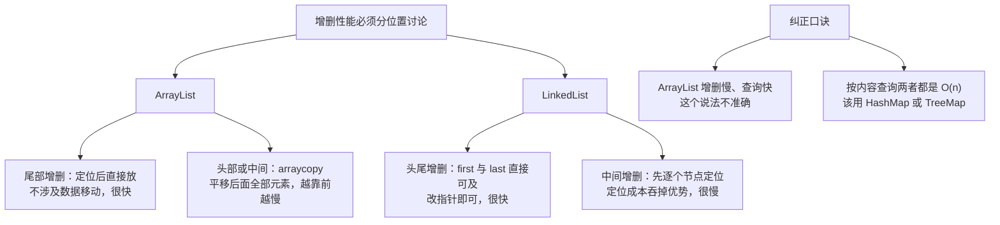

# LinkedList 与 ArrayList：增删性能比较

初学阶段大家都听过一句口诀：ArrayList 增删慢、查询快，LinkedList 增删快、查询慢。这句话读起来朗朗上口，方便记忆，但它并不准确。学完这一篇，就不要再这样说了。增删的快慢要分位置讨论，而「查询快」本身就用错了词。

## 先给结论

准确的说法是：ArrayList 的尾部增删性能没有问题，与 LinkedList 相当；只有头部与中间位置的增删会牵扯数组元素复制，性能随位置前移而下降。LinkedList 只有头尾增删快，中间增删因为要先逐个节点定位，性能很差。实测 1000 个元素下：头部插入 LinkedList 约 2100 纳秒、ArrayList 约 4300 纳秒；尾部插入 ArrayList 约 1000 纳秒、LinkedList 约 1200 纳秒，两者伯仲之间；中间插入 ArrayList 约 2300 纳秒、LinkedList 约 12000 纳秒，相差近六倍。



## 是什么

先纠正「查询」这个词。查询指的是按元素内容到集合中查找，看有没有想要的元素；而常说的「快」其实指随机访问，即随便根据索引挑一个。按内容查找时，ArrayList 与 LinkedList 的时间复杂度一样，都是 O(n)，谁都不适合做查询。真要查询，应该选择 HashMap、TreeMap 这类以哈希表、红黑树为底层的数据结构。

增删则必须分位置。同一个集合，在头部、中间、尾部增删的成本完全不同，笼统说「增删快慢」没有意义。

## 为什么

先看 ArrayList。数组已有若干元素，往尾部追加时，按索引定位到末尾位置，把新元素放进去即可，不涉及任何数据移动，速度相当快。往头部插入则不同：要把原有元素整体向后复制，平移之后索引 0 空出来，新元素放入，这个过程是一次 arraycopy 数据移动，性能受影响。越靠近头部，需要复制的元素越多，影响越明显。中间插入同理，也要移动插入点之后的全部元素。若数组容量已满，还会触发扩容复制，但那是扩容流程，不计入常规增删成本。

再看 LinkedList。头尾增删确实快，因为 first 与 last 指针直接可及，改指针即可完成。但中间增删要先定位：必须从一端顺着 next 指针逐个找到中间位置的元素，这个移动指针的过程非常慢。定位完成后的插入删除本身很快，改几个指针就完成了，但定位成本吞掉了所有优势。

## 深入细节

用代码实测三种场景。三个测试方法分别往头部、尾部、中间位置插入元素，用 StopWatch 计时。头部插入的测试写法如下：

```java
// 测试头部插入
private static void addFirst(List<Integer> list1, LinkedList<Integer> list2) {
    Stopwatch sw = new Stopwatch();
    sw.start("ArrayList");
    list1.add(0, element: 100);
    sw.stop();
    sw.start("LinkedList");
    list2.addFirst(100);
    sw.stop();
    System.out.println(sw.prettyPrint());
}
```

按课程原稿逐字收录，`list1.add(0, element: 100)` 一行的 `element:` 是稿件中 IDE 参数名提示的原有形态。

三组结果：

- 头部插入：LinkedList 约 2100 纳秒，ArrayList 约 4300 纳秒，LinkedList 快约一倍，头部插入它有明显优势。
- 尾部插入：ArrayList 约 1000 纳秒，LinkedList 约 1200 纳秒。尾部有空位时数组直接定位写入，不做任何移动，两者互有胜负、性能伯仲。
- 中间插入：ArrayList 约 2300 纳秒，LinkedList 约 12000 纳秒，相差近六倍。LinkedList 的定位成本在这里完全暴露。

这组数据解释了实际开发中的选型惯性：大家几乎都用 ArrayList 而不用 LinkedList。平均性能上，除了头部插入，ArrayList 各个方面都不输甚至优于 LinkedList；而头部插入的场景本就少见。随机访问的优势前面已经量化过，再加上尾部增删不弱、中间增删反超，LinkedList 的适用面被压缩得只剩「频繁头尾增删」这一小块。

## 面试怎么答

被问到两者增删性能，可以这样答：那句「ArrayList 增删慢、LinkedList 增删快」的口诀不准确，要分位置讨论。ArrayList 尾部增删没有问题，直接定位写入不移动数据；只有头部和中间增删会触发 arraycopy 元素复制，越靠近头部移动越多、越慢。LinkedList 只有头尾增删快，中间增删要先顺着 next 逐个节点定位，这个定位过程很慢。我用 1000 个元素实测：头部插入 LinkedList 约 2100 纳秒、ArrayList 约 4300 纳秒；尾部插入两者约 1000 与 1200 纳秒，基本持平；中间插入 ArrayList 约 2300 纳秒、LinkedList 约 12000 纳秒。另外「查询快」的说法也不准确，按内容查找两者都是 O(n)，要查询应该用 HashMap 这类结构。综合来看实际开发优先选 ArrayList。

## 常见误区

误区一：复述「ArrayList 增删慢、LinkedList 增删快」。不区分位置的口诀是错的，尾部增删两者相当，中间增删 LinkedList 反而慢近六倍。

误区二：把「随机访问快」说成「查询快」。随机访问是根据索引直达，查询是根据内容遍历，按内容查找两者都是 O(n)。

误区三：以为 LinkedList 改指针快就处处快。快的前提是已经定位，中间位置的定位成本是 O(n)，吞掉了指针操作的优势。
