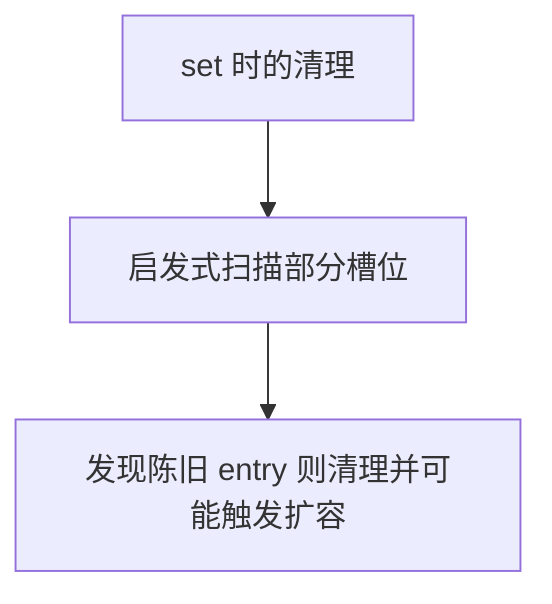

# value 的内存释放时机：set 时

上一篇讲了 value 释放的第一种时机：get 时发现 key 已为 null，顺手清理该条目的 value。本篇讲第二种：**set 操作会触发启发式扫描，把目标位置附近相邻的 null key 条目的 value 一并清理**。清理范围有限，离得远的过期条目管不到，这是 ThreadLocalMap 清理策略中有意为之的折中。

## 先给结论

执行 set 时，ThreadLocalMap 先定位目标索引，发现该位置 key 为 null 就顺手清理其 value，同时以该位置为中心向邻近位置做启发式扫描，把相邻的 null key 条目的 value 一并释放。扫描次数不固定，与两个因素有关：当前元素个数越多，扫描范围越大；扫描过程中是否发现 null key，发现了就多扫几次。离目标位置远的过期条目不在清理范围内，仍然残留。

## 是什么

先设定初始场景。ThreadLocalMap 中有四组键值 A、B、C、D，故意让 A、B、C 彼此紧挨，D 离得较远，中间隔着几个空位。模拟一次垃圾回收，假设外部没有任何地方引用这四个 ThreadLocal，作为弱引用的 key 会全部被回收，但 value 都保留着，内存未释放。

此时执行一次 set 操作，放入一个新的 key E，E 的索引是 8。set 先定位到索引 8，发现这个位置的 key 已经是 null，判定该条目已过期，顺手把它的 value 清理。不仅如此，它还会清理与之邻近的 null key：演示中索引 9、10 位置的两个过期 value 也被释放。但索引 14 那个离得远的 D 的 value 没有释放，因为清理只针对邻近的 null key，离得太远的不处理。

## 为什么

为什么是「清理邻近」而不是「全部清理」或「不清理」？这背后是一对矛盾的权衡。

一个极端是根本不清理：set 只负责写入，不管历史垃圾。结果是 map 中过期的 value 越积越多，内存泄漏加剧。

另一个极端是每次 set 都把整个数组扫一遍，逐个清理过期 value。垃圾是清得干净，但每次 set 都要付出 O(数组长度) 的成本，效率太低。

启发式扫描是这两个极端之间的折中：不会不清理，也不会全量清理，只清理目标位置邻近的 null key。它假设过期条目在空间上有聚集性，邻近清理能以较小成本覆盖大部分垃圾。

扫描几次不固定，受两个因素影响。其一与元素个数有关：元素多时扫描范围大一些，元素少时范围小一些。其二与是否发现 null key 有关：扫描过程中发现了 null key，就多扫几次，因为发现了垃圾说明附近可能还有；一直没发现，就少扫几次，及时收手。

## 深入细节

把三种清理时机放在一起看，层级关系更清楚。get 时的清理是点状的：命中哪个过期条目就清哪个。set 时是带状的：以目标位置为中心，向邻近范围做有限扫描。remove 时是直接的：主动删除条目，从源头消除隐患。前两种都是被动发现，即 key 已被 GC 回收、代码恰好访问到附近才触发；只有 remove 是使用者主动为之。

这个层级决定了使用建议。ThreadLocal 通常作为静态变量存在，静态变量的生命周期与类加载器绑定，GC 无法回收它，只要类不卸载，key 就一直可达，弱引用的兜底形同虚设。此时 get 与 set 的被动清理又要求代码继续访问这个 ThreadLocal，一旦线程池中的线程复用时不再碰这个 ThreadLocal，过期的 value 就会永久驻留。因此官方推荐的做法始终是：使用完 ThreadLocal 后主动调用 remove，不要依赖被动清理。

## 面试怎么答

被问到 value 释放的第二种时机，可以这样答：set 时会触发启发式扫描。set 定位到目标索引后，如果发现该位置 key 为 null，说明条目已过期，会顺手清理它的 value，同时向邻近位置扫描，把相邻的 null key 条目的 value 一并清理。扫描范围是折中策略：不清理会垃圾堆积，全量扫描又太低效，所以只扫邻近。扫描次数与元素个数和是否发现 null key 有关，元素多、发现了 null key 就多扫几次。离得远的过期 value 不在清理范围。set 清理仍是被动触发，ThreadLocal 作为静态变量时 GC 收不回 key，所以规范做法是用完主动 remove。

## 常见误区

误区一：以为 set 会清理所有过期 value。只清理目标位置及邻近范围，离得远的过期条目依然残留。

误区二：以为扫描次数固定。它由元素个数与是否发现 null key 动态决定，不是固定步数。

误区三：以为有 set 清理就不需要 remove。set 清理是被动的、要求代码继续访问该 ThreadLocal；静态 ThreadLocal 的 key 连 GC 都回收不了，主动 remove 才是可靠解法。
