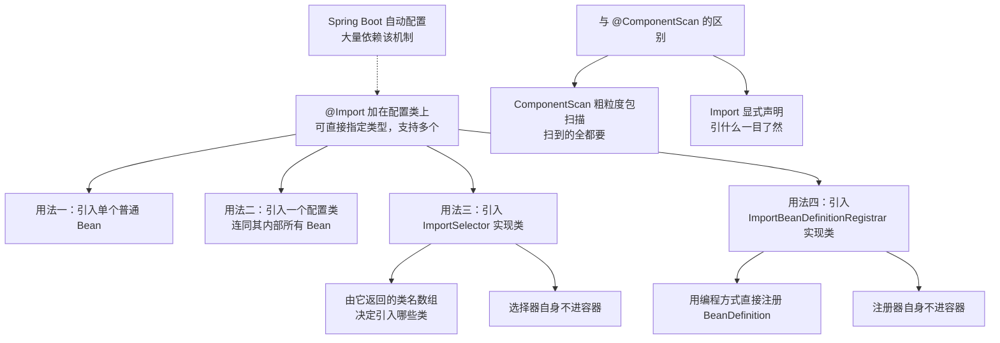

# @Import 注解的四种用法

@Import 的作用与 @ComponentScan 类似，都是把类型交给 Spring 容器管理。区别在于方式：@ComponentScan 扫描包，把包内标注了特定注解的类纳入管理；@Import 直接指定类型，把这个类型本身、或根据这个类型找到的其他类纳入管理。@Import 一共有四种用法，外加一个变体，本篇逐一过一遍。

## 先给结论

@Import 加在配置类上，后面跟着要引入容器的类型，支持一次引多个。四种用法分别是：引入单个普通 Bean；引入一个配置类，连同它内部定义的所有 Bean 一起引入；引入一个 ImportSelector 实现类，由它返回的类名数组决定引入哪些类，选择器自身不进容器；引入一个 ImportBeanDefinitionRegistrar 实现类，用编程方式直接注册 BeanDefinition，注册器自身不进容器。此外 DeferredImportSelector 是 ImportSelector 的子接口，用法相同但导入时机被推迟。



## 是什么

@Import 的价值在「精确」。@ComponentScan 是粗粒度的包扫描，扫到的全都要；@Import 是显式声明，引什么、引几个，一目了然。Spring Boot 的自动配置大量依赖 @Import 及其选择器机制，这就是为什么它值得单独掌握。

## 为什么

先说用法一，引入单个 Bean。@Import 加在配置类上，后面写要引入的 Bean 类型：

```java
@Configuration
@Import(MyConfig.class)
public class TestImport {
    // ...
}
```

把配置类注册进容器，refresh 之后查看容器中的 BeanDefinition，除了各类 Bean 工厂与后处理器、自己注册的配置类之外，通过 @Import 引入的 bean1 也在其中。注意单个 Bean 引入时，它在容器中的名字是全限定类名，即完整包名加类名。

用法二，引入一个配置类。引入配置类与引入普通 Bean 不同：它相当于把配置类自身连同其中定义的所有 Bean 全部引入。演示中新建一个 OtherConfig，内部定义一个 bean2，@Import 引入 OtherConfig 后，容器中除了原有配置类，多出 OtherConfig 自身以及它定义的 bean2。这提供了一种组合配置的能力：多个配置类可以像积木一样拼装。

## 深入细节

用法三，引入 ImportSelector 实现类。写一个类实现 ImportSelector 接口，按约定类名以 Selector 结尾：

```java
public class MySelector implements ImportSelector {
    @Override
    public String[] selectImports(AnnotationMetadata importingClassMetadata) {
        return new String[]{Bean3.class.getName(), Bean4.class.getName()};
    }
}
```

按课程原稿逐字收录。这个接口要求实现 `selectImports` 方法，返回一个字符串数组，数组元素是要引入的 Bean 的名字，必须是全限定类名，因此用 `Bean3.class.getName()` 获取。@Import 引入 MySelector 时，Spring 调用该方法拿到 bean3、bean4 两个名字，把它们注册进容器。有一个关键细节：**选择器自身不会加入容器**。运行结果中有 myConfig、bean3、bean4，但没有 MySelector。它只是一个选择器，不是 Bean。

用法四，引入 ImportBeanDefinitionRegistrar 实现类：

```java
public class MyRegistrar implements ImportBeanDefinitionRegistrar {
    @Override
    public void registerBeanDefinitions(AnnotationMetadata importingClassMetadata, BeanDefinitionRegistry registry) {
        registry.registerBeanDefinition("bean5", BeanDefinitionBuilder.genericBeanDefinition(Bean5.class).getBeanDefinition());
    }
}
```

按课程原稿逐字收录。这个接口要求实现 `registerBeanDefinitions` 方法，参数中的 registry 实际上就是 BeanFactory。通过它可以直接注册新的 BeanDefinition，用 `BeanDefinitionBuilder` 创建定义对象，指定 Bean 类型，再给一个 Bean 名字。BeanDefinition 可以详细定制 Bean 的各种信息，包括是否多例、初始化方法、销毁方法，属于高级用法。注册结果才会进容器：运行结果中通过 @Import 注册了 bean5，但 MyRegistrar 自身不在容器中。注册一个类就引入一个类，注册多个就引入多个。

最后是 DeferredImportSelector 变体：

```java
public class MySelector implements DeferredImportSelector {
    @Override
    public String selectImports(AnnotationMetadata importingClassMetadata) {
        return new String[]{Bean3.class.getName(), Bean4.class.getName()};
    }
}
```

按课程原稿逐字收录。它与 ImportSelector 接口形态几乎一致，只是把实现的接口换掉，导入结果看不出区别，bean3、bean4 同样被注册。但 Deferred 意为推迟，它会推迟 @Import 的时机，具体时机与特殊用法由下一篇展开。

四种用法回顾：引入单个 Bean，可以是任意 Bean；引入配置类，连同配置类及其内嵌的 BeanDefinition 一起加入；通过 ImportSelector 引入多个类，以方法返回的类名为准；通过 ImportBeanDefinitionRegistrar 以编程方式注册新的 BeanDefinition。后两种的实现类自身都不进容器，进容器的只是它们的选择结果与注册结果。

## 面试怎么答

被问到 @Import 的用法，可以这样答：@Import 加在配置类上，用于把类型显式引入容器，作用与 @ComponentScan 类似但更精确。有四种用法：第一，直接引入一个普通 Bean，此时 Bean 在容器中的名字是全限定类名；第二，引入一个配置类，会连同配置类自身及其中定义的所有 Bean 一起引入；第三，引入 ImportSelector 的实现类，实现 selectImports 方法返回要引入的类名字符串数组，Spring 按数组注册类，选择器自身不进容器；第四，引入 ImportBeanDefinitionRegistrar 的实现类，实现 registerBeanDefinitions 方法，通过 BeanDefinitionRegistry 以编程方式注册 BeanDefinition，注册器自身也不进容器。另外 DeferredImportSelector 是 ImportSelector 的子接口，用法相同但会推迟导入时机，Spring Boot 的自动配置用到它。

## 常见误区

误区一：以为选择器与注册器自身也是 Bean。它们只是工具，容器中的是它们返回的类名与注册的 BeanDefinition，实现类自身不进容器。

误区三：以为 ImportSelector 返回的类名可以简写。必须是全限定类名，通常用 `Xxx.class.getName()` 获取。

误区四：以为引入普通 Bean 与引入配置类效果相同。引入配置类会递归展开它内部的所有 @Bean，引入普通 Bean 只是把这一个类加进来。
