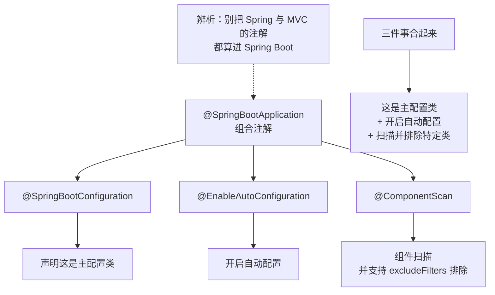

# @SpringBootApplication 注解的组合结构

Spring Boot 自动配置的核心原理，落到一个注解上：@SpringBootApplication。理解它是理解整个自动配置体系的入口。它不是单一功能的注解，而是三个注解的组合，把三个组成部分拆清楚，自动配置的地图就成形了大半。

## 先给结论

@SpringBootApplication 是三个注解的组合：@SpringBootConfiguration、@EnableAutoConfiguration 与 @ComponentScan。前两者本篇展开，@ComponentScan 重点讲它新增的 excludeFilters 排除机制。三者合起来覆盖了「这是主配置类」「开启自动配置」「组件扫描并排除特定类」三件事。



## 是什么

先看注解定义，三个组成部分一目了然：

```java
@Target(ElementType.TYPE)
@Retention(RetentionPolicy.RUNTIME)
@Documented
@Inherited
@SpringBootConfiguration
@EnableAutoConfiguration
@ComponentScan(excludeFilters = {@Filter(type = FilterType.CUSTOM, classes = TypeExcludeFilter.class)})
public @interface SpringBootApplication {
}
```

按课程原稿逐字收录。@SpringBootApplication 的功能就是这三个注解功能的组合。

第一个组成是 @SpringBootConfiguration。它标在类上，表示这是一个 Spring Boot 的配置类，本质上与普通 @Configuration 等价，看它的定义就能发现它身上也标注了 @Configuration，功能完全等同。区别在数量：普通 @Configuration 标注的类在一个程序里可以有多个，而 @SpringBootConfiguration 对应的类整个应用只应有一个，因为 Spring Boot 要根据它来判定主配置类，再根据主配置类找到应用的入口。它的文档也明确写了，应用应该只包含一个标注 @SpringBootConfiguration 的类。

第三个组成是 @ComponentScan，作用是组件扫描，被扫描的类上可以标注 @Component、@Controller、@Service、@Repository，也可以是 @Configuration，都是老熟人。@ComponentScan 自身的定义形态如下：

```java
@Target(ElementType.TYPE)
@Retention(RetentionPolicy.RUNTIME)
@Documented
@Inherited
@AliasFor(annotation = EnableAutoConfiguration.class)
public @interface ComponentScan {
    @AliasFor(annotation = EnableAutoConfiguration.class)
    Class<?>[] exclude() default {};
}
```

按课程原稿逐字收录。本篇的新知识点在它身上的 excludeFilters，即排除过滤器。

## 为什么

excludeFilters 解决的是「扫描范围里混进了不该扫的类」问题。默认情况下 @ComponentScan 会把指定包下符合条件的类全部纳入，但有些类必须在扫描时排除掉。演示场景：主配置类只扫描 day04.boot.sub 包，包下有 Bean1 与 Bean2，都标注了 @Component，不加过滤器时两个都会被扫进容器，最终容器中出现主配置类自身以及 Bean1、Bean2。

要排除 Bean1，第一步是写一个过滤器。实现 TypeExcludeFilter 接口，实现 match 方法判断一个类该排除还是保留，返回 true 表示过滤掉，返回 false 表示保留：

```java
public class MyFilter extends TypeExcludeFilter {
    @Override
    public boolean match(MetadataReader metadataReader, MetadataReaderFactory metadataReaderFactory) throws IOException {
        String className = metadataReader.getClassMetadata().getClassName();
        LoggerUtils.get().debug("{}", className);
        if (className.equals(Bean1.class.getName())) {
            return true;
        }
        return false;
    }
}
```

按课程原稿逐字收录。match 方法的参数 MetadataReader 能在扫描过程中提供当前类的元数据，包括类信息与类上的注解信息。演示逻辑很简单：拿到类名打印日志，类名是 Bean1 就返回 true 排除，其余返回 false 保留。

但光把过滤器类注册进容器还不够，它不会被调用，扫描结果仍是 Bean1、Bean2 都在。要让它生效，必须像 @SpringBootApplication 里那样在 @ComponentScan 上显式声明 excludeFilters：

```java
@ComponentScan(basePackages = {"day04.boot.sub"},
    excludeFilters = {@ComponentScan.Filter(type = FilterType.CUSTOM, classes = MyFilter.class)})
```

加上之后，每次扫描到类都会调用 match 方法，日志中能看到 Bean1 与 Bean2 都被检查过，但最终容器里只保留 Bean2，Bean1 因返回 true 被过滤掉。

## 深入细节

excludeFilters 的机制是：读取容器中所有实现了 TypeExcludeFilter 接口的过滤器，扫描过程中逐个调用它们的 match 方法，按返回值决定去留，返回 true 排除，返回 false 保留。这给了开发者在扫描阶段精确控制类去留的能力。

@SpringBootApplication 的 @ComponentScan 上挂的是 Spring Boot 内置的 TypeExcludeFilter，这是框架预留的扩展点。它身上的 excludeFilters 用了两个过滤器，第二个过滤器排除的是 Spring Boot 自身的自动配置类。为什么要排除它们？因为自动配置类不是通过组件扫描纳入容器的，而是稍后通过 @EnableAutoConfiguration 中的 @Import 方式导入。如果在组件扫描阶段不小心扫到了 Spring Boot 的包，把自动配置类扫进来，加载路径就与设计不符，可能引发冲突。第二个过滤器专门排除这些类，保证自动配置只走 @Import 这一条路。

这里把三个组成部分的分工再明确一次：@SpringBootConfiguration 标明这是唯一的主配置类；@ComponentScan 负责把自己写的组件扫进来，同时用 excludeFilters 挡住不该扫的类；@EnableAutoConfiguration 负责把 Spring Boot 的自动配置类引进来，这是下一篇的主题，涉及 @Import(AutoConfigurationImportSelector) 加载 META-INF/spring.factories 中定义的自动配置类。

## 面试怎么答

被问到 @SpringBootApplication，可以这样答：它是三个注解的组合。@SpringBootConfiguration 表明这是主配置类，功能与 @Configuration 等价，区别是它标注的类整个应用只有一个，Spring Boot 靠它定位应用入口。@ComponentScan 做组件扫描，且带有 excludeFilters，内置 TypeExcludeFilter 用于排除特定类，另一个过滤器排除 Spring Boot 自身的自动配置类，因为那些类要走 @Import 导入而不是组件扫描。@EnableAutoConfiguration 开启自动配置，通过 @Import(AutoConfigurationImportSelector) 加载 spring.factories 中的自动配置类。排除过滤器的机制是：实现 TypeExcludeFilter 接口写 match 方法，返回 true 排除，并在 @ComponentScan 的 excludeFilters 中声明，过滤器才会生效。

## 常见误区

误区一：以为写了 TypeExcludeFilter 实现就会自动生效。必须在 @ComponentScan 的 excludeFilters 中显式声明，否则 match 方法根本不会被调用。

误区二：以为 @SpringBootConfiguration 与 @Configuration 只是名字不同。数量约束不同，一个应用只应有一个 @SpringBootConfiguration，它是主配置类的判定依据。

误区三：以为自动配置类靠组件扫描加载。它们由 @EnableAutoConfiguration 经 @Import 导入，组件扫描阶段的排除过滤器专门负责把它们挡在外面。
