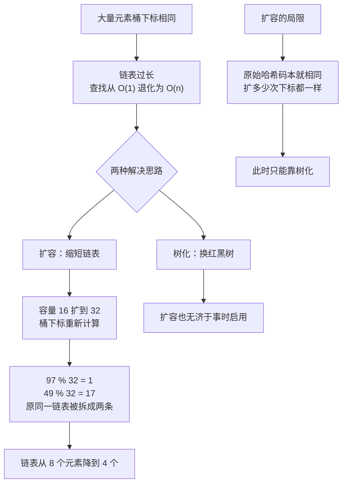

# 链表过长的解决：扩容

哈希表的最大优点是快速查找：算哈希码得桶下标，少量几次比较就能定位元素，最优只需一次。但如果大量元素的桶下标相同，这个优势就消失了。本篇讲第一种解决思路：扩容。先构造极端场景，再看扩容如何缩短链表，以及它的局限。

## 先给结论

链表过长会让查找从 O(1) 退化为 O(n)。两种解决思路：缩减链表长度，或用红黑树。缩减链表长度的手段之一是扩容：容量从 16 扩到 32，桶下标重新计算，原先挤在同一下标的元素按新容量取模后分散到不同下标，链表因此缩短。但扩容有局限：如果元素原始哈希码本来就相同，扩容再多次下标仍然相同，链表长度不变，这时只能靠红黑树化。



## 是什么

先复现问题。把模拟器的表清空重建，放入四个元素 1、2、3、4。正常情况它们的桶下标不同，但模拟器可以人为把哈希码固定成相同值，比如都固定成 97。哈希码相同，算出的桶下标自然相同，四个元素全部挤在索引 1。再放入 5、6、7、8，哈希码固定成 49，49 对 16 求模也是 1，同样落在索引 1。此时索引 1 上挂着一条八元素链表。

要找元素 8，只能从链表头逐个比较，最坏要比较 8 次。时间复杂度从理想的 O(1) 退化成 O(n)，查询性能明显下降。

## 为什么

提升性能有两条路：缩短链表，或用红黑树。先看扩容如何缩短链表。

容量为 16 时，元素个数达到容量的四分之三即 12 时触发扩容，第 13 个元素放入即扩容。演示中继续放入 9、10、11、12，它们的下标算出来是 5，放到另一条链表。此时共 12 个元素，放入第 13 个，扩容触发。

扩容后可以看到链表长度缩短了：索引 1 上的链表从 8 个元素变成 4 个。原因是桶下标重新计算。扩容前容量是 16，97 与 49 都对 16 取模，下标都是 1。扩容后容量变成 32，97 对 32 取模下标仍是 1，而 49 对 32 取模下标变成 17。两组元素被分到不同下标，链表各挂 4 个元素，比较次数随之减半。

扩容的触发条件与实现：

```java
if (size >= threshold) {
    resize();
}
```

```java
private void resize() {
    int newCapacity = capacity * 2;
    Node[] newTable = new Node[newCapacity];
    // 重新计算所有键的索引并重新分配
    for (Node node : table) {
        while (node != null) {
            Node next = node.next;
            int newIndex = hash(node.key) & (newCapacity - 1);
            node.next = newTable[newIndex];
            newTable[newIndex] = node;
            node = next;
        }
    }
    table = newTable;
    capacity = newCapacity;
    threshold = (int) (newCapacity * loadFactor);
}
```

两个代码块按课程原稿逐字收录。size 达到 threshold 触发 resize，容量翻倍，遍历旧表每个节点重新计算下标，用头插法挂到新表对应位置，最后更新 capacity 与 threshold。

## 深入细节

扩容并非万能。构造另一个极端场景：放入 1 到 8 共 8 个元素，人为把它们的哈希码全部固定为相同值。继续放 9、10、11、12，放到另一侧，哈希码固定成另一个相同值。到第 13 个元素时扩容触发，但链表长度没有缩短。因为这一组 8 个元素的原始哈希码完全一样，无论容量扩到多少，它们对新容量取模的结果仍然相同，下标永远一致，扩容无法把它们分散开。

这种情况下只能走第二条路：红黑树化。把过长的链表转成红黑树，桶内查找从 O(n) 降为 O(log n)。树化的具体条件与阈值是下一篇的主题。

两条思路的分工由此清晰：扩容解决「因容量不足导致的聚集」，对分布性冲突有效；树化解决「因哈希值本身相同导致的冲突」，对扩容无效的极端场景兜底。实际中绝大多数冲突是前者，扩容是常规手段；树化兜底后者，保证任何情况下查找都有对数级上限。

## 面试怎么答

被问到链表过长怎么办，可以这样答：有两种思路。第一种是扩容，容量从 16 扩到 32 时所有桶下标重新计算，原先冲突的元素按新容量取模后分散到不同下标，链表缩短，比如 97 和 49 对 16 取模都是 1，对 32 取模分别是 1 和 17，链表就从 8 个元素分成两个 4 个。扩容阈值是容量的 0.75 倍，即 16 的 12 个，第 13 个触发。但扩容有局限，如果多个元素的哈希码本来就相同，扩容再多次下标还是一样，链表长度不变。这时走第二种思路，红黑树化，把链表转成红黑树，桶内查找变为 O(log n)。所以扩容解决分布性冲突，树化对哈希值相同的极端场景兜底。

## 常见误区

误区一：以为扩容总能缩短链表。只对「不同哈希值恰好冲突」有效，哈希值本身相同的元素，扩到任何容量下标都相同。

误区二：以为扩容阈值是容量本身。阈值是容量乘负载因子，16 的阈值是 12，第 13 个元素才触发扩容。

误区三：以为链表过长只能靠树化。扩容是第一道手段，树化是兜底，两者分工不同，树化前先用扩容争取把链表压到阈值以下。
