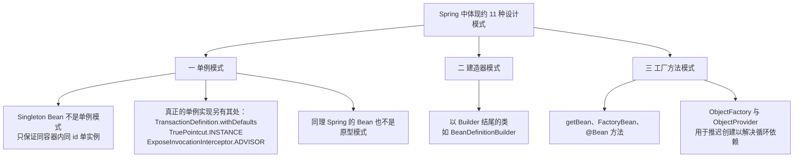

# Spring 中的设计模式：单例、建造器、工厂方法

面试常问「Spring 中实现了哪些设计模式」。这个问题的难点不在列举，在区分：Spring 里名字带 Singleton 的东西不一定是单例模式，名字带工厂的东西未必是同一种工厂。这一系列共讲 11 种，前三篇是单例模式、建造器模式与工厂方法模式，其中前两个的辨析味道最浓。

## 先给结论

Spring 中能体现出约 11 种设计模式，都是 23 种经典模式在 Spring 里的落地。前三类的关键结论：Spring 的 Singleton Bean 不是单例模式，它只保证同一容器内相同 id 的 Bean 单实例，单例模式本身在 Spring 中另有实现；BeanDefinitionBuilder 等地道的 Builder 结尾类是建造器模式；getBean、FactoryBean、@Bean 方法以及 ObjectFactory、ObjectProvider 都体现工厂方法模式，其中后两者专门用于推迟创建以解决循环依赖。

## 是什么

先看单例模式。单例模式的原始定义是：确保一个类只有一个实例，并且提供一个全局的访问点。Spring 的 Singleton Bean 是否符合这个定义？不符合。一个 Spring 容器里，同一个类型可以定义多个实例，只要这些 Bean 的 id 不同，就可以同时存在多个。仅「一个类只有一个实例」这半句就被否定了。而且 Spring 允许多个容器，同一 个类在不同容器中也可以有不同实例。所以 Singleton Bean 只能保证每个 Spring 容器内相同 id 的 Bean 是单实例，它不是单例模式。

Spring 中确实有真正的单例模式实现，只是不在 Singleton Bean 上，比如这几个地方：TransactionDefinition 的 withDefaults、TruePointcut 的 INSTANCE、ExposeInvocationInterceptor 的 ADVISOR。同理，Spring 中的 Bean 也不是原型模式。这一条的答法要点是：单例模式在 Spring 中有体现，但绝不是 Singleton Bean，两者不能混淆。

## 为什么

第二种是建造器模式。它用于对象的建造过程比较复杂的场景，把构建器与对象分离开：构建器负责创建前的准备，最后调用 build 方法创建最终产品。它的亮点有三个：构建过程灵活；不执行 build 方法前产品对象不可用；构建过程一般采用方法的链式调用，写起来流畅。

Spring 中体现建造器模式的地方，辨识方法很实用：看源码时如果类名以 Builder 结尾，一般都可以认为它实现了建造器模式，对照定义去验证即可。典型的有 BeanDefinitionBuilder、UriComponentsBuilder、ResponseEntity 的 HeadersBuilder 与 BodyBuilder。

第三种是工厂方法模式。抛开定义，它的核心是让接口与实现分离，降低耦合。Spring 中最典型的体现是 ApplicationContext 与 BeanFactory 的 getBean 方法：getBean 隐藏了最终产品的创建过程与具体实现，你 get 一个接口，具体是哪个实现由配置文件或配置类决定，怎么构建的也不用关心，调用方完全无感。getBean 方法体现了工厂方法模式。

## 深入细节

Spring 中的工厂不止 getBean 一种，按职责分两组。第一组封装第三方 Bean 的创建过程，包括 FactoryBean 与 @Bean 标注的方法，后者即前面讲过的静态工厂方法与实例工厂方法。第二组用于推迟 Bean 创建，包括 ObjectFactory 与 ObjectProvider，注入时先注入工厂本身，不提前创建产品，目的是解决循环依赖以及单例注入到多例的问题。

两组的分工值得记住：前者回答「怎么造」，把复杂创建藏起来；后者回答「什么时候造」，把创建时机交出去。循环依赖问题之所以能解，关键就在于第二组工厂提供的延迟能力。

设计模式系列本篇先讲这三种，后续篇目继续展开其余八种。回答这类面试题的结构建议：先给总数约 11 种，再分类说，每个模式点明 Spring 中的具体落地点，对有辨析价值的地方主动澄清误区，比如 Singleton Bean 与单例模式的关系，这是加分项。

## 面试怎么答

被问到 Spring 中的设计模式，可以这样答：Spring 中大约体现了 11 种设计模式。举几个有代表性的：工厂方法模式，最典型的是 ApplicationContext 与 BeanFactory 的 getBean，它隐藏了产品创建过程与具体实现，让接口与实现分离；FactoryBean 和 @Bean 方法也是工厂方法的体现，前者封装第三方 Bean 创建，后者分静态与实例工厂方法。建造器模式，如 BeanDefinitionBuilder，类名以 Builder 结尾的类一般都可对照建造器模式定义去验证，特点是链式调用、build 之前产品不可用。还有单例模式要澄清：Spring 的 Singleton Bean 不是单例模式，它只保证同一容器内相同 id 的 Bean 单实例，同一类型可以有多个不同 id 的实例，多个容器间也不共享；真正的单例模式在 Spring 中另有实现，比如 TruePointcut 的 INSTANCE。另外 ObjectFactory 与 ObjectProvider 是工厂的另一种形态，用于推迟 Bean 创建，解决循环依赖与单例注入多例的问题。

## 常见误区

误区一：把 Singleton Bean 当成单例模式。它只保证容器内相同 id 单实例，一个类可以有多个不同 id 实例，多个容器也不共享，与单例模式定义不符。

误区二：把 Spring 中的 Bean 当成原型模式。同理，原型模式在 Spring 中的体现另有其处，不在普通 Bean 语义里。

误区三：以为 Spring 的工厂只有一种。封装创建的 FactoryBean、@Bean 与推迟创建的 ObjectFactory、ObjectProvider 是两组不同职责的工厂，后者专治循环依赖。
