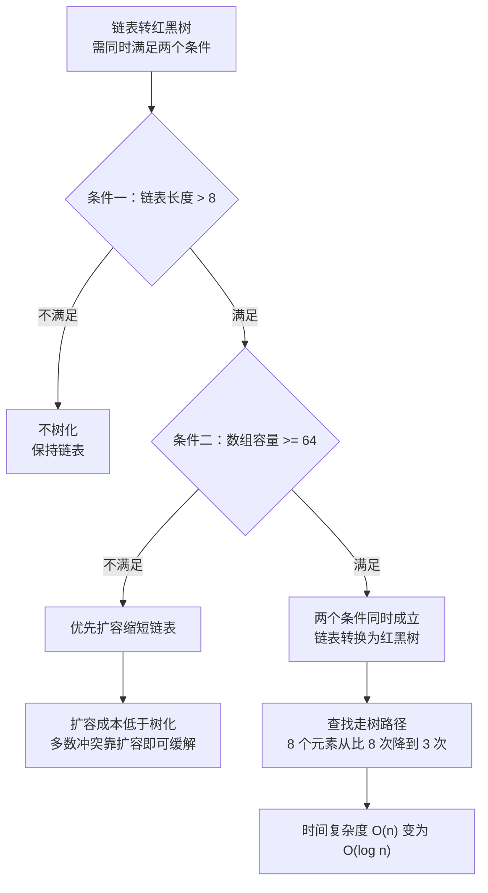

# 链表过长的解决：树化

上一篇讲了第一种思路扩容，以及它的局限：元素原始哈希码相同时，扩多少次链表都不缩短。这时启动第二种思路，树化。树化不是满足一个条件就触发，它有两个前提，且扩容永远排在树化前面尝试。

## 先给结论

链表转红黑树需要同时满足两个条件：链表长度超过树化阈值，阈值是常量 8，即元素个数大于 8；数组容量大于等于 64。容量不达标时优先扩容来缩短链表，不会树化。树化是万不得已的手段。树化后查找从链表逐个比对变为走树路径，找 8 个元素中的目标从 8 次比较降为 3 次，时间复杂度从 O(n) 变为 O(log n)。

## 是什么

两个条件的具体内容。条件一，链表长度必须超过树化阈值，阈值固定为 8，即链表元素个数大于 8 才尝试树化，小于等于 8 不考虑。条件二，数组容量必须大于等于 64，容量不够时先尝试用扩容减少链表长度。

为什么容量不够时先扩容？因为扩容成本低于树化，且多数冲突靠扩容就能缓解。树化一定是在扩容也无济于事时才动用的手段。

## 为什么

构造场景验证。已有 8 个元素 1 到 8 挂在索引 1，哈希码固定为 97。现在再 put 一个 a，人为让它的哈希值不同。此时索引 1 上会有 9 个元素，链表长度超过 8，条件一满足。但不会树化，因为容量还没到 64。实际发生的是扩容：容量扩到 64，1 到 8 的桶下标重新计算变成 33，移到新位置，而 a 的下标仍是 1。扩容已经把链表长度降下来了，系统判定没必要树化。

再 put 一个 b，哈希码固定成 97。97 在容量 64 下算出的下标是 33，与 1 到 8 相同。此时条件二满足，容量已到 64；加上 b 后链表长度 9，超过 8，条件一也满足。两个条件同时成立，链表转换为红黑树。

## 深入细节

看这棵红黑树的结构。红黑树的特性是每个节点左侧的元素都比它小，右侧都比它大，且规则递归适用于各个子节点。以演示结果为例：根节点 4，左侧 2 比它小，右侧 6 比它大；2 的左侧 1 比它小，右侧 3 比它大；6 的左侧 5 比它小，右侧 8 比它大；8 的左侧 7 比它小，右侧是新加入的 b，因为按字符串比较时 b 大于 8。整棵树满足左小右大的有序性。

比较规则补充一句：先按哈希码比较，哈希码相等的才按 key 的字符串值比较。这个规则在面试中会被追问。

树化后的性能提升可以数出来。在 9 个元素中找 8：链表要逐个比 8 次；红黑树先与根 4 比，8 大于 4 走右侧；再与 6 比，8 大于 6 走右侧，左侧的 5 不用看；再与 8 比，命中。三次比较。链表搜索的时间复杂度是 O(n)，红黑树是 O(log n)，效率提升显著。

最后用一组追问巩固理解。放入 1 到 8，哈希码固定 97，再加 9，哈希码同样 97，会树化吗？不会，容量不够 64，先扩容。加 10 呢？也不会，容量仍未到 64，继续扩容。注意此时链表长度已经 10，超过了阈值 8，但没树化，因为第二个条件不满足。加到第 11 个时，容量到达 64，两个条件同时满足，才树化。最终树中有 11 个元素，因为按字符串排序，10 和 11 都排在左侧。这个例子说明：链表长度完全可能超过 8 而不树化，阈值只是必要条件，容量是另一个必要条件。

## 面试怎么答

被问到树化，可以这样答：链表转红黑树有两个条件，必须同时满足。第一，链表长度超过树化阈值，阈值固定是 8，即元素个数大于 8；第二，数组容量大于等于 64。容量不满足时优先扩容，不会树化，因为扩容成本更低。树化后桶内查找从 O(n) 降为 O(log n)，比如 9 个元素中找目标，链表要 8 次比较，红黑树 3 次就够。红黑树节点满足左小右大，比较规则是先比哈希码，哈希码相等再比 key 值。要注意链表长度可能超过 8 仍不树化，因为容量条件不满足，两个条件缺一不可。

## 常见误区

误区一：以为链表长度到 8 就树化。还要容量大于等于 64，容量不够先扩容，演示中链表到 10 都没树化。

误区二：以为树化优先于扩容。顺序相反，容量不达标时一定先扩容，扩容无效才树化。

误区三：以为树化后查找次数固定。取决于目标在树中的深度，演示中 3 次只是该结构的例子，复杂度上界是 O(log n)。
