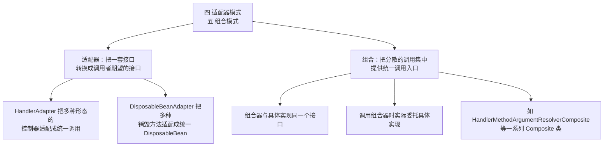

# Spring 中的设计模式：适配器、组合

设计模式系列的第四与第五种：适配器模式与组合模式。两者都服务于「统一调用」这个大目标，但切入角度不同：适配器把不同的接口转换成调用者期望的同一个接口，组合把分散的实现聚拢到一个统一入口后面。

## 先给结论

适配器模式的定义是把一套接口转换成另一套调用者所期望的接口，让接口不兼容的类协同工作。Spring 中的体现主要有两处：HandlerAdapter 把多种形态的控制器适配成统一调用，DisposableBeanAdapter 把多种形式的销毁方法适配成统一的 DisposableBean 调用。组合模式把分散的调用集中起来，提供统一调用入口，组合器与具体干活的实现同一个接口，调用组合器时实际委托具体实现完成。Spring 中的体现有 HandlerMethodArgumentResolverComposite 等一系列 Composite 类。

## 是什么

先看适配器。控制器的实现方式多种多样：最常见的是用 @RequestMapping 注解标注的控制器，传统方式是让类实现 Controller 接口，较新的方式是让类实现 RouterFunction 接口。这些实现方式不同，接口也不同，调用方式自然也不同。但 DispatcherServlet 希望以统一的 HandlerAdapter 方式来调用控制器，不管底层是哪种实现。

解决方式是给 HandlerAdapter 提供不同的适配器实现：有的适配器专门调 @RequestMapping 型的控制器，有的专门调实现 Controller 接口的控制器，以此类推。最终所有控制器都被适配成 HandlerAdapter 接口，调用方式统一。

第二个例子是 DisposableBeanAdapter。销毁方法的来源同样多样：有基于注解的，有基于自定义方法的，有基于 DisposableBean 接口的，调用方式不统一。Spring 在注册销毁 Bean 时，把它们全部转换成实现了 DisposableBean 接口的 DisposableBeanAdapter，统一调用销毁方法。

适配器模式的落地特征是：存在一个调用方期望的标准接口，以及若干形态各异的具体实现，每个实现配一个适配器，把差异吞在适配器里。

## 为什么

再看组合模式。它的作用是把分散的调用集中起来，提供一个统一的调用入口。典型场景是 Spring MVC 中调用控制器方法前的参数准备：不同参数的来源与获取方式完全不同，有的从 @PathVariable 路径变量取，有的从请求参数取，有的要生成 Model 模型对象作为参数，有的从传统的 Request、Response 取。每种参数对应一个解析器，解析逻辑各不相同。

这么多参数解析器，调用方不想逐个判断该用哪个。Spring 提供了 HandlerMethodArgumentResolverComposite，即参数解析器的组合器。调用方只需调用组合器，组合器内部持有一个集合，集合里是各种参数解析器，由组合器统一分发。分散的调用被集中，入口只有一个。

组合器的特征是它与具体干活的实现同一个接口，都实现 HandlerMethodArgumentResolver。调用组合器的接口方法时，组合器本身不干具体活，而是把活儿委托给集合里的具体实现完成。对调用方而言，面对组合器与面对单个实现没有区别，这就是组合模式的价值。

## 深入细节

Spring 中的组合器不止一个，同系列的还有：HandlerMethodReturnValueHandlerComposite 统一处理返回值，HandlerExceptionResolverComposite 统一处理异常解析，ViewResolverComposite 统一处理视图解析。命名上带 Composite 后缀是强信号，与 Builder 后缀标识建造器模式一样，看类名即可快速识别模式类型。

把四种模式放一起对比，能看出 Spring 用模式的分层逻辑：工厂方法模式解决「谁来造」，建造器模式解决「怎么一步步造」，适配器模式解决「接口不一致怎么统一调」，组合模式解决「实现分散怎么统一入口」。回答设计模式面试题时，按这个逻辑分组比平铺列举更清晰。

## 面试怎么答

被问到适配器与组合模式，可以这样答：适配器模式在 Spring 中最典型的体现是 HandlerAdapter。控制器的实现方式很多样，可以基于 @RequestMapping 注解，也可以实现 Controller 接口，还可以实现 RouterFunction 接口，接口和调用方式都不同，DispatcherServlet 需要统一调用，于是为每种实现提供对应的适配器，都适配成 HandlerAdapter 接口。另一个例子是 DisposableBeanAdapter，销毁方法有注解式、自定义方法、DisposableBean 接口等多种形式，注册时统一适配为 DisposableBean 来调用。组合模式的体现是各种 Composite 类，比如 HandlerMethodArgumentResolverComposite，Spring MVC 的参数来源很多样，路径变量、请求参数、Model、Request 各有解析器，组合器持有一个解析器集合，提供统一入口，调用组合器时它委托集合里的具体实现干活，组合器与具体实现同一个接口。

## 常见误区

误区一：以为适配器改变了实现本身。适配器只在外层做接口转换，控制器与销毁方法的原有实现不动。

误区二：以为组合器自己干活。组合器只做分发与委托，具体逻辑仍由集合内的实现完成，它与实现是同一个接口。

误区三：认不出系列类。Spring 中带 Composite 后缀的类基本都是组合模式，带 Builder 后缀的基本是建造器模式，看类名是快速识别的实用技巧。
