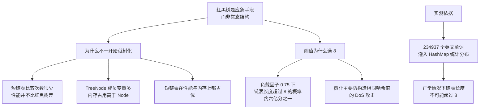

# 红黑树的意义与树化阈值为何是 8

前两篇分别讲了树化的两个条件，本篇回答剩下的连环追问：为什么要用红黑树、为什么不一上来就树化、阈值为什么选 8。这三个问题背后是同一个判断：红黑树是应急手段而非常态结构。用一个 23 万单词的实测分布来证明这一点。

## 先给结论

1.7 中链表过长会拖垮 HashMap 性能，1.8 引入红黑树后，链表再长对性能的影响也可控。不一上来就树化的原因是短链表在性能与内存占用上都优于红黑树：短链表比较次数很少，红黑树节点成员变量多、占内存大，短链表没必要树化。阈值选 8 的依据是概率：负载因子 0.75 下，哈希足够随机时链表长度超过 8 的概率仅约六亿分之一，选 8 让树化概率足够小，树化主要防的是构造相同哈希值的 DoS 攻击，不是正常场景。



## 是什么

先回顾已经能回答的两个问题。为什么要用红黑树：1.7 中链表太长会影响整个 HashMap 的性能，1.8 引入红黑树后，链表较长时性能也不会受太大影响。何时树化：两个条件，链表长度超过阈值 8，且数组容量大于等于 64，两个都满足才树化。

剩下三个问题：为什么不一开始就树化、阈值为何是 8、红黑树何时退化为链表。前两个是本篇重点，第三个在下一篇。

## 为什么

先看为什么不一开始就树化。多数情况下链表里只有一两个三个元素，比较次数最多三次。费很大劲把短链表变成树，性能并不会更高，链表短的时候性能其实比红黑树好。只有链表比较长时，红黑树才远远优于链表。

内存层面差距更大。链表的数据结构是 Node，红黑树底层是 TreeNode，成员变量比 Node 多很多，堆内存占用更高。所以无论性能还是内存，短链表都占优，如非必要不转红黑树。

再看阈值为什么是 8。先澄清一个事实：红黑树绝不是正常情况，正常情况下链表长度不可能超过 8。用一个 Linux 单词表验证。文件里有 234937 个正常英文单词，把它们灌进 HashMap，看链表长度分布。读文件并收集成 Map 的代码如下：

```java
Map<String, Object> words = Files.readAllLines(Path.of(first: "words")).stream()
    .collect(Collectors.toMap(w -> w, w -> value));
```

按课程原稿逐字收录，`Path.of(first: "words")` 的 `first:` 是 IDE 参数名提示的原有形态。

先确认 Stream API 得到的 Map 确实是 HashMap 实现，否则统计无意义，随后输出每种长度的链表分布：

```text
class java.util.HashMap
总的桶个数[524288]
0个元素的桶个数[334855]
1个元素的桶个数[150323]
2个元素的桶个数[33401]
3个元素的桶个数[5090]
4个元素的桶个数[555]
5个元素的桶个数[62]
6个元素的桶个数[2]
```

23 万多个单词，数组扩容到 52 万多个桶，33 万个桶是空的。有元素的桶里，一个元素的 15 万多个，占一半以上；两个元素的 3 万多个；三个元素的 5000 多个；四个 555 个；五个 62 个；最长的链表 6 个元素，且这样的只有 2 个。正常业务数据不刻意构造，链表长度最多 6 个左右，占比极少，不可能出现超过 8 的链表。

那什么情况下会出超长链表？恶意攻击。有一种 DoS 攻击手段，构造一大批哈希值完全相同的对象，哈希值相同则桶下标相同，链表被拉到特别长，从 HashMap 里随便找个元素都要花很长时间，系统被拖垮。这种超长链表一定是攻击造成的，不是正常情况。

## 深入细节

红黑树的主要用途就是防这种 DoS 攻击，防止链表超长时性能下降。它是偶然情况的对策，不是常态结构。

选 8 的理论依据是概率分布。如果哈希值选取足够随机，桶内链表长度符合泊松分布。负载因子 0.75 的情况下，链表长度超过 8 的概率约为六亿分之一。选 8 正是为了让树化概率足够小，不要轻易变成树。如果阈值设成 4，链表很短就树化，没有必要。正常的短链表比较四五完全可接受，六次已经极少，这些场景用树反而是浪费。

顺便对比两个复杂度：哈希表查找与更新的理想时间复杂度是 O(1)，一两次常量级比较就能定位；红黑树的查找与更新都是 O(log n)，还要维护树的平衡。如非必要尽量用链表，红黑树只是防攻击的底线。

## 面试怎么答

被问到红黑树的意义与阈值，可以这样答：1.7 中链表过长会严重影响性能，1.8 引入红黑树，让链表较长时性能仍然可控，红黑树查找是 O(log n)。不一上来树化，因为短链表性能与内存都优于红黑树：短链表比较一两次就够，红黑树节点 TreeNode 成员变量多、占内存大，维护成本也高，如非必要不转树。阈值选 8 有概率依据：负载因子 0.75 下哈希足够随机时链表长度服从泊松分布，长度超过 8 的概率约六亿分之一，选 8 让树化概率足够小。我用一个 23 万单词的词表实测过，HashMap 扩容到 52 万桶，最长链表只有 6 个元素且只有 2 个，正常情况下不会出现超过 8 的链表。超长链表一般是恶意构造相同哈希值的 DoS 攻击，红黑树就是防这种场景的底线。

## 常见误区

误区一：以为红黑树是常态优化。它是应对攻击与极端冲突的应急结构，正常数据下链表长度不超过 8，树化概率约六亿分之一。

误区二：以为阈值越小越安全。阈值小会让树轻易触发，付出不必要的空间与维护成本，8 是在性能、内存与防护之间的平衡点。

误区三：只说「防止链表过长」不讲概率依据。实测分布加泊松分布概率，是把答案从及格拉到优秀的完整论证链。
