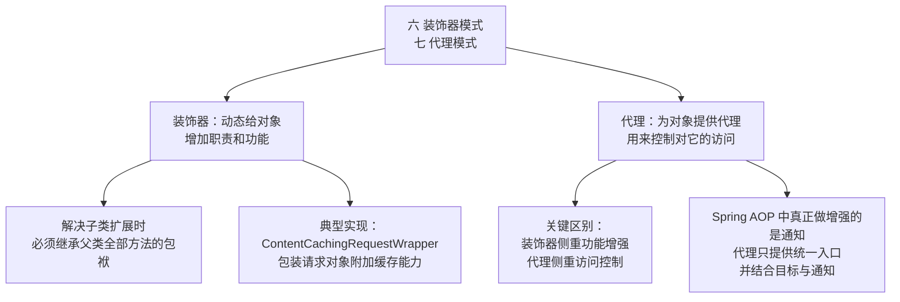

# Spring 中的设计模式：装饰器与代理

设计模式系列的第六与第七种，也是辨析价值最高的一对：装饰器模式与代理模式。两者的定义看起来都像「给对象动态添加功能」，很多资料把它们混为一谈。本篇把边界划清楚：装饰器注重功能增强，代理注重控制访问。

## 先给结论

装饰器模式的定义是对一个对象动态地增加一些职责和功能，它解决的是用子类扩展功能时「不管用不用得上都得继承父类全部方法」的问题。代理模式的原始定义是对另外一个对象提供一个代理或占位，用来控制对这个对象的访问。关键区别：装饰器侧重功能增强，代理侧重访问控制。在 Spring AOP 中做功能增强的其实是通知，代理只提供统一入口并结合目标与通知。

## 是什么

先看装饰器。它的定义是动态地给对象附加职责，它是子类扩展的灵活替代方案。子类做功能增强的最大问题是不管用得到用不到，都得把父类的方法全部继承过来，可能继承一大堆根本用不上的方法。装饰器模式避免了这个包袱，需要什么功能包一层什么装饰器。

Spring 中装饰器的典型实现是 ContentCachingRequestWrapper，它包装请求对象，附加缓存请求内容的能力。

## 为什么

装饰器的定义容易和代理混淆，因为过去讲代理时也说「代理对目标对象动态添加功能增强」。这个理解其实有偏差。在 Spring AOP 里职责划分很明确：真正做功能增强的是通知，包括环绕通知、前置通知、后置通知等；代理只起到入口作用，把目标对象和通知方法结合起来，提供一个统一入口。

回到 23 种设计模式的原始定义看代理：对另一个对象提供一个代理或占位，用来控制对这个对象的访问。原始定义的重点是控制访问，而不是功能增强。功能增强是通知的事，代理管的是「能不能访问、何时访问、以什么方式访问」。

两者的边界因此清晰：装饰器注重功能增强，解决子类继承带来的臃肿问题；代理注重控制目标访问，负责结合通知与目标，在环绕通知里还能做权限判断，权限不满足就不放行去访问目标。

## 深入细节

Spring 中代理的典型实现有两个。JdkDynamicAopProxy，用 JDK 动态代理方式生成代理对象，限制是目标对象必须实现接口，代理是针对接口的代理。ObjenesisCglibAopProxy，基于 CGLIB，既可以针对接口代理，也可以生成一个子类作为代理。

Objenesis 是对 CGLIB 的补充。CGLIB 有一个限制：目标类如果没有无参构造，创建目标对象时会失败，它必须让目标提供无参构造。Objenesis 是个小工具，即使目标只有带参构造、没有无参构造，它也能生成一个空空如也的对象，让代理创建成功。

把装饰器与代理并排记：装饰器的问题是「继承太笨」，解法是包一层加功能；代理的问题是「访问要管控」，解法是造一个占位控制入口。名字都带「包一层」，目的相反。

## 面试怎么答

被问到装饰器与代理的区别，可以这样答：装饰器模式是对一个对象动态增加职责和功能，它替代子类扩展，避免继承一堆用不上的父类方法，Spring 中 ContentCachingRequestWrapper 是典型实现。代理模式按原始定义是对另一个对象提供代理或占位，用来控制对这个对象的访问，重点在控制而非增强。Spring AOP 中真正做功能增强的是通知，包括环绕、前置、后置通知，代理只提供统一入口，把目标和通知结合起来，还能在环绕通知里做权限控制。代理的典型实现是 JdkDynamicAopProxy 与 ObjenesisCglibAopProxy，前者基于 JDK 动态代理要求目标实现接口，后者基于 CGLIB 可生成子类代理，Objenesis 补足了 CGLIB 需要无参构造的限制。

## 常见误区

误区一：把代理等同于功能增强。增强由通知完成，代理负责控制访问与提供入口，两者职责不同。

误区二：把装饰器与代理混为一谈。装饰器替代继承做功能叠加，代理控制访问，设计目标不同。

误区三：忽略 CGLIB 的无参构造限制。没有无参构造时 CGLIB 创建目标会失败，Objenesis 正是为补这个短板而存在。
