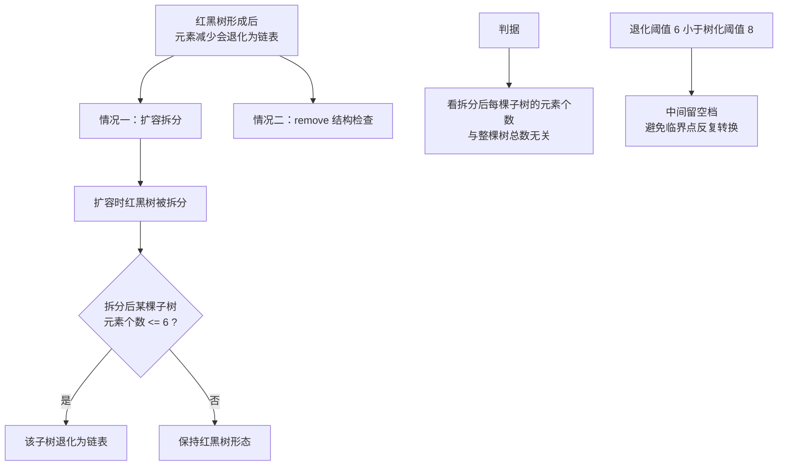

# 树退化为链表：情况一，扩容拆分

红黑树不是形成后就固定不变，元素减少时会退化为链表。退化分两种情况，本篇讲第一种：扩容时对树做拆分，拆分后元素个数小于等于 6 就退化成链表。判断依据是拆分后每棵子树的元素个数，与整棵树的元素总数无关。

## 先给结论

第一种退化情况发生在扩容过程中。扩容时红黑树会被拆分，如果拆分后某棵树的元素个数小于等于 6，这棵树就退化为链表。阈值为 6，比树化阈值 8 小，中间的空档避免了在临界点反复转换。



## 是什么

先用模拟器构造现场。一开始就让数组容量为 64，省去前置扩容。放入 1、2、3、4、5、6，哈希码固定为 10，全部落在下标 10。再放入 a、b、c、d，哈希码固定为 74，74 与 10 虽然不同，但在容量 64 下算出的桶下标也是 10。put 之后下标 10 上共有 10 个元素，超过树化阈值 8，且容量已达 64，两个条件满足，链表变为红黑树。

桶下标的计算公式：

```text
index = hash(key) & (capacity - 1)
```

## 为什么

接下来触发扩容，让树经历拆分。容量 64 时下次扩容阈值是 48，即元素个数达到 48 触发。目前树里已有 10 个元素，再放入 38 个正常分布的元素，总共 48 个，第 49 个元素放入即触发扩容，容量从 64 扩到 128。

扩容后树被拆分。1 到 6 拆分后落到一边，因为元素个数是 6，小于等于 6，退化为链表。a、b、c、d 拆分后落到另一边，元素个数也是 6，同样退化为链表。原先的一棵树，拆分后变成两条链表。

再看不退化的对照。同样容量 64，放入 1 到 7 共 7 个元素，哈希码相同，再放入 a、b、c 共 3 个元素，哈希码也是 10，共 10 个元素，满足树化条件成树。再触发扩容到 128，拆分后 1 到 7 这一组元素个数是 7，不小于等于 6，保持树形态不退化；a、b、c 这一组拆分后元素个数是 3，小于等于 6，退化为链表。同一棵树拆分后，一部分保持树，一部分退化，判据就是拆分后各自的元素个数。

## 深入细节

两个数字放一起记：树化阈值是 8，退化阈值是 6。为什么不设成同一个数？如果树化要超过 8、退化要少于 8，元素个数在 8 附近抖动时，会出现反复树化与退化的来回转换，每次转换都有成本。退化阈值定 6，与树化阈值 8 之间留出 2 的空档，只有元素个数明确降到 6 及以下才退化，避开临界抖动。

拆分的判据是拆分后的元素个数，不是整棵树的元素个数。上面第二组实验中，拆分前整棵树 10 个元素，但拆分后一组 7 个保持树、一组 3 个退化，说明判断发生在拆分之后、逐组进行。

第二种退化情况与 remove 操作相关，在下一篇展开。

## 面试怎么答

被问到树何时退化为链表，可以这样答：分两种情况。第一种是扩容时树会被拆分，拆分后如果某部分的元素个数小于等于 6，这部分就退化为链表。注意阈值是 6 而不是树化的 8，两个阈值之间留空档是为了避免元素个数在临界点反复树化与退化。判断依据是拆分后的元素个数，不是整棵树的总数，同一棵树拆分后可能一部分保持树、一部分退化成链表。第二种情况与 remove 有关，删除树节点时若根节点左右子节点有一个为 null，也会退化为链表。

## 常见误区

误区一：把退化阈值记成 8。树化阈值是 8，退化阈值是 6，两者不同，留空档防止临界抖动。

误区二：以为看整棵树的元素总数。判据是拆分后各部分的元素个数，逐组判断。

误区三：以为退化只在 remove 时发生。扩容拆分是第一种退化路径，与删除无关。
