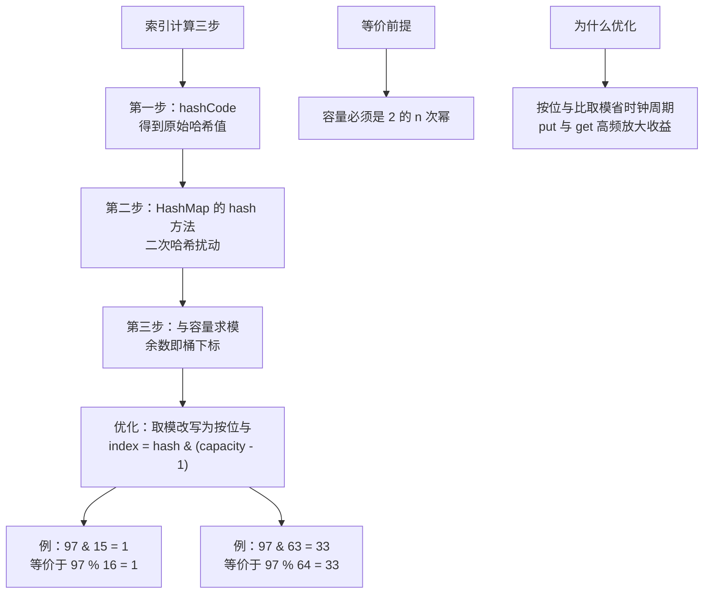

# 索引如何计算：二次哈希与按位与优化

索引计算、二次哈希、容量为何是 2 的 n 次幂，这三个问题关联性很强，放在一起讨论。核心结论：索引由三步得出，其中求模可以优化为按位与，而按位与的等价性要求容量必须是 2 的 n 次幂。这正是容量设计的原因。

## 先给结论

索引计算分三步：调用对象的 hashCode 得到原始哈希值；调用 HashMap 的 hash 方法做二次哈希；把二次哈希的结果与数组容量取模，得到的余数就是索引。取模可以优化为按位与运算，即用哈希值与 capacity 减 1 做按位与，结果与取模完全相同，且效率更高。但这个等价有个前提：容量必须是 2 的 n 次幂。

## 是什么

三步先完整走一遍。任何对象都提供 hashCode 方法，调用它得到原始哈希值。原始哈希值不能直接用，还要调用 HashMap 提供的 hash 方法做二次哈希。二次哈希的结果再与数组容量取模，余数即索引，也称桶下标。

以字符串 a 为例，二次哈希结果是 97，对容量 16 取模得 1，索引就是 1。这套流程在前面快速查找一篇已经演示过，本篇补充它的优化细节。

## 为什么

取模运算可以优化。97 对 16 取模得 1，等价的写法是让容量减 1 后与哈希值做按位与，即 97 与 15 按位与，结果也是 1。两次运算结果一模一样。

再看容量 64 的情况。97 对 64 取模，余数是 33，桶下标就是 33。改用按位与：97 与 63 按位与，结果同样是 33。等价关系在 2 的 n 次幂容量下稳定成立。

为什么要优化？因为按位与比取模效率高。求模类似除法运算，耗费的 CPU 时钟周期比按位与多。索引计算是 HashMap 中最频繁的操作之一，每次 put、get 都要算，把除法换成按位与，收益会被高频次放大。

## 深入细节

等价性有严格前提：容量必须是 2 的 n 次幂，即 2 的 0 次方、1 次方、2 次方等。16 是 2 的 4 次方，64 是 2 的 6 次方，都满足，所以等价。容量不是 2 的 n 次幂时，两种运算不等价。

用容量 11 验证。97 对 11 取模，余数是 9。套用按位与公式，97 与 11 减 1 即 10 按位与，结果是 0。两个结果不同，无法等价替换。这说明按位与优化不是通用技巧，它依赖容量的二进制形态：2 的 n 次幂减 1 后是低位全 1 的二进制数，如 16 减 1 得 15 即二进制 1111，64 减 1 得 63 即二进制 111111，按位与正好截取哈希值的低位，与取模效果一致。

把索引计算规则完整总结：先算对象的 hashCode，再调 HashMap 的 hash 方法做二次哈希，最后把二次哈希结果与数组容量减 1 按位与得到索引。按位与容量减 1 比普通求模效率更高，前提是容量必须是 2 的 n 次幂。下一篇讲为什么要做二次哈希，即让高位参与运算、分布更均匀；再下一篇讲容量不用 2 的 n 次幂行不行。

## 面试怎么答

被问到索引如何计算，可以这样答：分三步。第一步调用 key 的 hashCode 方法得到原始哈希值；第二步调用 HashMap 的 hash 方法做二次哈希，让高位参与运算；第三步把二次哈希的结果与 capacity 减 1 做按位与，得到索引。这里用按位与代替取模，因为 2 的 n 次幂减 1 是低位全 1 的数，按位与等价于取模，而按位与比除法取模的 CPU 时钟周期更少。比如 97 与 15 按位与得 1，与 97 模 16 结果相同；97 与 63 按位与得 33，与 97 模 64 相同。等价的前提是容量必须是 2 的 n 次幂，容量为 11 时 97 模 11 得 9，而 97 与 10 按位与得 0，不等价。这正是容量取 2 的 n 次幂的原因之一。

## 常见误区

误区一：以为索引是 hashCode 直接对容量取模。中间还有一步二次哈希，直接取模会让高位信息浪费，分布变差。

误区二：以为按位与可以替换任意取模。只在容量为 2 的 n 次幂时等价，容量 11 的例子中两者结果完全不同。

误区三：只答结果不答原因。按位与替代取模的理由是 CPU 时钟周期更少，且索引计算高频发生，这个收益才被采纳。
