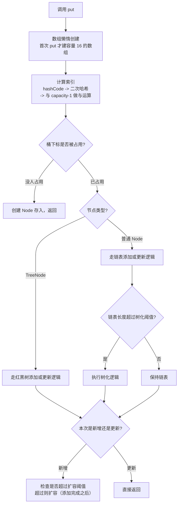

# HashMap 的 put 流程（1.7 与 1.8 的差异）

## 开场

「介绍一下 HashMap 的 put 流程，1.7 和 1.8 有什么不一样」是一道能一次考到很多细节的题：懒惰创建数组、二次哈希、链表与红黑树的分支、树化条件、扩容时机、以及头插法尾插法。能把这些串起来讲，基本就能证明你真的读过源码。

## 先给结论

put 的主流程是：

1. HashMap 的数组是**懒惰创建**的，首次调用 put 才创建默认容量 16 的数组；
2. 计算索引：拿 key 的 hashCode，做二次哈希，再和数组容量减一做与运算，得到桶下标；
3. 桶下标没人占用，就创建 Node 把键值存进去，返回；
4. 桶下标已被占用，按节点类型分两支：是 TreeNode（红黑树）就走红黑树的添加或更新逻辑；是普通 Node 就走链表的添加或更新逻辑，并且链表长度超过树化阈值时还会走树化逻辑；
5. 如果是新增（不是更新），返回前还要检查容量是否超过扩容阈值，超过就扩容。**扩容发生在元素添加完成之后**。

1.7 和 1.8 有三点主要差异：链表插入 1.7 是头插法、1.8 是尾插法；扩容条件 1.7 是「大于等于阈值且当前桶没有空位」才扩容，1.8 是「大于阈值就扩容」；此外 1.8 在扩容计算 Node 新索引时做了优化。

## 是什么：为什么叫懒惰创建

HashMap 并不是一 new 出来就把容量为 16 的数组创建好，而是**首次调用 put 方法、真的需要往里添加元素时**才去创建这个数组。数组有了，才能往下计算索引。

## 为什么：计算索引的三步

拿到 key 之后：

1. 取 key 的 `hashCode`；
2. 做**二次哈希**（把高 16 位和低 16 位做异或，让高位也参与进来，减少碰撞）；
3. 与「数组容量减一」做**与运算**，得到桶下标。

因为容量是 2 的 n 次幂，减一之后低位全是 1，这个与运算等价于取模，但比取模快。

## 深入细节一：桶被占用时的两条分支

**分支一：节点是 TreeNode，说明这里已经树化成红黑树了**，走红黑树的添加或更新逻辑。如果在这棵树里找到了你的 key，就是更新；没找到就是添加。

**分支二：节点是普通 Node，走链表的添加或更新逻辑**，同样找到了就更新、没找到就添加。

添加时还多一个逻辑：**如果添加后链表长度超过了树化阈值，会走树化逻辑**。树化本身还挺复杂：它会先看当前容量是不是小于 64，小于 64 的话**先扩容而不树化**（因为扩容之后链表很可能就变短了，树化的代价不划算）；只有容量大于等于 64，且链表长度也超过阈值，才真正转成红黑树。

## 深入细节二：扩容发生在添加之后

最后一个细节：扩容是在**添加完成以后**才进行的，不是先把新数组建好、迁移完元素再把新元素加进去。

顺序是：先把新元素加到旧数组里，这时元素个数超过了阈值，于是创建容量为原来两倍的新数组，然后把旧数组中的数据一条链表一条链表地迁移到新数组，迁移完成后新数组代替旧数组。

演示里能看得很清楚：放到第 13 个元素时触发扩容，此时旧数组里已经有 13 个元素（第 13 个元素已经先加进旧数组了），然后才创建翻倍后的新数组，接着逐个链表迁移：先迁过去 11，接下来是 1 和 12（这两个元素扩容后算出来的索引不一样，所以被分到了不同的桶），再接着 2 和 13、3、4、5、6、7、8、9、10，全部迁移完，扩容就完成了。

## 1.7 与 1.8 的差异之一：头插法与尾插法

**1.8 是尾插法。** 把几个 key 的哈希码都固定成同一个值，让它们落进同一个桶。先加 A，加进去了；再加 B，B 被放在 A 的**尾巴**上；再加 C，C 跑到 B 的尾巴上。也就是每次新加的元素都排在链表尾部。

**1.7 是头插法。** 同样的操作，先加 A；再加 B 时，B 不会跑到 A 的尾巴上，而是跑到 A 的**头部**；再加 C，C 又跑到（当前头部的）前面。也就是每次新加的元素都插在链表头部。

这个差异是 1.7 并发扩容死链问题的直接根源，1.8 改成尾插法后该问题消失。

## 1.7 与 1.8 的差异之二：扩容触发条件

**1.8：只要大于阈值就扩容。** 容量 16 时，扩容阈值是 16 乘 0.75 等于 12，只要加入的元素个数大于 12，也就是第 13 个，就扩容。

**1.7：大于等于阈值，并且当前桶没有空位时才扩容。** 如果目标桶还有空位，即使已经超过阈值也不扩容。这一点在很多教材上都没提到。

用 1.7 的实现演示一遍：依次加入 1 到 10，十个元素；再加 11，它落到下标 14；再加 12，落到下标 15。此时已经有 12 个元素了，按 1.8 的规则再来第 13 个就该扩容了。但 1.7 里第 13 个元素算出来的桶下标是 12，而下标 12 还是空的，既然有空位，它就不扩容，此时已经有 13 个元素了。

继续加第 14 个元素，它要放的下标是 13，下标 13 仍然有空位，所以还是不扩容。再加第 15 个元素，这次它要放的位置已经没有空位了（那个下标已经有元素），而且元素个数也超过阈值，于是触发扩容。

1.7 这个设计确实更省空间：既然还有空位可以放，就没必要急着扩容。

## 面试怎么答

「说说 HashMap 的 put 流程，1.7 和 1.8 有什么区别？」

> 首先数组是懒惰创建的，首次 put 才创建。然后计算桶下标：拿 key 的 hashCode 做二次哈希，再和容量减一做与运算。桶为空就新建 Node 放进去；桶不为空就看节点类型，是 TreeNode 走红黑树的添加更新逻辑，是普通 Node 走链表的添加更新逻辑，链表长度超过树化阈值还要考虑树化（容量小于 64 时先扩容不树化，大于等于 64 才真树化）。如果是新增，返回前检查是否超过扩容阈值，超过就扩容，注意扩容是在元素加进去之后才做的，先把元素放进旧数组，再建两倍大的新数组并逐个链表迁移。1.7 和 1.8 的区别主要有三点：链表插入 1.7 是头插法、1.8 是尾插法；扩容条件 1.7 要求大于等于阈值且目标桶没有空位，1.8 是大于阈值就扩容；另外 1.8 在扩容计算新索引时做了优化。

追问：「为什么要从 1.7 的头插法改成 1.8 的尾插法？」

> 头插法会颠倒链表顺序，多线程同时扩容时，一个线程改完了链表指向，另一个线程基于过时的引用继续迁移，可能把链表接成环，之后访问这个桶就死循环。改成尾插法后迁移前后链表相对顺序不变，就不会成环了。

追问：「扩容到底发生在添加前还是添加后？」

> 添加后。先把新元素放进旧数组，此时元素个数才超过阈值，然后创建两倍容量的新数组，把旧数组的数据一条链表一条链表迁移过去，最后用新数组替换旧数组。

## 常见误区

- 以为 new HashMap 时就创建了数组。它是懒惰创建，首次 put 才建。
- 以为桶下标是用取模算的。实际是和容量减一做与运算，这是容量必须是 2 的 n 次幂的原因之一。
- 以为链表一超阈值就立刻树化。容量小于 64 时会优先选择扩容而不是树化。
- 以为扩容发生在添加之前。实际是元素先加进旧数组，再扩容迁移。
- 以为 1.7 和 1.8 的扩容条件一样。1.7 多了一个「当前桶没有空位」的前提，有空位时即使超阈值也不扩容。
- 以为尾插法只是编码习惯变化。它是修复 1.7 并发死链问题的关键改动。
