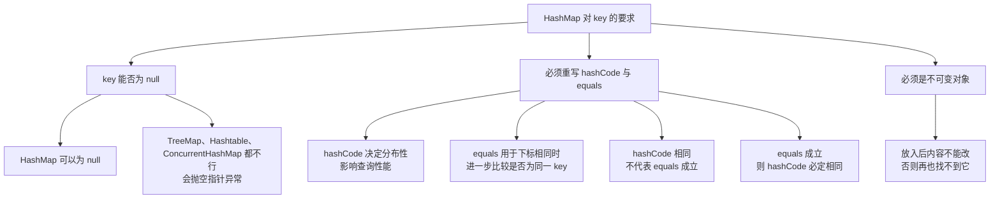

# HashMap 对 key 的要求

## 开场

HashMap 的 key 相关面试题一般有两问：key 能不能为 null？作为 key 的对象有什么要求？第一问答「能」就完了，第二问才是真正拉开差距的地方：除了「必须重写 hashCode 和 equals」这个人人都会的答案，还有一条经常被忽略的要求，就是 key 必须是不可变对象。

## 先给结论

- **HashMap 的 key 可以为 null**，但 `TreeMap`、`Hashtable`、`ConcurrentHashMap` 的 key 都不能为 null，否则会抛空指针异常。
- 作为 key 的对象**必须正确重写 `hashCode` 和 `equals`**：`hashCode` 决定 key 在 HashMap 里的分布性，进而影响查询性能；`equals` 用于在两个 key 算出相同下标时进一步比较是不是同一个 key。
- 还要记住两条推论：**`hashCode` 相同不代表 `equals` 一定成立**；但反过来，**两个对象 `equals` 成立，它们的 `hashCode` 一定相同**。
- 最后一条容易被忽略：key 必须是**不可变对象**，放进 HashMap 之后内容不能再改，否则就再也找不到它了。

这一条是很多人答漏的补充知识，下面会展开讲清楚为什么。



## 为什么：hashCode 和 equals 各自管什么

**重写 hashCode 是为了分布性。** key 在整个 HashMap 里分布得越均匀，冲突越少，查询性能就越高。如果所有 key 的 hashCode 都一样，它们会全挤在同一个桶里，HashMap 就退化成链表了。

**重写 equals 是为了区分。** 万一两个 key 计算出来的索引（下标）一样，也就是发生了哈希冲突，那就得进一步用 `equals` 来比较，看看它们到底是不是相同的 key。只有 `equals` 也成立才算找到。

关于两者的关系，有两条常见说法要记牢：

- `hashCode` 相同，`equals` 不一定成立（这就是哈希冲突）；
- 两个对象 `equals` 成立，那么它们的 `hashCode` 一定相同。

第二条是重写时必须保证的契约，否则 HashMap 的行为会完全错乱。

## 深入细节：为什么 key 必须不可变

看一个例子。有一个 `Student` 类，里面有 `name` 和 `age` 两个字段，并且**正确**实现了 `equals` 和 `hashCode`（两个方法里都用到了 `age`），`toString` 也重写了。但 `Student` 是一个**可变对象**，它的内容可以通过 setter 改变。

过程是这样的：

1. 先创建一个 `Student` 对象，姓名张三、年龄 18，把它作为 key 放进 HashMap；
2. 此时用这个 key 去 `get`，能拿到对应的 value。因为放进去时对象是「张三 18」，算出来的 hashCode 就是张三和 18 综合起来的那个值，按这个值去找肯定能找到；
3. 接下来把这个 key 的 `age` 改掉；
4. 再用它去 `get`，返回 `null`。

原因很直接：`age` 改了，将来计算哈希值时用的输入就变了，算出来的整数值也不一样。既然计算出来的整数值不一样，它去查找下标时就找错了桶，自然找不到之前存进去的那个对象了。

运行结果印证了这个推理：第一次 `get`（还没改属性）能找到对应的 value；第二次把 key 的内容改了，hashCode 算出来不一样，于是查到的是 `null`。

所以作为 key 的对象一定要是不可变的。平时大家用的 `Integer`、`String` 这些都是不可变类，它们的内容不能变，用起来从来没出过问题，就是因为满足了这个要求。

## 面试怎么答

「HashMap 的 key 有什么要求？」

> 三条。第一，key 可以为 null，但 TreeMap、Hashtable、ConcurrentHashMap 都不允许 null key。第二，作为 key 的类必须正确重写 hashCode 和 equals：hashCode 负责让 key 分布均匀、提高查询性能，equals 负责在哈希冲突时进一步判断是不是同一个 key；并且要保证 equals 成立的两个对象 hashCode 一定相同，反过来 hashCode 相同不代表 equals 成立，那就是哈希冲突。第三，key 应该是不可变对象，放进去之后不能再改内容，否则它的 hashCode 变了，再用它去 get 就会查错桶、返回 null。

追问：「为什么 String 适合做 key？」

> 因为它不可变，hashCode 计算出来就固定不变；而且 String 内部会缓存 hashCode，第一次计算之后复用，性能也好。再加上 String 的 hashCode 用 31 做乘数，分布性经过实测相当均匀。

追问：「如果非要用可变对象做 key 呢？」

> 要么把它改成不可变（去掉 setter、字段 final），要么在放进 HashMap 之后保证绝不修改参与 hashCode 计算的字段，并且用一个不可变的副本（比如对象的 id）做 key。实践中更推荐的做法是用不可变字段做 key，把可变部分放到 value 里。

## 常见误区

- 以为所有 Map 都允许 null key。只有 HashMap 和 LinkedHashMap 允许，Hashtable 和 ConcurrentHashMap 会抛空指针，TreeMap 会因为比较时报错。
- 以为只重写 `equals` 就够了。不重写 `hashCode` 会导致 equals 成立的两个对象落到不同桶里，HashMap 完全失效。
- 以为 `hashCode` 相同就是同一个对象。那只是哈希冲突，还要 `equals` 判断。
- 以为把可变对象放进去、只要不调 setter 就没事。只要参与 hashCode 计算的字段有可能被改，风险就一直在，最好从设计上做成不可变。
- 以为改了 key 之后用原来的引用还能 get 到。它按新的 hashCode 去查桶，查的是另一个桶，返回 null。

## 课件源码参考

> 以下示例出自课件 day01 的 `HashMapMutableKey.java`，与上文讲解一一对应，可直接对照阅读。

```java
package day01.map;

import java.util.HashMap;
import java.util.Objects;

public class HashMapMutableKey {
    public static void main(String[] args) {
        HashMap<Student, Object> map = new HashMap<>();
        Student stu = new Student("张三", 18);
        map.put(stu, new Object());

        System.out.println(map.get(stu));

        stu.age = 19;
        System.out.println(map.get(stu));
    }

    static class Student {
        String name;
        int age;

        public Student(String name, int age) {
            this.name = name;
            this.age = age;
        }

        public String getName() {
            return name;
        }

        public void setName(String name) {
            this.name = name;
        }

        public int getAge() {
            return age;
        }

        public void setAge(int age) {
            this.age = age;
        }

        @Override
        public boolean equals(Object o) {
            if (this == o) return true;
            if (o == null || getClass() != o.getClass()) return false;
            Student student = (Student) o;
            return age == student.age && Objects.equals(name, student.name);
        }

        @Override
        public int hashCode() {
            return Objects.hash(name, age);
        }
    }
}
```
