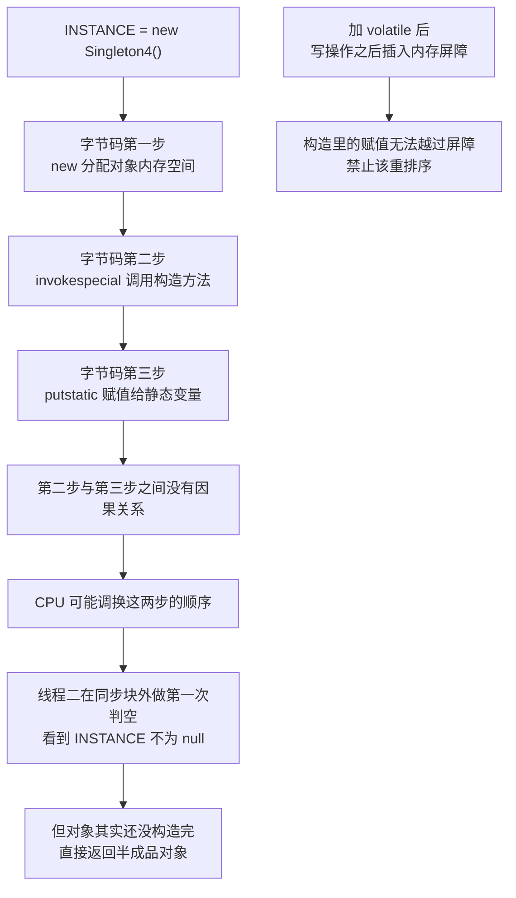

# DCL 懒汉式为什么要加 volatile

## 开场

双重检查锁（DCL）懒汉式单例里，`INSTANCE` 上那个 `volatile` 到底能不能省？这是单例模式里最经典的追问。答「防止指令重排序」只能算及格，面试官要的是你能把字节指令拆开、把两个线程的交错讲清楚。

## 先给结论

`INSTANCE = new Singleton4()` 这一行 Java 代码在字节码层面分成几步：先 `new` 分配对象内存空间，再 `invokespecial` 调用构造方法给成员变量赋值，最后 `putstatic` 把对象赋值给静态变量。其中「调用构造」和「给静态变量赋值」两步之间没有因果关系，CPU 可能把它们调换顺序。一旦调换，另一个线程在同步块外面做第一次判空时，就会看到 `INSTANCE` 已经不为 `null` 但对象还没构造完，于是直接返回一个半成品对象。

给 `INSTANCE` 加 `volatile`，会在写操作之后插入内存屏障，阻止构造方法里的赋值操作越过屏障跑到下面去，从而禁止这个重排序。



## 是什么：先看代码

```java
public class Singleton4 implements Serializable {
    private Singleton4() { System.out.println("private Singleton4()"); }
    private static volatile Singleton4 INSTANCE = null; // 可见性，有序性
    public static Singleton4 getInstance() {
        if (INSTANCE == null) {
            synchronized (Singleton4.class) {
                if (INSTANCE == null) {
                    INSTANCE = new Singleton4();
                }
            }
        }
        return INSTANCE;
    }
    public static void otherMethod() { System.out.println("otherMethod()"); }
}
```

## 为什么：这一行代码的底层是四条指令

用 JDK 自带的反编译工具 `javap` 把 `Singleton4.class` 反编译一下，在 `getInstance` 方法里顺着往下找，看到带 `new` 关键字的位置就对了：

```java
descriptor: ()V
flags: ACC_PUBLIC, ACC_STATIC
Code:
stack=2, locals=0, args_size=0
0: getstatic #21  // Field INSTANCE:day01/pattern/Singleton4;
3: ifnonnull #37
6: ldc #22
8: dup
9: astore_0
10: monitorenter
11: getstatic #21  // Field INSTANCE:day01/pattern/Singleton4;
14: ifnonnull #27
17: new #22
20: dup
21: invokespecial #27  // Method <init>():V
24: putstatic #21  // Field INSTANCE:day01/pattern/Singleton4;
27: aload_0
28: monitorexit
29: goto #37
32: astore_0
33: aload_0
34: monitorexit
35: athrow
36: return
```

其中关键的四条指令是：

- `new`：创建一个新对象。所谓创建对象，本质是把对象需要的内存空间分配出来，内部会计算这个对象有哪些成员变量、需要占多少内存。
- `dup`：复制栈顶引用，这里先不用管。
- `invokespecial`：调用方法。在反编译结果里看到尖括号包着的 `<init>`，那就是构造方法，所以这一步是调用 `Singleton4` 的构造方法。
- `putstatic`：给静态变量赋值，也就是把刚创建好的对象赋给 `INSTANCE`。

这里要特别注意：**创建对象和调用构造方法是两步操作**。前者只是把内存分配好，对象里的成员变量要等到构造方法执行时才被赋值。演示代码里构造方法几乎是空的，但真实的类里构造方法往往要给一批成员变量做初始化。

## 深入细节：哪两条指令会被调换，调换后会发生什么

CPU 会对指令的执行次序做优化：如果几条指令之间没有因果关系，谁先执行谁后执行关系不大，CPU 就可能调换它们的顺序。

先看哪几条指令的顺序是确定的：`new` 必须在调用构造之前执行，内存空间都没分配，拿什么去初始化，所以这两步的先后顺序不会变。

但**调用构造方法和 `putstatic` 之间没有因果关系**。构造方法做的是给成员变量赋值，`putstatic` 做的是给静态变量赋值，两者都是赋值操作，谁先谁后从单线程角度看没有区别。于是 CPU 就可能先执行 `putstatic`，再执行构造方法。

单线程下这么调换没有任何影响，纯粹是一种优化。多线程下就会出问题。

假设蓝色线程拿到了锁，进入同步块，开始执行「创建对象」这三步：分配空间、调用构造、赋值给 `INSTANCE`。如果它被重排成了「分配空间、赋值给 `INSTANCE`、调用构造」，就在赋值完成而构造还没执行的这个间隙里，红色线程来了。

关键在于：红色线程执行的第一次判空和 `return`，是写在 `synchronized` 外面的，不受锁的保护，所以蓝色线程在同步块里执行的同时，红色线程可以并行执行它的这两行。

于是红色线程做 `if (INSTANCE == null)` 判断时发现 `INSTANCE` 已经被赋值了，不为 `null`，条件不成立，它就直接跳过后面的 `synchronized` 代码块，把这个 `INSTANCE` 对象返回了。可此时构造方法还没执行完，对象里的成员变量可能都还是零值。红色线程拿到的是一个**没有完整构造的半成品对象**，用它就会产生各种稀奇古怪的问题。

## volatile 是怎么解决这个问题的

解决方式就是给共享变量 `INSTANCE` 加上 `volatile` 修饰。

对 `volatile` 修饰的变量做赋值操作时，会在赋值语句之后加上一个**内存屏障**。这个屏障的作用是阻止之前的赋值操作越过屏障跑到它下面去。构造方法里那些成员变量的赋值操作，就不能越过这道屏障跑到 `putstatic` 的下面。

形象地说，屏障就像一排向上的尖刺，上面的语句遇到尖刺就下不来。加了屏障之后执行顺序被固定为：`new` 创建对象、调用构造、最后才执行赋值。

再来看加屏障之后两个场景：

**场景一：红色线程在赋值之前执行判空。** 此时 `INSTANCE` 还是 `null`，条件成立，红色线程只能乖乖去竞争 `synchronized` 锁并等待，等蓝色线程执行完释放锁。它不会提前返回一个未构造好的对象。

**场景二：红色线程在赋值之后执行判空。** 此时 `INSTANCE` 不为 `null`，条件不成立，直接返回。但是因为有屏障，赋值一定发生在构造方法执行完之后，所以红色线程拿到的一定是经过完整构造的对象，不会是半成品。

## 面试怎么答

「DCL 单例为什么要加 volatile？」

> 因为 `INSTANCE = new Singleton()` 不是原子操作，字节码层面是 `new` 分配空间、`invokespecial` 调用构造、`putstatic` 给静态变量赋值这几步。其中调用构造和 `putstatic` 之间没有因果关系，可能被 CPU 重排成先赋值再构造。这时另一个线程在同步块外做第一次判空，会看到 `INSTANCE` 不为 null 就直接返回，拿到一个成员变量还没初始化的半成品对象。加 `volatile` 之后，对 volatile 变量的写操作后面会插入内存屏障，构造方法里的赋值不能越过屏障跑到 `putstatic` 下面，重排序被禁止，同时 volatile 还保证了可见性。

追问：「听说 JDK 新版里不加 volatile 也行？」

> 这个说法要谨慎。JDK 9 之后 `VarHandle` 提供了 `setRelease`、`getAcquire` 这类更精细的内存语义，理论上可以用 release 或 acquire 模式替代 volatile 达到同样的效果；另外 JDK 内部（比如 `VarHandle` 相关的实现）确实有用 `releaseFence` 手工加屏障的写法。但业务代码里写 DCL，最稳妥、最通行的做法仍然是加 `volatile`，不要赌处理器的重排序行为。

追问：「除了 volatile，还有别的办法吗？」

> 有。最推荐的是干脆不用 DCL，改用静态内部类方式：把实例放在私有静态内部类的静态变量里，创建过程由 JVM 的类初始化机制保证线程安全，天然没有重排序问题，代码还更简单。或者直接用枚举单例。

## 常见误区

- 以为 `synchronized` 已经保证了可见性和有序性，不需要 volatile。同步块内的操作确实有保证，但别的线程在同步块**外面**读 `INSTANCE`，那次读没有任何保护，这正是问题的来源。
- 以为 `new` 一个对象是原子操作。它至少包含分配空间和调用构造两步，加上赋值是三步。
- 以为重排序只发生在编译器。CPU 同样会做，而且这是这里讨论的场景。
- 以为 volatile 只是保证可见性。它在 DCL 里更关键的作用是禁止重排序，也就是保证有序性。
- 以为加了 volatile 就万事大吉。反射、反序列化、`Unsafe` 依然可以破坏单例，那是另一条赛道的问题。
