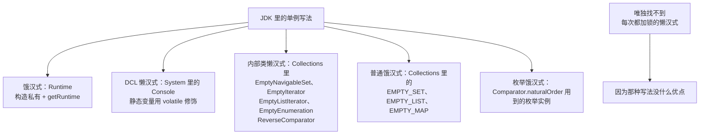

# 单例模式在 JDK 中的体现

## 开场

单例模式的五种实现方式讲完之后，面试官很爱追问一句：「你在哪儿用过单例模式？」这一问的正确答法不是讲自己的项目，而是去 JDK 里找例子。原因很简单：JDK 是成熟的库，里面的用法经得起推敲，而业务项目里的单例往往经不起追问。

## 先给结论

JDK 里能找到前面讲过的几乎所有单例写法：

- **饿汉式**：`Runtime`，构造私有、静态成员变量直接创建唯一实例、`getRuntime()` 返回；
- **双重检查锁懒汉式**：`System` 里的 `Console` 对象，静态变量用 `volatile` 修饰；
- **内部类懒汉式**：`Collections` 里一大批以 `empty` 打头的类，比如 `EmptyNavigableSet`、`EmptyIterator`、`EmptyListIterator`、`EmptyEnumeration`，以及 `ReverseComparator`；
- **饿汉式（普通写法）**：`Collections` 里的 `EMPTY_SET`、`EMPTY_LIST`、`EMPTY_MAP`；
- **枚举饿汉式**：`Comparator.naturalOrder()` 里用到的枚举实例。

唯独「性能不好的那种懒汉式」（每次都加锁的写法）在 JDK 里找不到，因为它没什么优点。



## 是什么：为什么要在 JDK 里找单例

使用单例的场景基本都在各种库里面，自己的项目里不要乱用单例，很容易用错。所以面试官问「你在哪用到单例模式」，标准答案是去 JDK 里举例：JDK 是别人写好的成熟库，举它的例子最稳妥。

## 深入细节一：Runtime 是饿汉式

`Runtime` 这个类大家可能不熟，但一定用过它的效果：`System.exit()` 用来退出当前 Java 虚拟机、结束虚拟机运行，它实际上调用的是 `Runtime` 对象的 `exit` 方法；`System.gc()` 用来告诉虚拟机做一次垃圾回收，底层也是调用了 `Runtime` 对象的 `gc`。

它是标准的饿汉式单例，三个特征齐全：

1. 构造方法是私有的；
2. 有一个私有静态成员变量，在声明时就创建了唯一的实例；
3. 提供了一个公共的静态方法返回这个唯一实例，方法名不叫 `getInstance`，而叫 `getRuntime`。

## 深入细节二：System 里的 Console 是双重检查锁

`System` 中有一个类型为 `Console` 的成员变量，`Console` 是对系统控制台的抽象。看到这个静态变量被 `volatile` 修饰，就应该立刻联想到：它接下来会用双重检查的方式来创建对象。它一开始并没有创建对象，是第一次用到时才创建，所以是懒汉式。

获取对象的逻辑是这样的：先拿到 `cons` 这个静态变量判断是否为 `null`，为 `null` 说明还没有 `Console` 对象，于是进入同步代码块，锁的是 `System` 的类对象；进入之后再做第二次检查，看 `console` 是否还是 `null`，仍然是 `null` 才真正创建。这里的第二次检查就是双重检查锁里的「双检」，用来防止并发下 `Console` 对象被重复创建。

至于 `Console` 对象真正的创建过程，源码里是调用了另外一个工具方法完成的，这里不展开。另外，这是 JDK 里能找到的唯一一个用双重检查锁实现懒汉式单例的例子。

## 深入细节三：Collections 里的一大批 empty 类

`Collections` 是集合工具类，它经常有一个需求：获取一个空集合，里面不放任何元素。这个需求催生了一大批以 `empty` 打头的类，它们在使用上大多体现了单例模式的运用。

**内部类懒汉式的例子：`EmptyNavigableSet`。** 它是一个有序的 `Set` 集合实现，先看它是不是单例：

```java
public EmptyNavigableSet() {
    super(new TreeSet<>());
}
```

它是 `Collections` 里的一个私有静态内部类，所以外界根本没法使用它，只有 `Collections` 内部能用。有人会问「单例不是必须构造私有吗」，其实不一定：这个类本身是私有的内部类，别人连访问都访问不到，这时候构造方法公不公有已经无所谓了，不影响它作为单例的行为。

它确实是单例：唯一的实例在静态成员变量里初始化，别处再找不到创建它的地方。用 IDE 的「find usage」查一下构造方法的调用点，只有这一处。

它属于哪种单例？关键看这个静态变量在哪被用到：它出现在 `emptyNavigableSet()` 这个方法里。外部类是 `Collections`，你不调用这个方法，就不会触发里面这个类的类加载和初始化，也就不会创建这个单例对象；只有第一次用到这个方法时，内部类被初始化，静态成员变量才被赋值，单例对象才被创建。所以它是**内部类方式的懒汉式单例**。

它在实现上还考虑得很周到，写了 `readResolve` 方法来解决反序列化对单例的破坏：

```java
@java.io.Serial
private Object readResolve() {
    return EMPTY_NAVIGABLE_SET;
}
```

反序列化时返回单例对象本身，就不会凭空多出一个新实例。

类似的还有 `EMPTY_ITERATOR`、`EMPTY_LIST_ITERATOR`（双向迭代器）、`EMPTY_ENUMERATION`，它们都是内部类方式的懒汉式单例。

**饿汉式的例子：`EMPTY_SET`、`EMPTY_LIST`、`EMPTY_MAP`。** 这几个一上来就把对象创建好了，属于饿汉式单例。比如 `EmptyList` 的 `size` 直接返回 0：

```java
public int size() {
    return 0;
}
```

`EMPTY_LIST`、`EMPTY_SET` 最初被设计成了公共的成员变量，后来 JDK 又提供了 `emptyList()` 这样的方法。相比之下，做成方法来获取实例更好一些，这算是 JDK 版本更迭留下的历史痕迹。

## 深入细节四：ReverseComparator 与枚举饿汉式

`Comparators` 里提供了一个反向比较器，作用是把原本升序的比较变成降序。`ReverseComparator` 也是 `Collections` 里的私有静态内部类，外界访问不到它，自然没法创建它的实例；它自己内部创建了唯一的实例。

从哪看出它是反向的？普通比较是 `c1.compareTo(c2)`，它反过来写成 `c2.compareTo(c1)`，就是倒序：

```java
public int compare(Comparable<Object> c1, Comparable<Object> c2) {
    return c2.compareTo(c1);
}
```

它同样写了 `readResolve` 方法来防止反序列化破坏单例。它的成员变量也是内部类懒汉式的：在调用到相关方法之前，不会触发 `ReverseComparator` 这个类的初始化，也就不会创建它的实例。

最后是枚举饿汉式的例子。反向比较器还有一个 `reversed()` 方法，反序再反转就是正序，所以它会调用 `Comparator.naturalOrder()`，也就是自然顺序比较器：

```java
public Comparator<Comparable<Object>> reversed() {
    return Comparator.naturalOrder();
}
```

看 `naturalOrder()` 的实现，它内部用了一个内部类，而这个内部类的 `INSTANCE` 实例是用枚举实现的，枚举保证了它是一个单例。这是 JDK 里能找到的唯一一个用枚举实现饿汉式单例的例子。

## 面试怎么答

「你在哪儿见过单例模式的应用？」

> 我主要从 JDK 里举例。`Runtime` 是标准的饿汉式：构造私有、静态成员变量直接创建实例、`getRuntime()` 返回实例，我们常用的 `System.exit()`、`System.gc()` 底层都是调它的方法。`System` 里的 `Console` 是双重检查锁懒汉式，静态变量用 volatile 修饰，锁的是 `System` 类对象，进入同步块后再做第二次判空。`Collections` 里有一批以 empty 打头的类是内部类懒汉式，比如 `EmptyNavigableSet`、`EMPTY_ITERATOR`、`EMPTY_ENUMERATION`，它们靠「外部类方法被调用才触发内部类初始化」实现懒加载，并且写了 `readResolve` 防止反序列化破坏单例；`EMPTY_LIST`、`EMPTY_SET`、`EMPTY_MAP` 则是饿汉式。`Comparator.naturalOrder()` 内部用枚举实现了一个饿汉式单例。

追问：「为什么说 `EmptyNavigableSet` 是懒汉式？」

> 因为它是 `Collections` 的私有静态内部类，实例由它自己的静态成员变量持有。外部不调用 `emptyNavigableSet()` 这个方法，就不会触发这个内部类的加载和初始化，静态成员变量也就不会被赋值；只有第一次调用这个方法时才会创建实例，所以是懒汉式。

追问：「单例为什么还要写 `readResolve`？」

> 因为反序列化会绕过构造方法直接造出一个新对象，从而破坏单例。`readResolve` 在反序列化完成后被调用，它返回既有的单例对象来替换掉反序列化出来的那个新对象，这样无论序列化反序列化多少次，拿到的都是同一个实例。

## 常见误区

- 被问到单例应用时去讲自己的项目。项目里的单例往往经不起追问，讲 JDK 的例子更稳妥。
- 以为单例的构造方法必须私有。`Collections` 里那些私有静态内部类，类本身就是私有的，构造方法公有也不影响单例性。
- 以为 `volatile` 在双重检查锁里可有可无。没有 `volatile` 就可能拿到未初始化完成的对象，`System` 里的 `Console` 就是加了 `volatile` 的正面例子。
- 只保证构造私有就以为单例安全了。还要考虑反射和反序列化两条破坏路径，JDK 的写法里用 `readResolve` 处理了后者。
- 以为空的集合对象每次都会新建。JDK 把它们做成了单例，因为这些对象不可变，复用一个实例既省内存又安全。
