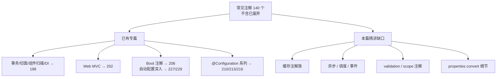

# Spring 注解完整速查与缺口精讲

198（Spring 注解体系总览）、202（Web MVC 注解）、206（Boot 注解）三篇加起来覆盖了注解体系的大头，但有两个空白：一是**没有一个地方把课件里那份 Spring 注解脑图（脑图即思维导图，是用 xmind 软件梳理出来的；SPRING 注解大全 60+32+48）里的完整 140 个注解一次性摊开做速查**；二是**缓存、异步/调度/事件、validation、scope 这几组还没有专篇**。这一篇就补这两个空白：先给全集速查表，再对尚无专篇的组做精讲，已有专篇的只给跳转，不重复造轮子。

## 先给结论

140 个常见注解（不含已废弃），按框架拆成 Spring Framework 自身 60 个、Spring Web MVC 32 个、Spring Boot 自身 48 个；从功能上看归成 11 类。下面这张图把「已有专篇」和「本篇补的缺口」分开标了。

## 是什么：11 类注解速查表（完整版）

下面清单直接来自课件 xmind，带「★」的是面试高频。需要原理的，先按类别看它有没有专篇。

### Web 相关（多属 Spring MVC，原理见「Web MVC 注解」（202））

- **mapping**：`@Mapping`、`@RequestMapping`★、`@GetMapping`、`@PostMapping`、`@PutMapping`、`@DeleteMapping`、`@PatchMapping`
- **rest**：`@RequestBody`★、`@ResponseBody`★、`@ResponseStatus`、`@RestController`★
- **统一处理**：`@ControllerAdvice`★、`@ExceptionHandler`★、`@RestControllerAdvice`★
- **参数**：`@RequestHeader`、`@CookieValue`、`@PathVariable`★、`@RequestParam`★、`@MatrixVariable`、`@RequestPart`
- **转换与格式化**：`@DateTimeFormat`、`@NumberFormat`、`@InitBinder`
- **validation**：`@Validated`★
- **scope**：`@ApplicationScope`、`@RequestScope`、`@SessionScope`、`@ModelAttribute`★、`@RequestAttribute`、`@SessionAttribute`、`@SessionAttributes`
- **ajax**：`@CrossOrigin`

### Boot 自动配置相关（原理见「Boot 注解」（206）；自动配置底层机制深入见「自动配置深入」（227 / 229））

- **auto**：`@AutoConfigurationPackage`、`@AutoConfigureAfter`、`@AutoConfigureBefore`、`@AutoConfigureOrder`、`@ImportAutoConfiguration`、`@SpringBootApplication`★、`@EnableAutoConfiguration`★、`@SpringBootConfiguration`
- **condition**：`@ConditionalOnBean`、`@ConditionalOnClass`★、`@ConditionalOnCloudPlatform`、`@ConditionalOnExpression`、`@ConditionalOnJava`、`@ConditionalOnJndi`、`@ConditionalOnMissingBean`★、`@ConditionalOnMissingClass`、`@ConditionalOnNotWebApplication`、`@ConditionalOnProperty`★、`@ConditionalOnResource`、`@ConditionalOnRepositoryType`、`@ConditionalOnSingleCandidate`、`@ConditionalOnWarDeployment`、`@ConditionalOnWebApplication`
- **properties**：`@EnableConfigurationProperties`★、`@ConfigurationProperties`★、`@ConfigurationPropertiesBinding`、`@ConfigurationPropertiesScan`、`@ConstructorBinding`、`@DeprecatedConfigurationProperty`、`@NestedConfigurationProperty`、`@DefaultValue`、`@Name`
- **convert**：`@DataSizeUnit`、`@Delimiter`、`@DurationFormat`、`@DurationUnit`、`@PeriodFormat`、`@PeriodUnit`
- **其它**：`@DependsOnDatabaseInitialization`、`@EntityScan`、`@BatchDataSource`、`@FlywayDataSource`、`@LiquibaseDataSource`、`@QuartzDataSource`、`@QuartzTransactionManager`、`@JsonComponent`、`@LocalRSocketServerPort`、`@LocalServerPort`、`@ServletComponentScan`

### 依赖注入（原理见「Spring 注解体系总览」（198））

`@Autowired`★、`@Qualifier`★、`@Value`★、`@Lookup`

### 缓存（本篇精讲）

`@EnableCaching`★、`@CacheConfig`、`@CacheEvict`、`@CachePut`、`@Cacheable`★、`@Caching`

### 组件扫描与配置类（原理见「Spring 注解体系总览」（198））

`@Component`★、`@Controller`★、`@Service`★、`@Repository`★、`@Indexed`、`@ComponentScan`★（`@Filter`）、`@ComponentScans`、`@Conditional`、`@DependsOn`、`@Description`、`@Configuration`★、`@Bean`★、`@Import`★、`@ImportResource`、`@Lazy`★、`@Primary`★、`@Profile`、`@PropertySource`★、`@PropertySources`、`@Role`、`@Scope`★

### 切面（原理见「Spring 注解体系总览」（198））

`@EnableAspectJAutoProxy`★、`@EnableLoadTimeWeaving`、`@Configurable`

### 事件、调度、异步（本篇精讲）

`@EventListener`★、`@TransactionalEventListener`、`@EnableAsync`★、`@Async`★、`@EnableScheduling`★、`@Scheduled`★、`@Schedules`

### 核心与监控

- **核心**：`@AliasFor`、`@Order`★
- **监控（JMX，日常少用）**：`@EnableMBeanExport`、`@ManagedAttribute`、`@ManagedMetric`、`@ManagedNotification`、`@ManagedNotifications`、`@ManagedOperation`、`@ManagedOperationParameter`、`@ManagedOperationParameters`、`@ManagedResource`

### 事务（原理见「Spring 注解体系总览」（198））

`@EnableTransactionManagement`★、`@Transactional`★

### lang（框架内部自用，可跳过）

`@NonNull`、`@NonNullApi`、`@NonNullFields`、`@Nullable`、`@UsesSunMisc`

## 为什么：补上没有专篇的几组

### 缓存注解族（声明式缓存）

`@EnableCaching` 开启声明式缓存；真正干活的是 `CacheManager`，注解只是声明。四个核心注解要分清职责：

- `@Cacheable` 先查缓存，命中直接返回，未命中才执行方法并把返回值回填缓存。它适合「读多写少」的方法。
- `@CachePut` 不管缓存有没有，都执行方法并把结果写入缓存，用来更新缓存。注意它和 `@Cacheable` 经常成对出现，但语义不同：一个读、一个写。
- `@CacheEvict` 淘汰缓存，可以只删某个 key，也可以用 `allEntries = true` 清空整个缓存区。
- `@Caching` 在一个方法上组合多个缓存操作（比如又填又删）。
- `@CacheConfig` 放在类上，抽离这一类缓存的公共配置（缓存区名字、key 生成器、缓存管理器），方法上的注解就不用重复写。

key 的生成默认是 `SimpleKey`（按方法参数生成），也可以用 SpEL 自定义，比如 `@Cacheable(key = "#id")`、`@Cacheable(key = "#root.methodName")`。要注意它和「缓存击穿、雪崩、穿透」那类主题不在一个层面：后者聊的是缓存中间件怎么保护，这里聊的是 Spring 自己的注解抽象，底层接什么 `CacheManager`（Redis、Caffeine、Ehcache）都能换。

### 异步、调度与事件

- `@EnableAsync` + `@Async` 让方法异步执行。`@Async` 标注的方法会被提交到线程池，调用方不阻塞等结果。老坑：类内部方法调自己的 `@Async` 方法不生效，因为没走代理，这和 `@Transactional` 自调用失效是同一类问题。
- `@EnableScheduling` + `@Scheduled` 做定时任务。`cron` 按表达式；`fixedRate` 以上一次开始时间为基准固定间隔；`fixedDelay` 以上一次结束时间为基准。`@Schedules` 可以在一个方法上挂多个 `@Scheduled`。
- `@EventListener` 监听 Spring 容器发布的事件，解耦组件间调用；`@TransactionalEventListener` 更精细，可以绑在事务的提交后、回滚后等阶段再处理，适合「事务成功后再发消息」这类场景。

### validation 与 scope 注解

- `@Validated` 是 Spring 提供的校验开关（注意和 JSR 的 `@Valid` 区分：`@Validated` 支持分组校验和类级别的方法参数校验，`@Valid` 多用于嵌套对象级联校验）。配合 `javax.validation` 的 `@NotNull`、`@Size` 等约束注解，能在方法入口统一拦截非法参数，不必在每个方法里手写 if。
- scope 这组里，`@RequestScope` / `@SessionScope` / `@ApplicationScope` 让 bean 分别活在一次请求、一次会话、整个应用里，和原型、单例并列；`@ModelAttribute` 有两个常见用法，一是标注在方法上做「每个请求前的公共模型预处理」，二是标注在参数上把表单字段绑到对象；`@SessionAttributes`（类级别）指定哪些模型属性存进 session。

### properties 的 convert 细节（「Boot 注解」（206）没展开的部分）

`@ConfigurationProperties` 绑定配置时，类型转换靠 convert 这组注解撑着：`@DurationFormat` 把 `10s`、`5m` 绑成 `Duration`；`@PeriodFormat` 处理 `Period`；`@DataSizeUnit` 把 `1024KB` 之类的容量串绑成 `DataSize`；`@ConstructorBinding` 支持把配置绑到构造器参数上，配合不可变类（甚至 record）做类型安全配置；`@DefaultValue` 给没配的字段兜底默认值，`@Name` 指定绑定时的字段别名。

## 面试怎么答

被问「Spring 有哪些常用注解」或「Spring Boot 注解」时，分两步：先说全貌：常见注解共 140 个（不含已废弃），按框架拆成 Spring 自身 60 个、Web MVC 32 个、Boot 48 个，按功能归 11 类；再挑重点，已有专篇的组按各自套路答：事务、切面、组件扫描与 DI 见「Spring 注解体系总览」（198），Web MVC 见「Web MVC 注解」（202），Boot 见「Boot 注解」（206）。本篇补的缺口里挑缓存和异步两个点说：缓存讲清 `@Cacheable`/`@CachePut`/`@CacheEvict` 的读、写、删分工；异步讲清 `@Async` 自调用不生效的坑。能同时给出「全景 + 专篇定位 + 缺口精讲」，比背一长串注解名值钱得多。

## 常见误区

**误区一：把「缓存中间件怎么保护」和「Spring 怎么声明缓存」混为一谈。** 缓存击穿、雪崩、穿透是 Redis 这类缓存中间件本身的「方案层」问题，讲的是怎么给缓存加锁、错峰过期、预热来兜底；`@Cacheable` 这套是 Spring 的「抽象层」注解，只负责声明「这个方法的结果要进缓存」，底层接 Redis、Caffeine 还是 Ehcache 都能换。一个谈的是「怎么让缓存不崩」，一个谈的是「怎么少写缓存代码」，两层别混。

**误区二：以为 `@Cacheable` 和 `@CachePut` 差不多。** 前者命中就短路不执行方法，后者永远执行并写缓存。想「读时回填、写时更新」就得两个配合，用错语义缓存会失效。

**误区三：以为 `@Async` 标了就异步。** 同类内部自调用不生效，必须走代理（被别的 bean 调用，或自己注入自己再调）。和 `@Transactional` 自调用失效同源。

**误区四：分不清 `@Validated` 和 `@Valid`。** 前者是 Spring 的，支持分组校验和方法级校验；后者是 JSR 标准，多用于嵌套级联。校验不生效时先确认引的是哪一个、有没有真正进校验器。

**误区五：以为 `@RequestScope` 这类注解凭空生效。** 它们定义的是 bean 的生命周期作用域，得配合组件扫描和对应作用域的解析器；脱离 Spring 容器单独提「作用域」没有意义。
