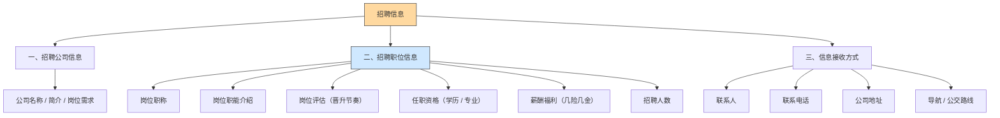
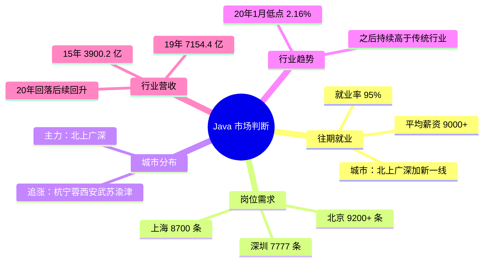

# Java 市场篇：往期就业数据、岗位需求量与招聘信息怎么读

学 Java 的人，心里多半悬着几个很具体的问题：现在市场上还要不要 Java 开发？我不是科班出身、学历也不算高，能不能找到工作？不在北上广深，回老家的省会城市还有没有机会？毕业之后薪资大概落在什么水平？空讲道理没说服力，直接看数据。本文围绕三点展开：先看公开就业样本的真实数据，再看各大城市的岗位需求量，最后把招聘信息里的条目一条条拆开讲清楚。

> **读前须知**：这是系列的「市场观察」篇。读它之前最好先看完工作篇（搞清楚岗位长什么样），它会用公开就业样本的数据，回答你最关心的几个问题：现在还要不要 Java、回老家省会能不能找到工作、薪资大概多少。看完再去写简历、投简历，心里更有底。

## 先给结论

- 从公开就业样本看，就业率约 95%，平均薪资在 9000 以上；就业城市集中在北上广深，武汉、重庆、杭州这类新一线城市也有不少。
- 学历确实有影响，但不是决定性的。技术岗位最终看技术，专科和本科的实际差距不大。公开样本中，一位 20 年专科毕业的求职者，在广州拿到 10k。
- 北京当天搜索「Java 开发工程师」，有 9200 多条招聘信息，来自 19 家招聘网站；上海 8700 条，深圳 7777 条。
- 程序员主要聚集在北、上、深，近些年杭州、南京、成都、西安、武汉、苏州、重庆、天津的岗位也越来越多。
- 2020 年 1 月是互联网行业招聘需求的最低点 2.16%，此后一直高于传统行业，到现在不但没有掉下去，还有回升。
- 计算机行业营业收入从 2015 年的 3900.2 亿元增长到 2019 年的 7154.4 亿元，20 年上半年受疫情影响回落，之后持续回升。
- 招聘信息拆成三块看就够了：招聘公司信息、招聘职位信息、信息接收方式。
- 程序员不是吃青春饭。天花板哪个行业都有，能保证学到的东西换来一份合适的工作，就已经解决问题了。

## 就业样本数据：就业率 95%，城市和薪资长什么样

先说本篇结构，本文围绕三点展开：公开就业样本的数据展示，当前各岗位的市场需求量，以及职业招聘信息怎么读。

第一张图是近期样本的就业情况，表头列的是学科方向与就业信息，往下是就业公司、期望就业薪资和就职城市。从薪资和城市这两列看，求职者找工作主要集中在北上广深这样的一线城市，武汉、重庆、杭州这些新一线城市也有分布，薪资基本在 10k 以上。

图上给出的整体数据是就业率 95%，平均薪资在 9000 以上，公开资料中写的平均值是 9023 元。表里的岗位包括前端、产品、Python，还有 Java 开发工程师，毕业薪资都比较可观。

所以担心毕业找不到工作，或者担心薪资达不到预期，其实可以先放下。只要踏踏实实把要掌握的内容学完，求职前认真复习、认真面试，出去找工作基本都能找到合适的。从已有样本看，前人能找到，后来者没有理由找不到。

需要说明一点，这里展示的只是一部分数据。样本覆盖全国多地，还有很多其他城市的就业情况因为信息太多没有全部放上来，这里只是节选。

**第一，不在一线城市能不能找到工作。** 很多人会问，我不在北上广深，还能不能干这行。答案是能。杭州、苏州、东莞，或者西安这类各大省会城市，都可以在 BOSS 直聘、智联招聘、前程无忧上搜一下你即将从事的岗位，需求量都相当大。

**第二，下面看三个更具体的样本。** 前面那张表是所有样本的汇总，后面每张只对应一位求职者。

第一位样本成功入职浪潮，薪资 10.5k，是 2019 年的本科毕业，学完之后拿到了这份工作。第二位入职广州的一家公司，薪资 10k，是 20 年的专科毕业。第三位是 17 年的本科毕业，入职贵州的一家公司，薪资 8k，8k 放在贵州这样的城市已经算可观，那边整体薪资水平并不算高，他选择去贵州应该是个人原因。

**第三，这几个样本说明什么。** 学历这个东西对求职有影响，但没有决定性影响，专科和本科的差异并不大。技术岗位讲究的还是技术，学得好，基本都能找到符合自己预期的薪资。把这些数据放在一起看，结论也很直接：无论你在北上广深，还是在二三线城市，都能找到一份比较合适的工作，开发岗位的薪资普遍不算太低。

已就业样本的信息就到这里。对于还没开始找工作的人来说，这些都是过去式，真正要关心的是未来的岗位在市场上的前景如何。

## 市场需求量：北京 9200 多条，上海 8700 条，深圳 7777 条

看岗位需求量的图，重点看两个维度。一个是地区，这里选的是北京，看开发岗位当然从一线城市开始看。另一个是岗位，搜索的关键词是「Java 开发工程师」。

**第一，筛选条件为什么不做限制。** 页面上有很多限制条件，这里基本没有做筛选，原因很简单，求职者的情况太不一样了：有的是应届毕业生，有的已经工作好几年，还有的毕业多年但没有互联网从业经验；学历上专科、本科、硕士、博士都有；地区也没有具体划分；薪酬水平就更没法统一，期望薪资和目标城市是匹配的，城市不一样，薪资自然有区别。

**第二，不筛选之后剩下的量有多大。** 这些搜索都是当天做的，也就是说，当天在北京这个地区搜索「Java 开发工程师」，一共是 9200 多条招聘信息，来自 19 家招聘网站。智联招聘、前程无忧、BOSS 直聘、猎聘、百度百聘、拉勾这些耳熟能详的站点，都发布了 Java 开发工程师的岗位，没列出的站点同样有。这些信息汇总起来，可以在职友集这样的网站上直接查到。临近求职的时候，隔三差五去搜一次「Java 开发工程师」到底有多少岗位，是很有必要的。

**第三，9000 多条是什么概念。** 把学历、经验、地区、薪酬这些条件全部筛完，剩下的依然是一大批可观的、符合自身条件的岗位。筛完之后可能还有 1000 个到 2000 个，就算往少了说只剩 500 个，拿这 500 个岗位去投简历，换来的面试机会已经足够多，想在其中找到一家符合期望薪资、离家近、又有一定规模的公司，并不是什么难事。

**第四，换城市还有没有这么多。** 有人不想去北京，想去别的城市。往下看深圳的数据，深圳的岗位不如北京多，但差距并不大，数字也比较有意思，是 7777 条 Java 开发工程师的招聘信息。再看上海，上海的 8700 条和北京也差不太多。

这些信息综合起来传递的信号很清楚：Java 这个岗位在各大城市的需求量都比较大。选择 Java 方向的求职者，眼光是有前瞻性的，市场不会让人失望，薪资也不会让人失望。

## 程序员都集中在哪些城市

前面说的是某一个岗位的市场需求情况，现在看程序员这个群体本身的城市分布。

**第一，主力还是北上广深，但新一线在追上来。** 互联网从业者基本集中在北上广深，但从图上能看出，近些年杭州、南京、成都、西安、武汉、苏州、重庆、天津这样的城市，这类岗位也在越来越多。数据来自猎聘网，图上北京 24.38 万，上海 19.7%，深圳 11.7%，三地相对居高，其他城市之间差距并不大。

**第二，折线部分是薪资，单位是万元。** 北上广深机会多，薪资也高于其他城市，但相对的压力肯定也是有的。

**第三，怎么选，取决于你要什么。** 想有更好的平台、更好地施展个人才能，就选一线城市。不想太累、不想长期处于 996 的工作状态，可以选相对平缓一些的新一线或者二线城市，这都看自己的选择。

## 行业对比：互联网招聘需求为什么还在涨

去年情况特殊，疫情加速了信息化的发展。很多公司面临倒闭、裁员，但居家办公又让互联网相关岗位迅速发展，20 年程序员的招聘需求高于所有行业。

这张折线图这么看：蓝色线是互联网行业，黄色线是传统行业，横轴是 2018 到 2020 年。20 年 1 月是最低点，2.16%，从那之后一路往后，互联网行业的招聘需求始终高于传统行业。

到现在已经过去这么久了，互联网行业的招聘需求非但没有下落，还有一定的回升。之前很多公司的项目停滞了，疫情一好转，所有项目重新启动，都在加大力度招人。所以往后看，这个岗位只会越来越好，不会越来越差。

也有人常说市场饱和。市场一直在发展，只要发展就有需求，有需求就可以去从事这个岗位、这个行业。想进互联网行业的，越早上车越好。

## 计算机行业的营收曲线

再看计算机行业的收入情况。这张图统计的是 15 年到 20 年上半年计算机行业的营业收入，数据来自华经情报网。

从 15 年开始一直到 2019 年，每年都呈现递增状态，2015 年是 3900.2 亿元，2019 年涨到 7154.4 亿元。20 年出现回落，原因是疫情的影响。随着疫情好转，这个数据一直在回升，后续也会持续跟踪，有兴趣的可以去华经情报网上自己查询，互联网每年的营收数据还是相对可观的。

所以选择这个行业，眼光同样是有前瞻性的。这里再重申一次：程序员并不是吃青春饭的。有人担心程序员到了一定年纪会不会遇到天花板，天花板这个说法确实存在，但哪个行业、哪个岗位没有天花板？在现有条件下，能保证学到的东西换来一份合适的工作，这就够了。

## Java 与人工智能：是威胁还是新机会

聊市场不能只盯着当下的岗位数量，技术风向本身也在变。这两年 AI 火得不行，Java 程序员心里最绕不开的一个问题是：AI 会不会把 Java 开发这个岗位吃掉？

先把几个词理清楚。机器学习是实现人工智能的一种方法，深度学习是实现机器学习的一项技术，而人工神经网络是深度学习领域里最常用的算法。所以 AI 不是一把单一的锤子，是一层层叠起来的技术栈，越往下越偏算法和数学，越往上越偏工程落地。

落到 Java 这边，现实的位置其实很清楚。业内对这块的普遍分工是：研究人员负责设计和训练模型，编程人员负责把训练好的模型接到业务系统里调用。说白了，绝大多数 Java 工程师要做的不是从头去训一个模型，而是把别人训好的模型，稳稳地接进自己写的 JavaEE 系统。这个定位反而让 Java 工程师更吃香，因为能跑在生产环境、能扛住业务的，恰恰是有工程底子的 Java 人。

真要上手，Java 生态里能用的机器学习库也不少：DeepLearning4J（圈内叫 DL4J）、Weka、MOA、Mallet、ELKI。其中 DL4J 最贴近 Java 工程师的习惯，想试水从这个切入最顺。

回到求职这件事。面试时被问到 AI，面试官通常不是要你现场训模型，能把 AI 和 Java 怎么配合讲清楚、知道 Java 有哪些现成的库，就已经比大多数人到位。这部分从原理到手写实现，相关的延伸资料里有完整的讲解。

结论一句话：AI 对 Java 是增量机会，不是替代。会调模型、能把模型接进系统的 Java 工程师，只会越来越值钱。

## 招聘信息怎么读：拆成三块

把招聘信息按下面这张图拆成三块，看的时候对着图逐块核对：

招聘信息看起来长，其实可以划成三个部分。

**第一，招聘公司信息。** 也就是公司名称、公司简介和岗位需求。公司先要自报家门，是上市公司，还是世界 500 强，或者是中小型公司、创业型公司，发布的时候都会有一段简介。简介一般会写得高大上一些，用意很明确，就是吸引人才。岗位需求一定要写清楚，招的这个岗位具体需要哪些职业技能，一条条列出来，让求职者能一一对应自身情况。

**第二，招聘职位信息。** 这一块包含的内容最多。

岗位职称，也就是岗位叫什么名字。岗位职能介绍，说清楚这个岗位具体干什么。岗位评估，指的是未来短时间内这个岗位的晋升情况，到这家公司之后，半年之内能升一次职，还是一个月之内，或者一个季度，要看公司的具体情况。任职资格，就是任职这个岗位需要什么资格：学历上是要统招本科，还是要本科以上、硕士研究生，或者只要有专科就可以；专业是否有限制。薪酬福利也要说清楚，公司有五险一金、六险一金还是八险一金，这直接影响你去不去。招聘人数同样要写明，这个岗位现在招十个人、五个人还是一个人。

**第三，信息接收方式。** 首先是联系人，联系人一般不会写全称，但会有一个姓氏，比如王女士、李先生这种。联系方式里的电话肯定要写清楚，不然怎么联系。然后是公司地址，地址必须明确写明，不然面试的时候怎么准确找到公司。最后是导航和公交路线，教你怎么坐车，去某个地方面试是坐公交方便还是坐地铁方便。地铁一般比较准时，公交可能会出现拥堵晚点，这些都要提前规划好，避免面试时出现不必要的迟到，给对方留下不好的印象。

**第四，地址对不上怎么办。** 有的求职者面试时会遇到这种情况：查到的公司地址在某处，但对方通知去面试的地方并不在那个地址。这种情况确实存在，有的公司或者集团，集团本身在一个位置，技术部门单独拿出来在别处办公，不在本公司办公，虽然不多，但有。遇到这种情况自己搞不清楚，就联系就业指导（职业顾问），请其帮你核实信息、做分析。

## 回顾：本文的三块内容

本文围绕三点展开。第一是就业样本数据，也就是已就业求职者的薪资、城市、公司等情况。第二是 IT 行业的发展前景，你所处的岗位和行业现在发展如何、未来的趋势怎么样，都一一做了说明。第三是职位招聘信息的解析，招聘信息里那些条目具体怎么看，前面已经重点讲过。

## 市场判断一图流

把前面几块数据合到一张图里，方便你做「要不要入行 Java」的判断：

## 常见误区

- **误区一**：只看「Java 岗位 9200 多条」这个总数就下判断。真实可用的是按学历、经验、城市、薪资筛完之后剩下的那部分，哪怕只剩 500 个也足够投。
- **误区二**：把学历当成决定性因素。它有影响，但技术岗位最终比的是技术，专科和本科的差距并没有想象中那么大。
- **误区三**：认为只有北上广深才有机会。杭州、苏州、东莞、西安这类城市的岗位需求量同样可观，新一线和第二梯队的城市这两年增长明显。
- **误区四**：面试前不核实办公地址、不规划路线。集团和技术部门分址办公的情况是存在的，临时才发现地址不对，很容易迟到，第一印象就砸了。

## 要点回顾

- 公开就业样本显示就业率约 95%，平均薪资 9000 以上，城市集中在一线与新一线；学历有影响但非决定性，技术岗位最终看技术。
- 一线及新一线对 Java 岗位需求量大：北京 9200+ 条、上海 8700 条、深圳 7777 条，按条件筛后仍有可观岗位。
- 互联网招聘需求长期高于传统行业，计算机行业营收持续增长；程序员并非「吃青春饭」。
- AI 对 Java 是增量机会而非替代，工程落地能力让 Java 工程师更吃香。
- 读招聘信息抓三块：公司信息、职位信息、接收方式；遇地址不符可联系就业指导（职业顾问）核实。
