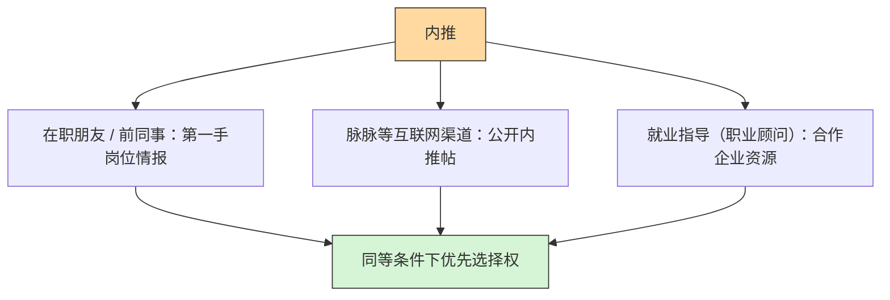
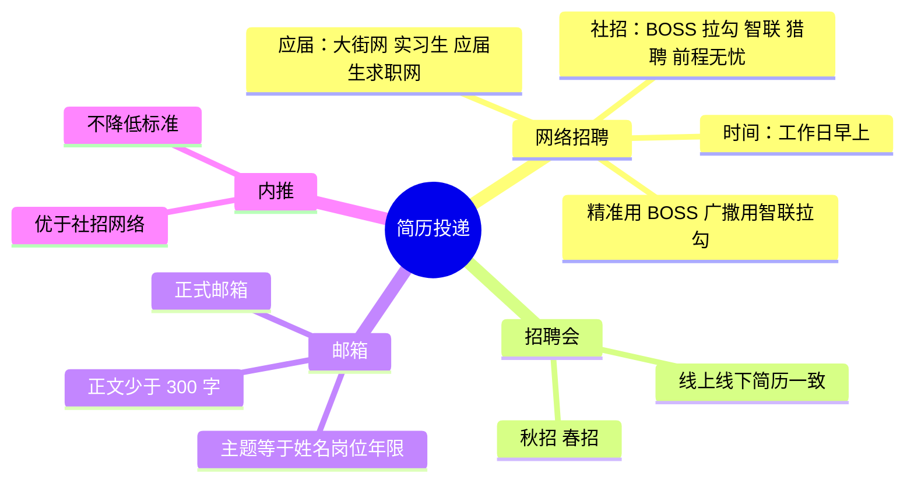

# 简历投出去没回音：渠道、时间、频次和格式里的讲究

简历做完了，接下来就是投。可同样是投，有人两天就能接到面试电话，有人投了几百份一点动静都没有。差别往往不在简历本身，而在投递这件事上：网站选得准不准，时间挑得合不合适，量够不够，邮件标题和正文是不是让 HR（人力资源，也就是收你简历的那位招聘负责人）一眼就能找到你。这篇就按网络招聘投递、招聘会投递、邮箱投递和内推四个场景，把这些细节捋一遍。

> **读前须知**：简历写好了，这一篇讲「投」的讲究：渠道怎么选、时间怎么挑、量怎么控、邮件怎么写。读完制作篇和这一篇，你的简历才算真正进了招聘方的视野，下一步就是面试。

## 先给结论

- 投递渠道分线上和线下，眼下很多招聘会也都转到了线上，四个场景分别是网络招聘投递、招聘会投递、邮箱投递、内推。
- 社招重点关注 BOSS 直聘、拉勾、智联、猎聘、前程无忧；应届生重点关注大街网、实习生、应届生求职网。
- 投递时间尽量选工作日早上，配合 HR 的筛选习惯；下午投的话就选在两点左右。
- BOSS 适合精准投递，智联和拉勾上尽量多投一些；学历和工作经验不占优势时，建议每天投 30 到 50 份左右，条件不错就精准投递。
- 简历和岗位要匹配，投的岗位不能跟自己的方向打架；同一家公司同一个岗位不要反复投。
- 简历命名用姓名、岗位、工作年限这个格式，线上简历和纸质简历保持一致。
- 内推优于社招和网络投递，但内推不会降低要求，只是同等条件下你的优先选择权更大。

## 网络招聘投递：先把网站挑对

**第一，社招看这几个网站。** BOSS 直聘、拉勾、智联、猎聘、前程无忧，参加社招的话尽量关注这几个。

**第二，应届生看这几个网站。** 大街网、实习生、应届生求职网，身份不一样，主战场也不一样。

**第三，投递时间有讲究。** 不管是社招还是应届生，投递的时候尽量选择工作日、尤其是工作日的早上，配合 HR 他们筛选简历的习惯。如果下午投，尽量选在两点左右。

**第四，精准投递还是广撒网。** 如果想要精准投递，BOSS 是一个非常不错的选择。要是在智联和拉勾上投，尽量多投一些，投递的频次根据自己的情况来定：学历不是很占优势、工作经验也不是很占优势的话，建议你每天投个 30 到 50 份左右；学历可以、工作经历也可以，那就精准投递，别浪费时间在明显不匹配的岗位上。

**第五，招聘是有周期性的。** 正好赶在金三银四或者金九金十这几个月份，找工作相对就容易一些；要是赶在年末，求职的难度会稍微大一点，薪资也可能偏低一些。

**第六，岗位和简历要匹配。** 投递的时候一定要注意，投的岗位跟你的简历是不是匹配的。你本来要投开发岗位，结果测试和运维的岗位也都投了，人家招你过去做了运维，干了一年之后再想转开发就比较难了。

**第七，不要重复投递。** 尽量不要投递同一个公司的同一个岗位，更不要多次投递同一个岗位，这样并不合理。

**第八，命名和一致性。** 简历命名的格式，一定要选择姓名、岗位和工作年限这样的写法。在网站上投递还要注意一点，线上简历和纸质简历一定要保持一致，别现场拿出来的是另一版。

## 招聘会投递

**第一，秋招和春招是主线。** 现在的招聘会主要分为秋招和春招，秋招的规模可能会更大一些。有的学校也会组织一些线下的招聘会，如果你是应届生，这几个时间段要注意一下。

**第二，校招信息从哪里看。** 一些企业会通过官网、公众号、小程序释放校招的岗位信息，可以根据自己的意向去关注和投递。

**第三，频次同样要克制。** 一定要注意投递的频次，尽量不要同一个公司同时投递多个岗位，也不要多次投递同一个岗位。

**第四，现场看的是整洁和沟通。** 投递的时候或者参加招聘会的时候，简历一定要保持整洁，线下招聘会一定要保持良好的形象，多和用人单位进行沟通。

## 邮箱投递

**第一，选一个正确的邮箱。** 尽量选择正式一些的邮箱，比如网易邮箱、学校的邮箱等等。

**第二，投递时间选工作日的上午。** 工作日里又以周一到周四的上午更合适，不要重复投递同一个公司同一个岗位。

**第三，注意你的昵称。** 有些求职者的邮箱昵称是一溜数字或者一溜字母，这样 HR 很不方便找到你。昵称可以简单写上你的求职基本信息，比如姓名、岗位、工作年限等等。

**第四，邮件主题要突出。** 主题尽量和简历的命名保持一致，让对方一眼就知道这封邮件是干嘛的。

**第五，正文不要写太多字。** 之前见过有求职者在正文里洋洋洒洒写出一整篇小作文，这种 HR 基本上没有时间看。用一两句话、两三句话简述一下你的求职意向就可以，或者把简历的内容直接粘贴到正文里，HR 打开邮件就能看到你的内容，连附件都不用下载。正文控制在 300 字以内是比较稳妥的。

## 内推

内推有三条可以发力的路径，画成下图，优先顺序自上而下：

**第一，内推是什么。** 现在很多公司都有内推机制，指的是公司内部的员工有内推名额，可以帮周围的熟人或者之前的同事做推荐。这样可以大大节省招聘的流程，成功的几率也会大一些。同时如果你认识的在职朋友正好在这个岗位上，还能提前了解第一手的情报。所以内推要远远优于社招或者网络投递这类方式，这方面一定要多关注。

**第二，找谁内推。** 如果你有认识的在职朋友或者前同事在意向的企业里，一定要联系人家，让人家帮忙内推一下，顺便问问这个岗位现在的需求大致是什么样的、你这边需要做哪些准备。

**第三，互联网渠道也能用。** 实在没有认识的人，可以找一些互联网渠道，像脉脉这个 APP 就不错，里面经常有人发布内推的招聘需求，可以根据自己的情况去联系。

**第四，别忘了寻求就业指导（职业顾问）的帮助。** 对方有一些合作企业，也有内推的渠道，把自己的情况跟对方沟通一下，对方有合适的岗位，肯定会第一时间给到你；如果暂时没有，那就只能选择其他渠道了。

**第五，内推很重要，但不是唯一，也不降标准。** 内推只是求职的一种方式，不是唯一的通道，可以根据自己的情况来选择。另外，内推并不等于要求上的降低，把简历内推过去之后，你更可能获得的是优先选择的权利：你和另外一个应聘者水平一致，从业经历或者学历也一致，那你的优先选择权会更大一些。所以内推很重要，但自身也要有实力。

## 最后再捋一遍

投递的时候尽量选择适合自己的网站：社招的话，尽量选择 BOSS、拉勾、猎聘；应届生的话，尽量选择大街网、实习生、应届生求职网这些。投递量上，以每周的面试量处在一个合理范围内为宜，每周 5 到 10 家，每天有一家到两家左右就行。邮箱投递这一块，一定要注意投递的时间和格式，方便 HR 找到你。

## 投递策略一图流

把四个场景和各自的关键讲究合到一张图里，投递前对照一遍：

## 常见误区

- **误区一**：不管自己是社招还是应届生，逮着一个网站就投。身份不同，主战场不同，选错了网站等于白投。
- **误区二**：深更半夜或者周末投简历。挑工作日早上，让简历出现在 HR 打开后台的第一屏里。
- **误区三**：海投不看匹配度，开发、测试、运维一把抓。入职方向一旦被带偏，后面想转回来很难。
- **误区四**：同一家公司同一个岗位反复投递。这不会增加你的机会，反而显得不合理。
- **误区五**：邮箱昵称是一溜数字，正文写成长篇小作文。HR 找不到你是谁，也没时间读完。
- **误区六**：以为内推等于放宽要求。内推给的是同等条件下的优先权，实力不够照样过不了。

## 要点回顾

- 渠道分线上（网络招聘、邮箱）与线下（招聘会、内推）；社招看 BOSS/拉勾/智联/猎聘/前程无忧，应届看大街网/实习生/应届生求职网。
- 投递时间选工作日早上，岗位与简历要匹配，同一公司同一岗位勿反复投；每天投 30–50 份适合优势不突出者，条件好则精准投递。
- 邮箱投递用正式邮箱、主题等于「姓名+岗位+年限」、正文控制在 300 字内。
- 内推优于社招与网络投递，但不降低标准，只给同等条件下的优先权；可找在职朋友、前同事或公开内推渠道。
