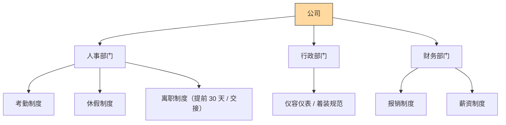
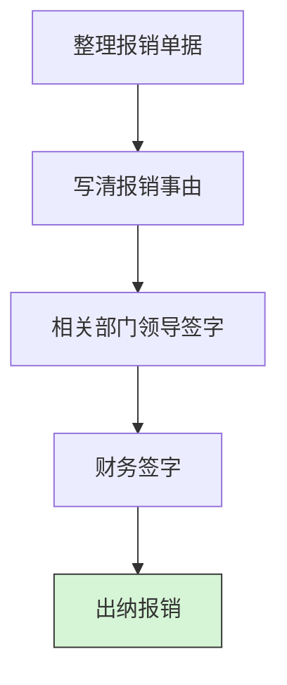
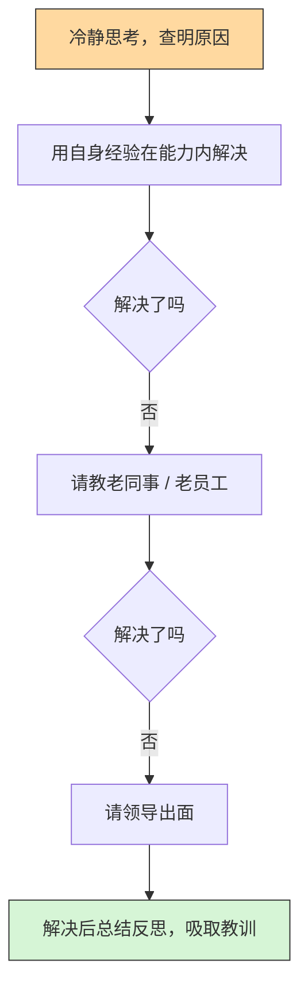

# 试用期怎么过：部门制度、避坑要点和转正之后的五种结果

入职之后最先要搞明白的，是公司的规矩由谁定、具体管什么。迟到怎么算、请假找谁批、报销走什么流程、办公室里哪些事不能做，看起来都是小事，但这些事踩一个坑，在试用期里代价就格外大。再往后，试用期遇到问题解决不了怎么办、公司发了 offer 又反悔要不要负责、转正之后会是哪种结果，也都有章可循。这篇就按部门制度、求职陷阱、劳动合同、问题应对、试用期结束结果这一条线往下讲。

> **读前须知**：这是「求职到入职」系列的最后一篇。前面七篇从了解行业一路讲到拿到 offer，这一篇收尾：讲清试用期里公司的规矩、常见的求职陷阱、劳动合同要点，以及转正之后的五种结果，帮你平稳落地、顺利转正。

## 先给结论

- 一般公司必设的三大部门是人事、行政、财务，对应人事制度、行政制度和财务制度。
- 人事制度主要管考勤、休假和离职。离职一般要提前三十天通知公司，按规定进行工作交接、归还公司物品。
- 财务制度主要管报销和薪资，包括薪资构成、薪资发放和薪资核算，发薪时间由财务部门根据核算周期制定。
- 行政制度管仪容仪表和着装规范。男性着装要求干净、合体、专业；女性要求头发干净利落、着装合体干净。
- 工作礼仪上，上班时不高声说笑、不大声喧哗，举止端庄，同事之间互相关怀尊重，协商配合完成工作。
- 求职陷阱最惯用的伎俩是收费：风险押金、保证金、违约金、中介费、培训费、体检费、服装费等等。凡是涉及收费的，一定要保持十二分警惕。
- 录用通知书是用人单位的要约。签发后即使还没签劳动合同，公司反悔并给劳动者造成损失的，应当承担赔偿责任。
- 试用期工资不得低于用人单位所在地的最低工资标准，不得低于本单位相同岗位最低档工资的 80%，或者不低于劳动合同约定工资的 80%，一般为转正工资的 80%。
- 入职第一天就应该签订劳动合同并开始缴纳社保；试用期不得单独设定；同一用人单位与同一劳动者只能约定一次试用期。
- 试用期遇到问题，先冷静思考查明原因，再用自己的经验在能力范围内解决，解决不了请教老同事，还不行再请领导出面，最后总结反思、吸取教训。
- 试用期结束后有五种结果：升职加薪、平安无事、无疾而终、中途被炒、临阵退缩。

## 企业制度分三大类

三大部门以及各自管的制度，画成下图，一眼看清「规矩由谁定、管什么」：

一般公司必设立的三大部门，也是和职场人息息相关的三个部门：人事、行政、财务。有这三个部门，就有人事制度、行政制度和财务制度。

先说人事制度，主要有三块。

**第一块是考勤制度。** 平时上下班打卡、迟到早退、旷工、出差等等，这些都要记录考勤。

**第二块是休假制度。** 公假、事假、病假、婚假、丧假、产假、年假，这些休假制度也是人事部门设定的。

**第三块是离职制度。** 一般情况下，公司员工的入职和离职都由人事部门来安排，所以离职也有相应的制度。比如离职的时候要提前三十天通知公司，按规定进行工作交接，归还公司物品，这些都是制度里写明的。

## 财务制度：报销和薪资

报销的线下流程画成下图，单据和签字顺序别搞反：

财务制度主要说两块。

**一块是报销制度。** 出差、宴请客户等等产生的消费，需要去财务报销。走线下报销的话，流程是整理报销单据、写清报销事由和缘由、找相关部门领导签字、财务签字，最后出纳报销。

现在有了线上的电子化办公，很多直接通过财务系统提交就可以：拍个照片把发票拍一下上传上去，领导审核、财务审核，最后钱就下来了，相对简单很多。不用再手写整理单据，也省掉了单据写错字要重写的麻烦，速度更快。

**另一块是薪资制度。** 主要包括薪资构成、薪资发放、薪资核算这些。哪天发工资，是财务部门制定的，因为有一个核算周期，发薪时间由他们来确定。薪资的构成，包括底薪是多少、奖金是多少、扣款是多少，也是财务部门在研究制定的。

## 行政制度：仪容仪表与着装

行政制度方面，一般每个公司都会规定员工的仪容仪表规范，还有一些特殊时候的服装规定，比如统一着装之类，这些工作都是行政部门在做。

在工作场合，员工的着装是有要求的，这里稍微提一下。

**男性的着装要求**是干净、合体、专业。头发要干净、精神，衣服也要干净、及时更换。细节方面同样要注意，比如头皮屑、体味、胡须等等。

**女性的要求**相对少一些，注意到位就行：头发干净利落，着装合体干净。

## 工作礼仪：办公室里的几条基本规矩

办公室的工作礼仪还是有必要了解一下的。上班的时候不要高声说笑、大声喧哗，影响其他同事工作；举止要端庄；同事之间要互相关怀尊重，协商互为配合完成工作。

这几条看着简单，但试用期里最容易在这些地方减分。

## 案例：李四为什么当天就被辞退

看一个具体案例。

李四，男，正值试用期。午休时在办公电脑上玩游戏，被分公司的董经理撞见，对方提醒他公司不允许在上班时间用工作电脑玩游戏。李四马上回答说，现在是午休时间，再说我也没玩别的，就玩个小游戏而已。下午的时候，人事专员就通知李四办理离职手续。

想想李四在处理这件事情上有什么不足。

很明显，上班时间是不应该玩游戏的。但被领导提醒之后还不承认自己的错误，这就更不应该了。问题的关键点就在这里：事情本身错了，面对提醒时的态度又错了，两个错误叠加，性质就变了。

## 求职陷阱：凡是收费都要警惕

求职陷阱主要是不法分子和一些单位，利用求职者求职心切的心理，采取骗取财物、个人信息，或者骗取低廉、免费劳动力的一些手段，收取各种名目的费用。

求职陷阱中比较惯用的伎俩就是收费：风险押金、保证金、违约金、中介费、培训费、体检费、服装费等等各种名目的费用。有的人可能也遇到过。

其次，还要警惕挂羊头卖狗肉的招聘欺骗、扣留证件，以及一些色情、传销类的陷阱。求职的时候，凡是涉及到收费的，一定要保持十二分警惕，谨防上当受骗。

还有一个实用的办法：可以去查全国企业信用信息公示系统。去一家公司面试或者入职之前，先在网上了解一下这家公司，其实是可以搜到一些信息的，像天眼查这类工具还是能搜到一些蛛丝马迹的。如果真的是有问题的公司，多半能查出来。多注意就好。

## offer 发了又反悔，公司要不要担责

来看一个试用期可能遇到的问题：企业发出录用通知书之后又反悔了，用人单位是否应该承担责任。

录用通知书是用人单位的要约。通知书签发后，虽然此时用人单位与应聘者之间还没有签订劳动合同，但如果用人单位反悔，而且给劳动者造成了损失，那么用人单位应该对该损失承担赔偿责任。相关法律依据如下：

> 《民法典》第 500 条（原《合同法》第 42 条）规定了缔约过失责任：当事人在订立合同过程中，有其他违背诚实信用原则的行为，给对方造成损失的，应当承担赔偿责任。

所以，用人单位如果对录用通知书反悔，作为求职者是可以要求用人单位赔偿损失的。

这里的损失是直接损失，一般是劳动者的工资损失或者其他支出。具体损失双方可以互相沟通协商，按照双方约定数字的工资数额来计算就可以，也可以按照劳动者从前一个单位离职时的工资来计算。

还有一点要注意：因为双方没有建立劳动关系，这不属于劳动争议。如果要走法律程序，不应该去劳动仲裁，应该直接去法院起诉。

## 劳动合同：试用期工资、期限与辞职

劳动合同签订主要涉及时间、期限和注意事项，这里说几个要点。

**第一，试用期工资有下限。** 试用期工资不得低于用人单位所在地的最低工资标准，不能低于本单位相同岗位最低档工资的 80%，或者是不低于劳动合同约定工资的 80%。试用期工资一般为转正工资的 80%，也就是说试用期的工资基本上都是定在转正工资的 80% 这个样子。

**第二，入职第一天就该签合同。** 入职第一天其实就应该签订劳动合同，而且开始缴纳社保。

**第三，试用期不得单独设定。** 如果用人单位只约定了试用期，没有约定劳动合同期限，那这个试用期就可以视为劳动合同期限。

**第四，同一用人单位与同一劳动者只能约定一次试用期。** 如果用人单位给你约定了一次试用期，同时又约定第二次试用期，那显然是不合规定的。

**第五，哪些情况不能约定试用期。** 劳动合同期限不满三个月的（不包括正好三个月），以及以完成一定工作任务为期限的劳动合同，还有一些非全日制用工的劳动合同，是不能约定试用期的。比如兼职、自由职业者，他们以完成劳动任务为支付工资的方式，就不能约定试用期。

**第六，辞职要提前多久提出。** 试用期辞职，一定要提前三天提出。其实试用期并不规定离职时间提出的期限，但提前提出更好一点。转正之后辞职，一定要提前三十天，也就是一个月提出，这个是有规定的。

辞职的时候应该提交辞呈或者辞职信，电子版也好纸质版也好。因为员工辞职不需要申请，只需要履行告知的义务，我要辞职了，我告诉你就行了，不管你同不同意。不存在说你申请了公司不同意就不能离职这样的规定。

**第七，关于补偿。** 转正之后如果企业要员工立刻离职，是需要给予一个月的代通知金的。签订劳动合同之后如果遇到裁员的情况，可以得到相应的经济补偿赔偿。试用期也是一样的，也要得到相应赔偿。这些都是基本常识，了解一下。

## 试用期遇到问题怎么办

把「先自助、再逐级求助、最后复盘」的处理路径画成图，遇到困难照着走：

试用期遇到问题是比较常见的现象，非常常见，不遇到问题才不正常。去到一个新的工作环境，遇到这样那样的问题肯定是很合理的，非常正常。

但不建议遇到问题时逃避，可以从几个方面去解决。这里给一个思路。

**第一，冷静思考，查明原因。** 冷静下来思考这个问题产生的原因、问题的背景，根据原因找出合理解决问题的对策和方法。

**第二，先用自己的经验解决。** 根据自己以往有效的经验，在自己能力范围之内马上解决。如果真的不知道如何解决，可以请教一下周围的老同事、老员工，去请别人帮忙。

**第三，还是解决不了就请领导出面。** 如果自己想办法、请教同事都行不通，那可能就要请领导出面来解决问题了。

**第四，总结思考。** 问题解决了之后，要总结思考一下这个问题是怎么解决的，从这个问题中吸取经验教训，以便以后更好地防止类似问题的发生，起到防微杜渐的作用。

这就是遇到问题时的处理思路：先冷静想办法，再逐级求助，最后总结沉淀。希望试用期遇到问题的时候不要退缩，冷静地去分析、去思考，平稳地度过试用期。

## 试用期结束后的五种结果

五种结果画成图，对照看看自己处在哪一类、该往哪类努力：

试用期结束后分五种情况。

**第一种，升职加薪。** 有的人试用期表现特别优异，试用期结束之后得到领导的认可，那肯定就升职加薪了。

**第二种，平安无事。** 有的人试用期结束之后，可能就步入正轨，平安无事地转正了。

**第三种，无疾而终。** 同样的试用期，有的人觉得各方面都很好，也没有任何问题，但可能就是不想在这里工作了，自己这边各种原因，最后无疾而终。

**第四种，中途被炒。** 中途被炒就是在试用期表现不好，遇到问题没有解决、工作能力差，或者不知道如何处理职场问题，这种情况就容易在试用期中途被炒。

**第五种，临阵退缩。** 遇到一些问题不想办法处理、逃避问题。前面说过，遇到问题很正常，一定要想办法去解决，不要退缩。试用期还在考察期，要努力争取度过试用期，这个才是最终的目的。

试用期结束后的结果到底怎么样，还是需要每个人去努力做到最好，才能有最好的结果。

## 常见误区

- **误区一**：把考勤、休假当形式。迟到早退、旷工都要记录考勤，这些记录直接影响试用期评价。
- **误区二**：报销单随手一填。报销要写清事由、找领导签字、财务审核，单据写错要重写，流程走不通钱就下不来。
- **误区三**：被领导提醒时先辩解。事情错了再顶一句，性质就变了，这在试用期里是最容易被放大处理的。
- **误区四**：求职时不查公司底细。凡是涉及收费的招聘都要警惕，入职前用企业信用信息公示系统查一遍，成本很低。
- **误区五**：以为试用期辞职要公司批准。辞职只需要履行告知义务，试用期提前三天，转正后提前三十天。
- **误区六**：把试用期问题当成自己不行。新人遇到问题很正常，关键是有没有一套冷静分析、逐级求助、事后总结的处理路径。

## 要点回顾

- 公司制度分人事、行政、财务三类，考勤、报销、着装等细节都直接影响试用期评价。
- 求职凡涉及收费（风险押金、保证金、违约金、中介费、培训费、体检费、服装费等）都要警惕；入职前可用企业信用信息公示系统核查公司底细。
- 录用通知书属于要约，单位反悔造成损失须赔偿；此类争议走法院而非劳动仲裁。
- 试用期工资不低于转正工资的 80%，入职当天应签合同、缴社保；同一单位与同一劳动者只能约定一次试用期。
- 遇到问题按「冷静自查—请教同事—请领导出面—复盘总结」的路径处理；试用期结果有五种，主动应对才能平稳转正。
