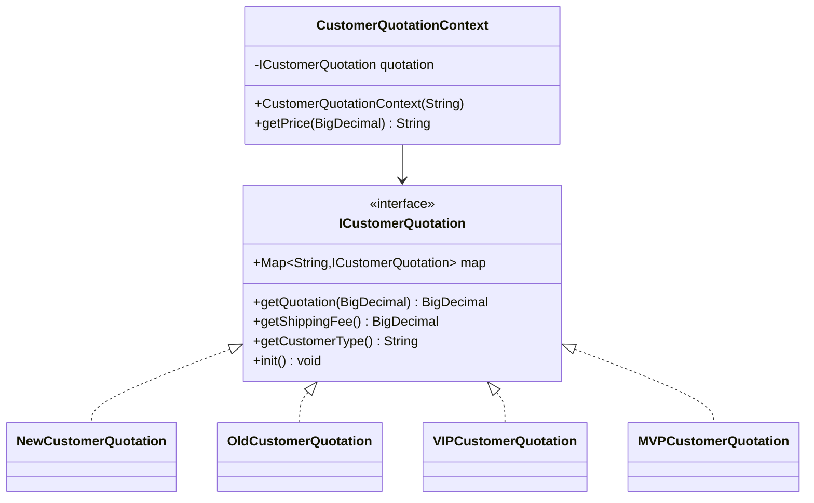
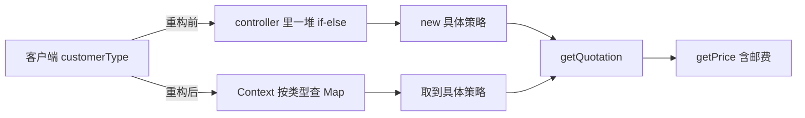

# 写了三屏 if-else 之后，我终于用策略模式重构了电商报价折扣

从一堆 `if-else` 走到策略模式，是一段几乎所有 Java 开发者都会经历过的重构之路。本文用一个电商报价折扣的完整演化过程，讲清楚怎么从朴素的分支判断一步步演进到策略模式，以及最后如何把 `if-else` 也顺手清掉。

> **读前须知：** 这篇只要你会写 Java 的 `if-else` 和实现接口就够了，不需要任何框架基础。全文按 v2 到 v6 的顺序一路演进，跟着走一遍，策略模式是自己「推」出来的，不用提前背概念。
>
> 先一句话说清策略模式是什么：**把一组可以互相替换的算法各自封装成独立的类，用的时候挑一个塞进去，而不是在函数内部用 `if-else` 挑。** 这样以后新增一种算法，只要加一个新类，老代码一行都不用动。

## 最初的写法：能跑，但会烂

最早的 v2、v3 版本就是最朴素的判断：根据客户类型算不同折扣，代码长这样（来自示例项目）：

```java
if ("新客户".equals(customType)) {
    System.out.println("抱歉，新用户没有折扣");
    return originalPrice;
} else if ("老客户".equals(customType)) {
    System.out.println("恭喜你老客户打九折");
    originalPrice = originalPrice.multiply(new BigDecimal(0.9)).setScale(2, BigDecimal.ROUND_HALF_UP);
    return originalPrice;
} else if ("VIP客户".equals(customType)) {
    System.out.println("恭喜你！VIP客户打8折");
    originalPrice = originalPrice.multiply(new BigDecimal(0.8)).setScale(2, BigDecimal.ROUND_HALF_UP);
    return originalPrice;
}
```

问题出在耦合上：每加一种客户，就要在这个方法里加一段 `else if`，多重条件判断堆在一起，逻辑和打印、计算混着写，改一处得通读整段，这就是典型的「改不动」。

## 第一次重构：先把分支提成方法

更好的做法是，先别急着上设计模式，把分支里的逻辑抽成独立方法。光是让方法名代替一大段计算，维护难度就降了一截：

```java
public BigDecimal getNewCustomerPrice(BigDecimal originalPrice) {
    return originalPrice;
}

public BigDecimal getOldCustomerPrice(BigDecimal originalPrice) {
    return originalPrice.multiply(new BigDecimal(0.9)).setScale(2,BigDecimal.ROUND_HALF_UP);
}

public BigDecimal getVIPCustomerPrice(BigDecimal originalPrice) {
    return originalPrice.multiply(new BigDecimal(0.8)).setScale(2,BigDecimal.ROUND_HALF_UP);
}
```

这步只是减负，没有解耦。方法还是都在一个类里，`if-else` 也没消失。真正的变化在下一步。

## 第二次重构：抽出接口和具体策略

关键的一步，是把「报价」这件事抽象成接口，每种客户给一个实现类。接口只定义要做什么，具体怎么打折交给各自的类：

```java
public interface ICustomerQuotation {
    public BigDecimal getQuotation(BigDecimal originalPrice);
}
```

```java
public class OldCustomerQuotation implements ICustomerQuotation {
    @Override
    public BigDecimal getQuotation(BigDecimal originalPrice) {
        return originalPrice.multiply(new
        BigDecimal(0.9)).setScale(2,BigDecimal.ROUND_HALF_UP);
    }
}

public class VIPCustomerQuotation implements ICustomerQuotation {
    @Override
    public BigDecimal getQuotation(BigDecimal originalPrice) {
        return originalPrice.multiply(new
        BigDecimal(0.8)).setScale(2,BigDecimal.ROUND_HALF_UP);
    }
}
```

客户端这边选策略的活还在。虽然计算逻辑挪走了，但「根据类型 new 哪个类」仍然要靠 `if-else`，只是从算法里挪到了选择上：

```java
ICustomerQuotation quotation;
if (Constant.NEW.equalsIgnoreCase(customerType)) {
    quotation = new NewCustomerQuotation();
} else if (Constant.OLD.equalsIgnoreCase(customerType)) {
    quotation = new OldCustomerQuotation();
} else if (Constant.VIP.equalsIgnoreCase(customerType)) {
    quotation = new VIPCustomerQuotation();
} else {
    quotation = new NewCustomerQuotation();
}
BigDecimal price = quotation.getQuotation(originalPrice);
```

## 第三次重构：用 Context 挡在客户端前面

更干净的做法，是加一个 Context 把具体策略包起来，客户端只跟 Context 打交道。前置、后置处理都收在上下文里，客户端完全不知道背后是哪个策略类：

```java
public class CustomerQuotationContext {
    private ICustomerQuotation quotation;

    public CustomerQuotationContext(ICustomerQuotation quotation) {
        this.quotation = quotation;
    }

    public String getPrice(BigDecimal originalPrice) {
        System.out.println("进行一些前置处理");
        BigDecimal price = quotation.getQuotation(originalPrice);
        System.out.println("进行一些后置处理");
        return price.toPlainString();
    }
}
```

到这一步，经典的「策略模式」就立起来了。定义就是：把一系列算法一个个封装起来，并且让它们可以相互替换。客户端持有的是接口，换策略不用改调用处。

## 加 MVP 客户（更高一级会员），只改新增的部分

策略模式真正的甜头在「扩展」上。现在要加 MVP 客户（比 VIP 再高一级的会员等级，打 7 折），因为已经有了统一接口，只要新增一个实现类，完全不动老代码（来自示例项目）：

```java
public class MVPCustomerQuotation implements ICustomerQuotation {
    @Override
    public BigDecimal getQuotation(BigDecimal originalPrice) {
        return originalPrice.multiply(new BigDecimal(0.7)).setScale(2,BigDecimal.ROUND_HALF_UP);
    }
}
```

这就是「开闭原则」：对扩展开放、对修改关闭。老客户、VIP 那几个类一行都不用碰。

## 再加邮费，接口补一个方法

需求又变了：要算邮费。新客户、老客户邮费 10.11 元，VIP 9.11 元，MVP 0.11 元。做法是给接口加 `getShippingFee()`，各实现类填自己的数。MVP 实现类最终长这样（来自示例项目）：

```java
public class MVPCustomerQuotation implements ICustomerQuotation {
    @Override
    public BigDecimal getQuotation(BigDecimal originalPrice) {
        return originalPrice.multiply(new BigDecimal(0.7)).setScale(2,BigDecimal.ROUND_HALF_UP);
    }
    @Override
    public String getCustomerType() {
        return Constant.MVP;
    }
    @Override
    public BigDecimal getShippingFee() {
        return new BigDecimal(0.11);
    }
}
```

Context 负责把邮费并进去，对客户端继续屏蔽细节：

```java
public String getPrice(BigDecimal originalPrice) {
    System.out.println("进行一些前置处理");
    BigDecimal price = quotation.getQuotation(originalPrice);
    price = price.add(quotation.getShippingFee()).setScale(2, BigDecimal.ROUND_HALF_UP);
    System.out.println("进行一些后置处理");
    return price.toPlainString();
}
```

## V6：用 Map 和 Spring 彻底干掉 if-else

前面每次客户端还要写 `if-else` 选策略，这步把它也去掉。思路是让每个策略自己注册进一个 Map：接口里放一个 `ConcurrentHashMap`，再用 `@PostConstruct` 在初始化时把自身按客户类型塞进去。

```java
public interface ICustomerQuotation {
    public static Map<String, ICustomerQuotation> map = new ConcurrentHashMap();

    public BigDecimal getQuotation(BigDecimal originalPrice);
    public BigDecimal getShippingFee();
    public String getCustomerType();

    @PostConstruct
    default public void init() {
        map.put(getCustomerType(), this);
    }
}
```

具体策略加上 `@Service`，交给 Spring 管理，初始化时自动进 Map。以新客户为例（来自示例项目）：

```java
@Service
public class NewCustomerQuotation implements ICustomerQuotation {
    @Override
    public BigDecimal getQuotation(BigDecimal originalPrice) {
        return originalPrice;
    }
    @Override
    public String getCustomerType() {
        return Constant.NEW;
    }
    @Override
    public BigDecimal getShippingFee() {
        return new BigDecimal(10.11);
    }
}
```

客户端 controller 一下子清爽了，再也不用 `if-else`，直接把 `customerType` 丢给 Context：

```java
public static final BigDecimal originalPrice = new BigDecimal(7100.00).setScale(2, BigDecimal.ROUND_HALF_UP);

@RequestMapping("/getMyQuotation")
@ResponseBody
public String getPrice(String customerType) {
    CustomerQuotationContext customerQuotationContext = new CustomerQuotationContext(customerType);
    return customerQuotationContext.getPrice(originalPrice);
}
```

Context 改成按类型从 Map 取策略，取不到就兜底成新客户：

```java
public CustomerQuotationContext(String customerType) {
    this.quotation = ICustomerQuotation.map.get(customerType);
    if (this.quotation == null) {
        quotation = ICustomerQuotation.map.get(Constant.NEW);
    }
}
```

这套结构画成类图，关系一眼就清楚：



重构前后的调用流向对比也很直观：



## 跑起来看看，各客户到底多少钱

光讲结构有点虚，拿那台 iPhone XR 原价 7100 元算一笔账更直观。新客户不打折，加邮费 10.11 元，到手 7110.11；老客户 9 折即 6390 元，再加 10.11 邮费是 6400.11；VIP 8 折 5680 元加 9.11 邮费，得 5689.11；MVP 7 折 4970 元加 0.11 邮费，是 4970.11。这些数字全是示例项目里写死的折扣系数和邮费，没有任何自己拍脑袋的地方。

有意思的是，算这笔账时你完全没碰那些策略类。在 `QuotationController` 的 `main` 里依次传 `Constant.NEW`、`Constant.OLD`、`Constant.MVP` 进去，拿到的就是对应价格，新增客户类型这件事对调用方彻底透明。这也解释了为什么示例项目里 `originalPrice` 直接写成 `new BigDecimal(7100.00).setScale(2, BigDecimal.ROUND_HALF_UP)` 这种精确写法，报价场景用 `BigDecimal` 而不是 `double`，就是为了避免浮点误差把账单算错。

上面这笔账不是纸上推演。把这些类用 JDK 17 编译跑一遍（脱离 Spring 时手动触发各策略的 `init()` 完成 Map 自注册），四种客户依次输出 7110.11、6400.11、5689.11、4970.11，传一个不存在的类型则兜底成新客户的 7110.11，跟这里的计算分毫不差。

## 策略模式到底适合什么场景

不是所有分支都值得上策略模式。实践中总结的几个适用点很实在：多个类只在算法或行为上稍有不同；算法需要自由切换；需要把算法规则对调用方屏蔽。电商报价正好三个都满足。

## 不止电商：JDK 里也到处是策略

学了最好能认出来，JDK 本身就大量用策略模式。比如 `ThreadPoolExecutor` 的 `RejectedExecutionHandler`，就是线程池里没有多余线程、保存任务的有界队列也满了之后，对仍在提交的任务的处理策略；Swing 的 `LayoutManager` 决定组件怎么摆；还有 `Collections.sort` 用的 `Comparator`，你实现一个比较器就能自定义排序规则，接口本身就是抽象策略，`Collections` 充当上下文。示例项目里还配了 `ThreadPoolExecutorTest`，构造时直接传 `new ThreadPoolExecutor.CallerRunsPolicy()` 作为拒绝策略，这正是策略模式「算法可自由替换」的活例子。

## 优点和坑都得提前看清

优点说三条就够用：算法可以自由切换；避免了多重条件判断；扩展性好，完美贴合开闭原则，新增行为不用动老系统，而且算法和使用算法的环境分开了，符合单一职责原则，策略类还能被不同地方复用。

坑也得正视。客户端必须知道所有策略类并自己决定用哪个，意味着调用方得理解各算法的区别；策略类会越加越多，任何一点小变化都可能新增一个类；而且一次只能用一种策略，没法拼着用两个策略各算一半。

> 从 `if-else` 到策略模式，不是为炫技，而是当「加一种客户就要改一整段」开始让你发怵时，它给出了一条清晰的出路：把会变的东西封进各自的类，让调用方只认接口。等哪天再加客户类型，你只需要新建一个类，而不是再去那堆分支里冒险。

## 要点回顾

- 朴素 `if-else` 把判断、打印、计算混在一起，扩展时容易牵一发动全身。
- 先抽方法减负，再抽接口 + 实现类解耦，最后用 `Context` 把策略选择对客户端屏蔽。
- 策略模式契合开闭原则：新增客户类型只需新增实现类，老代码一行不动。
- 用 `ConcurrentHashMap` + `@PostConstruct` 让策略自注册，可彻底干掉客户端的 `if-else`。
- JDK 里 `RejectedExecutionHandler`、`Comparator`、`LayoutManager` 都是策略模式的现成例子，看懂了就不难认。
