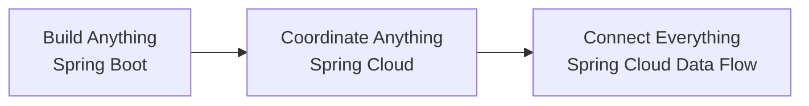
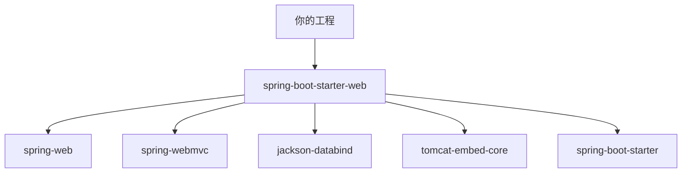

# Spring Boot 到底替你干了什么活：从配置繁琐到约定优于配置

接手一个老 SSM 项目，光是启动前的准备工作就够喝一壶：pom 里十几个坐标，版本还得自己挑；`applicationContext.xml`、`spring-mvc.xml`、`mybatis-config.xml` 一个都不能少，内容基本靠从别处粘过来改；还要装 Tomcat、打 war、部署。等真正开始写业务代码，半天已经过去了。

更要命的是，这些工作没有一项产出业务价值，却占据了大量的排查时间：依赖版本不兼容、配置项写错位置、容器起不来。Spring Boot 的出现就是冲着这些事来的。

## 先给结论

- Spring Boot 不是对 Spring 功能的增强，而是提供了一种快速使用 Spring 的方式，业务代码的编程模型一点没变。
- Spring 的两大痛点是配置繁琐和依赖繁琐，Spring Boot 用自动配置和起步依赖分别应对。
- 起步依赖把一组经过版本验证的坐标打成一个包，靠 Maven 依赖传递带进来，版本由父工程统一仲裁。
- 内嵌服务器、健康检查、外部化配置这些属于辅助功能，不是核心，但直接决定了日常开发体验。
- Spring Boot 在 Spring 生态里是顶级项目，和 Spring Framework、Spring Cloud 同级，2014 年 4 月发布 1.0.0。

## 概念：一句话说清它是什么

官方的描述是这样：Spring Boot 提供了一种快速使用 Spring 的方式，基于约定优于配置的思想，让开发人员不必在配置与业务逻辑之间来回切换思维，全身心投入业务代码编写，从而提高开发效率、缩短项目周期。

这里唯一需要解释的是「约定优于配置」。它的意思是：Spring 需要的那些配置，Spring Boot 提前按最通用的方式定好了，放在那里等你用。端口默认 8080，静态资源默认放 `static` 目录，组件扫描默认从引导类所在包往下扫。你不去改，它就按约定走；你真要改，一行配置就能覆盖。

**这一点带来的变化比想象中大。** 以前写配置是在「从零描述一个系统」，现在是在「对默认值做少量修正」，出错的概率和排查成本都降了一个数量级。

## 位置：它是 Spring 生态里的顶级项目

很多人以为 Spring 是一门技术，其实 Spring 是一个庞大的技术体系，下面挂着很多项目。打开 `spring.io`，进到 Projects 页面能看到 Main Projects 列表：Spring Boot、Spring Framework、Spring Cloud、Spring Data、Spring Integration 等等，每一个都是独立立项、独立发版的顶级项目。

官网首页那张三层图，把这个体系的分工讲得很清楚：



三层分别对应三种需求。Spring Boot 负责把单个应用构建出来；应用拆成微服务之后，服务之间要注册发现、要远程调用、要做熔断限流，这一层协调工作由 Spring Cloud 承担；再往上，数据在不同系统之间流转、编排，交给 Spring Cloud Data Flow。

认清这层关系有个实际用处：单体项目里不要急着引入微服务组件。Spring Boot 本身只管把应用搭好，它并不是为了微服务才存在的。

## Spring 的两个缺点

**配置繁琐。** Spring 整合其他技术时都要写一份 XML 配置，内容多、格式碎，很少有人能凭记忆写全。现实做法是找个地方复制一份过来，改几个参数变成自己的。这种方式带来的问题是：出问题的时候不知道哪一行是多余的，也不敢删。Spring 2.5 引入基于注解的组件扫描、Spring 3.0 引入基于 Java 的配置，都是在尝试缓解这个问题，但没从根本上解决。

**依赖繁琐。** 用 Maven 构建 Spring 项目时，要在 pom 里引一大堆坐标，光引进来还不够，还得逐个确认版本。A 坐标和 B 坐标到底哪个版本能兼容，往往只能查官方手册或者挨个试。一旦版本不兼容，项目直接起不来，报的错还常常不在点子上。调版本这件事极其耗时，却又没有任何技术含量。

## Spring Boot 的三个功能

**自动配置**对应配置繁琐。自动配置发生在运行时，也就是应用程序启动的时候：Spring Boot 会综合考虑 classpath 里有什么类、你写了哪些 Bean、配置文件里写了什么，然后决定 Spring 的配置该怎么配。整个过程自动完成，不需要你写配置文件。整合第三方技术时仍然要写一点配置（数据源地址、Redis 地址这类因环境而异的东西没法约定），但量已经非常少。

**起步依赖**对应依赖繁琐。它的做法是把某一类功能需要的多个坐标打包成一个：



图里的 `spring-boot-starter-web` 自身几乎没有代码，它只声明了一组依赖。你的工程引入它，Maven 的依赖传递机制就把后面那些坐标一并带进来了。这就是「起步依赖」的本质：用了依赖传递这个特性，把依赖配置简化到一行。

**辅助功能**是一些非核心但很实用的能力。嵌入式服务器是最典型的一个：以前开发 Web 项目要配 Tomcat 插件或者部署到外置容器，现在 Tomcat 直接内置，运行引导类的 `main` 方法就起来了。此外还有安全控制、健康检测、外部化配置等，都属于这一类。

## 用代码对照一下差别

传统 SSM 工程要引的坐标是 spring-context、spring-web、spring-webmvc、jackson、servlet-api 等等，每个带版本号。Spring Boot 版本的 pom 长这样（课程源码，包名已改为中性）：

```xml
<parent>
    <groupId>org.springframework.boot</groupId>
    <artifactId>spring-boot-starter-parent</artifactId>
    <version>2.1.8.RELEASE</version>
</parent>

<dependencies>
    <dependency>
        <groupId>org.springframework.boot</groupId>
        <artifactId>spring-boot-starter-web</artifactId>
    </dependency>
</dependencies>
```

注意 `spring-boot-starter-web` 没有写版本，版本由父工程的管理清单决定。配置这边也是同样的思路，改端口和上下文路径只需要两行：

```properties
server.servlet.context-path=/hello
server.port=8081
```

而在传统 Spring 工程里，这两件事分别意味着改 Tomcat 配置和改部署路径。启动方式的变化更直观，引导类就是项目入口：

```java
package com.example;

import org.springframework.boot.SpringApplication;
import org.springframework.boot.autoconfigure.SpringBootApplication;

@SpringBootApplication
public class SpringbootConfigApplication {

    public static void main(String[] args) {
        SpringApplication.run(SpringbootConfigApplication.class, args);
    }
}
```

跑 `main` 方法，内嵌 Tomcat 随容器一起启动，不需要任何外部容器。

## 一句话收束：它没有增强 Spring

把上面这些功能看一遍会发现，Spring Boot 没有提供任何 Spring 不具备的能力。IOC、AOP、事务、MVC，全是 Spring Framework 原有的东西。它做的事是把「拿到这些能力的过程」变短：原来需要你写的配置，它提前约定好；原来需要你挑的坐标，它打包好。

所以那句总结才重要：Spring Boot 并不是对 Spring 功能上的增强，而是提供了一种快速使用 Spring 的方式。理解这一点，就不会在学习时把精力放错地方，业务代码的写法和以前完全一样，要学的是约定、配置和依赖这三件事。

## 常见误区

- **以为 Spring Boot 是 Spring 的升级版**：两者不是版本关系，是并列关系。Spring Boot 底层用的就是 Spring Framework，升级 Spring Framework 的版本和升级 Spring Boot 的版本是两回事。
- **以为用了 Spring Boot 就不用写配置了**：约定只覆盖通用场景。数据源地址、第三方密钥、业务参数这些必须自己写，只是写法从 XML 变成 `application.properties` 或 `application.yml`。
- **以为自动配置是编译期完成的**：它发生在应用启动时，会读取 classpath、已存在的 Bean、配置文件内容再决定配什么。所以改了依赖或者加了 Bean，自动配置的结果就可能变。
- **以为起步依赖是必需的技术组件**：它只是一个依赖描述符，真正干活的还是被它引进来的那些 jar。

## 面试可能被问到的问题

1. 面试官追问：「Spring Boot 是什么？它和 Spring 有什么区别？」
   答：Spring Boot 是 Spring 生态中的一个顶级项目，用来快速构建 Spring 应用。它不提供 Spring 之外的新能力，改变的是使用方式：通过自动配置减少配置量，通过起步依赖简化依赖管理，通过内嵌服务器去掉外置容器。

2. 面试官追问：「怎么理解约定优于配置？」
   答：Spring Boot 把大量通用配置提前定好默认值，开发者不配置时按约定执行，需要修改时用一个配置项覆盖。比如端口默认 8080、静态资源默认在 `static` 目录、组件扫描默认从引导类所在包开始。

3. 面试官追问：「Spring 有哪些缺点，Spring Boot 是怎么解决的？」
   答：主要是两个：配置繁琐，整合技术时要写大量 XML，靠复制粘贴改参数，由自动配置解决；依赖繁琐，坐标多且版本兼容性靠试，由起步依赖解决，用依赖传递把一组版本验证过的坐标打包成一个。

4. 面试官追问：「起步依赖为什么能不写版本号？」
   答：因为工程继承了 `spring-boot-starter-parent`，这个父工程的依赖管理清单里维护了所有常用依赖的兼容版本。引入 starter 时不写版本就会用清单里的版本，从而避免版本冲突。

5. 面试官追问：「Spring Boot 是 Spring Cloud 的基础吗？」
   答：两者是同级别的顶级项目，不存在上下级关系。实际开发中微服务应用通常用 Spring Boot 构建单个服务、用 Spring Cloud 解决服务之间的协调问题，所以经常一起出现，但 Spring Boot 完全可以独立用于单体应用。

6. 面试官追问：「自动配置是在什么时候发生的？」
   答：在应用启动时，也就是运行期的容器初始化阶段。Spring Boot 会检查 classpath 上有哪些类、容器里已有哪些 Bean、配置文件里有哪些属性，综合判断后决定装配哪些组件，这也是为什么改依赖会改变自动配置结果。

## 配套资料

- 入门工程 pom 与引导类：`materials/code/01/1.spring boot/1.spring boot/SpringBoot 第一天/代码/springboot/springboot-helloworld/pom.xml`
- 配置示例工程：`materials/code/01/1.spring boot/1.spring boot/SpringBoot 第一天/代码/springboot/springboot-config/`
  （含 `src/main/resources/application.properties`、`SpringbootConfigApplication.java`、`HelloController.java`，文中包名已改为 `com.example`）
- IDEA 快速构建工程（含生成的测试类，可观察 starter-test 的引入）：`materials/code/01/1.spring boot/1.spring boot/SpringBoot 第一天/代码/springboot/springboot-init/`
