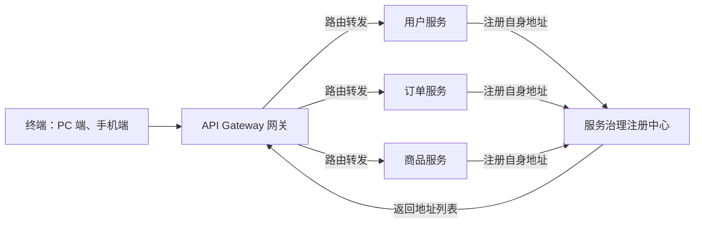
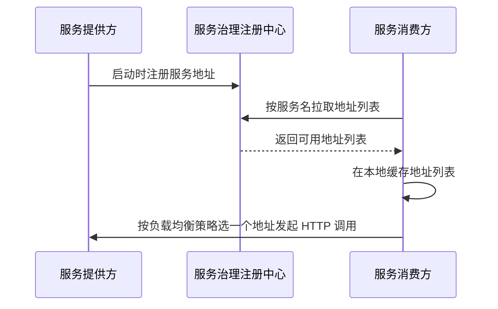

# 微服务架构到底改了什么：把 ESB 换成注册中心之后剩下的那套东西

系统拆成十几个服务之后，调用关系变成一张网，谁也记不清订单服务到底依赖了哪些接口。这时候通常会有人提议上微服务，可真到评审会上被问一句「微服务和我们现在用的 SOA 有什么区别」，得到的回答往往是「粒度更细」。粒度细只是结果，不是原因，真正发生变化的是服务之间怎么找到彼此、怎么通信。

把 ESB 那根集中管道拆掉之后，架构里还剩下什么、新加的东西又承担了什么，这一节就专门讲这件事。

## 先给结论

- 微服务架构是一套使用小服务来开发单个应用的方式或途径，每个服务基于单一业务能力构建，运行在自己的进程中。
- 服务之间用 HTTP API 这种轻量级机制通信，可以独立部署，也可以使用不同的编程语言和数据存储技术。
- 微服务本质上也是一种 SOA，可以理解为去掉了 ESB 的 SOA，地址管理改由服务治理注册中心承担。
- 四个特点：单一职责、服务粒度小、面向服务（对外暴露 REST API）、服务之间相互独立。
- 与 ESB 型 SOA 的差异集中在四点：组件大小、耦合程度、管理方式、目标。

## 一、定义里每个词都对应一个工程决策

微服务架构的定义是一句话：使用一套小服务来开发单个应用的方式或途径，每个服务基于单一业务能力构建，运行在自己的进程中，使用轻量级机制通信（一般是 HTTP API），可以独立部署。

这句话里没有一个是修辞，逐个拆开看：

**第一，「单一业务能力」划定了拆分的边界。** 一个用户管理就可以是一个服务，服务内部只有用户相关的逻辑，不掺订单、不掺库存。这是粒度小的原因，不是结果。

**第二，「运行在自己的进程」意味着独立部署。** 服务之间不是同一个 JVM 里的方法调用，而是进程间通信，某个服务重启不影响其他进程的存活。

**第三，「轻量级机制通信」通常指 HTTP API。** 能发 HTTP 请求的语言就能接入，所以不同服务用不同编程语言完全可行。

**第四，「不同的数据存储技术」是数据库分离。** 每个服务有自己的库，别的服务想拿数据，走接口，不能直接连表查。

**第五，「最低限度的集中式管理」是相对 ESB 说的。** 没有统一的总线去强管控所有通信，只保留必要的服务治理。

## 二、整体结构：网关、服务、注册中心

下图是微服务架构的典型结构，箭头方向代表请求或信息的流向：



要看明白这张图，关键是区分两种箭头：终端到服务是真实业务请求，服务与注册中心之间交换的只是地址信息。注册中心不转发业务报文，也不做协议转换，这是它和 ESB 的根本差别。

## 三、API 网关：唯一入口与非业务功能

网关是一个服务器，是系统的唯一入口，为每个客户端提供定制的 API。

**它的核心职责是路由。** 请求进来之后，网关判断你要访问哪个服务，把请求转到提供该服务的地址上。

**它顺带把非业务功能收拢了。** 身份验证、监控、负载均衡这些都放在网关层做，业务服务只管业务。这也让服务本身可以写得很薄。

**它对外的访问形式通常是 RESTful 风格的 HTTP。** 客户端不感知后面有几个服务、服务在哪台机器上。

## 四、服务治理中心：地址是怎么流转的

服务提供方启动时把地址注册到注册中心，消费方需要调用时向注册中心拉取地址，拿到地址后再直接发起访问。消费方不用记住任何地址。



这里有两个容易被忽略的细节。消费方不是每次调用都去注册中心问一次，它会把地址列表缓存在本地，只有列表变化时才更新；拿到的是一个列表而不是单个地址，具体调哪一个由负载均衡策略决定。所以注册中心短暂不可用，一般不会立刻导致整个系统调用失败。

## 五、四个特点落到工程上是什么样

**单一职责，一个服务只对应唯一的业务能力。** 示例工程 `http-demo` 里的用户实体长这样（包名已改为中性的 `com.example`）：

```java
package com.example.pojo;

import lombok.Data;

import java.util.Date;

@Data
public class User {
    private Long id;

    // 用户名
    private String userName;

    // 密码
    private String password;

    // 姓名
    private String name;

    // 年龄
    private Integer age;

    // 性别，1 男性，2 女性
    private Integer sex;

    // 出生日期
    private Date birthday;

    // 创建时间
    private Date created;

    // 更新时间
    private Date updated;

    // 备注
    private String note;
}
```

注意这个类的字段集合：全是用户相关的属性，没有订单号、没有商品信息。单一职责在数据模型上是能直接看出来的。

**面向服务，每个服务对外暴露 REST 风格的接口。** 示例工程里没有 Controller，下面这段按本课写法补全，用来说明「面向服务」暴露出去的是什么形态：

```java
package com.example.controller;

import com.example.pojo.User;
import org.springframework.web.bind.annotation.GetMapping;
import org.springframework.web.bind.annotation.PathVariable;
import org.springframework.web.bind.annotation.RequestMapping;
import org.springframework.web.bind.annotation.RestController;

@RestController
@RequestMapping("/user")
public class UserController {

    /**
     * 对外暴露 REST 接口，其他服务通过 HTTP 获取用户数据
     */
    @GetMapping("/{id}")
    public User findById(@PathVariable Long id) {
        // 省略查询逻辑，返回用户对象，由框架序列化成 json
        return null;
    }
}
```

订单服务需要用户信息时，发一个 `GET /user/8` 拿到 json，而不是去连用户服务的库。这就是「数据库分离」的实际含义。

**服务之间相互独立，独立到什么程度。** 团队独立，每个服务由不同团队开发，人数可以不同；技术独立，用什么语言、什么框架不限定；前后端分离，后端只提供接口；数据库分离，各自维护各自的数据；部署独立，单独发布上线不影响他人。示例工程 `http-demo` 配套的用户表结构（建表语句，数据行已省略）也印证了这点：

```sql
CREATE TABLE `tb_user` (
  `id` bigint(20) NOT NULL AUTO_INCREMENT,
  `user_name` varchar(100) DEFAULT NULL COMMENT '用户名',
  `password` varchar(100) DEFAULT NULL COMMENT '密码',
  `name` varchar(100) DEFAULT NULL COMMENT '姓名',
  `age` int(10) DEFAULT NULL COMMENT '年龄',
  `sex` tinyint(1) DEFAULT NULL COMMENT '性别，1男性，2女性',
  `birthday` date DEFAULT NULL COMMENT '出生日期',
  `note` varchar(255) DEFAULT NULL COMMENT '备注',
  `created` datetime DEFAULT NULL COMMENT '创建时间',
  `updated` datetime DEFAULT NULL COMMENT '更新时间',
  PRIMARY KEY (`id`),
  UNIQUE KEY `username` (`user_name`)
) ENGINE=InnoDB AUTO_INCREMENT=13 DEFAULT CHARSET=utf8;
```

**自治带来复用与可替换。** 服务是独立组件，可以被不同场景重复利用，也可以整体替换掉，耦合降低、维护变容易。

## 六、与 ESB 型 SOA 的四点区别

| 对比项 | ESB 型 SOA | 微服务架构 |
|---|---|---|
| 组件大小 | 大块业务逻辑 | 单独任务或小块业务逻辑 |
| 耦合 | 通常松耦合 | 总是松耦合 |
| 管理 | 着重中央管理 | 着重分散管理 |
| 目标 | 确保应用能够交互操作 | 易维护、易扩展、更轻量级的交互 |

除了这四点，还有一个前提要先摆正：微服务架构基于 SOA 思想，可以把微服务当做去除了 ESB 的 SOA。它不是推翻 SOA，而是换掉了 SOA 里最重的那个组件。

**第一，组件大小。** ESB 型 SOA 拆出来的是大块业务逻辑，微服务拆到单独任务或小块业务逻辑为止。

**第二，耦合程度。** ESB 型 SOA 通常是松耦合，服务之间仍然通过总线产生间接关联；微服务是总是松耦合，服务之间只有接口契约。

**第三，管理方式。** SOA 因为有 ESB 这根总线，天然是中央管理；微服务没有总线概念，分散管理，只保留一个注册中心记录地址。

**第四，目标不同。** SOA 的目标是让异构应用能够互相操作，微服务的目标是把项目做成易维护、易扩展、交互更轻量的形态。

## 常见误区

- **把注册中心当成 ESB 用。** 注册中心只记录并返回服务地址，不做消息转换、不做协议适配、不转发业务报文。它是地址簿，不是管道。
- **以为拆得越细越好。** 服务数量上升会带来调用链变长、问题排查困难、部署运维成本上升，拆分粒度要和团队规模、业务边界匹配。
- **以为用了 HTTP 接口就是微服务。** 一个没有拆分、所有模块共用一个数据库、必须整体发布的系统，即使用 HTTP 通信也只是单体套了层 HTTP。单一职责、独立部署、数据库分离三者缺一不可。
- **以为服务独立等于零成本。** 独立性换来的是分布式事务、链路追踪、接口兼容这些新难题，微服务不是省事的方案，只是把复杂度从代码里挪到了基础设施上。

## 面试可能被问到的问题

1. 面试官追问：「什么是微服务架构？」
   答：微服务架构是一套使用小服务来开发单个应用的方式或途径，每个服务基于单一业务能力构建，运行在自己的进程中，服务之间通过 HTTP API 这种轻量级机制通信，可以独立部署，也可以使用不同的编程语言和数据存储技术，并保持最低限度的集中式管理。

2. 面试官追问：「微服务架构有哪些特点？」
   答：单一职责，每个服务对应唯一的业务能力；服务粒度小，一个用户管理就可以是一个服务；面向服务，每个服务对外暴露 REST 风格的接口；服务之间相互独立，包括团队独立、技术独立、前后端分离、数据库分离和部署独立。

3. 面试官追问：「微服务架构和 SOA 架构的区别是什么？」
   答：微服务本质上也是一种 SOA，可以把微服务理解为去除了 ESB 的 SOA。区别在四点：组件大小上 SOA 是大块业务逻辑、微服务是单独任务或小块业务逻辑；耦合上 SOA 通常松耦合、微服务总是松耦合；管理上 SOA 着重中央管理、微服务着重分散管理；目标上 SOA 是确保应用能够交互操作，微服务是易维护、易扩展、更轻量级的交互。

4. 面试官追问：「服务注册中心在微服务架构里做什么？」
   答：它承担服务治理，服务提供方启动时把地址注册进来，消费方按服务名拉取地址列表，再按负载均衡策略选一个地址发起调用。地址列表通常会在消费方本地缓存，不会每次调用都去查注册中心。注册中心只管地址，不转发业务数据。

5. 面试官追问：「微服务架构里的 API 网关有什么作用？」
   答：网关是系统的统一唯一入口，核心职责是路由，把请求转发到提供对应服务的地址上；同时承担身份验证、监控、负载均衡这类非业务功能，让业务服务保持轻量。它通常对外提供 RESTful 风格的 HTTP 访问。

6. 面试官追问：「为什么说微服务是去除 ESB 的 SOA？」
   答：ESB 型 SOA 用企业服务总线统一做消息转换、解释和路由，虽然屏蔽了复杂调用关系，但自身实现复杂、部署测试麻烦，而且所有服务通信都经过它，会降低通信速度。微服务去掉了这根集中管道，改用注册中心记录地址，服务之间直接通信，性能瓶颈消失，同时把拆分粒度做得更细。

## 配套资料

- 课堂笔记：`materials/code/01/2.SpringCloud/2.springcloud/day01/笔记/Spring Cloud 第一天课堂笔记.md`
  （「2. 微服务架构说明」一节含本节分析、特点与对比结论）
- 示例工程：`materials/code/01/2.SpringCloud/2.springcloud/day01/资料/http-demo/`
  （文中 `User.java` 与 `tb_user.sql` 出自该工程，源码包名已统一改为中性的 `com.example`；`UserController` 为按本课写法补全的示例）
- 本节为理论课，无专属实现工程
