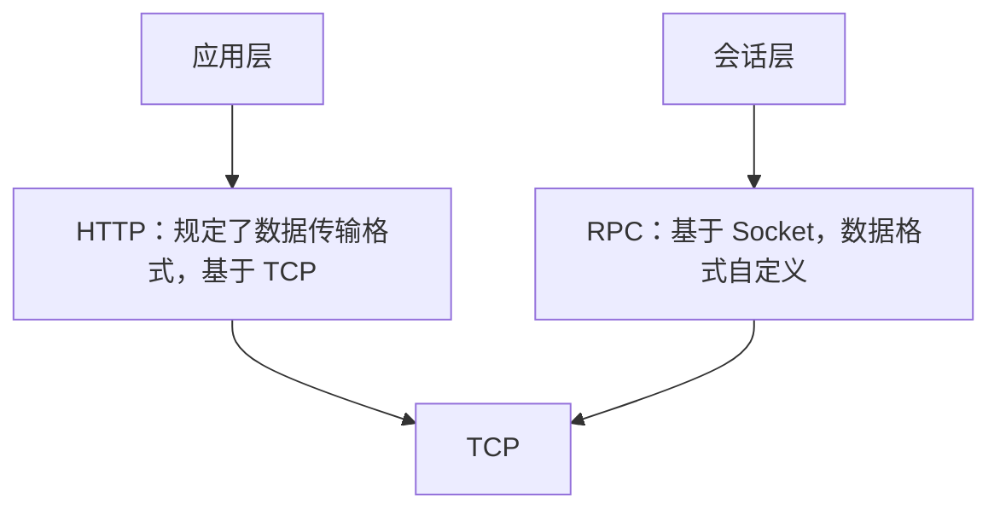
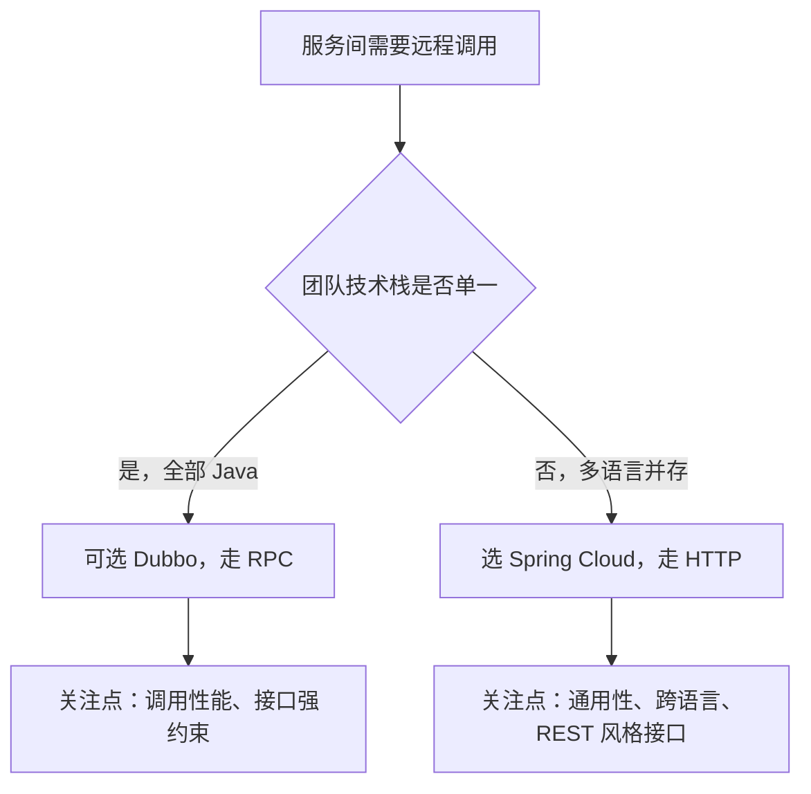

# 服务之间怎么互相调用：RPC 与 HTTP 这两条路的取舍

订单服务要展示下单人姓名，用户数据却在用户服务里。拆成微服务之后，这类问题会变成日常：一次业务操作要跨好几个服务才能完成，而跨服务就意味着要跨进程、跨机器。原来写一个方法调用就能拿到的数据，现在得先想清楚用什么方式发出去。

远程调用的方案很多，但归纳起来只有两个流派，选错流派后面整套技术栈都要跟着定。

## 先给结论

- 服务间远程调用常见的方式有两种：RPC 和 HTTP。
- RPC 是远程过程调用，基于 Socket，工作在会话层，自定义数据格式，速度快、效率高。典型代表是早期的 WebService 和现在的 Dubbo。
- HTTP 是一种网络传输协议，基于 TCP，工作在应用层，规定了数据传输格式。消息封装臃肿，但对服务提供方和调用方没有任何技术、语言上的限定。
- 两者的本质差异在于：RPC 的机制是根据语言的 API 来定义的，HTTP 是根据基于网络的应用来定义的。
- 技术栈单一的团队用 Dubbo 是不错的选择；技术栈多样化、倾向 Spring 体系的团队用 Spring Cloud，服务间走 HTTP 调用。
- 现在流行的 REST 风格就是通过 HTTP 协议实现的，Spring Cloud 的服务调用也采用 HTTP 方式。

## 一、为什么拆分之后必然要面对远程调用

无论是微服务还是 SOA，只要做了拆分，服务之间就一定存在远程调用。区别只在于调用方式：有的团队选择让远程调用看起来像本地方法，有的团队选择直接用网络协议。

**第一，远程调用的核心诉求是把参数和结果搬过网络。** 搬的方式不同，就产生了 RPC 与 HTTP 两条路线。

**第二，两种方式的差别不在性能高低这一件事上。** 速度、跨语言能力、运维成本、生态组件都要一起算，这也是选型时容易吵起来的原因。

## 二、RPC：把远程方法伪装成本地方法

RPC（Remote Procedure Call，远程过程调用）基于 Socket，工作在会话层，数据格式由自己定义。

**它快在哪里。** 自定义的数据格式意味着报文里没有多余的头信息，序列化与反序列化都按约定直接进行，不需要套一层通用协议的封装，所以速度快、效率高。

**代价是与语言绑定。** RPC 的机制是根据语言的 API 来定义的，不是根据基于网络的应用来定义的。用 Java 开发的服务要做 RPC 调用，调用方就得用 Java 的方式再写一遍调用方法；换成别的语言，就得基于那种语言重新写一套。

**典型代表有两个。** 早期的 WebService 采用 RPC 方式，传输的数据格式是 XML；现在热门的 Dubbo 由阿里巴巴开发，服务之间同样通过 RPC 方式远程调用。

一个 Dubbo 风格的调用写出来是这样的（按本课描述补全的示例，仅用于说明调用形态）：

```java
package com.example.service;

import com.example.pojo.User;
import org.apache.dubbo.config.annotation.Reference;
import org.springframework.stereotype.Service;

@Service
public class OrderService {

    // 像注入本地 Bean 一样拿到远程服务，调用时看起来就是普通方法调用
    @Reference
    private UserService userService;

    public String findOrderUserName(Long userId) {
        User user = userService.findById(userId);
        return user.getName();
    }
}
```

这段代码读起来和本地方法调用没有区别，这正是 RPC 想达到的效果，也是它要求调用双方语言一致的原因。

## 三、HTTP：用通用协议换通用性

HTTP 是一种网络传输协议，基于 TCP，工作在应用层，规定了数据传输的格式。

**它的覆盖面有多大。** 现在客户端浏览器与服务端通信基本都采用 HTTP 协议，它的应用范围远不止服务间调用，这也意味着现成的工具、网关、监控、抓包手段全都可用。

**缺点很明确，消息封装臃肿。** 除了要传输业务数据，还要按 HTTP 协议做一层层封装，请求头、状态行、分隔符都要占字节，相比自定义格式的 RPC 明显更重。

**优势同样明确，没有任何技术语言限定。** 只要能发 HTTP 请求、能解析 json，就能参与调用。对服务的提供方和调用方都自由灵活，这一点更契合微服务的理念，因为微服务允许每个服务用不同语言、不同数据存储技术。

**REST 风格就是建立在 HTTP 之上的。** 现在热门的 REST 风格通过 HTTP 协议实现，配合 json 做数据交换。

两种方式的协议位置可以这样看：



需要说明的是，这个层次划分描述的是二者的设计出发点：HTTP 是面向网络应用的通用协议，RPC 是面向语言 API 的调用约定。

## 四、怎么选：看技术栈，不看性能跑分



**第一，全 Java 技术栈适合 RPC 方案。** 公司全部采用 Java 技术栈时，用 Dubbo 作为微服务架构是一个不错的选择，调用快、接口定义清晰。

**第二，技术栈多样化就选 HTTP 方案。** 技术栈比较多、又倾向 Spring 家族的话，用 Spring Cloud 搭建微服务是更通用的做法，因为它的服务间调用使用 HTTP 方式，没有技术和语言的限定。

**第三，两种方案可以混合使用。** 架构选型不必一刀切，对性能敏感的链路走 RPC，对外开放的接口走 HTTP，在真实系统里很常见。

本系列后续使用 Spring Cloud 组件，因此服务间调用采用 HTTP 方式。

## 五、HTTP 调用在 Spring 里长什么样

Spring 提供的 `RestTemplate` 封装了底层的 HTTP 客户端工具，一次远程调用写起来只有几行。下面这段代码来自配套示例工程 `http-demo` 的测试类（包名已改为中性的 `com.example`）：

```java
package com.example.test;

import com.example.pojo.User;
import org.junit.Test;
import org.junit.runner.RunWith;
import org.springframework.beans.factory.annotation.Autowired;
import org.springframework.boot.test.context.SpringBootTest;
import org.springframework.test.context.junit4.SpringRunner;
import org.springframework.web.client.RestTemplate;

@RunWith(SpringRunner.class)
@SpringBootTest
public class RestTemplateTest {

    @Autowired
    private RestTemplate restTemplate;

    @Test
    public void test() {
        String url = "http://localhost/user/8";
        // RestTemplate 可以对 json 格式字符串进行反序列化
        User user = restTemplate.getForObject(url, User.class);
        System.out.println(user);
    }
}
```

`url` 里写的是对方暴露的 REST 接口地址，返回值由 `getForObject` 的第二个参数指定类型，json 字符串会被自动转成 Java 对象。

如果不借助任何框架，同样的调用要用 JDK 原生的 `URLConnection` 手写，下面这段按主流写法补全，用于对比：

```java
package com.example.test;

import java.io.BufferedReader;
import java.io.InputStreamReader;
import java.net.HttpURLConnection;
import java.net.URL;
import java.nio.charset.StandardCharsets;

public class UrlConnectionDemo {

    public static void main(String[] args) throws Exception {
        URL url = new URL("http://localhost/user/8");
        HttpURLConnection connection = (HttpURLConnection) url.openConnection();
        connection.setRequestMethod("GET");
        connection.setConnectTimeout(3000);
        connection.setReadTimeout(3000);

        // 手动读取响应流，再自己把 json 字符串转成对象
        try (BufferedReader reader = new BufferedReader(
                new InputStreamReader(connection.getInputStream(), StandardCharsets.UTF_8))) {
            StringBuilder builder = new StringBuilder();
            String line;
            while ((line = reader.readLine()) != null) {
                builder.append(line);
            }
            System.out.println(builder);
        }
        connection.disconnect();
    }
}
```

两段代码做的事完全一样，差别在于连接管理、异常处理、json 转换这些脏活有没有人替你做掉。这也是 Spring 要提供 `RestTemplate` 的原因。

## 常见误区

- **认为 HTTP 一定比 RPC 慢，所以无脑选 RPC。** RPC 少了协议封装确实更快，但如果系统里有 Python、Go 写的服务，RPC 的跨语言成本会迅速吃掉这点性能收益。
- **认为 RPC 和 HTTP 只能二选一。** 二者解决的是不同层面的问题，RPC 是调用模型，HTTP 是传输协议。实际上有不少 RPC 框架就是跑在 TCP 或 HTTP 之上的，系统里也可以两种并存。
- **把 REST 和 HTTP 当成并列的两个选项。** REST 是一种接口风格，它依赖 HTTP 协议实现，二者不是同类概念。
- **以为 WebService 就是 HTTP 调用。** WebService 属于 RPC 体系，只是它传输的数据格式是 XML，常见于早期系统。

## 面试可能被问到的问题

1. 面试官追问：「服务之间的远程调用方式有哪几种？」
   答：常见的有两种，RPC 和 HTTP。RPC 是远程过程调用，基于 Socket，工作在会话层，数据格式自定义，速度快效率高，代表是早期的 WebService 和现在的 Dubbo。HTTP 是网络传输协议，基于 TCP，工作在应用层，规定了数据传输格式，消息封装臃肿但没有技术语言限制，代表是 RESTful 接口和 Spring Cloud。

2. 面试官追问：「RPC 和 HTTP 的核心区别是什么？」
   答：RPC 的机制是根据语言的 API 来定义的，调用方要用与服务方相同的语言再写一遍调用方法，换来的是自定义数据格式带来的速度和效率。HTTP 是根据基于网络的应用来定义的，任何人按协议就能发请求，代价是要按 HTTP 协议层层封装，消息更臃肿。

3. 面试官追问：「为什么 HTTP 方式更符合微服务的理念？」
   答：微服务允许每个服务使用不同的编程语言和不同的数据存储技术，要求服务之间相互独立。HTTP 对服务提供方和调用方没有任何技术、语言的限定，只要能发 HTTP 请求就能接入，更加自由灵活，因此更契合微服务的理念。

4. 面试官追问：「公司技术栈全是 Java，选 Dubbo 还是 Spring Cloud？」
   答：全 Java 技术栈用 Dubbo 是合理选择，RPC 调用性能好、接口约束强。如果技术栈多样化，或者更倾向 Spring 家族的整套生态，用 Spring Cloud 更通用，因为它的服务间调用基于 HTTP，不受语言限制。两者也可以混合使用，按链路特点分别选型。

5. 面试官追问：「HTTP 方式做服务调用的缺点是什么，怎么缓解？」
   答：缺点是消息封装臃肿，除了业务数据还要带上协议头等额外字节，序列化和传输开销都比 RPC 大。缓解办法包括使用连接池、启用 gzip 压缩、选择更紧凑的序列化方式、在网关层做连接复用，以及在性能敏感的链路上改用 RPC。

6. 面试官追问：「REST 风格和服务调用方式是什么关系？」
   答：REST 是一种接口设计风格，它本身不是传输协议，需要通过 HTTP 协议来实现，通常用 json 交换数据。所以说服务调用方式时 REST 归属 HTTP 这一派，Spring Cloud 的服务间调用采用的就是基于 HTTP 的 REST 风格接口。

## 配套资料

- 课堂笔记：`materials/code/01/2.SpringCloud/2.springcloud/day01/笔记/Spring Cloud 第一天课堂笔记.md`
  （「3. 服务调用方式说明」一节含 RPC 与 HTTP 的对比结论）
- 示例工程：`materials/code/01/2.SpringCloud/2.springcloud/day01/资料/http-demo/`
  （文中 `RestTemplateTest.java` 出自该工程，源码包名已统一改为中性的 `com.example`；`OrderService.java` 与 `UrlConnectionDemo.java` 为按本课写法补全的示例）
