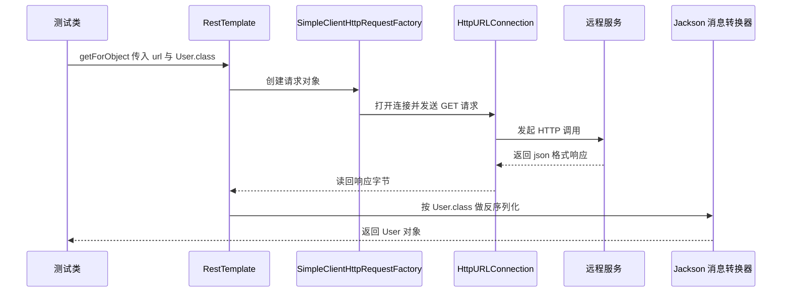

# 用 RestTemplate 发出第一个 HTTP 调用：示例工程导入到跑通全流程

要调用另一个服务暴露的接口，用 JDK 原生的 `URLConnection` 得自己开连接、读流、关流，再手动把 json 字符串转成对象，一个查询要写二十多行。每次都这样写不现实，于是问题变成：Spring 有没有把这件事封装好。

答案就是 `RestTemplate`。它把常见的 HTTP 客户端工具包统一封装成一套 API，在 Spring 项目里发起服务调用只需要几行代码。

## 先给结论

- 常用的 HTTP 客户端工具包有三类：HttpClient、OkHttp、JDK 原生 `URLConnection`。
- Spring 提供 `RestTemplate` 对这三类工具进行封装，默认使用 JDK 原生的 HTTP 工具包实现。
- `RestTemplate` 不会被 Spring Boot 自动注入，必须自己把它注册成 Bean，通常写在引导类里。
- `getForObject(url, Class)` 会把响应里的 json 字符串自动反序列化成指定类型的对象。
- 示例工程是一个普通 Spring Boot 工程，父工程版本 2.1.5.RELEASE，依赖 `spring-boot-starter-web`、`spring-boot-starter-test` 和 lombok。
- 导入方式是 New Module from Existing Sources，导入时按 Maven 工程处理并允许递归搜索子模块。

## 一、RestTemplate 封装了什么

业界常用的 HTTP 客户端工具包主要有三个：HttpClient、OkHttp，以及 JDK 原生的 `URLConnection`。三者都能完成 HTTP 服务调用，但 API 形态各不相同，换一个就等于重写一遍调用代码。

`RestTemplate` 是 Spring 提供的工具类，对上述三种客户端工具做了统一封装，在 Spring 项目里直接注入使用即可。它的默认实现走 `SimpleClientHttpRequestFactory`，也就是用 JDK 原生的 `HttpURLConnection` 发请求，不引入任何额外依赖也能跑起来。

需要提前记住的一点：`RestTemplate` 不是 Spring Boot 自动配置出来的 Bean，容器里不会凭空多出一个实例。没注册就注入，启动测试时会直接报注入失败。

## 二、把示例工程导入工作空间

导入步骤按顺序走一遍：

**第一，先建一个空工程。** 在 IDEA 里新建工程，起个名字（示例里叫 spring-cloud-study），选择在新窗口打开，这一步先不创建任何模块。

**第二，把示例工程复制进去。** 找到本课资料里的 `http-demo` 目录，整个复制到刚才新建的工程目录下。

**第三，以模块方式导入。** 通过 File 菜单里的 New，选 Module from Existing Sources，选中 `http-demo` 目录后点 OK。

**第四，按 Maven 工程处理。** 导入类型选 Maven，勾选自动导入 Maven 工程，并保留递归搜索子模块的选项，这样工程里如果还有聚合子模块也会被一并识别。后面一路下一步直到 Finish。

画面里展示的导入根目录形如 `D:\workspace\spring-cloud\http-demo`（原目录名已做中性化处理）。导入完成后，工程结构里应该能看到 `src/main/java`、`src/main/resources`、`src/test/java` 和 `pom.xml`。

## 三、pom.xml 里都有什么

```xml
<?xml version="1.0" encoding="UTF-8"?>
<project xmlns="http://maven.apache.org/POM/4.0.0"
         xmlns:xsi="http://www.w3.org/2001/XMLSchema-instance"
         xsi:schemaLocation="http://maven.apache.org/POM/4.0.0 http://maven.apache.org/xsd/maven-4.0.0.xsd">
    <modelVersion>4.0.0</modelVersion>

    <parent>
        <groupId>org.springframework.boot</groupId>
        <artifactId>spring-boot-starter-parent</artifactId>
        <version>2.1.5.RELEASE</version>
    </parent>
    <groupId>com.example</groupId>
    <artifactId>http-demo</artifactId>
    <version>1.0-SNAPSHOT</version>
    <properties>
        <java.version>1.8</java.version>
    </properties>

    <dependencies>
        <dependency>
            <groupId>org.springframework.boot</groupId>
            <artifactId>spring-boot-starter</artifactId>
        </dependency>
        <dependency>
            <groupId>org.springframework.boot</groupId>
            <artifactId>spring-boot-starter-web</artifactId>
        </dependency>
        <dependency>
            <groupId>org.springframework.boot</groupId>
            <artifactId>spring-boot-starter-test</artifactId>
        </dependency>
        <dependency>
            <groupId>org.projectlombok</groupId>
            <artifactId>lombok</artifactId>
        </dependency>
    </dependencies>

</project>
```

**第一，继承父工程之后版本号都不用写。** `spring-boot-starter-parent` 统一管理版本，这也就是为什么 pom 里连 lombok 都没写 version。

**第二，`java.version` 指定 1.8。** 父工程会用它配置编译插件的源码和目标版本。

**第三，`spring-boot-starter-test` 是测试类的来源。** 后面要用的 `@RunWith`、`@SpringBootTest`、`@Test` 都由它传递进来。

## 四、引导类：把 RestTemplate 注册成 Bean

```java
package com.example;

import org.springframework.boot.SpringApplication;
import org.springframework.boot.autoconfigure.SpringBootApplication;
import org.springframework.context.annotation.Bean;
import org.springframework.web.client.RestTemplate;

@SpringBootApplication
public class HttpDemoApplication {
    public static void main(String[] args) {
        SpringApplication.run(HttpDemoApplication.class, args);
    }

    @Bean
    public RestTemplate restTemplate(){
        return new RestTemplate();
    }
}
```

除了常规的 `main` 方法和 `@SpringBootApplication`，这里多出来的就是一个 `@Bean` 方法。注册之后，`RestTemplate` 由 IOC 容器管理，测试时直接注入即可。

想换底层实现也在这个方法里做，比如把默认的 JDK 实现换成 OkHttp：

```java
@Bean
public RestTemplate restTemplate() {
    return new RestTemplate(new OkHttp3ClientHttpRequestFactory());
}
```

## 五、一次 getForObject 背后发生了什么

测试类是这样写的（源码出自 `http-demo`，包名已改为中性的 `com.example`）：

```java
package com.example.test;

import com.example.pojo.User;
import org.junit.Test;
import org.junit.runner.RunWith;
import org.springframework.beans.factory.annotation.Autowired;
import org.springframework.boot.test.context.SpringBootTest;
import org.springframework.test.context.junit4.SpringRunner;
import org.springframework.web.client.RestTemplate;

@RunWith(SpringRunner.class)
@SpringBootTest
public class RestTemplateTest {

    @Autowired
    private RestTemplate restTemplate;

    @Test
    public void test(){
        String url = "http://localhost/user/8";
        User user = restTemplate.getForObject(url, User.class);
        System.out.println(user);
    }
}
```

`@RunWith(SpringRunner.class)` 把 JUnit 交给 Spring 的测试环境执行，`@SpringBootTest` 会加载引导类创建 Spring 容器，容器里有上一步注册的 `RestTemplate`，所以 `@Autowired` 能拿到实例。



图里最值得留意的是最后两步：反序列化由消息转换器完成，`RestTemplate` 能直接把 json 格式字符串转成 Java 对象，反过来序列化就是把 Java 对象转成 json 字符串。这是它比手写 `URLConnection` 省事的主要原因。

## 六、反序列化落到哪个类上

`getForObject` 的第二个参数指定了目标类型，示例里是 `User`（源码出自 `http-demo`）：

```java
package com.example.pojo;

import lombok.Data;

import java.util.Date;

@Data
public class User {
    private Long id;

    // 用户名
    private String userName;

    // 密码
    private String password;

    // 姓名
    private String name;

    // 年龄
    private Integer age;

    // 性别，1男性，2女性
    private Integer sex;

    // 出生日期
    private Date birthday;

    // 创建时间
    private Date created;

    // 更新时间
    private Date updated;

    // 备注
    private String note;
}
```

`@Data` 由 lombok 生成 getter、setter 和 `toString`，所以 `System.out.println(user)` 打印出来是带字段值的对象信息，而不是一串地址。字段名要和接口返回的 json 键对应，否则对应属性会是 null。

## 七、跑不通时先查这三处

**第一，地址本身要能返回数据。** 先在浏览器里访问 `http://localhost/user/8`，确认能拿到 json。地址不通时测试失败与 `RestTemplate` 无关，提供该接口的服务得先启动。

**第二，`RestTemplate` 是否注册成了 Bean。** 引导类里没有那个 `@Bean` 方法，测试类注入时就会找不到实例。

**第三，测试类的位置。** `RestTemplateTest` 在 `src/test/java` 下，且包路径要能被引导类的组件扫描覆盖，否则 `@SpringBootTest` 找不到引导类。

成功标准是控制台打印出一个用户信息对象。能跑通之后，`RestTemplate` 就可以在 Spring Boot 或 Spring Cloud 工程里直接引用，作为服务间 HTTP 调用的基础工具。

## 常见误区

- **以为 `RestTemplate` 是 Spring Boot 自动配置好的。** 它不在自动配置清单里，必须自己写 `@Bean` 注册，否则注入时报错。
- **以为反序列化不需要任何条件。** 目标类要有无参构造和可写的属性，字段名要和 json 的键匹配，`User` 里靠 lombok 的 `@Data` 提供了 setter。
- **把 `@SpringBootTest` 当成普通单元测试注解用。** 它会启动完整的 Spring 容器，运行较慢，且要求测试类能找到引导类所在的包。
- **忽略地址可用性直接跑测试。** 被调用的服务没启动，`getForObject` 会抛出连接异常，排查方向应该先放在服务提供方。
- **以为 `RestTemplate` 只能用 JDK 原生实现。** 默认如此，但通过传入不同的请求工厂就能切换到 HttpClient 或 OkHttp。

## 面试可能被问到的问题

1. 面试官追问：「RestTemplate 是什么，它解决了什么问题？」
   答：它是 Spring 提供的 HTTP 调用工具类，对 HttpClient、OkHttp、JDK 原生 URLConnection 这三种常见的 HTTP 客户端工具包做了统一封装。有了它，在 Spring 项目里发起服务调用只需要注入实例并调用 `getForObject` 这类方法，不用自己管理连接、读写流和解析 json。

2. 面试官追问：「RestTemplate 默认使用哪种 HTTP 客户端实现？」
   答：默认通过 `SimpleClientHttpRequestFactory` 使用 JDK 原生的 `HttpURLConnection`，不需要额外依赖就能运行。想换成 HttpClient 或 OkHttp，只要在构造 `RestTemplate` 时传入对应的请求工厂即可。

3. 面试官追问：「为什么注入 RestTemplate 会失败？」
   答：最常见的原因是没有把它注册成 Bean。Spring Boot 的自动配置不会创建 `RestTemplate` 实例，需要自己在配置类或引导类里写一个返回 `RestTemplate` 的 `@Bean` 方法。另一类情况是测试类未使用 `@SpringBootTest`，容器没有启动，同样拿不到实例。

4. 面试官追问：「getForObject 和 getForEntity 有什么区别？」
   答：`getForObject` 直接返回反序列化后的对象，拿不到响应状态码和响应头。`getForEntity` 返回 `ResponseEntity`，既能取到 body，也能拿到状态码、响应头信息，需要判断 404、500 这类情况时用后者。

5. 面试官追问：「RestTemplate 是怎么把 json 转成对象的？」
   答：它内部持有一组 `HttpMessageConverter`，其中 `MappingJackson2HttpMessageConverter` 负责 json。调用时根据 `getForObject` 传入的目标类型选择对应转换器，把响应字节反序列化成该类型实例。

6. 面试官追问：「Spring Cloud 为什么可以用 RestTemplate 做服务调用？」
   答：Spring Cloud 的服务间调用基于 HTTP 协议，而 `RestTemplate` 正是 Spring 体系里发起 HTTP 调用的标准工具，因此可以直接用于服务调用。它把地址硬编码的问题会在引入注册中心后由服务名解析解决，这也是后续演进的方向。

## 配套资料

- 示例工程：`materials/code/01/2.SpringCloud/2.springcloud/day01/资料/http-demo/`
  （含 `pom.xml`、`HttpDemoApplication.java`、`RestTemplateTest.java`、`User.java`，文中源码包名已统一改为中性的 `com.example`）
- 建表脚本：`materials/code/01/2.SpringCloud/2.springcloud/day01/资料/tb_user.sql`（示例接口背后的用户表结构）
- 课堂笔记：`materials/code/01/2.SpringCloud/2.springcloud/day01/笔记/Spring Cloud 第一天课堂笔记.md`
  （「4. Spring RestTemplate 示例工程导入」一节含本节小结代码）
