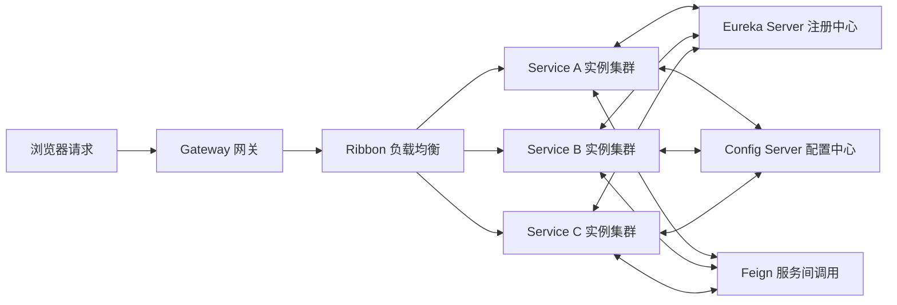

# Spring Cloud 不是一个框架，是一整套微服务组件的集合

把单体应用拆成十几个服务之后，麻烦才刚刚开始：服务之间怎么知道对方在哪台机器上？改一个数据库地址难道要重启十个工程？某个服务响应变慢，调用方会不会被一起拖死？这些问题每一个都有成熟的开源方案，但逐个拼装意味着你要自己解决版本兼容、配置风格不统一、API 用法各异这些琐事。

Spring Cloud 给出的答案不是再造一个新轮子，而是把业界已经在用的那批组件按 Spring 的方式整合到一起，用起来和引一个 Spring Boot 起步依赖没有区别。

## 先给结论

- Spring Cloud 是 Spring 家族的项目之一，本身不是单个组件，而是多个组件的集合。
- 它建立在 Spring Boot 之上，微服务系统里的每个服务都还是一个 Spring Boot 工程。
- 常见组件有 Eureka 注册中心、Gateway 网关、Ribbon 负载均衡、Feign 服务调用、Hystrix 熔断器。
- 版本号不用数字，而用英文单词命名，这些单词来自伦敦地铁站名，如 Hoxton、Greenwich、Finchley。
- 使用方式高度统一：需要哪个组件，就在 pom 里加对应的起步依赖即可，很少需要额外配置。

## 一、为什么落地微服务会选 Spring Cloud

微服务是一种架构方式，它需要具体的技术架构去实施，实现方式不止一种，Spring Cloud 是目前最主流的一种。

**第一，它背靠整个 Spring 生态。** Spring Cloud 是 Spring 家族成员，与 Spring Boot、Spring MVC 这些框架无缝整合，编程模型和注解习惯完全一致，开发时有很强的熟悉感，不需要重新学一套 API。

**第二，企业和社区基础扎实。** 大量企业在使用 Spring 全家桶，遇到问题时能查到的案例和解决方案足够多，踩坑成本远低于小众方案。

**第三，使用方式被 Spring Boot 统一了。** 用 Spring Boot 时往工程里加一个起步依赖就能整合某个组件，Spring Cloud 完全沿用了这套思路，用很少的配置就能把微服务框架搭起来。

## 二、Spring Cloud 到底整合了哪些东西

Spring 最擅长的就是集成，把很多框架吸收进自己的项目里，Spring Cloud 也一样。它把当下流行的技术整合到一起，实现了配置管理、服务发现、智能路由、负载均衡、熔断器、控制总线、集群状态等能力，用来协调分布式环境中的各个系统，为各类服务提供模板化配置。

日常用得到的组件主要是这几个：

| 组件 | 定位 | 解决了什么问题 |
|---|---|---|
| Eureka | 注册中心 | 服务注册与发现，维护各实例的地址列表 |
| Gateway | 服务网关 | 统一入口，负责路由与过滤 |
| Ribbon | 负载均衡 | 从地址列表中按算法挑出一个实例去调用 |
| Feign | 服务调用 | 声明式 HTTP 客户端，让服务间调用像调本地方法 |
| Hystrix | 熔断器 | 隔离与降级，防止故障级联扩散 |

网关这一块有个历史包袱：早期用的是 Zuul，现在 Zuul 已不再维护，新项目一律使用 Spring Cloud Gateway 来承担网关职责。熔断器同理，Hystrix 之后官方推荐 Resilience4j，两者思路一致，选哪个取决于你用的 Spring Cloud 版本。

## 三、一次请求在 Spring Cloud 架构里怎么走

下面这张图把各组件的协作关系串了起来：



关键路径是中间那条：请求进来先经过网关，网关负责路由；接着由 Ribbon 做负载均衡，它拿到的服务地址列表来自注册中心，再按负载均衡算法从列表里选出一个地址去访问；如果服务之间还要互相调用，走 Feign；当某个配置项需要变更时，由配置中心统一下发给所有微服务，不用逐个重启。

## 四、版本命名的特殊之处

Spring Cloud 的版本不是数字，而是英文单词，命名来源是伦敦地铁站的名字。官网的 Learn 页面里能看到这样的版本清单：

| 版本 | 状态 |
|---|---|
| Hoxton SNAPSHOT | 开发中 |
| Greenwich SR1 GA | 当前稳定版 |
| Greenwich SNAPSHOT | 开发中 |
| Finchley SR3 GA | 上一批稳定版 |

几个后缀要分清：GA 是 General Availability，正式对外发布的稳定版；SR 是 Service Release，在正式版基础上修复问题后发的小版本，比如 Greenwich.SR1；SNAPSHOT 是开发中的快照版，随时会变。

选型的判断标准很简单：生产环境只选带 GA 或 SR 标记的版本，看到 SNAPSHOT 就跳过。

## 五、组件接入就是加一个起步依赖

在 Spring Cloud 里用某个组件，动作和 Spring Boot 完全一致，往 pom 里加对应的 starter 即可。以注册中心客户端为例：

```xml
<!-- 需要注册中心客户端能力时，加这一个起步依赖就够了 -->
<dependency>
    <groupId>org.springframework.cloud</groupId>
    <artifactId>spring-cloud-starter-netflix-eureka-client</artifactId>
</dependency>
```

注意这里没有写版本号，因为版本由父工程导入的 `spring-cloud-dependencies` 统一仲裁，这一点在工程搭建时会专门配置。

服务之间的 HTTP 调用，最简单的形态就是 Spring 提供的 `RestTemplate` 工具类，课程的 `http-demo` 工程里有这段测试代码（包名已改成中性的 `com.example`）：

```java
package com.example.test;

import com.example.pojo.User;
import org.junit.Test;
import org.junit.runner.RunWith;
import org.springframework.beans.factory.annotation.Autowired;
import org.springframework.boot.test.context.SpringBootTest;
import org.springframework.test.context.junit4.SpringRunner;
import org.springframework.web.client.RestTemplate;

@RunWith(SpringRunner.class)
@SpringBootTest
public class RestTemplateTest {

    @Autowired
    private RestTemplate restTemplate;

    @Test
    public void test() {
        String url = "http://localhost/user/8";
        // RestTemplate 可以把返回的 json 字符串反序列化成对象
        User user = restTemplate.getForObject(url, User.class);
        System.out.println(user);
    }
}
```

这段代码的价值在于暴露了问题：URL 是写死的 `localhost`，如果 `user-service` 有三个实例、其中一个挂了，调用方一无所知。注册中心、负载均衡、熔断器这些组件，正是为了解决这类硬编码地址与故障扩散的问题才被引入的。

## 常见误区

- **把 Spring Cloud 当成一个 jar 包来引**：它本身是组件的集合，没有所谓「Spring Cloud 全家桶依赖」，用哪个组件就引哪个 starter，全引进来只会让启动变慢、依赖变重。
- **用 SNAPSHOT 版本做生产**：`Greenwich.SNAPSHOT` 这类版本会随时变化，依赖它可能出现今天能编译明天就报错的情况，稳定版选 `Greenwich.SR1` 这种带 GA 标记的。
- **继续使用 Zuul 做网关**：Zuul 已经停止维护，新项目直接用 Spring Cloud Gateway。
- **给每个 Spring Cloud 组件手写版本号**：组件版本与 Spring Boot 版本有严格的对应关系，自己指定极易出现类找不到或方法签名不匹配，交给 `spring-cloud-dependencies` 管理。

## 面试可能被问到的问题

1. 面试官追问：「Spring Cloud 和 Spring Boot 是什么关系？」
   答：Spring Cloud 建立在 Spring Boot 之上，它里面的每一个微服务本身都是一个 Spring Boot 工程。Spring Boot 负责单个服务的快速开发，Spring Cloud 负责把这些服务之间的治理问题（注册发现、配置、网关、负载均衡、熔断）解决掉。

2. 面试官追问：「Spring Cloud 是一个框架还是一个组件？」
   答：都不是，它是一系列组件的集合，本身没有单一的可执行实体。Eureka、Gateway、Ribbon、Feign、Hystrix 都是它整合进来的独立组件，按需引入各自的起步依赖即可。

3. 面试官追问：「Spring Cloud 的版本号为什么是 Hoxton、Greenwich 这种单词？」
   答：为了避免和它内部各组件的数字版本号混淆，Spring Cloud 采用伦敦地铁站名作为版本代号，按字母顺序递增，如 Finchley、Greenwich、Hoxton。后面再接 SR 或 GA 表示服务发布版与正式稳定版。

4. 面试官追问：「一次请求从浏览器进来，在 Spring Cloud 架构里经过哪些环节？」
   答：先到 Gateway 网关做路由与过滤，再由 Ribbon 做负载均衡，Ribbon 使用的服务地址列表来自 Eureka 注册中心，按负载均衡算法选出一个实例后发起调用；服务之间互相调用走 Feign；配置变更由 Config Server 统一下发。

5. 面试官追问：「Zuul 和 Spring Cloud Gateway 该怎么选？」
   答：选 Spring Cloud Gateway。Zuul 1.x 基于阻塞式 Servlet 模型且已停止维护，Gateway 基于响应式编程模型，性能更好，也是官方当前主推的网关方案。

6. 面试官追问：「服务地址写死在代码里会有什么问题，Spring Cloud 怎么解决？」
   答：写死地址后服务无法横向扩展，实例上下线调用方感知不到，也无法做故障摘除。Spring Cloud 用 Eureka 注册中心维护动态的地址列表，配合 Ribbon 的负载均衡算法选取实例，再用 Hystrix 做故障隔离与降级。

## 配套资料

- 代码：`materials/code/01/2.springcloud/2.springcloud/day01/资料/http-demo/`
  （含 `pom.xml`、`HttpDemoApplication.java`、`pojo/User.java`、`test/RestTemplateTest.java`，文中包名已统一改为 `com.example`）
- 课堂笔记：`materials/code/01/2.springcloud/2.springcloud/day01/笔记/Spring Cloud 第一天课堂笔记.md`
