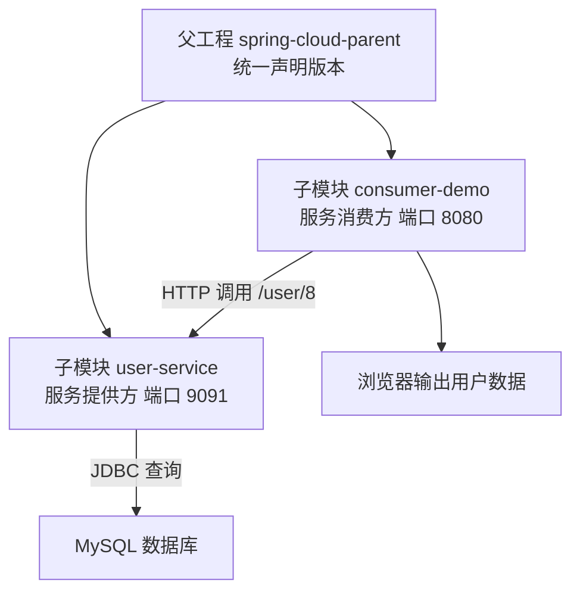

# 一个父工程管住所有版本：Spring Cloud 微服务工程骨架怎么搭

需求只有一句话：查询数据库中的用户数据并输出到浏览器。真落到工程上，它至少要拆成两个服务，一个提供查询用户的能力，一个调用这个能力并把结果抛给浏览器。两个工程都要引 Spring Boot、Spring Cloud、MyBatis、MySQL 驱动，如果版本各写一份，改一次就得改两处，版本冲突迟早出现。

解决这类问题的标准做法是先立一个父工程，把版本号集中在一个地方声明，子工程只负责声明「我要用什么」，不关心版本号是多少。

## 先给结论

- 需求拆成三个工程：父工程统一管理依赖版本，`user-service` 提供查询用户服务，`consumer-demo` 消费服务并输出到浏览器。
- 父工程的打包方式必须是 `pom`，并且要保留 IDEA 自动生成的 `<modules>` 声明，删掉它就聚合不到子模块。
- 父工程继承 `spring-boot-starter-parent`，同时在 `dependencyManagement` 里用 `scope=import` 导入 `spring-cloud-dependencies`，一套工程同时获得两处版本管理。
- 子工程引依赖时不写版本号，版本由父工程仲裁，这是避免 Spring Cloud 与 Spring Boot 版本打架的关键。
- 生产环境里服务提供方和消费方未必放在同一个父工程下，同团队、业务相近时放一起做聚合工程是合理的。

## 一、从需求到工程拆分

需求：查询数据库中的用户数据并输出到浏览器。按职责切成三个工程之后，各自要干的事情就很清楚了：

- 父工程：添加 Spring Boot 父坐标，管理其它组件的依赖版本。
- 用户服务工程 `user-service`：整合 MyBatis 查询数据库中的用户数据，对外提供查询用户服务。
- 服务消费工程 `consumer-demo`：调用查询用户服务拿到数据，输出到浏览器。

三者的关系可以这样看：



父工程本身不写业务代码，它只做两件事：声明聚合了哪些子模块，声明这些子模块能用到的依赖版本。

## 二、父工程的 pom：课程资料里的真实配置

课程资料中给出的父工程依赖配置如下（工程名与包名已改成中性的 `spring-cloud-parent` 与 `com.example`）：

```xml
<?xml version="1.0" encoding="UTF-8"?>
<project xmlns="http://maven.apache.org/POM/4.0.0"
         xmlns:xsi="http://www.w3.org/2001/XMLSchema-instance"
         xsi:schemaLocation="http://maven.apache.org/POM/4.0.0 http://maven.apache.org/xsd/maven-4.0.0.xsd">
    <modelVersion>4.0.0</modelVersion>

    <groupId>com.example</groupId>
    <artifactId>spring-cloud-parent</artifactId>
    <packaging>pom</packaging>
    <version>1.0-SNAPSHOT</version>

    <parent>
        <groupId>org.springframework.boot</groupId>
        <artifactId>spring-boot-starter-parent</artifactId>
        <version>2.1.5.RELEASE</version>
        <relativePath/>
    </parent>

    <properties>
        <java.version>1.8</java.version>
        <spring-cloud.version>Greenwich.SR1</spring-cloud.version>
        <mapper.starter.version>2.1.5</mapper.starter.version>
        <mysql.version>5.1.46</mysql.version>
    </properties>

    <dependencyManagement>
        <dependencies>
            <!-- springCloud -->
            <dependency>
                <groupId>org.springframework.cloud</groupId>
                <artifactId>spring-cloud-dependencies</artifactId>
                <version>${spring-cloud.version}</version>
                <type>pom</type>
                <scope>import</scope>
            </dependency>
            <!-- 通用Mapper启动器 -->
            <dependency>
                <groupId>tk.mybatis</groupId>
                <artifactId>mapper-spring-boot-starter</artifactId>
                <version>${mapper.starter.version}</version>
            </dependency>
            <!-- mysql驱动 -->
            <dependency>
                <groupId>mysql</groupId>
                <artifactId>mysql-connector-java</artifactId>
                <version>${mysql.version}</version>
            </dependency>
            <dependency>
                <groupId>org.springframework.cloud</groupId>
                <artifactId>spring-cloud-starter-config</artifactId>
            </dependency>
        </dependencies>
    </dependencyManagement>

    <dependencies>
        <dependency>
            <groupId>org.projectlombok</groupId>
            <artifactId>lombok</artifactId>
        </dependency>
    </dependencies>

    <build>
        <plugins>
            <plugin>
                <groupId>org.springframework.boot</groupId>
                <artifactId>spring-boot-maven-plugin</artifactId>
            </plugin>
        </plugins>
    </build>
</project>
```

几个容易看漏的点值得单独说。

**第一，`<packaging>pom</packaging>` 不能省。** 父工程只是聚合与版本声明的载体，不产出 jar，打包类型必须是 pom。

**第二，`<relativePath/>` 写成空标签。** 表示不从本地磁盘的相对路径去找父 pom，直接从 Maven 仓库解析 `spring-boot-starter-parent`。

**第三，`spring-boot-maven-plugin` 放在父工程的 `<build>` 里。** 所有子模块就都能打出可执行 jar，不用每个子工程再配一遍。

## 三、`scope=import` 到底解决了什么问题

Maven 的继承是单继承，一个 pom 只能有一个 `<parent>`。父工程已经继承了 `spring-boot-starter-parent` 2.1.5，就没有名额再去继承 `spring-cloud-dependencies` 了，可 Spring Cloud 那一堆组件的版本又必须被统一管理。

解决办法就是上面那段配置里的写法：

```xml
<dependency>
    <groupId>org.springframework.cloud</groupId>
    <artifactId>spring-cloud-dependencies</artifactId>
    <version>${spring-cloud.version}</version>
    <type>pom</type>
    <scope>import</scope>
</dependency>
```

`type` 为 `pom`、`scope` 为 `import` 时，Maven 会把目标 pom 里 `dependencyManagement` 的内容整体导入当前工程，效果等同于「多继承一份版本清单」。也就是说，这个父工程同时继承了 Spring Boot 2.1.5 的依赖版本和 `spring-cloud-dependencies` 里的依赖版本，后续子工程引用 Spring Cloud 的任何组件都不必写版本号。

## 四、子工程的创建与依赖写法

在 IDEA 里对父工程右键新建 Module，依次建出 `user-service` 和 `consumer-demo`。建完之后父工程的 pom 会自动多出一段：

```xml
<modules>
    <module>user-service</module>
    <module>consumer-demo</module>
</modules>
```

这段是聚合子模块的清单，不要删掉，删掉之后父工程就检测不到里面还有这些子模块，`mvn` 构建时也不会带上它们。

子工程自己的 pom 只要声明父工程和artifactId，依赖按需添加即可，版本全部省略：

```xml
<project xmlns="http://maven.apache.org/POM/4.0.0"
         xmlns:xsi="http://www.w3.org/2001/XMLSchema-instance"
         xsi:schemaLocation="http://maven.apache.org/POM/4.0.0 http://maven.apache.org/xsd/maven-4.0.0.xsd">
    <modelVersion>4.0.0</modelVersion>

    <parent>
        <groupId>com.example</groupId>
        <artifactId>spring-cloud-parent</artifactId>
        <version>1.0-SNAPSHOT</version>
    </parent>

    <artifactId>user-service</artifactId>

    <!-- 具体依赖在后续配置各服务时逐个添加，此处不写 version -->
</project>
```

`consumer-demo` 的骨架完全一样，只改 `<artifactId>`。两个子工程的具体依赖先不加，等各自的角色明确了再单独配置，这样能避免在还没用到的时候就引入一堆无关 jar。

## 五、`dependencyManagement` 与 `dependencies` 的分工

父工程里这两个标签承担的职责不同，混用是新手最常见的错误来源。

`dependencyManagement` 只声明「如果要用，用这个版本」，它不会真正把 jar 加进工程；父工程里写的 `dependencies` 才是真正引入的依赖，比如 Lombok，它会被所有子模块无条件继承。

这套分工带来的好处是：子工程想用 MyBatis 或 MySQL 驱动时，在自己的 `dependencies` 里只写 `groupId` 和 `artifactId`，版本号由父工程的 `dependencyManagement` 补齐，全工程的版本永远只有一份来源。

## 常见误区

- **父工程漏写 `<packaging>pom</packaging>`**：子模块继承时会报「父工程没有 pom 打包类型」或者直接把父工程当 jar 处理，构建失败。
- **手工删掉 `<modules>`**：IDEA 生成的这段是聚合子模块的依据，删掉后父工程感知不到子模块，整体构建时子模块被跳过。
- **把 `dependencyManagement` 当成引入依赖**：它只锁版本，不产生实际依赖，只在里面写坐标的话工程里压根没有这个 jar，编译时报类找不到。
- **子工程自己写版本号**：一旦子工程写了和父工程不同的版本，父工程的版本管理就被架空，Spring Cloud 与 Spring Boot 版本不匹配的问题会立刻回来。
- **认为服务提供方和消费方必须在同一个父工程下**：聚合只是为了演示与统一管理方便，实际开发中两个服务分属不同仓库也很常见。

## 面试可能被问到的问题

1. 面试官追问：「Maven 是单继承的，那 Spring Boot 父工程和 Spring Cloud 依赖清单怎么同时继承？」
   答：在父工程的 `dependencyManagement` 里用 `type` 为 pom、`scope` 为 import 的方式导入 `spring-cloud-dependencies`。这样父工程仍然只继承 `spring-boot-starter-parent`，但额外获得了 Spring Cloud 各组件的版本清单，效果相当于多继承一份版本管理。

2. 面试官追问：「`dependencyManagement` 和 `dependencies` 有什么区别？」
   答：`dependencyManagement` 只声明版本与范围，不真正引入依赖，子模块引用时仍需写坐标但可省略版本；`dependencies` 是真实引入，写在父工程的 `dependencies` 里的依赖会被所有子模块继承。

3. 面试官追问：「父工程的打包方式为什么必须是 pom？」
   答：父工程只承担聚合子模块与统一版本声明的职责，不产出可执行产物。打包类型为 pom 时 Maven 才会按聚合工程的方式处理它并递归构建 `<modules>` 中声明的子模块。

4. 面试官追问：「父工程的 `<modules>` 标签有什么用，删掉会怎样？」
   答：它声明了这个聚合工程包含哪些子模块。删掉之后执行父工程构建时 Maven 不会带上这些子模块，IDEA 里也会丢失聚合关系，子模块需要单独构建。

5. 面试官追问：「Spring Cloud 组件的版本号应该写在哪一层？」
   答：写在父工程的 `properties` 里，再用 `dependencyManagement` 导入 `spring-cloud-dependencies` 并把版本指向该属性。子工程一律不写版本号，保证整个工程只有一个版本来源。

6. 面试官追问：「服务提供方和消费方一定要放在同一个父工程下吗？」
   答：不一定。生产环境里它们往往是独立的仓库与独立的构建流水线，通过注册中心互相发现。放在同一个聚合父工程中是为了统一依赖版本和演示方便，适合业务相近、同一团队维护的场景。

## 配套资料

- 父工程依赖配置：`materials/code/01/2.springcloud/2.springcloud/day01/资料/`（目录内的父工程 pom 配置片段，文中工程名改为 `spring-cloud-parent`，包名改为 `com.example`）
- 课堂笔记：`materials/code/01/2.springcloud/2.springcloud/day01/笔记/Spring Cloud 第一天课堂笔记.md`
- 同目录 `http-demo` 工程可作 Spring Boot 基础工程结构参考
