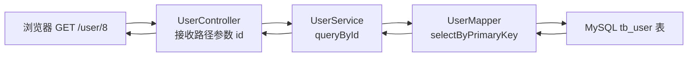

# 从零搭出第一个微服务：user-service 按 id 查询用户并输出 JSON

上一节把父工程和两个子模块建好了，但 `user-service` 还是个空壳。这一节要把它填成一个真正能跑的服务：浏览器访问 `http://localhost:9091/user/8`，返回数据库里 id 为 8 的那条用户记录。

说白了这就是一个标准的 Spring Boot 工程，前面学的那套搭建流程完全可以复用，多出来的只是「端口改成 9091」和「用通用 Mapper 操作数据库」这两处。

## 先给结论

- 实现五步走：添加启动器依赖、创建启动引导类和配置文件、修改配置参数、编写测试代码、启动测试。
- 依赖只有三样：`spring-boot-starter-web`、通用 Mapper 启动器 `mapper-spring-boot-starter`、`mysql-connector-java`，版本号全部由父工程仲裁，子工程不写。
- 端口设为 9091，把 8080 留给后面的 `consumer-demo`，两个服务在同一台机器上跑才不会撞端口。
- 通用 Mapper 让 `UserMapper` 只写一个空接口继承 `Mapper<User>` 就具备单表 CRUD，不需要 XML，也不需要写 SQL。
- 引导类上必须用 tk.mybatis 包下的 `@MapperScan` 指定 Mapper 接口所在包，引成 MyBatis 官方的同名注解会扫描不到。

## 一、需求与实现步骤

需求：访问 `http://localhost:9091/user/8`，输出数据库中 id 为 8 的用户数据。

一次请求在这个服务内部的流转路径如下：



按图上的顺序，工程搭建分成五步：添加启动器依赖、创建启动引导类和配置文件、修改配置文件中的参数、编写测试代码（Mapper、Service、Controller）、启动测试。

## 二、添加启动器依赖

`user-service` 是一个 Web 工程又要查数据库，三个依赖刚好对应三件事：

```xml
<dependencies>
    <dependency>
        <groupId>org.springframework.boot</groupId>
        <artifactId>spring-boot-starter-web</artifactId>
    </dependency>
    <!-- 通用Mapper启动器 -->
    <dependency>
        <groupId>tk.mybatis</groupId>
        <artifactId>mapper-spring-boot-starter</artifactId>
    </dependency>
    <!-- mysql驱动 -->
    <dependency>
        <groupId>mysql</groupId>
        <artifactId>mysql-connector-java</artifactId>
    </dependency>
</dependencies>
```

三个依赖都没写版本号，因为父工程的 `dependencyManagement` 已经导入了 `spring-cloud-dependencies` 并声明了 `mapper.starter.version` 与 `mysql.version`，子工程只负责声明要用什么。

## 三、引导类与配置文件

引导类比普通的 Spring Boot 工程多一个注解：

```java
package com.example.user;

import org.springframework.boot.SpringApplication;
import org.springframework.boot.autoconfigure.SpringBootApplication;
import tk.mybatis.spring.annotation.MapperScan;

@SpringBootApplication
// 注意是 tk.mybatis 包下的 MapperScan，不是 org.mybatis 的
@MapperScan("com.example.user.mapper")
public class UserApplication {

    public static void main(String[] args) {
        SpringApplication.run(UserApplication.class, args);
    }
}
```

`@SpringBootApplication` 默认只扫描引导类所在包及其子包，`com.example.user` 下面的 `controller`、`service` 都会被扫到，但 Mapper 接口是接口不是注解类，需要 `@MapperScan` 单独指定。

配置文件 `application.yml` 里要改的参数就这几项：

```yaml
server:
  port: 9091
spring:
  datasource:
    driver-class-name: com.mysql.jdbc.Driver
    url: jdbc:mysql://localhost:3306/springcloud
    username: root
    password: root
mybatis:
  type-aliases-package: com.example.user.pojo
```

`server.port` 从默认的 8080 改成 9091，`spring.datasource` 四件套指向本地 3306 上的 `springcloud` 库，`mybatis.type-aliases-package` 声明实体类别名扫描包，也就是接下来要建的 `com.example.user.pojo`。

## 四、实体类与数据库表

课程资料里提供了现成的实体类，字段与表结构一一对应（包名已改为 `com.example.user.pojo`）：

```java
package com.example.user.pojo;

import lombok.Data;
import tk.mybatis.mapper.annotation.KeySql;

import javax.persistence.Id;
import javax.persistence.Table;
import java.util.Date;

@Data
@Table(name = "tb_user")
public class User {
    // id
    @Id
    // 开启主键自动回填
    @KeySql(useGeneratedKeys = true)
    private Long id;

    // 用户名
    private String userName;

    // 密码
    private String password;

    // 姓名
    private String name;

    // 年龄
    private Integer age;

    // 性别，1男性，2女性
    private Integer sex;

    // 出生日期
    private Date birthday;

    // 创建时间
    private Date created;

    // 更新时间
    private Date updated;

    // 备注
    private String note;
}
```

`@Table` 指定表名，`@Id` 标注主键，`@KeySql(useGeneratedKeys = true)` 让插入后能拿回自增主键，这三个注解是通用 Mapper 识别实体类的依据。

数据库的建库建表语句如下，库名用 `springcloud`，字符集选 utf8：

```sql
CREATE TABLE `tb_user` (
  `id` bigint(20) NOT NULL AUTO_INCREMENT,
  `user_name` varchar(100) DEFAULT NULL COMMENT '用户名',
  `password` varchar(100) DEFAULT NULL COMMENT '密码',
  `name` varchar(100) DEFAULT NULL COMMENT '姓名',
  `age` int(10) DEFAULT NULL COMMENT '年龄',
  `sex` tinyint(1) DEFAULT NULL COMMENT '性别，1男性，2女性',
  `birthday` date DEFAULT NULL COMMENT '出生日期',
  `note` varchar(255) DEFAULT NULL COMMENT '备注',
  `created` datetime DEFAULT NULL COMMENT '创建时间',
  `updated` datetime DEFAULT NULL COMMENT '更新时间',
  PRIMARY KEY (`id`),
  UNIQUE KEY `username` (`user_name`)
) ENGINE=InnoDB DEFAULT CHARSET=utf8;
```

类名 `User` 对应表名 `tb_user` 是靠 `@Table` 显式声明的，字段名走的是驼峰转下划线的默认规则，`userName` 对应 `user_name`，规则对不上就会查不到列。

## 五、Mapper、Service 与 Controller

三层代码都很短，通用 Mapper 把数据访问层压成了一个空接口：

```java
package com.example.user.mapper;

import com.example.user.pojo.User;
import tk.mybatis.mapper.common.Mapper;

public interface UserMapper extends Mapper<User> {
}
```

继承 `Mapper<User>` 之后，`selectByPrimaryKey`、`select`、`insertSelective` 这些单表方法就都有了，不用写任何 XML。

业务层调用它完成按主键查询：

```java
package com.example.user.service;

import com.example.user.mapper.UserMapper;
import com.example.user.pojo.User;
import org.springframework.beans.factory.annotation.Autowired;
import org.springframework.stereotype.Service;

@Service
public class UserService {

    @Autowired
    private UserMapper userMapper;

    /**
     * 根据主键查询用户
     */
    public User queryById(Long id) {
        return userMapper.selectByPrimaryKey(id);
    }
}
```

处理器接收路径参数并返回用户对象：

```java
package com.example.user.controller;

import com.example.user.pojo.User;
import com.example.user.service.UserService;
import org.springframework.beans.factory.annotation.Autowired;
import org.springframework.web.bind.annotation.GetMapping;
import org.springframework.web.bind.annotation.PathVariable;
import org.springframework.web.bind.annotation.RequestMapping;
import org.springframework.web.bind.annotation.RestController;

@RestController
@RequestMapping("/user")
public class UserController {

    @Autowired
    private UserService userService;

    @GetMapping("/{id}")
    public User queryById(@PathVariable Long id) {
        return userService.queryById(id);
    }
}
```

`@RestController` 相当于在所有方法上都加了 `@ResponseBody`，返回的 `User` 对象会被 Jackson 直接序列化成 JSON 写进响应体，不需要额外的视图解析配置。

## 六、启动与验证

运行 `UserApplication` 的 `main` 方法，控制台出现 `Tomcat started on port(s): 9091` 说明容器就绪，此时访问：

```bash
curl http://localhost:9091/user/8
```

响应体是一段 JSON，形如 `{"id":8,"userName":"...","name":"...","age":21}`。

浏览器里直接打开这个地址，能看到一段 JSON，这就是需求里要求的「输出用户数据」。到这里 `user-service` 作为服务提供方已经可用，接下来 `consumer-demo` 只要用 HTTP 客户端访问这个地址就能拿到同样的数据。

## 常见误区

- **`@MapperScan` 引错包**：通用 Mapper 用的是 `tk.mybatis.spring.annotation.MapperScan`，引成 `org.mybatis.spring.annotation.MapperScan` 时启动会报 `UserMapper` 无法注入。
- **忘记改端口导致冲突**：`user-service` 用 9091，`consumer-demo` 用 8080，两个都留 8080 时第二个服务启动会报端口被占用。
- **在子工程里手写依赖版本号**：父工程已通过 `dependencyManagement` 统一版本，子工程再写一份就可能出现通用 Mapper 与 MyBatis 版本不匹配。
- **实体类忘了 `@Table` 或表名写错**：通用 Mapper 默认按类名推断表名，`User` 会被推成 `user`，与实际的 `tb_user` 不符，查询直接报表不存在。
- **配置里的库名带空格**：`jdbc:mysql://localhost:3306/spring cloud` 这种写法会导致连接失败，库名要用 `springcloud` 这类不带空格的名字，或者在 URL 里做转义。

## 面试可能被问到的问题

1. 面试官追问：「通用 Mapper 相比原生 MyBatis 省掉了什么？」
   答：省掉了单表 CRUD 的 SQL 与 XML 映射文件。Mapper 接口继承 `Mapper<T>` 后即具备 `selectByPrimaryKey`、`insertSelective` 等方法，靠实体类上的 `@Table`、`@Id`、`@KeySql` 等注解解析表名与主键，只有复杂多表查询才需要自己写 SQL。

2. 面试官追问：「`@MapperScan` 和 `@SpringBootApplication` 的扫描范围有什么不同？」
   答：`@SpringBootApplication` 里的 `@ComponentScan` 扫描注解标注的类，如 `@Service`、`@Controller`；Mapper 是接口，必须靠 `@MapperScan` 指定所在包，由 MyBatis 为其生成代理实现并注册进容器。两者扫描范围相互独立。

3. 面试官追问：「`@RestController` 和 `@Controller` 的区别是什么？」
   答：`@RestController` 等价于 `@Controller` 加 `@ResponseBody`，它把方法返回值直接写入响应体而不是交给视图解析器，返回对象会被自动序列化成 JSON，适合做前后端分离的接口。

4. 面试官追问：「`@PathVariable` 的作用是什么，和 `@RequestParam` 有什么区别？」
   答：`@PathVariable` 取的是 URL 路径中的占位符，如 `/user/8` 里的 8；`@RequestParam` 取的是查询参数，如 `/user?id=8`。前者用于 RESTful 风格的资源定位，后者用于传统的参数传递。

5. 面试官追问：「为什么 `user-service` 要用 9091 而不用默认的 8080？」
   答：单机开发时多个微服务同时启动，端口必须各不相同，否则后启动的服务会因端口占用而失败。课程里约定 `user-service` 用 9091、`consumer-demo` 用 8080，后续的 `eureka-server` 用 10086，改端口只需在配置文件里写 `server.port`。

6. 面试官追问：「子工程依赖不写版本号，Maven 怎么知道用哪个版本？」
   答：版本来自父工程的 `dependencyManagement`。父工程通过 `scope=import` 导入了 `spring-cloud-dependencies`，并在 `properties` 里声明了通用 Mapper 与 MySQL 驱动的版本，子工程只写坐标就能拿到统一仲裁后的版本。

## 配套资料

- 实体类与建表脚本：`materials/code/01/2.springcloud/2.springcloud/day01/资料/`（目录内 `User.java` 与 `tb_user.sql`，文中包名已改为 `com.example.user.pojo`）
- 课堂笔记：`materials/code/01/2.springcloud/2.springcloud/day01/笔记/Spring Cloud 第一天课堂笔记.md`（第 7 节含依赖与 `application.yml` 原文）
- 父工程依赖配置同上目录，供 `user-service` 继承版本管理
