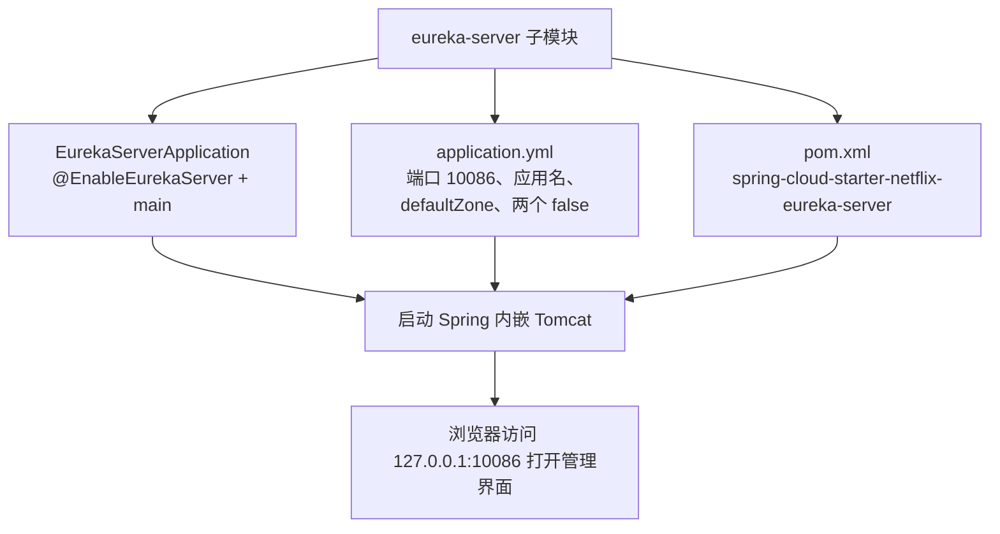

# 三步起一个注册中心：搭建 eureka-server 并打开它的管理页面

前面两个工程已经能互相调用，调用的代价是地址被写死在代码里。要把这件事交出去，第一步是先把注册中心跑起来。它听起来很重，实际形态却非常朴素：一个普通的 Spring Boot Web 工程，比普通的接口工程多了一个依赖、一个注解和几行配置。

这一节的目标是添加 Eureka 相关依赖、编写引导类，最终能在浏览器里打开 Eureka 的服务管理界面。

## 先给结论

- `eureka-server` 自身既不提供服务也不消费服务，它只做一件事：登记别人的服务地址。
- 依赖只有一个 `spring-cloud-starter-netflix-eureka-server`，版本号不用写，父工程导入的 `spring-cloud-dependencies` 已经锁定了版本。
- 引导类上要加 `@EnableEurekaServer`，少了它，工程只是一个空壳 Web 应用。
- 配置文件里四项最关键：端口 10086、应用名 `eureka-server`、`defaultZone` 指向自己、`register-with-eureka` 与 `fetch-registry` 设为 false。
- 启动后访问 `http://127.0.0.1:10086` 能看到管理界面即搭建成功，此时实例列表为空，等服务注册进来才有内容。

## 一、注册中心其实就是一个 Web 工程

很多同学第一次接触时会把注册中心想成某种中间件，需要额外安装、额外部署。它并不如此。Eureka 是 Netflix 开源的服务治理组件，Spring Cloud 把它做成了 starter 之后的形态是：引入依赖就得到一个 Java 库，工程本身仍然是你熟悉的 Spring Boot 项目，用 `main` 方法启动，内嵌 Tomcat，打 jar 部署。

理解了这一点，搭建步骤就顺理成章：

1. 创建工程（作为父工程下的一个子模块）；
2. 添加 Eureka Server 起步依赖；
3. 编写引导类并加上 Eureka 服务端注解，同时创建配置文件；
4. 修改配置文件，设置端口、应用名等参数；
5. 启动并访问管理界面验证。

## 二、创建工程与添加依赖

工程建好后，pom 里只需要声明这一个坐标：

```xml
<project xmlns="http://maven.apache.org/POM/4.0.0"
         xmlns:xsi="http://www.w3.org/2001/XMLSchema-instance"
         xsi:schemaLocation="http://maven.apache.org/POM/4.0.0 http://maven.apache.org/xsd/maven-4.0.0.xsd">
    <modelVersion>4.0.0</modelVersion>

    <parent>
        <groupId>com.example</groupId>
        <artifactId>springcloud-parent</artifactId>
        <version>1.0-SNAPSHOT</version>
    </parent>

    <artifactId>eureka-server</artifactId>

    <dependencies>
        <!-- Eureka 服务端起步依赖，由 Netflix 提供的注册中心实现 -->
        <dependency>
            <groupId>org.springframework.cloud</groupId>
            <artifactId>spring-cloud-starter-netflix-eureka-server</artifactId>
        </dependency>
    </dependencies>
</project>
```

注意这里没有写 `<version>`。父工程通过 `scope=import` 的方式导入了 `spring-cloud-dependencies`，Spring Cloud 旗下所有组件的版本都在那里被锁定：

```xml
<dependencyManagement>
    <dependencies>
        <dependency>
            <groupId>org.springframework.cloud</groupId>
            <artifactId>spring-cloud-dependencies</artifactId>
            <version>${spring-cloud.version}</version>
            <type>pom</type>
            <scope>import</scope>
        </dependency>
    </dependencies>
</dependencyManagement>
```

子模块手写一个版本号，轻则和 parent 仲裁的版本不一致，重则出现 Spring Cloud 与 Spring Boot 版本不匹配导致的启动失败，这类报错通常表现为莫名其妙的 `NoSuchMethodError`。

## 三、引导类：一个注解声明身份

用插件生成的引导类和普通 Spring Boot 工程完全一样，唯一的区别是多一个注解：

```java
package com.example.eureka;

import org.springframework.boot.SpringApplication;
import org.springframework.boot.autoconfigure.SpringBootApplication;
import org.springframework.cloud.netflix.eureka.server.EnableEurekaServer;

@EnableEurekaServer
@SpringBootApplication
public class EurekaServerApplication {

    public static void main(String[] args) {
        SpringApplication.run(EurekaServerApplication.class, args);
    }
}
```

`@EnableEurekaServer` 的含义是声明当前应用是一个 Eureka 服务，也就是注册中心。它的作用是触发 Eureka Server 相关的一整套自动配置：加载 `EurekaServerAutoConfiguration`、注册处理注册与续约请求的 Controller、初始化注册表和剔除任务。缺少这个注解时，工程会以一个普通 Web 应用的身份启动，端口能起来，但访问管理界面是 404，也不会有任何服务能注册上来。

## 四、配置文件：端口、应用名与两个 false

```yaml
server:
  port: 10086
spring:
  application:
    name: eureka-server
eureka:
  client:
    service-url:
      # eureka 服务地址，如果是集群的话，需要指定其它集群 eureka 地址
      defaultZone: http://127.0.0.1:10086/eureka
    # 不注册自己
    register-with-eureka: false
    # 不拉取服务
    fetch-registry: false
```

逐项看为什么这么配。

**第一，`server.port` 设为 10086。** 单纯的端口约定，避开 `user-service` 的 9091 和 `consumer-demo` 的 8080，管理界面直接通过根路径访问。

**第二，`spring.application.name` 设为 `eureka-server`。** 应用名会显示在管理界面上。注册中心自己做集群时，彼此之间也需要靠应用名互相识别，所以哪怕现在只有一台也要起好名字。将来其他服务注册进来，界面上的列表同样按各自的应用名展示。

**第三，`defaultZone` 指向自己。** 这一项是 Eureka 服务的地址，其他服务要注册就得往这里发请求，消费者也是从这里拉列表。当前只有一台，所以填自己的地址；做集群时这里要填其他集群节点的地址，多个地址用逗号分隔。注意路径里必须带 `/eureka` 后缀，那是 Eureka Server 对外提供的 REST 端点根路径，漏掉它会导致注册请求打空。

**第四，两个 false。** `register-with-eureka` 默认 true，表示把自己注册到注册中心；注册中心自己不提供服务，把自己登记成服务毫无意义，单机部署时关掉。`fetch-registry` 默认 true，表示从注册中心拉取服务列表；这里也没有需要拉取的服务，同样关掉。这两个 false 只在单机注册中心上这么写，一旦 Eureka Server 要做高可用集群，多台节点必须互相注册、互相同步，那时就要改回默认的 true。

## 五、启动与验证

运行 `EurekaServerApplication` 的 `main` 方法，控制台出现 Tomcat 在 10086 端口启动的日志后，浏览器访问：

```bash
# 管理界面地址，注意是根路径，没有项目上下文
http://127.0.0.1:10086
```

页面上会显示环境（默认是测试环境）、当前时间、内存与 JVM 参数，以及最关键的一块：当前注册上来的实例列表，此刻应当是空的。页面顶部如果出现自我保护相关的红色提示属于正常现象，那是 Eureka 在心跳不足时的保护策略，与搭建成败无关。

整套工程的目录结构非常干净：



三步配置换来一个可以登记服务的能力，接下来把 `user-service` 和 `consumer-demo` 接进来，注册进来后，控制器里那句硬编码地址就可以删掉了。

## 常见误区

- **漏加 `@EnableEurekaServer`**：工程照常启动，但访问 10086 是 404，服务也注册不上来。
- **`defaultZone` 少写 `/eureka`**：客户端注册时报 404 或无法解析，Eureka 的 REST 端点就挂在 `/eureka` 下面。
- **把单机配置直接搬到集群**：集群模式下必须让多个节点互相注册（`register-with-eureka` 与 `fetch-registry` 保持 true），并把 `defaultZone` 指向其他节点，否则节点之间互不可见。
- **在子模块里手写版本号**：绕过了父工程的版本仲裁，容易出现 Spring Cloud 与 Spring Boot 版本错配。
- **用 `localhost` 之外的方式乱填 `defaultZone`**：多机部署时地址要写对外的 IP，本地实验阶段用 `127.0.0.1` 最省事。

## 面试可能被问到的问题

1. 面试官追问：「`@EnableEurekaServer` 的作用是什么？」
   答：它是 Eureka 服务端的开关，声明当前应用是注册中心，加载 `EurekaServerAutoConfiguration` 等自动配置，准备好处理注册、续约、下线请求的端点，以及注册表与失效剔除任务。没有它，工程只是一个普通的 Spring Boot Web 应用。

2. 面试官追问：「为什么要配置 `register-with-eureka: false` 和 `fetch-registry: false`？」
   答：单机部署时注册中心自身不提供也不消费业务服务，把自己注册成实例没有意义，也没有服务列表需要拉取，关掉这两项可以让启动过程不报「连不上注册中心」的异常。Eureka Server 做高可用集群时必须改回 true，让各节点互相注册、互相同步注册表。

3. 面试官追问：`defaultZone` 是什么，为什么路径后面要带 `/eureka`？
   答：`defaultZone` 是 Eureka 客户端与服务端通信的默认区域地址，服务注册、拉取列表、发送心跳都往这个地址发。`/eureka` 是 Eureka Server 对外暴露 REST 端点的上下文路径，DispatcherServlet 就映射在这条路径上，漏掉会请求到根路径而得到 404。

4. 面试官追问：「Eureka 依赖为什么不用写版本号？」
   答：父工程通过 `dependencyManagement` 以 `scope=import` 的方式导入了 `spring-cloud-dependencies`，其中已经对 Spring Cloud 各组件的版本做了锁定。子模块只声明坐标即可获得统一仲裁后的版本，这也是避免组件之间版本冲突的标准做法。

5. 面试官追问：「注册中心和普通微服务在工程形态上有什么区别？」
   答：没有本质区别。`eureka-server` 同样是一个 Spring Boot 工程，靠引导类的 `main` 方法启动，内嵌 Tomcat，打成 jar 运行。差别只在依赖坐标、引导类上的注解和配置内容，这也说明 Spring Cloud 的组件都是以库的形式嵌入到普通应用里的。

6. 面试官追问：「访问 Eureka 管理页面时实例列表为空，正常吗？」
   答：正常。注册中心刚启动时还没有任何客户端注册过来。要到服务提供方引入 Eureka Client 依赖、配置 `defaultZone` 并启动之后，管理页面上才会出现对应应用名与 `UP` 状态的实例。

## 配套资料

- 课堂笔记：`materials/code/01/2.springcloud/2.springcloud/day01/笔记/Spring Cloud 第一天课堂笔记.md`（第 10 节含 Eureka Server 起步依赖与 `application.yml` 原文）
- 同天课程资料目录：`materials/code/01/2.springcloud/2.springcloud/day01/资料/`（内有父工程依赖配置文件与各服务工程的实体类、建表脚本）
- 本课 `eureka-server` 工程未在资料包中提供成品源码，正文中的三个文件按课堂实录与上述笔记还原，可直接编译运行
