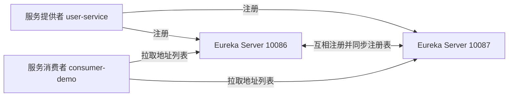

# Eureka Server 高可用：把注册中心自己注册成服务，两台互相同步

单机注册中心跑通之后，一个现实的问题马上摆在面前：整个服务体系的所有寻址都依赖这一台 `eureka-server`，它一旦挂掉，新服务注册不进来，老服务虽然靠本地缓存还能撑一阵，扩容和重启就全废了。注册中心成了新的单点。

这一节做的就是把这一台变成两台：同一份代码、不同端口、互相注册，服务注册到其中任意一台都会被同步到另一台。

## 先给结论

- Eureka Server 本身就是一个 Spring Boot Web 应用，起多个实例只需要换端口，不需要新工程、不需要新依赖。
- 高可用的实现方式是**把注册中心自己当成服务注册到别的注册中心**：多个节点互相注册、互相同步注册表。
- 因此单机版那两个 `false` 必须去掉：`register-with-eureka` 与 `fetch-registry` 要恢复默认的 `true`。
- 配置上用占位符 `${port:10086}` 与 `${defaultZone:http://...}` 把端口和注册地址参数化，启动时用 `-D` 传值，一份配置文件可复用于所有节点。
- 客户端的 `defaultZone` 可以填多个地址，用逗号分隔，一台不可用时会尝试另一台。

## 一、先看清 Eureka 的三个角色

讲义里把 Eureka 的基础架构拆成三个核心角色。

**服务注册中心**，也就是这一节要集群化的 `eureka-server`，职责是提供服务的注册与发现功能。

**服务提供者**，案例中是 `user-service`，职责是提供服务。它不限于 Spring Boot 应用，只要对外暴露的是 REST 风格的服务即可，用别的语言、别的技术栈实现同样能注册进来，注册中心只关心你能不能给出一个可访问的地址。

**服务消费者**，案例中是 `consumer-demo`，职责是从注册中心获取服务地址列表，再用任意 HTTP 手段去访问，案例里用的是 `RestTemplate`。

三个角色里只有注册中心需要高可用，因为它是唯一被所有服务共同依赖的一方。

## 二、集群是怎么同步数据的

假设有三台 Eureka，端口分别是 10086、10087、10088。它们之间两两注册：10086 注册到 10087 和 10088，10087 注册到 10086 和 10088，以此类推。



同步的意义在于：当 `user-service` 注册到 10086 时，10086 会把这条注册信息同步给集群中的其它节点。这样即使 10086 随后整个崩掉，10087 依然握有完整的地址列表，既能够继续接收新的注册，也能够继续对外提供地址查询。

这里有个容易混淆的点：每一台 Eureka 都既是服务端也是客户端。作为服务端它接收别人的注册，作为客户端它把自己注册到别人那里。所谓「互相注册」就是每个节点都同时开着这两种身份。

## 三、用占位符参数化配置

同一份代码要起多个实例，端口和注册地址就不能写死。改造后的 `eureka-server` 配置如下：

```yaml
server:
  # 启动参数里有 port 就用传入的值，没有就用 10086
  port: ${port:10086}
spring:
  application:
    name: eureka-server
eureka:
  client:
    service-url:
      # 启动参数里有 defaultZone 就用传入的值，没有就用本机的 10086
      defaultZone: ${defaultZone:http://127.0.0.1:10086/eureka}
```

`${port:10086}` 是 Spring 的占位符默认值语法：冒号前是变量名，冒号后是取不到时使用的默认值。变量名不固定，叫 `port` 只是因为它和端口语义对应，你改叫 `serverPort` 也行，只要启动时 `-D` 后面的名字跟着改。

接着把单机版那两个 `false` 注释掉：

```yaml
eureka:
  client:
    service-url:
      defaultZone: ${defaultZone:http://127.0.0.1:10086/eureka}
    # 集群模式下要恢复默认行为：把自己注册到其它节点，并从其它节点拉取注册表
    # register-with-eureka: false
    # fetch-registry: false
```

这两个配置项的默认值本来就是 `true`，注释掉等价于改回 `true`。保留 `false` 的话，节点不会把自己注册到对方，集群之间互不可见，注册表也就无从同步。

## 四、启动两份实例

配置文件改完后，复制一份启动配置即可。以命令行形式表达，两台实例的启动参数是这样的：

```bash
# 第一台：端口 10086，把自己注册到 10087
java -Dport=10086 -DdefaultZone=http://127.0.0.1:10087/eureka -jar eureka-server.jar

# 第二台：端口 10087，把自己注册到 10086
java -Dport=10087 -DdefaultZone=http://127.0.0.1:10086/eureka -jar eureka-server.jar
```

在 IDE 里对应的操作是打开 Run/Debug Configurations，在 VM options 里填 `-Dport=10086 -DdefaultZone=http://127.0.0.1:10087/eureka`，再复制一份改名为 10087 并把两个值对调。

第一台启动时控制台一定会刷出一堆错误，内容是注册失败、无法执行请求，指向的正是还没启动的 10087。这是预期内的现象，对方不存在自然连不上。把第二台也启动起来之后，重试机制会让它们互相发现，日志转为正常，控制台出现注册成功与初始化完成的输出。

验证方式是分别访问两个管理页面：`http://127.0.0.1:10086` 上能看到 10087 的实例，`http://127.0.0.1:10087` 上能看到 10086 的实例，两边展示的内容一致。

## 五、客户端把两个地址都配上

集群搭好之后，`user-service` 的配置文件不需要改也能工作，它原本注册到 10086，10086 会把信息同步给 10087，访问 10087 的管理页面同样能看到 `USER-SERVICE`。

不过只填一个地址意味着 10086 不可用时客户端就失去了注册入口，所以生产配置要把所有节点都列出来：

```yaml
spring:
  application:
    name: user-service
eureka:
  client:
    service-url:
      # 多个 Eureka 地址之间用逗号分隔
      defaultZone: http://127.0.0.1:10086/eureka,http://127.0.0.1:10087/eureka
```

客户端会按顺序尝试这些地址，前一个不可用就换下一个，注册成功后继续心跳续约。

学习阶段要反复启停多个实例实在麻烦，可以把配置改回单机形态：删掉启动参数里的 `-D`，让端口走默认的 10086，再把那两个 `false` 的注释放开。两种方式随时可以切回来。

## 常见误区

- **把单机配置原样复制到集群**：`register-with-eureka: false` 和 `fetch-registry: false` 不去掉，节点之间互不可见，页面上永远只显示自己。
- **两台实例端口相同**：后启动的直接报端口占用退出，集群根本没起来。
- **`defaultZone` 指向自己而不是对方**：节点自己注册自己，另一台的节点列表为空，服务同步不会发生。真正的集群里每台都要指向**其它**节点。
- **看到启动报错就以为配置错了**：先启动的那台必然会报连不上对方的错误，把另一台拉起来即可，不必回滚配置。
- **客户端只写一个注册中心地址**：集群白搭了，那个地址不可用时客户端照样注册不进来。

## 面试可能被问到的问题

1. 面试官追问：「Eureka Server 的高可用是怎么实现的？」
   答：把每个 Eureka Server 自身也作为一个服务注册到其它 Eureka Server 上，多个节点之间互相注册、互相发现，注册表在节点间同步。这样任意一个节点宕机，其余节点仍然持有完整的服务列表，可以继续接收注册与提供查询。

2. 面试官追问：「搭建集群时 `register-with-eureka` 和 `fetch-registry` 应该怎么配？」
   答：集群模式下必须保持默认的 `true`，也就是把单机部署时写的两个 `false` 去掉。前者让节点把自己注册到别的节点，后者让节点从别的节点拉取注册表，缺一个就无法完成同步。

3. 面试官追问：「一份配置文件怎么支撑多个不同端口的实例？」
   答：用 Spring 的占位符默认值语法，例如 `server.port: ${port:10086}`、`defaultZone: ${defaultZone:http://127.0.0.1:10086/eureka}`，启动时通过 `-Dport=10087` 传入不同取值。不传就走冒号后的默认值，本地单实例启动时不需要任何额外参数。

4. 面试官追问：「客户端在集群环境下 `defaultZone` 要怎么填？」
   答：把所有注册中心节点的地址都列上，用逗号分隔，例如 `http://127.0.0.1:10086/eureka,http://127.0.0.1:10087/eureka`。客户端按顺序尝试，前一个不可用就换下一个。只填一个也能靠节点间同步拿到完整列表，但那个节点本身不可用时客户端就失去了注册入口。

5. 面试官追问：「先启动的那台 Eureka 报了一堆连接错误，是配置有问题吗？」
   答：不是。它要注册到的目标节点尚未启动，连接失败属于正常现象。客户端内置重试机制，等其它节点启动完成后会自动注册成功，日志随之恢复正常。

6. 面试官追问：「Eureka 的服务提供者必须是 Java 应用吗？」
   答：不必。注册中心只要求提供者能给出可访问的地址并按约定发送注册与心跳请求，只要对外暴露 REST 风格的服务，任何语言实现的系统都可以接入。

## 配套资料

- 课堂笔记：`materials/code/01/2.springcloud/2.springcloud/day01/笔记/Spring Cloud 第一天课堂笔记.md`（第 9 节含 Eureka 三个核心角色的说明，第 12 节为 Eureka Server 高可用配置的目标与小结）
- 父工程依赖管理：`materials/code/01/2.springcloud/2.springcloud/day01/资料/` 目录下的父工程 pom 配置文件（`spring-cloud-dependencies` 的 `import` 写法与 `Greenwich.SR1` 版本定义）
- 客户端工程配置可参考同目录课堂笔记第 11 节的 `defaultZone` 写法；`eureka-server` 工程的成品源码未在资料包中提供，正文配置按上述笔记与课堂实录还原
