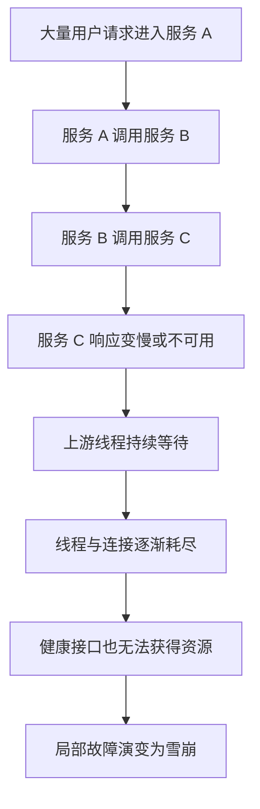

# Hystrix 熔断保护：避免一次远程故障拖垮整条调用链

微服务之间往往不是一次调用就能完成业务。一个入口请求可能依次访问用户、库存、订单和积分服务，只要其中一个远程服务长时间没有响应，上游线程就会持续等待。并发请求不断进入后，等待中的线程越积越多，连接、内存和线程池都可能被耗尽，原本健康的服务也会失去处理能力。

Hystrix 是面向分布式调用的延迟与容错库。它把远程访问放进受控边界，在调用异常、超时或达到熔断条件时快速失败，并返回降级结果，避免局部故障沿调用链扩散成系统性故障。

## 先给结论

- Hystrix 保护的是服务调用方及其资源，不是把已经故障的远程服务直接修复。
- 雪崩效应的根因，是故障调用长期占用有限资源，并通过调用链把阻塞向上游传播。
- Hystrix 通过线程隔离、超时、服务降级和熔断等机制限制故障影响范围。
- 降级负责返回可接受的备用结果，熔断负责在故障达到阈值后暂时停止真实调用，两者不是同一个概念。
- 课程使用的 Hystrix 已处于维护状态，但它的隔离、快速失败和断路器思想仍是理解微服务容错的重要基础。

## 一、雪崩效应是怎样形成的

假设一个请求要经过服务 A、B、C 和 D。正常情况下，每次远程调用很快返回，Web 容器线程完成响应后便能继续处理其他请求。若服务 C 出现故障且迟迟不返回，A、B 中等待结果的线程就不会及时释放。

请求量持续增加时，等待线程会迅速堆积。线程池容量、数据库连接和 HTTP 连接都有限，一旦资源被占满，新的请求即使不依赖服务 C，也可能因为拿不到线程而失败。一个服务的故障由此扩大到多个服务，这就是级联失败，也常被称为雪崩效应。

这张图展示了局部超时怎样沿调用链向上游扩散。



关键问题不只是「服务 C 报错」，而是「等待服务 C 的资源没有及时释放」。容错机制要做的，是缩短无效等待，并限制每个依赖最多能占用多少资源。

## 二、Hystrix 的保护边界

Hystrix 在服务消费者与远程依赖之间增加一层保护。课程笔记对它的定义是：用于隔离访问远程服务和第三方库，防止出现级联失败。

**第一，线程隔离限制资源占用。** 远程调用不直接无限制地占用主业务线程，而是在独立线程池中执行。某个依赖变慢时，它主要消耗自己的隔离资源，不会轻易占满整个应用的工作线程。

**第二，超时让调用快速结束。** 远程服务超过允许时间仍未返回时，Hystrix 会把这次调用判定为失败，不再让请求长期悬挂。合理的超时值应结合正常响应时间设置，过短会误杀慢请求，过长又无法及时释放资源。

**第三，降级提供备用结果。** 调用失败后，系统可以返回默认提示、缓存数据或经过裁剪的结果。降级不保证原业务完整成功，它保证调用方能够在可控时间内结束请求。

**第四，熔断减少无意义调用。** 当一段时间内的失败达到条件，断路器会打开，后续请求不再访问故障依赖，而是直接执行降级逻辑。经过休眠窗口后，再允许少量请求探测依赖是否恢复。

这几种机制相互配合：隔离控制影响范围，超时负责快速失败，降级给出替代响应，熔断避免持续冲击故障服务。

## 三、课程工程怎样引入 Hystrix

课程使用 Spring Cloud Netflix 的启动器接入 Hystrix。真实课程笔记中的 Maven 依赖如下：

```xml
<dependency>
    <groupId>org.springframework.cloud</groupId>
    <artifactId>spring-cloud-starter-netflix-hystrix</artifactId>
</dependency>
```

父工程已经通过 `spring-cloud-dependencies` 管理组件版本，子工程不应再随意指定一个不匹配的 Hystrix 版本。课程基线是 Spring Boot 2.1.5.RELEASE 与 Spring Cloud Greenwich.SR1，依赖组合应保持一致。

接入后，远程调用方法可以用 `@HystrixCommand` 纳入保护，并准备降级方法。下面的结构取自课程 `ConsumerController`，包名已改为中性命名：

```java
package com.example.consumer.controller;

import com.netflix.hystrix.contrib.javanica.annotation.DefaultProperties;
import com.netflix.hystrix.contrib.javanica.annotation.HystrixCommand;
import org.springframework.web.bind.annotation.GetMapping;
import org.springframework.web.bind.annotation.PathVariable;
import org.springframework.web.bind.annotation.RequestMapping;
import org.springframework.web.bind.annotation.RestController;
import org.springframework.web.client.RestTemplate;

@RestController
@RequestMapping("/consumer")
@DefaultProperties(defaultFallback = "defaultFallback")
public class ConsumerController {

    private final RestTemplate restTemplate;

    public ConsumerController(RestTemplate restTemplate) {
        this.restTemplate = restTemplate;
    }

    @GetMapping("/{id}")
    @HystrixCommand
    public String queryById(@PathVariable Long id) {
        String url = "http://user-service/user/" + id;
        return restTemplate.getForObject(url, String.class);
    }

    public String defaultFallback() {
        return "服务暂时不可用，请稍后重试";
    }
}
```

这段代码体现了容错的基本边界：正常时仍由 `RestTemplate` 调用 `user-service`；受保护方法执行失败时，不让异常和等待继续扩散，而是进入 `defaultFallback` 返回明确结果。

课程还给出了默认命令的超时配置。配置值为 2000 毫秒，表示隔离线程中的执行超过该时间后进入失败处理：

```yaml
hystrix:
  command:
    default:
      execution:
        isolation:
          thread:
            timeoutInMilliseconds: 2000
```

超时配置不是越小越好。若远程接口正常情况下就需要 1500 毫秒，把阈值设为 500 毫秒会让大量正常请求被降级。应依据监控中的响应时间分布和业务可接受等待时间决定阈值。

## 四、降级、熔断与限流不要混为一谈

**服务降级**关注「失败后返回什么」。网络异常、执行超时、代码异常或断路器打开时，都可能进入 fallback。它是面向用户结果的兜底策略。

**服务熔断**关注「是否还要继续调用」。断路器统计一段时间内的请求量和失败比例，达到条件后转为打开状态，直接拒绝真实调用。它减少对故障服务的持续压力，也避免调用方重复等待。

**线程隔离**关注「一个依赖最多占用多少资源」。即使远程调用持续变慢，其影响也应被限制在独立线程池内，避免挤占其他依赖的执行资源。

**限流**关注「允许多少流量进入」。它通常在入口或资源边界控制请求速率，与 Hystrix 针对远程依赖的失败隔离并不相同。实际系统可能同时使用限流和熔断，但二者解决的问题不同。

## 五、为什么熔断器不能替代故障治理

熔断器是保护机制，不是故障修复工具。数据库慢查询、线程死锁、连接池配置错误仍要找到根因并处理。若只看到降级响应而不告警，真实故障可能被长期掩盖。

降级结果也要结合业务设计。查询页面可以返回缓存或友好提示，扣款、库存扣减等关键写操作却不能随意伪造「成功」。备用逻辑应明确说明当前状态，并配合日志、指标和告警，让维护人员能够发现熔断、超时和 fallback 的触发情况。

## 常见误区

- **认为 Hystrix 能修复远程服务**：它只能隔离、快速失败和降级，故障服务仍需单独排查与恢复。
- **把 fallback 当成正常业务分支**：降级结果是异常情况下的兜底，应有监控和告警，不能静默吞掉所有错误。
- **把降级等同于熔断**：降级决定失败后的返回内容；熔断决定一段时间内是否继续发起真实调用。
- **超时时间设置得越短越安全**：阈值过短会把正常慢请求误判为失败，造成大量不必要的降级。
- **所有远程依赖共用一套隔离资源**：关键依赖之间没有边界时，一个慢服务仍可能拖累其他调用，应按依赖设计隔离策略。

## 面试可能被问到的问题

1. 面试官追问：「什么是微服务雪崩效应？」
   答：某个下游服务异常或响应缓慢，导致上游请求持续等待并占用线程、连接等资源。并发积累后，上游也无法处理正常请求，故障沿调用链扩散到更多服务。

2. 面试官追问：「Hystrix 的核心作用是什么？」
   答：它为远程调用提供延迟控制和容错保护，通过隔离、超时、降级与熔断限制故障影响，避免单个依赖造成级联失败。

3. 面试官追问：「服务降级和服务熔断有什么区别？」
   答：降级是失败后的备用处理，决定返回默认提示、缓存数据还是裁剪结果；熔断是断路器达到条件后暂时停止访问故障依赖。熔断打开时通常也会执行降级逻辑。

4. 面试官追问：「线程隔离为什么能防止雪崩？」
   答：它为不同远程依赖划定独立资源边界。某个依赖变慢时，只会逐步耗尽自己的隔离线程，不容易占满整个应用的工作线程。

5. 面试官追问：「配置 Hystrix 超时时间时要考虑什么？」
   答：要参考接口正常响应时间分布、网络波动和业务可接受等待时间。阈值过长不能及时释放资源，过短又会误判正常请求，并且应配合监控持续调整。

## 配套资料

- Hystrix 课程代码与配置：`materials/code/01/2.springcloud/2.springcloud/day01/笔记/Spring Cloud 第一天课堂笔记.md`
- 远程调用示例工程：`materials/code/01/2.springcloud/2.springcloud/day01/资料/http-demo/`
- `RestTemplate` Bean 源码目录：`materials/code/01/2.springcloud/2.springcloud/day01/资料/http-demo/src/main/java/`
- 远程调用测试源码目录：`materials/code/01/2.springcloud/2.springcloud/day01/资料/http-demo/src/test/java/`
