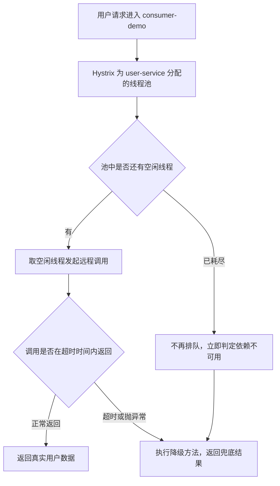

# 给远程调用加一层兜底：Hystrix 线程隔离与服务降级落地

consumer-demo 里那句 `restTemplate.getForObject("http://user-service/user/" + id, String.class)`，
在 user-service 健康时看不出任何问题。一旦把 user-service 停掉，浏览器就不再返回数据，而是转圈半天，
最后抛一个连接异常。更麻烦的是高并发场景：每个请求都占着一个 Web 容器线程死等，线程很快被耗尽，
连不依赖 user-service 的接口也一起不可用。

Hystrix 给出的解法由两件事组成，一件限制资源占用，一件限制等待时间。这篇把这两件事在
Spring Cloud 工程里真正配出来，并顺带说清超时时间为什么默认 1 秒会「误杀」正常请求。

## 先给结论

- 线程隔离：请求不再直接访问远程服务，而是交给 Hystrix 为每个依赖分配的线程池里的空闲线程去访问，线程池耗尽就立刻判定该依赖不可用。
- 服务降级：远程调用超时或异常时，不再死等，直接执行降级方法返回一个兜底结果，让线程马上释放。
- 接入只需三步：加 `spring-cloud-starter-netflix-hystrix` 依赖、引导类加 `@EnableCircuitBreaker`、被保护方法加 `@HystrixCommand`。
- 一个类里多个方法都要兜底时，在类上加 `@DefaultProperties(defaultFallback = "defaultFallback")`，方法上只写 `@HystrixCommand` 即可。
- 降级方法的方法签名必须与被保护方法一致，参数列表和返回值类型都要对上，否则启动阶段就会抛 `fallback method wasn't found`。
- Hystrix 默认超时是 1000 毫秒，多数业务偏紧，一般通过 `timeoutInMilliseconds` 调到 2000 毫秒左右。

## 一、线程隔离：给每个依赖一个小线程池

线程隔离的核心动作是「不直接访问」。用户的请求进来后，不再由业务线程自己去发远程调用，
而是从 Hystrix 为这个依赖准备的线程池里借一个空闲线程去发。池子里有固定的线程数，
借不到就说明这个依赖当前消化不了更多请求，请求当场失败，不用排队等待。



图里有两条通往降级方法的路径，值得分开看。右边一条是「等太久」，调用发出去了但没按时回来；
左边一条是「根本发不出去」，线程池已经满了。两者都让请求在很短时间内拿到一个明确结果，
而不是悬在那里消耗线程。这就是「加速失败判断时间」的含义。

## 二、服务降级：及时返回失败结果

服务降级决定的是失败之后返回什么。远程服务正常时，返回值照旧是用户数据；
一旦超时、抛异常或线程池耗尽，就转向降级方法，返回一句「对不起，网络太拥挤了」之类的兜底内容。

降级结果的设计要分业务看。查询类接口可以返回提示语、缓存快照或空列表；
下单、扣款这类写操作则不能随便伪造成功，降级时应该明确返回失败并记日志，交给上层重试或人工处理。

## 三、接入 Hystrix：依赖与开启熔断

第一步，在服务消费工程 consumer-demo 的 pom 里加启动器依赖。版本由父工程的
`spring-cloud-dependencies` 统一管理，这里不要自己写 version：

```xml
<dependency>
    <groupId>org.springframework.cloud</groupId>
    <artifactId>spring-cloud-starter-netflix-hystrix</artifactId>
</dependency>
```

第二步，在引导类上开启熔断。课程源码里引导类同时挂着三个注解：

```java
package com.example.consumer;

import org.springframework.boot.SpringApplication;
import org.springframework.boot.autoconfigure.SpringBootApplication;
import org.springframework.cloud.client.discovery.EnableDiscoveryClient;
import org.springframework.cloud.netflix.hystrix.EnableCircuitBreaker;
import org.springframework.context.annotation.Bean;
import org.springframework.web.client.RestTemplate;

@SpringBootApplication
@EnableDiscoveryClient
@EnableCircuitBreaker
public class ConsumerApplication {

    public static void main(String[] args) {
        SpringApplication.run(ConsumerApplication.class, args);
    }

    @Bean
    public RestTemplate restTemplate() {
        return new RestTemplate();
    }
}
```

这三个注解可以用一个组合注解 `@SpringCloudApplication` 代替，它本身就由
`@SpringBootApplication`、`@EnableDiscoveryClient` 和 `@EnableCircuitBreaker` 组成。
项目里如果不需要单独微调其中某一个，直接用组合注解更省事。

## 四、编写降级逻辑

被保护的方法加 `@HystrixCommand`，用 `fallbackMethod` 指定降级方法名。课程源码里的
`ConsumerController` 是这样的（包名已统一为中性命名）：

```java
package com.example.consumer.controller;

import com.netflix.hystrix.contrib.javanica.annotation.HystrixCommand;
import lombok.extern.slf4j.Slf4j;
import org.springframework.beans.factory.annotation.Autowired;
import org.springframework.web.bind.annotation.GetMapping;
import org.springframework.web.bind.annotation.PathVariable;
import org.springframework.web.bind.annotation.RequestMapping;
import org.springframework.web.bind.annotation.RestController;
import org.springframework.web.client.RestTemplate;

@RestController
@RequestMapping("/consumer")
@Slf4j
public class ConsumerController {

    @Autowired
    private RestTemplate restTemplate;

    @GetMapping("/{id}")
    @HystrixCommand(fallbackMethod = "queryByIdFallback")
    public String queryById(@PathVariable Long id) {
        String url = "http://user-service/user/" + id;
        return restTemplate.getForObject(url, String.class);
    }

    public String queryByIdFallback(Long id) {
        log.error("查询用户信息失败。id：{}", id);
        return "对不起，网络太拥挤了！";
    }
}
```

这里有个很容易忽略的细节：`queryById` 的返回值被定义成 `String` 而不是 `User`。
原因是降级方法只能返回字符串形式的兜底内容，两个方法的返回值类型必须一致；
而远程服务返回的本来就是 JSON 字符串，直接透传 `String` 对结果没有任何影响。
降级方法也必须带上同样的 `Long id` 参数，否则 Hystrix 找不到匹配的方法。

## 五、一个类统一兜底

如果控制器里有五六个远程调用方法，每个都配一个专属 fallback，类会迅速膨胀。
这种情况改用类级别的默认降级：

```java
@RestController
@RequestMapping("/consumer")
@Slf4j
@DefaultProperties(defaultFallback = "defaultFallback")
public class ConsumerController {

    @Autowired
    private RestTemplate restTemplate;

    @GetMapping("/{id}")
    @HystrixCommand
    public String queryById(@PathVariable Long id) {
        String url = "http://user-service/user/" + id;
        return restTemplate.getForObject(url, String.class);
    }

    public String queryByIdFallback(Long id) {
        log.error("查询用户信息失败。id：{}", id);
        return "对不起，网络太拥挤了！";
    }

    public String defaultFallback() {
        return "默认提示：对不起，网络太拥挤了！";
    }
}
```

`@DefaultProperties(defaultFallback = "defaultFallback")` 声明了全类共用的兜底方法，
方法上的 `@HystrixCommand` 不再写 `fallbackMethod`，失败时统一走 `defaultFallback`。
需要特殊处理的个别方法仍可以单独指定 `fallbackMethod`，它的优先级高于类级别的默认配置。

## 六、超时配置与验证

Hystrix 默认超时是 1000 毫秒。第一次访问往往因为类加载、连接池初始化而偏慢，
于是明明服务是健康的，也被判定超时走进了降级方法。把阈值放宽到 2000 毫秒：

```yaml
hystrix:
  command:
    default:
      execution:
        isolation:
          thread:
            timeoutInMilliseconds: 2000
```

等价的 properties 写法是从讲义里复制出来的那一行，
放进 `application.properties` 时不需要改结构：

```properties
hystrix.command.default.execution.isolation.thread.timeoutInMilliseconds=2000
```

验证方式有两种。第一种最直接，把 user-service 停掉，消费端无论怎么访问都拿不到服务，
超过 2 秒后返回降级内容：

```bash
curl http://localhost:8080/consumer/8
# 对不起，网络太拥挤了！
```

第二种用来验证超时阈值本身。在 user-service 的接口里临时加一段睡眠，让响应时间稳定超过 2 秒：

```java
@RestController
@RequestMapping("/user")
public class UserController {

    @Autowired
    private UserService userService;

    @GetMapping("/{id}")
    public User queryById(@PathVariable Long id) {
        // 仅用于演示超时降级，验证完记得删除
        try {
            Thread.sleep(2000);
        } catch (InterruptedException e) {
            e.printStackTrace();
        }
        return userService.queryById(id);
    }
}
```

加上睡眠后，请求总耗时约 2.47 秒，超过阈值，返回降级内容；把睡眠注释掉，
耗时降到 1 秒以内，接口又恢复正常数据。这个对照实验能直接确认阈值确实生效，
也说明阈值必须大于接口正常耗时的上限，否则会把慢但正确的请求一起误杀。

## 常见误区

- **降级方法参数对不上**：被保护方法是 `queryById(Long id)`，fallback 写成无参的 `queryByIdFallback()`，启动时报找不到降级方法。参数列表与返回值类型必须完全一致。
- **返回值类型坚持用实体类**：降级只能给出字符串兜底内容，被保护方法返回 `User` 会导致签名不匹配。改成 `String` 直接透传 JSON 即可。
- **忽略默认 1 秒超时**：首访较慢时明明服务正常却走进降级。按接口真实耗时调整 `timeoutInMilliseconds`，不要沿用默认值。
- **把降级当成正常业务分支**：降级触发说明依赖已经出问题，必须配日志和告警，静默返回提示会让故障被长期掩盖。
- **只在一个方法上加 `@HystrixCommand`**：同一个类里其他远程调用不受保护，故障仍能从没有兜底的入口扩散。

## 面试可能被问到的问题

1. 面试官追问：「线程隔离和服务降级分别解决什么问题？」
   答：线程隔离解决资源占用问题，它给每个远程依赖分配独立线程池，依赖变慢时最多耗尽自己的池子，不会拖垮整个应用的工作线程。服务降级解决等待问题，调用失败或超时后直接返回兜底结果，让线程立刻释放。

2. 面试官追问：「Hystrix 的降级方法在签名上有什么硬性要求？」
   答：降级方法必须与被保护方法在同一类中，参数列表和返回值类型完全一致，方法名通过 `fallbackMethod` 指定。不一致时 Hystrix 在初始化阶段就会抛出找不到 fallback 方法的异常。

3. 面试官追问：「为什么课程里把 `queryById` 的返回值从 `User` 改成了 `String`？」
   答：因为降级方法只能返回字符串形式的兜底内容，两个方法返回值类型必须一致。远程服务本来返回的就是 JSON 字符串，消费端直接透传不影响结果，还能省掉一层反序列化。

4. 面试官追问：「`@DefaultProperties` 和 `fallbackMethod` 同时存在时以谁为准？」
   答：以方法上的 `fallbackMethod` 为准。类上的 `@DefaultProperties(defaultFallback = ...)` 只是给没有单独声明降级方法的所有 `@HystrixCommand` 提供一个统一兜底，显式指定的优先级更高。

5. 面试官追问：「`@SpringCloudApplication` 包含了哪些注解？」
   答：包含 `@SpringBootApplication`、`@EnableDiscoveryClient` 和 `@EnableCircuitBreaker`。在同时需要注册发现和熔断能力的服务上，可以用它替代三个单独的注解。

6. 面试官追问：「Hystrix 默认超时是多少，怎么调整比较合理？」
   答：默认是 1000 毫秒，通过 `hystrix.command.default.execution.isolation.thread.timeoutInMilliseconds` 调整。合理的值应大于该接口正常耗时的上限并留出网络波动余量，太小会误杀正常请求，太大又无法及时释放资源。

## 配套资料

- 本课依赖、降级代码与超时配置均取自：`materials/code/01/2.springcloud/2.springcloud/day01/笔记/Spring Cloud 第一天课堂笔记.md`
- 远程调用示例工程：`materials/code/01/2.springcloud/2.springcloud/day01/资料/http-demo/`
- 用户实体源码：`materials/code/01/2.springcloud/2.springcloud/day01/资料/User.java`
- 示例库表脚本：`materials/code/01/2.springcloud/2.springcloud/day01/资料/tb_user.sql`
