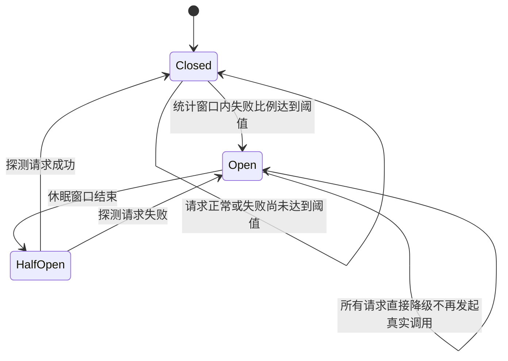

# 断路器什么时候打开：Hystrix 服务熔断演示与参数调优

有一个现象只看降级逻辑解释不通：访问 `/consumer/1` 会失败，这是代码里故意抛的异常；
可连续点了一二十次之后，再去访问从来没出过问题的 `/consumer/2`，返回的竟然也是
「对不起，网络太拥挤了」。服务明明是健康的，为什么也被降级了？

答案是断路器已经打开。熔断一旦触发，Hystrix 不再区分这次请求本身会不会成功，
而是对全部请求直接走降级。这篇把三个状态的流转规则和触发阈值讲清楚，
并在工程里把这个现象复现出来。

## 先给结论

- 熔断器和家里的保险丝同理：依赖持续故障时主动切断调用，避免整个系统被拖垮，故障恢复后能自动重连。
- 断路器有三个状态：Closed 放行所有请求，Open 对所有请求降级，Half Open 放行少量探测请求。
- 打开条件是「量」和「比例」同时满足：默认统计窗口内请求数不少于 20 次，且失败比例达到 50%。
- 打开后经过休眠窗口（默认 5000 毫秒）进入 Half Open，探测成功则关闭，失败则退回 Open。
- 三项参数都可配：`requestVolumeThreshold`、`errorThresholdPercentage`、`sleepWindowInMilliseconds`。
- `circuitBreaker` 必须写在 `hystrix.command.default` 下、与 `execution` 平级，顶格另起一个根节点会导致配置不生效。

## 一、熔断器的三个状态

断路器（Circuit Breaker）描述的是「还要不要继续调用这个依赖」。
它的状态流转可以这样看：



三个状态的含义要分开理解。

**Closed 是常态。** 断路器关闭不代表没有失败，而是失败还没有攒到阈值。
这时候请求照常发往远程服务，只有真正出错的那一次才会走降级。

**Open 是熔断态。** 一旦打开，Hystrix 对后续请求直接执行降级逻辑，连远程调用都不发起。
这样做有两个收益：调用方不再堆积等待线程，故障服务也不再被持续冲击，有机会喘口气恢复。

**Half Open 是试探态。** 休眠窗口结束后，断路器放少量请求过去探路。
这些请求成功，说明依赖大概率恢复了，断路器关闭；失败，说明还没恢复，退回 Open 继续等下一个窗口。
这个设计让熔断具备弹性，不需要人工介入就能自动重连。

## 二、触发熔断的两个数字

从 Closed 跳到 Open 需要同时满足两个条件，缺一个都不触发。

**第一是请求量门槛。** 默认 `requestVolumeThreshold` 为 20，意思是统计窗口内的请求数不足 20 次时，
无论失败多少次都不熔断。这个门槛是为了避免样本太小导致误判，两三次请求里失败两次就熔断显然不合理。

**第二是失败比例。** 默认 `errorThresholdPercentage` 为 50，失败请求占窗口内总请求的一半，
才认定这个依赖处于故障状态。这里的「失败」包含抛异常、超时以及线程池拒绝。

把两个数字合起来读：窗口内 20 次请求中失败超过 10 次，断路器打开。
这也解释了演示时的操作要点，请求要发得快，因为统计窗口是滚动的时间窗口，
慢慢点会让失败请求分摊到不同窗口里，永远攒不够比例。

## 三、动手构造一个必失败的调用

在 consumer-demo 的控制器里让 id 等于 1 时直接抛异常，其余 id 正常调用远程服务：

```java
package com.example.consumer.controller;

import com.netflix.hystrix.contrib.javanica.annotation.DefaultProperties;
import com.netflix.hystrix.contrib.javanica.annotation.HystrixCommand;
import lombok.extern.slf4j.Slf4j;
import org.springframework.beans.factory.annotation.Autowired;
import org.springframework.web.bind.annotation.GetMapping;
import org.springframework.web.bind.annotation.PathVariable;
import org.springframework.web.bind.annotation.RequestMapping;
import org.springframework.web.bind.annotation.RestController;
import org.springframework.web.client.RestTemplate;

@RestController
@RequestMapping("/consumer")
@Slf4j
@DefaultProperties(defaultFallback = "defaultFallback")
public class ConsumerController {

    @Autowired
    private RestTemplate restTemplate;

    @GetMapping("/{id}")
    @HystrixCommand
    public String queryById(@PathVariable Long id) {
        if (id == 1) {
            throw new RuntimeException("太忙了");
        }
        String url = "http://user-service/user/" + id;
        return restTemplate.getForObject(url, String.class);
    }

    public String defaultFallback() {
        return "默认提示：对不起，网络太拥挤了！";
    }
}
```

`queryById` 抛出的 `RuntimeException` 会被 Hystrix 计为一次失败，
由于类上有 `@DefaultProperties(defaultFallback = "defaultFallback")`，失败时统一进入 `defaultFallback`。

## 四、观察断路器打开与恢复

启动 consumer-demo 和 user-service，按下面的顺序验证：

```bash
# id 为 2，远程调用正常
curl http://localhost:8080/consumer/2
# {"id":2,"userName":"liuyan",...}

# id 为 1，代码主动抛异常，进入降级
curl http://localhost:8080/consumer/1
# 默认提示：对不起，网络太拥挤了！

# 连续快速访问 /consumer/1 超过 20 次后，再访问正常的 id
curl http://localhost:8080/consumer/2
# 默认提示：对不起，网络太拥挤了！

# 等待休眠窗口结束后再次访问，断路器已关闭
curl http://localhost:8080/consumer/2
# {"id":2,"userName":"liuyan",...}
```

第三步是整个演示的关键。此时 `/consumer/2` 这条路径本身没有任何问题，
远程服务也健康，但因为断路器处于 Open 状态，请求在发起远程调用之前就被拦下，直接走降级。
过了休眠窗口，断路器进入 Half Open，这次探测成功，于是关闭，第四步就能拿到真实数据了。

演示时如果用浏览器手动刷，建议打开开发者工具确认每次都真的发到了后端。
浏览器缓存或过快的重复点击很容易造成「点了二十次却没触发」的错觉。

## 五、三个熔断参数怎么配

默认参数偏保守，可以按业务调整。课程给出的配置把最小请求数降到 10、休眠窗口延长到 10 秒：

```yaml
hystrix:
  command:
    default:
      execution:
        isolation:
          thread:
            timeoutInMilliseconds: 2000
      circuitBreaker:
        errorThresholdPercentage: 50 # 触发熔断的错误比例阈值，默认值 50
        sleepWindowInMilliseconds: 10000 # 熔断后休眠时长，默认值 5000 毫秒
        requestVolumeThreshold: 10 # 熔断触发最小请求次数，默认值 20
```

写这段配置时有两个坑值得留意。

**第一是缩进层级。** `circuitBreaker` 和 `execution` 是平级关系，同属 `hystrix.command.default`。
从讲义里复制配置时如果缩进错位，比如把 `circuitBreaker` 顶格写成了另一个根节点，
YAML 不会报错，但熔断参数完全不生效，排查起来很费时间。判断依据很简单：
配置层级应该呈现出清晰的阶梯感，怀疑有问题就和删除重排对比一下。

**第二是 IDE 没有提示不代表写错。** `application.yml` 里并不是所有 Hystrix 配置项都有自动补全，
`circuitBreaker` 这几个键没有提示是正常现象，只要缩进正确、服务能正常启动，配置就是生效的。

参数取值要结合流量。低流量的内部系统把 `requestVolumeThreshold` 调小，
否则一天都凑不够 20 次请求，熔断形同虚设；高峰流量大的接口则可以适当调大，
避免偶发抖动触发误熔断。休眠窗口设置得太短，会让还没恢复的依赖被反复探测，
相当于持续给故障服务加压。

## 常见误区

- **以为熔断打开后只有失败的请求才降级**：Open 状态下所有请求都不再发起真实调用，包括那些本来能成功的请求，这正是熔断的意图。
- **只看失败比例忽略请求量门槛**：窗口内请求数不足 `requestVolumeThreshold` 时，失败比例再高也不会熔断。
- **把 `circuitBreaker` 写错层级**：与 `execution` 平级才有效，缩进错位的 YAML 不报错但配置静默失效。
- **慢慢点鼠标做熔断测试**：统计窗口是滚动的时间窗口，请求要集中在窗口内发送才可能达到失败比例。
- **休眠窗口设得过短**：依赖尚未恢复就被反复探测，失败后继续退回 Open，还额外消耗了调用方资源。

## 面试可能被问到的问题

1. 面试官追问：「Hystrix 断路器有哪几种状态，分别是怎么流转的？」
   答：Closed、Open、Half Open 三种。Closed 时正常放行，失败比例达到阈值后转为 Open；Open 时所有请求直接降级，经过休眠窗口后转为 Half Open；Half Open 放行少量探测请求，成功则回到 Closed，失败则退回 Open。

2. 面试官追问：「熔断触发的默认条件是什么？」
   答：统计窗口内请求数达到 `requestVolumeThreshold`（默认 20），且失败比例达到 `errorThresholdPercentage`（默认 50%）。两个条件同时满足才打开断路器，单次或少量失败不会触发。

3. 面试官追问：「熔断打开后，访问一个本来正常的接口为什么也被降级？」
   答：因为 Open 状态下 Hystrix 不再发起真实远程调用，而是对所有请求直接执行降级逻辑。这是设计上的取舍，目的是尽快释放调用方资源，同时停止对故障服务的持续冲击。

4. 面试官追问：「服务熔断和服务降级有什么关系？」
   答：降级是失败后的兜底策略，决定返回什么内容；熔断是断路器的状态控制，决定一段时间内是否还要发起真实调用。熔断打开时通常会执行降级逻辑，但降级本身在熔断未打开时也会发生。

5. 面试官追问：「`sleepWindowInMilliseconds` 调大或调小分别有什么影响？」
   答：调大能给故障服务更长的恢复时间，代价是调用方在这段时间内持续返回降级结果；调小能更快探测恢复，但依赖尚未恢复时会被反复探测，失败后又退回 Open，白白消耗资源。

6. 面试官追问：「熔断配置明明写了却不生效，一般怎么排查？」
   答：先确认 `circuitBreaker` 与 `execution` 同在 `hystrix.command.default` 下，缩进错位会让配置静默失效；再确认窗口内请求量是否达到 `requestVolumeThreshold`；还要注意 IDE 没有自动补全并不代表配置项写错。

## 配套资料

- 熔断状态图与参数配置取自：`materials/code/01/2.springcloud/2.springcloud/day01/笔记/Spring Cloud 第一天课堂笔记.md`
- 远程调用示例工程：`materials/code/01/2.springcloud/2.springcloud/day01/资料/http-demo/`
- 示例工程 pom：`materials/code/01/2.springcloud/2.springcloud/day01/资料/http-demo/pom.xml`
- 用户实体源码：`materials/code/01/2.springcloud/2.springcloud/day01/资料/User.java`
