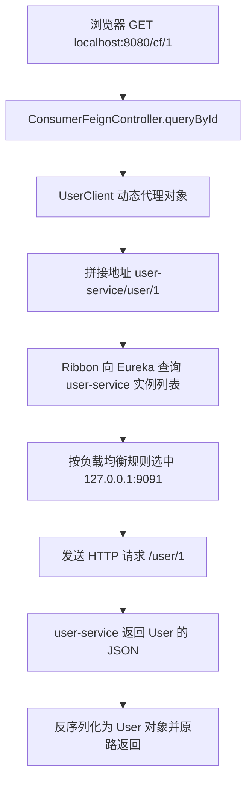

# 把远程调用写成一个接口方法：Feign 声明式客户端的接入与使用

用了 Ribbon 之后，远程调用的代码已经短了不少，但服务消费者里仍然躺着这样的字符串拼接：

```java
String url = "http://user-service/user/" + id;
return restTemplate.getForObject(url, String.class);
```

地址要自己拼、参数要自己塞、返回值要自己转，一个接口写下来满屏都是 URL 片段。服务一多，这类代码就会在多个消费者里反复出现，改一个路径得全局搜索。

Feign 解决的就是这件事：把 REST 请求伪装成一个本地接口方法，地址拼接、参数绑定、结果反序列化全部交给动态代理完成。

## 先给结论

- Feign 也叫「伪装」，核心作用是**根据参数自动拼接 HTTP 请求地址**，让远程调用看起来像调用本地方法。
- 接入只需要三步：导入 `spring-cloud-starter-openfeign` 起步依赖、引导类加 `@EnableFeignClients`、编写带 `@FeignClient` 的接口。
- Feign 客户端是一个**接口**，不需要写实现类，由 Spring 通过动态代理生成，这一点和 MyBatis 的 Mapper 接口非常相似。
- 接口方法上可以直接使用 Spring MVC 的注解（`@GetMapping`、`@PathVariable` 等），`@FeignClient` 的服务名加上方法上的路径就是最终请求地址。
- Feign 默认就整合了 Ribbon，服务名到真实地址的解析和负载均衡无需额外配置。

## 一、为什么 Ribbon 之后还要 Feign

服务消费者用 Ribbon 加 `RestTemplate` 的写法，实际承担了三类职责：

**第一，URL 的拼装。** 服务名、路径、路径参数、查询参数都要由业务代码手动拼成字符串，拼错一个斜杠就是 404。

**第二，请求的执行。** 用 `getForObject`、`postForObject` 等方法发起调用，方法签名和 HTTP 语义绑在一起。

**第三，结果的转换。** 返回值类型要显式声明，复杂对象依赖消息转换器。

Feign 把这三件事收拢到接口声明里。接口只描述「调用哪个服务的哪个路径、传什么参数、返回什么类型」，执行细节由代理对象补齐。从调用方视角看，`userClient.queryById(id)` 和调用一个本地 Service 没有任何区别。

## 二、起步依赖与开启 Feign

在服务消费工程 `consumer-demo` 的 pom 中加入起步依赖（包名已统一改为中性的 `com.example`）：

```xml
<dependency>
    <groupId>org.springframework.cloud</groupId>
    <artifactId>spring-cloud-starter-openfeign</artifactId>
</dependency>
```

这个起步依赖已经传递引入了 Ribbon，所以不需要再单独引入负载均衡的依赖，也不需要再手动注册 `RestTemplate` 对象。

接着在启动引导类上开启 Feign 功能：

```java
package com.example.consumer;

import org.springframework.boot.SpringApplication;
import org.springframework.boot.autoconfigure.SpringBootApplication;
import org.springframework.cloud.client.discovery.EnableDiscoveryClient;
import org.springframework.cloud.openfeign.EnableFeignClients;

@SpringBootApplication
@EnableDiscoveryClient
@EnableFeignClients
public class ConsumerApplication {

    public static void main(String[] args) {
        SpringApplication.run(ConsumerApplication.class, args);
    }
}
```

`@EnableFeignClients` 会在启动时扫描带有 `@FeignClient` 注解的接口，为它们生成代理对象并注册到 Spring 容器。

## 三、编写 Feign 客户端接口

接口统一放在 `client` 包下，它声明的是「要访问的服务」和「要访问的路径」：

```java
package com.example.consumer.client;

import com.example.consumer.pojo.User;
import org.springframework.cloud.openfeign.FeignClient;
import org.springframework.web.bind.annotation.GetMapping;
import org.springframework.web.bind.annotation.PathVariable;

// 声明当前接口是一个 Feign 客户端，指定服务名为 user-service
@FeignClient("user-service")
public interface UserClient {

    // 最终拼接出的地址：http://user-service/user/{id}
    @GetMapping("/user/{id}")
    User queryById(@PathVariable Long id);
}
```

`@FeignClient` 的 value 是服务名，服务名必须在 Eureka 中注册过，Feign 才能通过 Ribbon 拿到实例列表。

方法上的 `@GetMapping("/user/{id}")` 不能直接凭空写，它必须是服务提供方真实存在的路径。课程里 `user-service` 的 `UserController` 暴露的正是 `/user/{id}`，所以这里的路径要和它对齐：

```java
@GetMapping("/user/{id}")
public User queryById(@PathVariable Long id) {
    return userService.queryById(id);
}
```

`@PathVariable` 在这里是必填的。路径中的占位符只有靠这个注解才能取到实参，缺少它启动就会报「PathVariable annotation was empty on param」这类错误。传入 id 为 1 时，代理对象最终拼出的地址就是 `http://user-service/user/1`。

## 四、在处理器中注入并使用

新建一个处理器 `ConsumerFeignController`，与之前的 `ConsumerController` 区分开，避免路径冲突：

```java
package com.example.consumer.controller;

import com.example.consumer.client.UserClient;
import com.example.consumer.pojo.User;
import org.springframework.beans.factory.annotation.Autowired;
import org.springframework.web.bind.annotation.GetMapping;
import org.springframework.web.bind.annotation.PathVariable;
import org.springframework.web.bind.annotation.RequestMapping;
import org.springframework.web.bind.annotation.RestController;

@RestController
@RequestMapping("/cf")
public class ConsumerFeignController {

    @Autowired
    private UserClient userClient;

    @GetMapping("/{id}")
    public User queryById(@PathVariable Long id) {
        return userClient.queryById(id);
    }
}
```

注入的是接口而不是实现类，Spring 容器里放的是动态代理生成的那个对象。方法返回值直接声明为 `User`，反序列化由 Feign 的消息转换器完成。

一次完整调用的执行过程如下：



图里最关键的一环是「服务名到实例的解析」。`user-service` 并不是一个能被 DNS 解析的域名，它是 Eureka 中的应用名，由 Ribbon 翻译成真实的主机和端口。这也是为什么测试时 Eureka 必须处于启动状态：注册中心不在线，Feign 拿不到地址列表，请求会在解析阶段就失败。

## 五、启动与验证

需要同时启动三个工程：Eureka Server（10086）、服务提供方 `user-service`（9091）、服务消费方 `consumer-demo`（8080）。三者都就绪后访问：

```bash
curl http://localhost:8080/cf/1
# {"id":1,"userName":"zhangsan","name":"张三","age":20,...}
```

能返回用户数据，说明 Feign 客户端拼接出的地址是真实可访问的。换成 `/cf/2` 同样能拿到结果。

验证时有两点要留意：服务提供方的工程也要处于运行状态，Feign 只是帮你拼地址，不会凭空造出数据；另外访问的是消费方自己的端口（这里是 8080），路径 `/cf/1` 是消费方暴露出来的路径，不要和提供方的 `/user/1` 混淆。

## 常见误区

- **把 `@FeignClient` 的 value 写成 IP 或带协议的地址**：这个位置只放服务名，`http://` 前缀和端口都不需要，写成 `http://user-service` 会导致拼接出的地址异常。
- **接口方法上漏写 `@PathVariable`**：占位符 `{id}` 取不到值，启动阶段直接抛异常。路径参数必须显式绑定。
- **路径随意发挥**：Feign 客户端的路径必须和提供方的 `Controller` 映射完全一致，写错就是 404，且报错信息里看不出是哪一侧写错了。
- **忘记加 `@EnableFeignClients`**：接口注入时报 `No qualifying bean of type UserClient`，本质是代理对象没有被创建并注册。
- **以为用了 Feign 就不需要 Eureka**：服务名解析依赖注册中心，注册中心没启动会报找不到实例的错误。

## 面试可能被问到的问题

1. 面试官追问：「Feign 和 RestTemplate 加 Ribbon 的区别是什么？」
   答：RestTemplate 需要业务代码手动拼接 URL、指定 HTTP 方法和返回值类型，调用逻辑散落在各处。Feign 把这些信息收敛到接口的注解上，由动态代理完成拼接与执行，调用方只写一个方法调用，可读性和可维护性都更好。

2. 面试官追问：「Feign 的底层是怎么实现的？」
   答：`@EnableFeignClients` 会扫描 `@FeignClient` 接口，通过 JDK 动态代理为每个接口生成实现并注册为 Bean。调用接口方法时，代理对象根据注解解析出服务名、路径和参数，拼接出完整 URL，再交给内部的 HTTP 客户端执行，并把响应反序列化成方法声明的返回类型。

3. 面试官追问：「Feign 为什么能直接用服务名访问？」
   答：因为 Feign 整合了 Ribbon，Ribbon 会拿着服务名去 Eureka 拉取实例列表，按负载均衡规则选出一个实例，把服务名替换成真实的主机和端口。所以服务名必须在注册中心中存在。

4. 面试官追问：「Feign 接口方法上可以用哪些注解？」
   答：Spring MVC 的常用注解都可以使用，包括 `@RequestMapping`、`@GetMapping`、`@PostMapping`、`@PathVariable`、`@RequestParam`、`@RequestBody` 等。Feign 按 Spring MVC 的语义解析这些注解，用来生成最终的请求路径、参数和请求体。

5. 面试官追问：「Feign 客户端的接口需要写实现类吗？」
   答：不需要。Feign 在运行时生成代理实现，这一点和 MyBatis 的 Mapper 接口一致。开发者只需要维护接口声明，这也让消费方和服务提供方可以通过同一套接口定义来对齐契约。

6. 面试官追问：「服务提供方改了路径，消费方会立刻报错吗？」
   答：会表现为 404。Feign 客户端的路径是硬编码在注解里的，提供方改动后消费方不会有任何编译期提示，只有请求到达时才会暴露问题。比较稳妥的做法是把接口定义抽成独立模块，提供方和消费方共用。

## 配套资料

- 课堂笔记：`materials/code/01/2.springcloud/2.springcloud/day02/笔记/Spring Cloud 第二天课堂笔记.md`（第 1 节含 Feign 起步依赖与 `UserClient` 原文）
- `User` 实体类：`materials/code/01/2.springcloud/2.springcloud/day01/资料/User.java`
- 服务消费方 `ConsumerController` 原写法：`materials/code/01/2.springcloud/2.springcloud/day01/笔记/Spring Cloud 第一天课堂笔记.md`（第 8 节、第 13 节）
- RestTemplate 示例工程：`materials/code/01/2.springcloud/2.springcloud/day01/资料/http-demo/`
- 本课 `consumer-demo` 工程未在资料包中提供成品源码，正文中的 `UserClient` 与 `ConsumerFeignController` 按课堂实录与上述笔记还原，包名已统一改为 `com.example`
