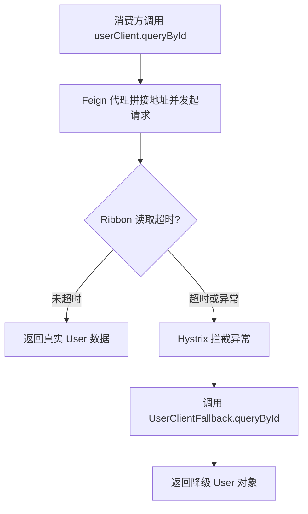

# Feign 的负载均衡与熔断配置：超时、降级、压缩与日志级别

Feign 客户端跑通之后，真正的麻烦才刚开始：被调用的服务偶尔慢一次，消费方就跟着卡住；出了问题没有任何兜底，页面直接弹一个 500。这些都不是业务代码能解决的，得靠 Feign 内建的几组配置项。

Ribbon 的负载均衡、Hystrix 的熔断降级、请求压缩、日志级别，这四件事 Feign 全部集成了，差的就是一段配置和一个降级类。

## 先给结论

- Feign 已经传递依赖了 Ribbon 和 Hystrix，**只需配置不需要额外引坐标**，也不用再注册 `RestTemplate`。
- 超时由 Ribbon 的 `ConnectTimeout` 和 `ReadTimeout` 控制，熔断开关是 `feign.hystrix.enabled: true`。
- Feign 的降级和直接在处理器上写 `@HystrixCommand` 不同：要**单独写一个 Fallback 类实现 Feign 客户端接口**，再在 `@FeignClient` 上用 `fallback` 指定。
- 请求压缩用 `feign.compression` 配置，对请求体和响应体做 gzip，减少通信数据量。
- 日志级别要两步才生效：`logging.level` 打开 debug，再写一个配置类注册 `Logger.Level` 并挂到 `@FeignClient` 的 `configuration` 上。

## 一、负载均衡：改的是 Ribbon 的参数

Feign 本身不做负载均衡，它把这件事委托给了 Ribbon。引入 `spring-cloud-starter-openfeign` 时 Ribbon 就已经被传递进来了，所以配置项直接写在服务消费工程的 `application.yml` 里：

```yaml
ribbon:
  ConnectTimeout: 1000 # 连接超时时长
  ReadTimeout: 2000 # 数据通信超时时长
  MaxAutoRetries: 0 # 当前服务器的重试次数
  MaxAutoRetriesNextServer: 0 # 重试多少次服务
  OkToRetryOnAllOperations: false # 是否对所有的请求方式都重试
```

`ConnectTimeout` 是与目标实例建立连接的等待上限，`ReadTimeout` 是连接建立后等待响应数据的时长。这两个值要和业务的真实耗时匹配，配得太小会让正常的慢请求被误判为失败。

`MaxAutoRetries` 表示对当前这台实例的重试次数，`MaxAutoRetriesNextServer` 表示换一台实例重试的次数。非幂等的写操作要谨慎开启重试，`OkToRetryOnAllOperations` 保持 `false` 可以避免 POST 请求被重复提交。

验证超时最直接的办法是在服务提供方制造延迟：

```java
@GetMapping("/user/{id}")
public User queryById(@PathVariable Long id) {
    try {
        Thread.sleep(2000);
    } catch (InterruptedException e) {
        e.printStackTrace();
    }
    return userService.queryById(id);
}
```

提供方固定睡两秒，加上请求本身的耗时一定超过 `ReadTimeout: 2000`，这时刷新消费方接口就会直接报错。这个报错正是「没有降级兜底」的典型表现。

## 二、熔断与降级：写一个 Fallback 类

开启熔断只需要一行配置，写在 `feign` 节点下，不要和 `hystrix` 的原生配置混在一起：

```yaml
feign:
  hystrix:
    enabled: true # 开启 Feign 的熔断功能
```

开关打开之后，还要给 Feign 客户端准备降级实现。这个类的写法有个硬性约束：**实现 Feign 客户端接口，方法签名与接口保持一致**，这样每个接口方法都有对应的降级方法：

```java
package com.example.consumer.client.fallback;

import com.example.consumer.client.UserClient;
import com.example.consumer.pojo.User;
import org.springframework.stereotype.Component;

@Component
public class UserClientFallback implements UserClient {

    @Override
    public User queryById(Long id) {
        User user = new User();
        user.setId(id);
        user.setName("用户异常");
        return user;
    }
}
```

`@Component` 不能省，这个类要被注册进 Spring 容器才能被 `fallback` 引用到。降级返回什么由业务决定，这里返回一个带原始 id、名称标记为异常的 `User` 对象，前端至少能拿到结构完整的数据。

接着在 Feign 客户端上把它挂上去：

```java
@FeignClient(value = "user-service", fallback = UserClientFallback.class)
public interface UserClient {

    @GetMapping("/user/{id}")
    User queryById(@PathVariable Long id);
}
```

再刷新消费方接口，返回结果就变成了降级对象：`id` 还在，`name` 是「用户异常」。整个失败处理过程可以这样看：



图里的分支点就是 Hystrix 的介入位置。Feign 请求失败时不会把异常往外抛，而是转交给 `fallback` 指定的实现类，取同名方法的返回值。

和第一天在 `ConsumerController` 上写 `@HystrixCommand(fallbackMethod = "...")` 相比，Feign 的方式把降级逻辑从处理器里剥离出来，一个接口方法对应一个降级方法，结构更清晰，代价是要多写一个类。

## 三、请求压缩

请求或响应体较大时，可以开启 gzip 压缩来减少传输量：

```yaml
feign:
  compression:
    request:
      enabled: true # 开启请求压缩
      mime-types: text/html,application/xml,application/json # 设置压缩的数据类型
      min-request-size: 2048 # 设置触发压缩的大小下限
    response:
      enabled: true
```

`min-request-size` 默认是 2048 字节，小于这个体积的请求不压缩，避免为几个字节付出压缩和解压缩的开销。`mime-types` 限定哪些响应类型参与压缩，默认已覆盖常见的 JSON 和 XML。

压缩效果在控制台上看不出来，验证方式只能是重启工程确认没有配置错误导致的启动失败，再用抓包工具观察请求头是否带上了 `Content-Encoding: gzip`。

## 四、日志级别

Feign 的日志开关分两步。先在配置文件里把客户端所在包的级别放开：

```yaml
logging:
  level:
    com.example: debug
```

只做这一步是不够的。Feign 默认的日志级别是 `NONE`，即不记录任何日志，还需要一个配置类显式声明级别：

```java
package com.example.consumer.client;

import feign.Logger;
import org.springframework.context.annotation.Bean;
import org.springframework.context.annotation.Configuration;

@Configuration
public class FeignConfig {

    @Bean
    public Logger.Level feignLoggerLevel() {
        // FULL：记录所有请求和响应的明细，包括头信息、请求体、元数据
        return Logger.Level.FULL;
    }
}
```

然后在 Feign 客户端上引用它：

```java
@FeignClient(value = "user-service",
        fallback = UserClientFallback.class,
        configuration = FeignConfig.class)
public interface UserClient {

    @GetMapping("/user/{id}")
    User queryById(@PathVariable Long id);
}
```

Feign 支持四种级别：`NONE` 不记录任何日志（默认）；`BASIC` 只记录请求方法、URL、响应状态码和执行时间；`HEADERS` 在 `BASIC` 基础上加上请求和响应的头信息；`FULL` 记录请求与响应的全部明细。

配置生效后，控制台会打出完整的请求头、请求体和响应内容，排查参数传递问题时非常好用。但 `FULL` 的输出量很大，生产环境应收敛到 `BASIC`，或直接把日志级别调回 `info`，避免日志文件膨胀。

## 常见误区

- **把熔断开关写错位置**：`feign.hystrix.enabled` 是 `feign` 的子节点，写成顶层的 `hystrix.enabled` 不会生效，Feign 的降级依然不触发。
- **Fallback 类忘了加 `@Component`**：启动时报「无法找到 UserClientFallback 类型的 Bean」，因为 `fallback` 是按类型从容器里取的。
- **降级方法签名和接口不一致**：方法名、参数、返回值都要对齐，否则覆盖不了接口方法，异常还是会往外抛。
- **只配 `logging.level` 就期待有日志**：Feign 默认级别是 `NONE`，必须同时注册 `Logger.Level` 并在 `configuration` 中引用。
- **生产环境保留 `FULL` 级别**：请求体、响应体全部落盘，日志体积会迅速失控，上线前应降级为 `BASIC`。
- **给写操作开全量重试**：`OkToRetryOnAllOperations: true` 会让 POST 请求在超时后重复提交，非幂等接口可能产生脏数据。

## 面试可能被问到的问题

1. 面试官追问：「Feign 为什么不需要单独引入 Ribbon 和 Hystrix？」
   答：`spring-cloud-starter-openfeign` 已经传递依赖了这两个组件，并且提供了对应的自动配置。开发者只需要在配置文件中给出参数、编写降级类即可，不需要额外坐标，也不必再手动注册 `RestTemplate`。

2. 面试官追问：「Feign 的熔断降级和 `@HystrixCommand` 的降级有什么不同？」
   答：`@HystrixCommand` 是写在处理器方法上的，降级方法通常是同一个类里的另一个方法，粒度是单个业务方法。Feign 的降级要求编写一个实现 Feign 客户端接口的类，通过 `@FeignClient` 的 `fallback` 指定，粒度是客户端接口，降级逻辑与业务代码完全分离。

3. 面试官追问：「Feign 的超时由谁控制？」
   答：底层请求仍由 Ribbon 负责，超时参数就是 Ribbon 的 `ConnectTimeout` 和 `ReadTimeout`。Hystrix 自身也有超时配置，两者并存时要保证 Hystrix 的超时不小于 Ribbon 的超时，否则 Ribbon 还没判定失败，Hystrix 就已经先熔断了。

4. 面试官追问：「为什么配置了 `logging.level` 还是看不到 Feign 日志？」
   答：因为 Feign 自身的日志级别默认是 `NONE`，不输出任何内容。需要定义配置类注册 `Logger.Level` 的 Bean，并在 `@FeignClient` 的 `configuration` 属性中引用，两处都配齐才会打印。

5. 面试官追问：「Feign 有哪些日志级别，生产环境该选哪个？」
   答：共四种，分别是 `NONE`、`BASIC`、`HEADERS` 和 `FULL`。生产环境推荐 `BASIC`，只记录方法、URL、状态码和耗时，既能定位问题又不会输出请求体等敏感明细。排查复杂问题时再临时切到 `FULL`。

6. 面试官追问：「开启请求压缩要注意什么？」
   答：要注意 `min-request-size` 下限，小于阈值的请求不会被压缩，避免无谓的 CPU 开销；同时 `mime-types` 要覆盖实际的响应类型。压缩对调用方是透明的，但会增加服务端的压缩与客户端的解压缩成本，需要在带宽和 CPU 之间权衡。

## 配套资料

- 课堂笔记：`materials/code/01/2.springcloud/2.springcloud/day02/笔记/Spring Cloud 第二天课堂笔记.md`（第 2 节含 Ribbon、熔断、压缩、日志的完整配置项原文）
- `User` 实体类：`materials/code/01/2.springcloud/2.springcloud/day01/资料/User.java`
- 服务提供方 `UserController` 写法参考：`materials/code/01/2.springcloud/2.springcloud/day01/笔记/Spring Cloud 第一天课堂笔记.md`
- 第 1 天 Hystrix 降级写法对照：`materials/code/01/2.springcloud/2.springcloud/day01/笔记/Spring Cloud 第一天课堂笔记.md`（第 12 节 `ConsumerController`）
- 本课 `UserClientFallback` 与 `FeignConfig` 未在资料包中提供成品源码，正文代码按课堂实录还原，包名已统一改为 `com.example`
