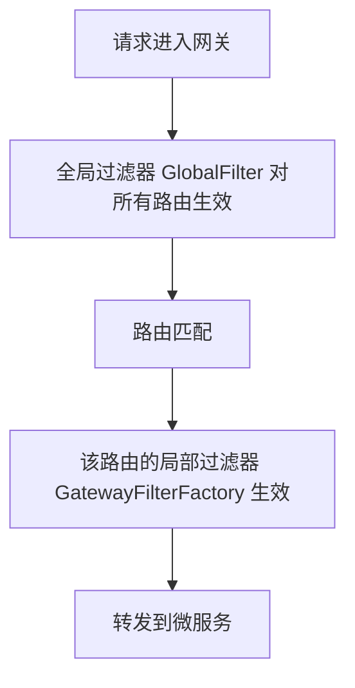

# 自己写网关过滤器：局部过滤器取参数，全局过滤器做鉴权

内置过滤器能覆盖大部分通用需求，但业务里总有定制的味道。比如想在网关统一打印某个请求参数的值，或者所有请求都必须带 `token` 否则直接拒绝。这一节把「自定义局部过滤器」和「自定义全局过滤器」合在一起讲：前者挂在某个路由下、参数名可配；后者对全部路由生效、用来做统一的权限校验。

## 先给结论

- 自定义局部过滤器继承 `AbstractGatewayFilterFactory<Config>`，类名必须以 `GatewayFilterFactory` 结尾，配置时同样去掉后缀，剩下的名字就是 `filters` 里的过滤器名。
- 局部过滤器的可变参数通过内部 `Config` 类和 `shortcutFieldOrder` 接收，这样参数名可以在 `application.yml` 里自由指定，不必写死。
- 自定义全局过滤器实现 `GlobalFilter` 接口，再加 `Ordered` 接口控制执行顺序，值越小越先执行，且不需要在配置文件里写任何东西。
- 局部过滤器适合路由级别的定制处理，全局过滤器适合所有请求都要过的通用逻辑，比如鉴权、黑白名单、全链路追踪。

## 一、局部过滤器要解决什么

需求很具体：在网关过滤器里，把请求地址中某个参数的值取出来打到控制台，而且这个参数名不固定，今天叫 `name`，明天可能叫 `h`，希望靠配置来指定，而不是改代码。

这正好是局部过滤器的用武之地。它挂在一条路由下，配置时写 `MyParam=name`，含义就是「取名为 `name` 的查询参数」。把 `name` 换成 `h`，过滤器立刻改取 `h`，无需重新编译。

内置过滤器的写法就是模板。所有过滤器都实现 `GatewayFilterFactory`，而它们普遍继承一个抽象基类 `AbstractGatewayFilterFactory`，并指定一个泛型 `Config` 来承载配置。我们照着这个套路写自己的就行。

## 二、自定义局部过滤器的完整实现

类名约定为 `MyParamGatewayFilterFactory`，后缀 `GatewayFilterFactory` 是固定要求，配置时只用 `MyParam`。`Config` 是一个静态内部类，里面只有一个 `param` 字段，对应配置文件里传进来的参数名。

```java
package com.example.gateway.filter;

import org.springframework.cloud.gateway.filter.GatewayFilter;
import org.springframework.cloud.gateway.filter.factory.AbstractGatewayFilterFactory;
import org.springframework.http.server.reactive.ServerHttpRequest;
import org.springframework.stereotype.Component;

import java.util.Arrays;
import java.util.List;

@Component
public class MyParamGatewayFilterFactory
        extends AbstractGatewayFilterFactory<MyParamGatewayFilterFactory.Config> {

    static final String PARAM_NAME = "param";

    public MyParamGatewayFilterFactory() {
        super(Config.class);
    }

    // 声明配置项的快捷字段顺序，对应 yml 里 MyParam=name 的 name
    public List<String> shortcutFieldOrder() {
        return Arrays.asList(PARAM_NAME);
    }

    @Override
    public GatewayFilter apply(Config config) {
        return (exchange, chain) -> {
            // 例如请求 http://localhost:10010/api/user/8?name=example
            // config.param 在配置里指定为 name，这里就是取 name 的值
            ServerHttpRequest request = exchange.getRequest();
            if (request.getQueryParams().containsKey(config.param)) {
                request.getQueryParams().get(config.param)
                        .forEach(value -> System.out.printf(
                                "------------局部过滤器--------%s = %s------",
                                config.param, value));
            }
            // 过滤逻辑结束后必须放行，交给后续过滤器链
            return chain.filter(exchange);
        };
    }

    public static class Config {
        // 对应在配置过滤器时指定的参数名
        private String param;

        public String getParam() {
            return param;
        }

        public void setParam(String param) {
            this.param = param;
        }
    }
}
```

几个关键点：

**第一，构造方法必须调用 `super(Config.class)`。** 这告诉父类用哪个内部类来反序列化配置，漏掉这一步会报错。

**第二，`shortcutFieldOrder` 返回的字段名要和 `Config` 的属性对应。** 这里返回 `param`，配置文件里 `MyParam=name` 就会把 `name` 注入到 `config.param`。

**第三，`apply` 返回的 lambda 里务必调用 `chain.filter(exchange)` 放行。** 忘记放行，请求就卡在过滤器里再也到不了后端。

配置文件里这样挂到路由上：

```yaml
spring:
  cloud:
    gateway:
      routes:
        - id: user-service-route
          uri: lb://user-service
          predicates:
            - Path=/api/user/**
          filters:
            - StripPrefix=1
            # 指定取请求中名为 name 的参数值
            - MyParam=name
```

启动后访问 `http://localhost:10010/api/user/8?name=example`，控制台会打印出 `局部过滤器 name = example`；把地址换成 `?h=example` 且把配置改成 `MyParam=h`，打印的就会是 `h = example`。参数名完全由配置驱动。

## 三、全局过滤器与局部过滤器的区别

局部过滤器要挂在路由上、参数可配，适合单条路由的定制。全局过滤器则实现 `GlobalFilter`，注册成组件后对所有路由生效，配置文件中无需声明。两者配合，一张图看清分工：



图上全局过滤器在路由匹配之前就拦截所有请求，局部过滤器只作用于命中的那条路由。权限校验这种「人人都要过」的逻辑，放在全局过滤器最自然。

## 四、自定义全局过滤器做鉴权

需求：所有请求必须携带 `token` 参数，且值非空才放行；否则直接把响应状态码设为 401（未授权）并终止，不再往后执行。这相当于一个简单的网关级权限鉴定。

实现 `GlobalFilter` 的同时实现 `Ordered`，用 `getOrder` 返回值控制顺序，值越小越先执行。

```java
package com.example.gateway.filter;

import org.springframework.cloud.gateway.filter.GlobalFilter;
import org.springframework.cloud.gateway.filter.GatewayFilterChain;
import org.springframework.core.Ordered;
import org.springframework.http.HttpStatus;
import org.springframework.http.server.reactive.ServerHttpRequest;
import org.springframework.stereotype.Component;
import org.springframework.util.StringUtils;
import reactor.core.publisher.Mono;

import java.util.List;

@Component
public class MyGlobalFilter implements GlobalFilter, Ordered {

    @Override
    public Mono<Void> filter(ServerWebExchange exchange, GatewayFilterChain chain) {
        System.out.println("--------------全局过滤器 MyGlobalFilter------------------");
        // 取请求中名为 token 的第一个参数值
        String token = exchange.getRequest().getQueryParams().getFirst("token");
        if (StringUtils.isBlank(token)) {
            // token 为空或不存在，设置 401 并直接结束，不再执行后续过滤器与转发
            exchange.getResponse().setStatusCode(HttpStatus.UNAUTHORIZED);
            return exchange.getResponse().setComplete();
        }
        // 校验通过，放行
        return chain.filter(exchange);
    }

    @Override
    public int getOrder() {
        // 值越小越先执行
        return 1;
    }
}
```

逻辑要点：

**第一，拦截点选在 pre 阶段。** 请求还没转发就检查 `token`，不合法直接 `setComplete` 中断，性能上最省。

**第二，`setComplete` 之后必须 return。** 不再调用 `chain.filter`，请求到此为止，客户端拿到 401。

**第三，`getOrder` 的语义是越小越先。** 多个全局过滤器并存时，靠这个值排先后，比如日志过滤器可以设成比鉴权过滤器更小的值，先打日志再鉴权。

测试时，不带 `token` 访问返回 401；带上 `?token=abc` 则正常返回数据，状态码 200。

## 常见误区

- **局部过滤器忘记调用 `chain.filter(exchange)`**：请求卡死在过滤器里，永远到不了后端，表现像请求无响应。
- **`shortcutFieldOrder` 字段名和 `Config` 属性对不上**：配置注入失败，`config.param` 始终为 `null`，取不到参数。
- **把全局过滤器也写进 `filters` 配置**：全局过滤器实现 `GlobalFilter` 后注册成组件即对所有路由生效，再写到路由 `filters` 下属于画蛇添足，甚至类型不匹配。
- **`getOrder` 误以为越大越先**：实际是值越小优先级越高，顺序写反会导致鉴权晚于其它处理执行。
- **构造方法漏掉 `super(Config.class)`**：抽象基类不知道用哪个配置类反序列化，启动即报错。

## 面试可能被问到的问题

1. 面试官追问：「自定义局部过滤器必须遵循什么约定？」
   答：类名以 `GatewayFilterFactory` 结尾，继承 `AbstractGatewayFilterFactory<Config>`，构造方法调用 `super(Config.class)`，通过 `shortcutFieldOrder` 声明配置字段，在 `apply` 里返回过滤逻辑并记得 `chain.filter` 放行。配置时去掉 `GatewayFilterFactory` 后缀作为过滤器名。

2. 面试官追问：「局部过滤器和全局过滤器分别怎么生效？」
   答：局部过滤器基于 `GatewayFilterFactory`，配在路由 `filters` 下对该路由生效；全局过滤器实现 `GlobalFilter`，注册为组件后对所有路由自动生效，无需配置。

3. 面试官追问：「全局过滤器的执行顺序由什么决定？」
   答：由 `Ordered` 接口的 `getOrder` 返回值决定，值越小越先执行。不实现 `Ordered` 也有默认顺序，但显式控制更可控。

4. 面试官追问：「全局过滤器里如何中断请求？」
   答：拿到 `exchange.getResponse()`，设置状态码后调用 `setComplete()` 并直接 `return`，不再调用 `chain.filter`，请求即终止，客户端收到对应状态码。

5. 面试官追问：「为什么 `Config` 通常写成静态内部类？」
   答：它只是承载该过滤器可配置项的简单 POJO，和外部过滤器强相关、不对外复用，写成静态内部类既能保持内聚，又便于 `super(Config.class)` 引用。

## 配套资料

- 本课真实代码见课程笔记：`materials/code/01/2.springcloud/2.springcloud/day02/笔记/Spring Cloud 第二天课堂笔记.md`（第 8 节「自定义局部过滤器」的 `MyParamGatewayFilterFactory` 与第 9 节「自定义全局过滤器」的 `MyGlobalFilter`，文中包名已统一为 `com.example.gateway.filter`）
