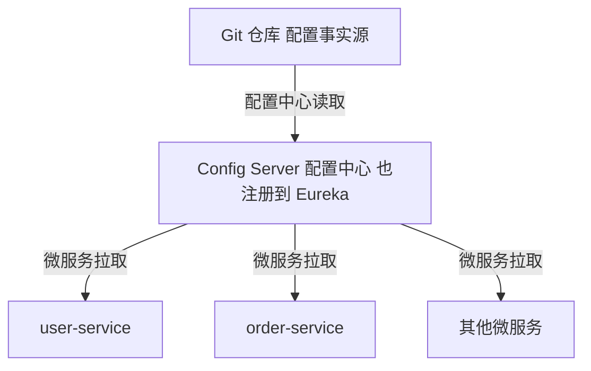

# 微服务配置越来越多：用分布式配置中心集中管

微服务拆开之后，每个服务都有自己的 `application.yml`，散落在不同机器、不同工程里。哪天要改一个数据库地址或者调一个开关，得一台一台登上去改，漏一台就出事故。Spring Cloud Config 就是为解决这种「配置分散、改动麻烦、容易出错」而生的集中式配置组件。

## 先给结论

- Spring Cloud Config 把配置文件从各个微服务里抽出来，统一交给一个配置中心管理，配置中心再从 Git 仓库读取，实现「改一处、全服务同步」。
- 配置可以放在配置中心本地，也可以放在远程 Git 仓库（GitHub、Gitee 等），生产环境几乎都用 Git 后端，方便版本化和协作。
- 配置中心本身也是一个微服务，通常把它也注册到 Eureka，方便其它服务通过服务名发现它。
- 它解决的核心痛点是：不用再逐台登录服务器改配置，在 Git 仓库里改一次，所有微服务拉到的就是新值。

## 一、为什么需要配置中心

在分布式系统里，服务数量可能几十上百个，配置却分散在每个服务的工程里。要调整一个公共参数，传统做法是逐个服务、逐台机器去改配置文件，效率低、易遗漏、难回滚。

集中式管理的思路是：建一个配置中心，所有微服务的配置都从它这里拉取；配置中心自己再从 Git 仓库读取配置内容。这样配置的唯一事实源就是 Git 仓库，改配置等于改仓库里的文件，所有服务重新拉取即可生效。



图上 Git 仓库是配置的唯一来源，配置中心负责把仓库内容暴露给各个微服务，微服务不再各自持有配置。

## 二、配置中心从哪读、微服务往哪取

配置中心不直接手写配置，而是到 Git 仓库取。Git 仓库可以是公有的 GitHub、Gitee，也可以自己搭建私有仓库。运维或开发把 `user-dev.yml` 这类配置文件提交进仓库，配置中心就能把它们暴露成 HTTP 接口。

举例，仓库里放一个 `user-dev.yml`，内容是某个服务的公共配置：

```yaml
# user-dev.yml 存放在 Git 仓库中，作为统一配置源
server:
  port: 9091
spring:
  application:
    name: user-service
  datasource:
    url: jdbc:mysql://localhost:3306/test
    username: root
    password: root
eureka:
  client:
    service-url:
      defaultZone: http://127.0.0.1:10086/eureka
```

注意这个文件命名有约定：前半段 `user` 是应用名（application），后半段 `dev` 是环境（profile），中间用横杠隔开。后面微服务在拉取时，要指明自己要的是哪个应用、哪个环境的配置，名字必须能对上。

配置中心把仓库文件暴露成一个固定格式的 HTTP 端点，可以直接用浏览器或命令行验证它能否正确读到配置：

```bash
# 访问配置中心，拉取 user 应用在 dev 环境的配置
curl http://127.0.0.1:12000/user-dev.yml
```

能返回上面那份 YAML 内容，说明配置中心已经成功从 Git 仓库加载到配置。在 Git 仓库里改动这个文件并提交，再次访问同一地址，拿到的就是更新后的值，做到了及时同步。

这个端点还有几种等价写法：把 `/user-dev.yml` 换成 `/user/dev`，返回的是 JSON 结构，包含属性名、来源文件与版本信息，比直接给 yml 更适合程序解析；再带上 label 段还能取不同分支的配置。排障时建议先用最简单的 `user-dev.yml` 形式确认连通，再逐步细化到具体分支与环境，一步到位反而不好定位问题。

## 三、配置中心也要注册进服务治理

配置中心不是孤立的，它自身也是一个微服务，把它注册到 Eureka 之后，其它微服务就可以通过 `config-server` 这样的服务名去发现并拉取配置，而不是写死配置中心的 IP。这样配置中心本身也能多实例部署，避免成为单点。


图上改配置的入口只有 Git 仓库一个，链路清晰，回滚也只需在 Git 里回退提交。

## 常见误区

- **把配置中心当成配置的物理存储**：配置中心本身不存配置，它只是 Git 仓库的「读取与中转」层，真正的配置事实源是 Git 仓库。
- **文件名不按 application-profile 约定**：写成 `userdev.yml` 或环境名拼错，微服务按 `name` 和 `profile` 去拉就匹配不到。
- **以为改了仓库配置所有服务立刻生效**：Config Server 能及时读到新配置，但微服务是否刷新到内存还要看后续刷新机制（如 Spring Cloud Bus），基础版需要重启或触发刷新。
- **配置中心和微服务之间不注册 Eureka**：写死 IP 会失去服务发现能力，配置中心实例变化时要改一堆地方。

## 面试可能被问到的问题

1. 面试官追问：「Spring Cloud Config 解决了什么问题？」
   答：解决微服务架构下配置分散、改动麻烦、容易出错的痛点。它把配置集中管理，配置中心从 Git 仓库读取，微服务统一从配置中心拉取，改 Git 一处即可同步到所有服务。

2. 面试官追问：「Config Server 的配置存在哪里？」
   答：配置中心本身不存储配置，它从后端仓库读取，最常用的是 Git 仓库（GitHub、Gitee 等），也支持本地文件。生产环境一般用 Git 以获得版本化和协作能力。

3. 面试官追问：「配置文件命名有什么约定？」
   答：格式是 `application-profile.yml`，前半段是应用名，后半段是环境，中间用横杠分隔，例如 `user-dev.yml`。微服务拉取时要指定对应的 `name` 和 `profile` 与之匹配。

4. 面试官追问：「配置中心要不要注册到 Eureka？」
   答：建议注册。配置中心本身也是微服务，注册后其它服务通过服务名发现它，便于多实例部署和避免单点，不必写死 IP。

5. 面试官追问：「在 Git 仓库改了配置，微服务会自动更新吗？」
   答：Config Server 能及时读到新配置，但微服务内存里的配置是否刷新取决于是否接入刷新机制（如搭配 Spring Cloud Bus 或手动触发刷新端点）。基础配置中心本身不保证自动推送到运行中的服务。

## 配套资料

- 本课无独立配置中心源码包，以下为按本课写法补全的示例（`user-dev.yml` 与配置中心访问方式）；课程笔记中亦有架构说明：`materials/code/01/2.springcloud/2.springcloud/day02/笔记/Spring Cloud 第二天课堂笔记.md`（第 11 节「Spring Cloud Config 分布式配置中心简介」）
