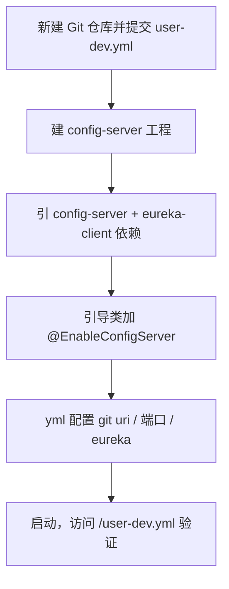

# 动手搭一个配置中心：config-server 从 Git 仓库读配置

上一节讲了配置中心解决什么问题，这一节落地：创建一个远程 Git 仓库，再搭一个 `config-server` 微服务，让它把仓库里的配置文件通过 HTTP 暴露出来。搭好之后，所有微服务后续都能从它这里统一拉配置。

## 先给结论

- 搭建配置中心分两步：先在 Git（GitHub 或 Gitee）建一个公开仓库并放入 `application-profile.yml` 格式的配置文件；再建一个 Spring Boot 工程引入 `spring-cloud-config-server` 依赖并加 `@EnableConfigServer`。
- 配置中心的 `application.yml` 只需告诉它 Git 仓库地址、服务端口和 Eureka 注册信息，其它交给框架。
- 启动后访问 `http://配置中心IP:端口/application-profile.yml` 就能直接拿到仓库里的配置内容，且在 Git 里改动后会即时反映出来。
- 配置中心本身也注册到 Eureka，方便其它微服务用服务名发现它。

## 一、先准备 Git 仓库和配置文件

配置中心不自己存配置，它去 Git 仓库读。所以第一步是有一个仓库，并在里面放配置文件。文件命名要遵守 `application-profile.yml` 约定，例如 `user-dev.yml`：`user` 是应用名，`dev` 是环境。后面微服务拉取时会用同样的 `name` 和 `profile` 去匹配，名字必须对得上。

仓库里 `user-dev.yml` 的内容，可以直接从某个微服务的原配置搬过来，例如：

```yaml
# user-dev.yml 提交到 Git 仓库
server:
  port: 9091
spring:
  application:
    name: user-service
  datasource:
    url: jdbc:mysql://localhost:3306/test
    username: root
    password: root
eureka:
  client:
    service-url:
      defaultZone: http://127.0.0.1:10086/eureka
```

仓库建好、文件提交后，配置中心的「数据源」就准备好了。

环境多了以后，同一个应用往往不止一个文件：`user-dev.yml` 给开发环境，`user-test.yml` 给测试环境，生产环境再单独一份。它们放在同一个仓库里，靠文件名里的 profile 区分，微服务启动时声明自己的环境就能各取所需。仓库本身建议独立于任何业务工程，例如专门建一个配置仓库，所有微服务的公共配置都往这里放，查找与权限管理都更简单。

## 二、搭建 config-server 工程

新建一个 Spring Boot 子模块，取名 `config-server`。依赖要两块：一块是配置中心自己的 `spring-cloud-config-server`，另一块是 Eureka 客户端，因为我们要把它注册进服务治理。

```xml
<dependencies>
    <dependency>
        <groupId>org.springframework.cloud</groupId>
        <artifactId>spring-cloud-starter-netflix-eureka-client</artifactId>
    </dependency>
    <dependency>
        <groupId>org.springframework.cloud</groupId>
        <artifactId>spring-cloud-config-server</artifactId>
    </dependency>
</dependencies>
```

启动引导类上加上 `@EnableConfigServer`，声明这是一个配置中心服务端：

```java
package com.example.config;

import org.springframework.boot.SpringApplication;
import org.springframework.boot.autoconfigure.SpringBootApplication;
import org.springframework.cloud.config.server.EnableConfigServer;

@EnableConfigServer
@SpringBootApplication
public class ConfigServerApplication {

    public static void main(String[] args) {
        SpringApplication.run(ConfigServerApplication.class, args);
    }
}
```

`@EnableConfigServer` 做的事是打开配置中心的一整套端点，让工程具备把 Git 仓库文件映射成 HTTP 接口的能力。不加它，即使依赖和仓库地址都配对了，访问 `/user-dev.yml` 也只会 404，这是新手最容易漏的一步。

配置文件把「去哪个 Git 仓库读、监听哪个端口、注册到哪个 Eureka」三件事交代清楚：

```yaml
server:
  port: 12000
spring:
  application:
    name: config-server
  cloud:
    config:
      server:
        git:
          # 仓库地址，替换成你自己的 Git 远程仓库
          uri: https://gitee.com/example/springcloud-config.git
eureka:
  client:
    service-url:
      defaultZone: http://127.0.0.1:10086/eureka
```

配置里最核心的是 `spring.cloud.config.server.git.uri`，它告诉配置中心去哪里读文件。端口、Eureka 地址与普通微服务无异，真正属于配置中心自己的配置其实只有 `uri` 这一处，这也是它的轻量之处。如果配置分散在仓库子目录，还可以用 `search-paths` 指定搜索目录，多仓库场景再补 `repos` 节点，入门阶段先用单仓库跑通即可。



图上五步串起来就是完整的搭建链路，最后一步用浏览器或 curl 验证能否读到配置。

关于仓库地址再补一句：这里用的是 HTTPS 的公开仓库地址，换成 GitHub 同样可行，前提是配置中心所在机器能联网访问到仓库。若内网环境访问不了外网 Git，可以先把仓库克隆到本地，`uri` 换成 `file://` 形式的本地路径跑通流程，后续再切回远程仓库，搭建步骤本身完全不变。

## 三、启动验证与即时更新

启动 `config-server` 后，访问：

```bash
curl http://127.0.0.1:12000/user-dev.yml
```

能返回仓库里 `user-dev.yml` 的内容，说明配置中心已经成功从 Git 拉到了配置。更关键的是，这时候去 Git 仓库里把 `user-dev.yml` 改一下（比如新增一个配置项）并提交，再次访问同一地址，拿到的就是更新后的值。配置中心读 Git 是即时跟进的，不需要重启。

验证时若返回的是 JSON 而不是 yml，多半是访问了 `/user/dev` 这类路径，那是配置中心的另一种端点格式，内容等价。另外，配置中心首次访问某文件时才真正去 Git 拉取并在本地缓存，缓存目录默认在系统临时路径下，见到类似 `config-repo` 开头的临时目录属于正常现象，直接改缓存里的文件没有意义，改动提交到 Git 仓库才是正道。

## 常见误区

- **Git 仓库地址填错或私有仓库无权限**：`uri` 指向的仓库不存在、拼写错，或私有仓库没配置凭证，启动后访问配置直接报错。公开仓库先验证可达，私有仓库记得配用户名密码。
- **文件名不按 application-profile 约定**：写成 `userdev.yml` 或 `user_dev.yml`，访问 `/user-dev.yml` 匹配不到，返回 404。
- **忘记加 `@EnableConfigServer`**：工程就是个普通 Spring Boot 应用，不会暴露配置端点，访问路径 404。
- **只引 config-server 没引 eureka-client**：若打算让其它服务通过 Eureka 服务名发现配置中心，漏掉客户端依赖就无法注册，后续微服务拉取时找不到 `config-server`。

## 面试可能被问到的问题

1. 面试官追问：「搭建 Config Server 需要哪些关键配置？」
   答：引入 `spring-cloud-config-server` 依赖并在引导类加 `@EnableConfigServer`，配置文件里指定 Git 仓库 `uri`、服务端口和 Eureka 注册信息即可。

2. 面试官追问：「配置中心是怎么拿到配置的？」
   答：配置中心本身不存储配置，它根据配置的 Git 仓库地址去拉取对应文件。访问 `/application-profile.yml` 时，它从仓库读取并返回内容，仓库改动后会即时反映。

3. 面试官追问：「为什么配置中心也要注册到 Eureka？」
   答：注册后其它微服务可以通过 `config-server` 这个服务名发现它，避免写死 IP，也便于配置中心自身多实例部署、避免单点。

4. 面试官追问：「配置文件命名规则是什么，为什么重要？」
   答：规则是 `application-profile.yml`，`application` 对应应用名、`profile` 对应环境。微服务拉取时用 `name` 和 `profile` 去匹配，命名不一致就找不到配置。

## 配套资料

- 本课真实代码与配置见课程笔记：`materials/code/01/2.springcloud/2.springcloud/day02/笔记/Spring Cloud 第二天课堂笔记.md`（第 12 节「搭建配置中心微服务」，含 `config-server` 的 pom 依赖、`application.yml` 与 `@EnableConfigServer`；文中 Git 仓库地址已改为中性示例 `https://gitee.com/example/springcloud-config.git`）
