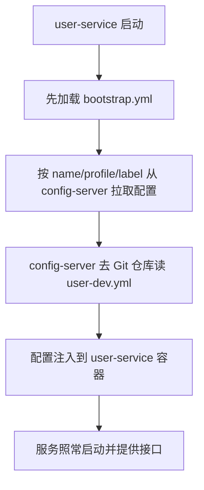

# 微服务改用配置中心：删掉 application.yml，交给 bootstrap.yml

配置中心搭好后，接下来要让真正的业务服务从它那里取配置，而不是自己带着 `application.yml`。这一节以 `user-service` 为例，把它本地的 `application.yml` 删除，改成通过 `bootstrap.yml` 到 `config-server` 拉取配置，启动后服务照常可用。

## 先给结论

- 让微服务从配置中心取配置，核心动作是：引入 `spring-cloud-starter-config` 依赖，删除本地 `application.yml`，新增 `bootstrap.yml` 指明去哪个配置中心、取哪个应用哪个环境的配置。
- `bootstrap.yml` 是 Spring Boot 的引导配置文件，加载顺序早于 `application.yml`，专门用来放「从哪里拿配置」这类固定信息。
- 三个必须和 Git 仓库文件名对齐的字段：`name` 对应应用名、`profile` 对应环境、`label` 对应分支，配错任何一个都拉不到配置。
- 配置中心通过服务发现方式对接：开 `spring.cloud.config.discovery.enabled=true` 并指定 `service-id: config-server`，微服务用服务名找到配置中心。

## 一、为什么是 bootstrap.yml 而不是 application.yml

当配置来源从「本地文件」变成「远程配置中心」时，有一个先后问题：Spring Boot 启动时得先知道「去哪拉配置」，才能拿到数据库地址、端口这些真正要用的配置。这个「先知道去哪」的信息必须放在最早加载的 `bootstrap.yml` 里。

`bootstrap.yml` 和 `application.yml` 都是 Spring Boot 默认配置文件，区别在于加载时机：`bootstrap.yml` 先加载，适合放固定、不常变的引导项（比如去哪个配置中心、分支是什么）；业务里频繁变动的项，本来在 `application.yml`，现在应该挪到 Git 仓库对应的配置文件中集中管理。



图上 `bootstrap.yml` 是起点，它决定了后续配置从哪来，拉取成功之后服务才完整初始化。

从机制上看，引入 starter 之后，Spring Boot 会先创建一个引导上下文，作为主上下文的父容器：`bootstrap.yml` 里的配置最先进入环境，拉到的远程配置再叠加给主上下文。这也解释了为什么数据库地址、Eureka 地址这些「容器刷新早期就要用」的项能从仓库下发，靠 `application.yml` 那个阶段再去远程拉取已经来不及了。

## 二、引入配置中心客户端依赖

在 `user-service` 工程里添加配置中心 starter 依赖。版本按课程环境指定：

```xml
<dependency>
    <groupId>org.springframework.cloud</groupId>
    <artifactId>spring-cloud-starter-config</artifactId>
    <version>2.1.1.RELEASE</version>
</dependency>
```

仅仅加这个依赖还不够，关键在配置文件。原本 `user-service` 的 `application.yml`（含端口、数据库、Eureka 等）要删掉，改由配置中心下发。

版本上要与工程使用的 Spring Cloud 整体版本保持同一系列，不要单独挑一个高版本 starter 硬塞进去，否则容易出现引导上下文相关类找不到的问题。引入后建议先启动一次确认依赖干净，再动手删除本地文件，出问题时也好缩小范围。另外，若工程曾经手动排除过 bootstrap 相关的自动配置，接入配置中心前记得把排除项放开，否则引导阶段依旧不会生效。

## 三、编写 bootstrap.yml

新建 `bootstrap.yml`，把「去哪个配置中心、取哪份配置」写清楚：

```yaml
spring:
  cloud:
    config:
      # 要与 Git 仓库中配置文件的 application 保持一致
      name: user
      # 要与 Git 仓库中配置文件的 profile 保持一致
      profile: dev
      # 要与 Git 仓库中配置文件所属分支保持一致
      label: master
      discovery:
        # 开启通过服务发现定位配置中心
        enabled: true
        # 配置中心在 Eureka 中的服务名
        service-id: config-server
eureka:
  client:
    service-url:
      defaultZone: http://127.0.0.1:10086/eureka
```

三个字段必须和 Git 仓库里的文件名对上：`name=user`、`profile=dev` 对应仓库的 `user-dev.yml`，`label=master` 对应仓库的 `master` 分支。开了 `discovery.enabled=true` 后，微服务通过 Eureka 找到名为 `config-server` 的服务，而不是写死它的 IP。

删掉本地 `application.yml` 之后启动 `user-service`（端口 9091），启动日志里能看到它已经发现并连接上配置中心（端口 12000），原来配置在 `application.yml` 里的数据库、Eureka、应用名等信息全部从仓库拉到，访问 `http://127.0.0.1:9091/user/8` 等服务照常可用，说明配置获取成功。

这里有个隐含条件值得点破：此时服务对配置中心是强依赖，`config-server` 没启动或网络不通，`user-service` 会直接启动失败。因此本地调试顺序应该是先起 Eureka，再起 `config-server`，最后起业务服务。极端情况下想让服务裸跑，可以临时用启动参数传关键配置，但那只是应急，正式方案仍以仓库配置为准。顺带一提，启动日志里 `Located property source` 一行会直接列出拉取到的配置文件名与分支，name、profile、label 对不上时，对照这一行最容易发现是哪个字段写错了。

## 常见误区

- **把 name/profile/label 写错**：三者必须和 Git 仓库里 `application-profile.yml` 的应用名、环境、分支完全一致，否则拉不到配置，服务启动缺少关键参数。
- **还留着本地 application.yml**：本地文件和配置中心冲突或冗余，容易让人误以为改了本地就生效，应以仓库为准。
- **在 bootstrap.yml 里塞业务配置**：`bootstrap.yml` 适合放固定的引导项，频繁变动的业务配置应放到 Git 仓库对应文件，混在一起又回到分散管理的老路。
- **忘了开 discovery 又没写配置中心地址**：`enabled=true` 配合 `service-id` 才能通过 Eureka 定位配置中心，否则要直接写 `uri`，否则连不上。
- **bootstrap.yml 放错目录**：它和 `application.yml` 一样要放在 `src/main/resources` 下，放错位置引导阶段就读不到，表现为服务没去配置中心拉配置就按默认值启动了。

## 面试可能被问到的问题

1. 面试官追问：「微服务怎么从配置中心获取配置？」
   答：引入 `spring-cloud-starter-config` 依赖，删除本地 `application.yml`，新增 `bootstrap.yml` 配置 `name`、`profile`、`label` 和配置中心发现信息，启动时会先从配置中心拉取对应配置。

2. 面试官追问：「为什么用 bootstrap.yml 而不是 application.yml？」
   答：`bootstrap.yml` 加载顺序早于 `application.yml`，用来放「去哪个配置中心、取哪个环境配置」这类引导信息，保证在真正初始化业务配置之前就定位到配置来源。

3. 面试官追问：「name、profile、label 分别是什么意思？」
   答：`name` 对应 Git 仓库配置文件的应用名，`profile` 对应环境，`label` 对应分支，三者拼接即 `name-profile.yml` 在指定分支的配置，必须和仓库文件名一致。

4. 面试官追问：「微服务如何找到配置中心？」
   答：开启 `spring.cloud.config.discovery.enabled=true` 并通过 `service-id` 指定配置中心在 Eureka 里的服务名，微服务用服务发现定位，不必写死 IP。

5. 面试官追问：「删除 application.yml 后服务还能起来吗？」
   答：能，前提是配置中心可用且 `bootstrap.yml` 配置正确。所需配置会从配置中心拉取并注入，服务照常启动，原来本地 `application.yml` 的内容应已迁移到 Git 仓库。

## 配套资料

- 本课真实代码与配置见课程笔记：`materials/code/01/2.springcloud/2.springcloud/day02/笔记/Spring Cloud 第二天课堂笔记.md`（第 13 节「获取配置中心配置」，含 `config` starter 依赖与 `bootstrap.yml` 完整配置）
